# 四足机器狗导航避障：逐篇论文流程图讲解

版本 v1.0｜2026-11-12｜配套文档：`plan/四足机器人导航避障文献综述与选型建议.md`（下称「综述」）

---

## 0. 这份文档是什么，怎么读

### 0.1 定位

综述回答「**该引谁、为什么**」；这份文档回答「**那篇论文内部到底怎么转起来的**」。

- 每一篇给**一张流程图**，画的是「输入 → 每个模块吃掉什么、吐出什么 → 输出」，不是论文标题的方框搬运。
- 每张图后面固定四段：`图里读什么`（节点为什么存在）、`赛场映射`（落到我们 12×10 m 废墟赛道的哪一处）、`边界`（什么条件下它不成立）。
- **字段纪律沿用综述**：作者/年份/venue/arXiv/DOI 全部照抄综述的已核实字段；综述写「未核实」的，这里也写「未核实」，不补全、不推测。本文件不新增任何未标源的字段。

### 0.2 三条读法（按你的目的选一条，不要从头读到尾）

| 目的 | 读哪些 | 大约耗时 |
|---|---|---|
| **15 天工程落地**（当前 `start_blocked` 卡点） | §2.6 RTEB → §7.4 GBPlanner → §6.3 TEB 多拓扑 → §9.3 恢复流程 | 40 分钟 |
| **写研制报告书的理论依据** | §1 论文地图 → §2 六篇必读 → §4、§6 两组的「边界」段 | 2 小时 |
| **补算法底子** | §3（经典与基线）→ §5（定位）→ §6（规划）顺序读 | 半天 |

### 0.3 图例约定

| 形状 | 含义 |
|---|---|
| `(["圆角"])` | 外部输入 / 最终输出（传感器、指令、动作） |
| `["方框"]` | 一个处理模块（网络、优化器、状态机节点） |
| `{"菱形"}` | 判断 / 分支条件 |
| `[("圆柱")]` | 持久化数据（地图、栅格、日志、事件表） |

全文的**失败分支统一画在下侧或右侧**，用「失败 / 退化 / 放弃 / 回退」字样标注——这是本队最需要的一类边，不要跳过。

### 0.4 两种打开方式

| 文件 | 适合 | 说明 |
|---|---|---|
| `四足机器人导航避障文献逐篇流程图讲解.md`（本文件） | 编辑、检索、写报告时复制引用 | 流程图是 Mermaid 源码块，需要 Typora / VS Code（Markdown Preview Mermaid 插件）/ Obsidian / GitHub 才能渲染成图 |
| `四足机器人导航避障文献逐篇流程图讲解.html` | 只想看图和翻目录 | 双击用浏览器打开即可，左侧带目录、每图下方可展开源码；Mermaid 从 CDN 加载，**离线时图不渲染但源码仍可看** |

### 0.5 编号体系

- §2 必读 6 篇（Lead 亲写，最重要）
- §3 经典与基座 9 篇｜§4 感知/地形/落脚点 8 篇｜§5 定位与 SLAM 7 篇
- §6 局部规划与 TEB 谱系 9 篇｜§7 系统级灾害响应 6 篇｜§8 前沿与国内资料 9 篇
- §9 横切对比（把前八节压成 3 张决策图）｜§10 引用边界

合计 **54 篇**（含 §3.2 与 §2.1 的重复项已去重）。

---

## 1. 先看全局：这 54 篇落在同一条链路的哪里

### 1.1 五层论文地图

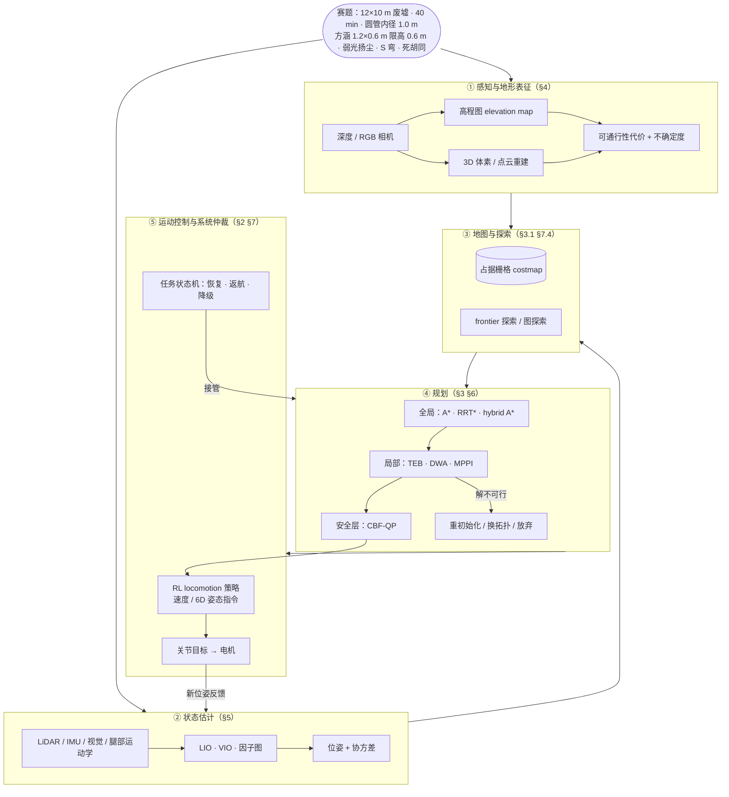

### 1.2 这张图暴露的三件事

1. **文献量分布极不均匀**：④规划层和 ①感知层各十几篇，②状态估计 7 篇，但**⑤里的「系统仲裁 / 恢复语义」只有 §7 那 6 篇**——而这正是我们 `start_blocked` 卡住的地方。文献不缺，是我们没把 §7 的语义接进代码。
2. **两条完全不同的技术路线在图里是并联的**：上支（高程图 → costmap → TEB，经典机器人栈，我们现在的 `navigation_core` 走这条）和下支（原始深度 → RL 策略直出关节，§2.1/§2.4/§8.1 走这条）。两者不是替代关系，是「同一台狗上的两层」，混着用要先定接口。
3. **限高这一维只有三篇真正覆盖**：§2.3（3D 体素 + 6D 指令）、§2.4（crawl / squeeze）、§4.6（可变形包围盒）。2.5D 高程图对悬垂障碍是**结构性盲区**，不是精度问题。

### 1.3 章节索引

| 章节 | 内容 | 篇数 | 对应我们方案的哪块 |
|---|---|---|---|
| §2 | 必读 6 篇 | 6 | 理论主干 |
| §3 | 经典与基座：A* → RL 训练框架 | 9 | `plan_grid` / TEB 初值 / 前沿探索 / 训练基座 |
| §4 | 感知、地形与落脚点 | 8 | 高程图 / 限高 / 承载 / 落足 |
| §5 | 定位与 SLAM | 7 | 退化感知 / 重定位（真机无 LiDAR，只取语义） |
| §6 | 局部规划与 TEB 谱系 | 9 | `start_blocked` 恢复 / S 弯换侧 |
| §7 | 系统级灾害响应 | 6 | 任务状态机 / 放弃判据 / 返航 |
| §8 | 前沿与国内资料 | 9 | 趋势判断 + 国内可直连引用 |
| §9 | 横切对比 | — | 三张决策图 |
| §10 | 引用边界 | — | 写报告书时的红线 |

---

## 2. 必读 6 篇

> 一句话导读：这 6 篇是「机器狗在废墟里能不能靠得住」的六块拼图——**感知退化怎么办（2.1）、技能库怎么组织（2.2）、限高怎么看见（2.3）、单个策略怎么自学技能（2.4）、机身姿态怎么当规划变量（2.5）、规划器不可行怎么救（2.6）**。2.6 直接对应我们当前卡点，可以最后读但必须读。

### 2.1 Learning robust perceptive locomotion for quadrupedal robots in the wild

**一句话**：用 attention 把「本体感知历史」和「高程图」融成一个 belief 隐变量，让策略在外感知失效时**自己学会忽略它**，平滑退化为盲走，而不是崩掉。

**出处**：[已核实] Takahiro Miki, Joonho Lee, Jemin Hwangbo, Lorenz Wellhausen, Vladlen Koltun, Marco Hutter｜2022｜*Science Robotics* 7(62): eabk2822｜`arXiv:2201.08117`｜DOI `10.1126/scirobotics.abk2822`｜官方代码仓库未核实

**流程图**

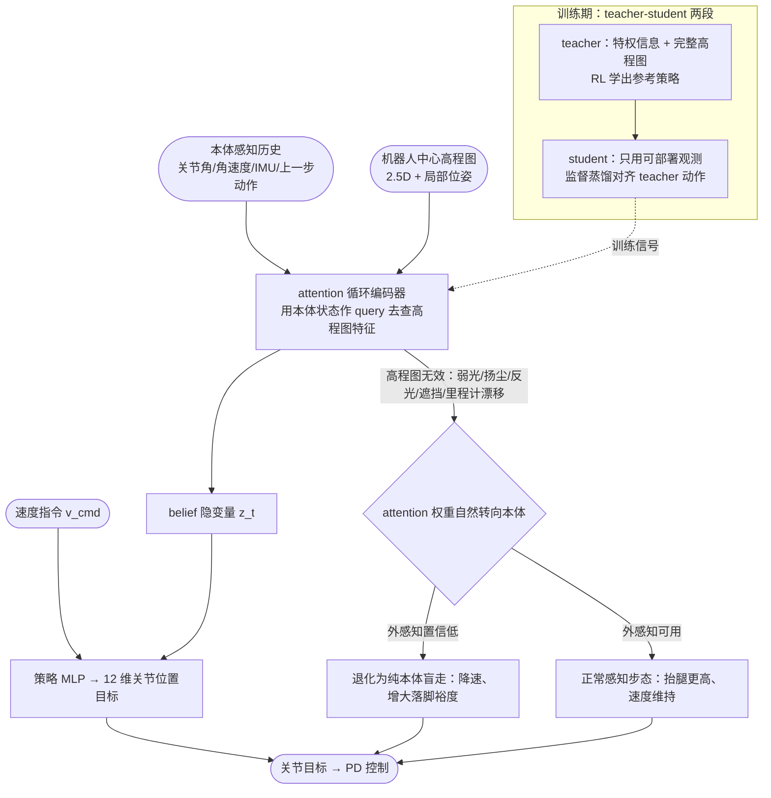

**图里读什么**

1. **不是「融合」而是「门控」**：attention 的作用是让网络自己决定这一帧高程图信几分。硬编码的加权融合在传感器坏掉时会持续灌噪声，门控式融合会做减法。
2. **训练和部署的观测不一样**：teacher 看特权信息，student 只看能上机的量，两点之间靠蒸馏对齐。这是 ETH 系（2.2/2.3/2.4 同源）的标准套路。
3. **两个出口都在图里**：同一个网络同一套权重，输出的是「感知步态」还是「盲走步态」，取决于隐变量 z_t 落哪边，没有显式的模式切换开关——所以退化是**平滑**的，这才是野外能用的原因。
4. 阿尔卑斯 1 小时徒步（按人类徒步推荐时间走完）是这套设计最强的验收：全程光照/地形都在变。

**赛场映射**：弱光 L3 挑战、废墟扬尘、坡道乱石处深度相机短暂失效——这三点在我们的赛道上不是「可能发生」，是「必然发生」。工程上直接对应 `navigation_core` 里「感知帧不可信时降速 + 继续走」而不是「停车等感知」，也就是把「传感器异常」从**终止条件**降级为**降级条件**。

**边界**：①它是端到端策略，不可解释、不能直接改「哪一步不信高程图」；②训练需要 Isaac Gym 级算力，我们 15 天做不出来；③论文的「graceful degradation」是**训练出来的统计行为**，不保证覆盖我们这种「相机被灰浆糊住」的极端样本。**用法建议：取它的设计语义（门控 + 降级 + 降速），不取它的模型。**

### 2.2 ANYmal Parkour: Learning Agile Navigation for Quadrupedal Robots

**一句话**：全学习式三层——感知模块从严重遮挡的噪声点云重建障碍、运动模块提供走/跳/爬/蹲伏技能库、高层策略按场景**选技能并规划**，实机连续障碍 2 m/s。

**出处**：[已核实] David Hoeller, Nikita Rudin, Dhionis Sako, Marco Hutter｜arXiv 2023-06 / 期刊 2024-03｜*Science Robotics* 9(88): eadi7566｜`arXiv:2306.14874`｜DOI `10.1126/scirobotics.adi7566`｜项目页 `https://sites.google.com/leggedrobotics.com/agile-navigation`｜官方代码仓库未核实

**流程图**

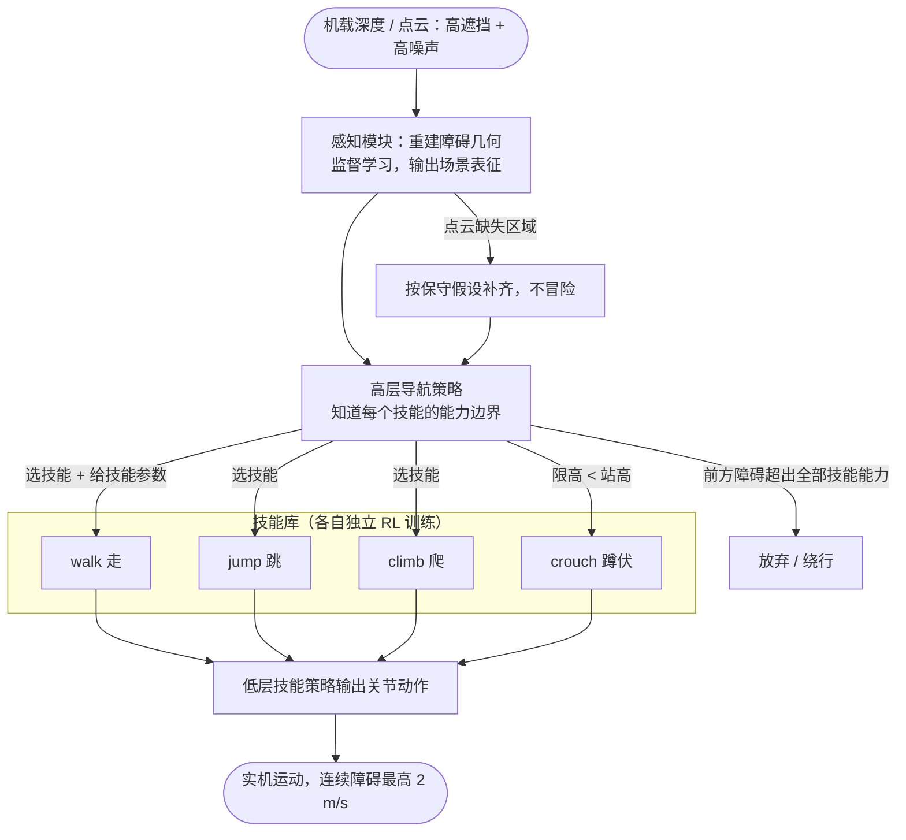

**图里读什么**

1. **高层知道低层的能力**：高层策略的观测里包含各技能的可执行性，所以它不是「盲目选」，而是「按能力分配」。这是分层相对端到端的核心优势，也是我们能借鉴的组织方式。
2. **crouch 是独立技能，不是参数的连续变化**：蹲伏被当成一个离散技能训练，说明「限高通行」在技能空间里就该占一格，而不是让速度策略去硬凑。
3. **感知模块是单独监督训练的**，不靠 RL 端到端学重建——所以它能处理「高度遮挡」：先补全几何，再决策。
4. **不需要专家示范、不需要离线计算、不需要先验环境**，这是它对 field robotics 最实际的贡献。

**赛场映射**：与 12×10 m 废墟救援在**系统级**最贴合的一篇：crouch ↔ 方涵 0.6 m 限高；高层技能选择 ↔ S 弯/死胡同的方向决策；感知重建 ↔ 乱石堆与遮挡；2 m/s ↔ 40 分钟时限内的通行效率。写研制报告书时，「分层 + 技能库」这一段可以直接引它。

**边界**：①纯仿真训练，sim-to-real 靠域随机化，实机换平台（我们 Lite2 与 ANYmal 差一个量级）需要重训；②技能库是**离线确定**的，赛场上遇到库里没有的地形就是没有；③整套要 GPU 训练，15 天不可复制。**取结构，不取权重。**

### 2.3 Learning to walk in confined spaces using 3D representation

**一句话**：明确指出 **2.5D 高程图对顶部悬垂障碍是盲的**，改用 3D 体素；低层稳健跟随 6D 指令（含机身高度、roll/pitch），高层基于 3D 空间感知规划姿态，从悬垂障碍下钻过去。

**出处**：[已核实] Takahiro Miki, Joonho Lee, Lorenz Wellhausen, Marco Hutter｜2024｜*ICRA 2024*（arXiv Comments: Accepted to ICRA 2024）｜`arXiv:2403.00187`

**流程图**

```mermaid
flowchart TD
    A(["L1 任务层：目标点 / 方向"]) --> H["高层策略：3D 空间感知"]
    V[("3D 体素表征<br/>机器人周围体素占用")] --> H
    H -->|"输出 6D 指令"| L["低层策略：稳健跟随 6D 指令"]
    P(["本体感知历史"]) --> L
    L --> O(["关节动作"])

    subgraph C6["6D 指令的六维"]
        C1["前进速度"]
        C2["横移速度"]
        C3["偏航角速度"]
        C4["机身高度"]
        C5["roll"]
        C6["pitch"]
    end
    H -.-> C6
    C6 -.-> L

    G["程序化地形生成器<br/>碎石 / 不稳定台阶 / 倾斜顶部结构"] -->|"训练环境"| H
    G -->|"训练环境"| L

    H -->|"前方体素净空 < 当前机身高度"| D1["输出低机身高度 + 侧倾的 6D 指令"]
    D1 --> L
    H -->|"净空连蹲伏都不够"| D2["放弃该通道，回上层改目标"]
    V -->|"体素稀疏 / 观测缺失"| D3["保守假设：视为有障碍"]
    D3 --> H
```

**图里读什么**

1. **「高度」进了指令空间**：6D 指令里的机身高度、roll、pitch 是策略要跟踪的量——这意味着「蹲下来」不再是失败，而是一个正常的控制目标。这是与 2.5D 方案最本质的区别。
2. **3D 体素是必需的，不是升级选项**：2.5D 高程图对每个 XY 只存一个高度值，悬垂障碍在它上面**根本不产生数据点**。圆管顶壁、方涵顶板、塌落楼板全都落在盲区里。
3. **低层只负责「跟随」，高层负责「想」**：分工让低层可以在多种地形上保持稳健（同一个低层策略重复用），高层换任务不用重训低层。
4. **程序化地形生成器是隐藏的关键**：训练分布决定了策略会不会在「半坍塌楼板」上崩，这直接影响我们做 MuJoCo 场景随机化时的设计。

**赛场映射**：**圆管（内径 1.0 m）+ 方涵（1.2×0.6 m，限高 0.6 m）+ 隧道限高最对口的一篇**。落到工程上是三件事：①`terrain_map.npz` 若只有单层高度，就必然判不出限高，需要补一层「顶部净空」；②规划器输出要能带「机身高度指令」；③姿态不能再当常数。

**边界**：①3D 体素的内存与算力开销比 2.5D 高一个档，我们机上（Lite2 级别）不一定扛得住；②它验证在 ANYmal-C/D（站高约 80 cm、体宽约 60 cm），我们的狗更小，「蹲伏」的绝对余量不同；③第三方提到在模拟 `collapsed building` 上部署，这属于**第三方解读**，不是摘要原文，报告里引用要标明。

### 2.4 Robot Parkour Learning

**一句话**：用受 direct collocation 启发的 RL 生成五类跑酷技能（含 **crawling beneath low barriers** 与 **squeezing through thin slits**），蒸馏成一个**只用前向深度相机**的端到端视觉策略，两台低成本四足实机自主选技能。

**出处**：[已核实] Ziwen Zhuang, Zipeng Fu, Jianren Wang, Christopher Atkeson, Soeren Schwertfeger, Chelsea Finn, Hang Zhao｜2023｜*CoRL 2023 (Oral)*（arXiv Comments 明确）｜`arXiv:2309.05665`｜项目页 `https://robot-parkour.github.io`｜仓库 `https://github.com/ZiwenZhuang/parkour` 由第三方资料指向，仓库本身未抓取核实

**流程图**

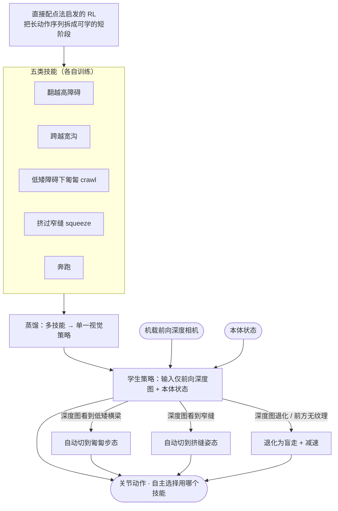

**图里读什么**

1. **crawl 与 squeeze 是论文级原文术语**（摘要明写 `crawling beneath low barriers`、`squeezing through thin slits`），不是我们的引申——这是写报告时最硬的一句话。
2. **只用前向深度相机，不用高程图、不用 VIO、不用动物动作参考数据**：对算力受限平台意义极大，我们 Lite2 的感知配置比 ANYmal 简单一个档次，这一篇是「低配也能干」的证据。
3. **技能不是被调度器选的，是被策略自己学的**：蒸馏后没有显式状态机，「看到横梁就趴下」是端到端学出来的反应。好处是反应快，坏处是**不可解释、无法插规则**。
4. 两台**不同**低成本实机都能跑通，说明策略不是对某一台机器的过拟合。

**赛场映射**：crawl + squeeze 是圆管/方涵隧道**最直接的论文级对应**；单一策略自主选技能可用于 S 弯 + 死胡同的连续决策；免高程图适合我们这种算力受限的小平台。如果只能引一篇来支撑「机器狗可以趴着过方涵」，引它。

**边界**：①它解决的是「单个障碍的通过」，不是「在未知废墟里找路」——没有全局导航、没有探索、没有回环，和我们的任务层级不同；②匍匐是固定高度假设，方涵 0.6 m 是否够它爬，要看具体机型，论文没给我们的平台结论；③仓库未核实，复现风险高；④我们 15 天内不可能重训这套。

### 2.5 Perceptive whole-body planning for multilegged robots in confined spaces

**一句话**：把**机身位姿当规划变量**——机载深度建 3D 地形图，随机采样机身位姿并平滑，同时生成机身位姿、落脚点与摆腿轨迹，满足运动学与碰撞约束，在线 500 ms 重规划 3 m 轨迹。

**出处**：[已核实] R. Buchanan et al.（L. Wellhausen, M. Bjelonic, T. Bandyopadhyay, N. Kottege, M. Hutter）｜2021｜*Journal of Field Robotics* 38(1): 68–84｜DOI `10.1002/rob.21974`（ETH Research Collection、OpenAIRE、CSIRO、Google Scholar 四处一致）｜无 arXiv｜官方代码仓库未核实

**流程图**

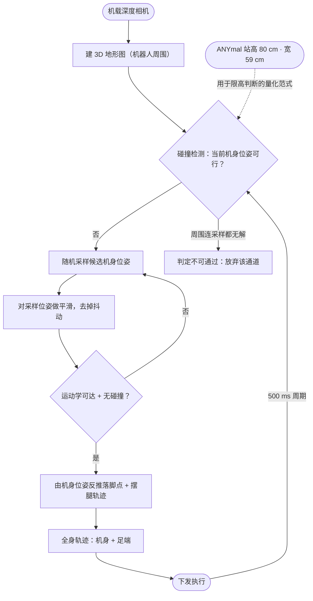

**图里读什么**

1. **机身位姿是决策变量**：不是「先选落脚点再摆机身」，而是「先定机身能待在哪，再验腿能不能落地」。方向反了，窄空间就过不去。
2. **随机采样 + 平滑**：采样保证覆盖多模态解（左倾/右倾都能过），平滑保证轨迹能用——这是它相对纯采样的工程优势。
3. **有明确的「放弃」出口**：连采样都无解就判不可通过。我们「隧道1 过窄 0.2 m 应识别并放弃」的判据，就是这一条的工程翻译。
4. **50 cm 一支的余量关系是量化范式**：站高 80 cm、宽 59 cm 的机器过 60 cm 开口——余量只有 1 cm 级。我们算「圆管 1.0 m 能不能过」时应该照这个格式写：`机体外廓（含腿摆幅）vs 通道最窄净空`，而不是拍脑袋。

**赛场映射**：直接对应「隧道1 过窄 0.2 m 应识别并放弃」「圆管 1.0 m」「方涵 1.2×0.6 m」的**通行/放弃判据**。这是六篇里唯一一篇把「过不去怎么办」写成算法的。

**边界**：①计算量大（随机采样 + 平滑 + 全身轨迹），机载算力要求高，500 ms/3 m 已经是优化后的结果；②需要高质量 3D 地形图，弱光扬尘下建图退化会直接传导成规划失败；③它假设地形是**静态**的，坍塌中的废墟不满足。

### 2.6 Resilient Timed Elastic Band Planner (RTEB)

**一句话**：正面回答「**初始规划器的解变得不可行怎么办**」——每个周期检查轨迹可行性，不可行就用 hybrid A* 生成可行轨迹 + 软约束平滑，**重新初始化 TEB**；窄通道用动态 Voronoi 改善，中间位姿带独立朝向支持**前进/倒退双向**。

**出处**：[已核实] G. Kulathunga, A. Yilmaz, Z. Huang, I. Hroob, …, M. Hanheide｜2025｜*Journal of Field Robotics* 42(7): 3902–3917｜DOI `10.1002/rob.22602`｜`arXiv:2412.03174`｜代码未核实（论文声明基于 ROS2 navigation stack 验证）

**流程图**

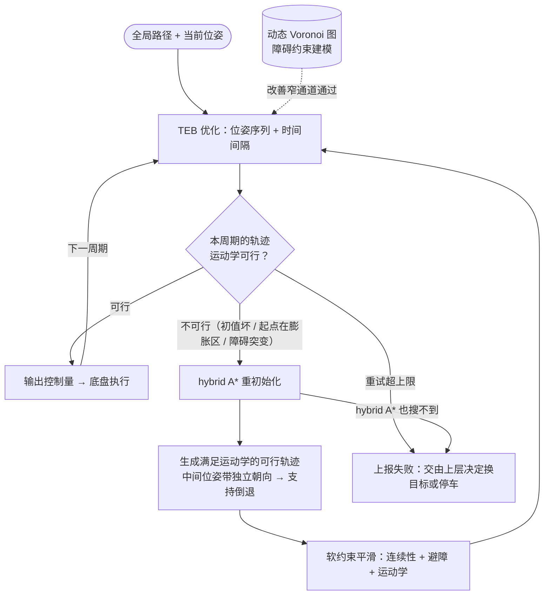

**图里读什么**

1. **「不可行」被当成一个可处理的中间状态，不是终态**：这是整篇论文对我们最值钱的一句话。我们现在的 `start_blocked` 恰恰是把「不可行」写成了终态。
2. **重初始化用的是另一种算法**：TEB 是局部优化（依赖初值），hybrid A* 是带运动学约束的搜索（不依赖初值）。用搜索救优化，是这条链的设计核心。
3. **双向朝向**：中间位姿各自带朝向，允许倒退。死胡同里「倒着出来」在数学上是合法的轨迹，不需要特殊状态。
4. **动态 Voronoi 是窄通道的关键**：Voronoi 图让轨迹倾向走通道中线，天然避免贴墙擦碰——我们「S 弯净宽 1.2 m」的通行质量直接受益。
5. 论文表格明确列出 TEB 的三个缺陷：挑战环境成功率低、朝向受限、窄缝处理差。这给了我们「为什么改」的引用依据。

**赛场映射**：死胡同倒退 + S 弯净宽 1.2 m + 隧道口识别放弃 + TEB 两大劣势，**一篇全中**。它就是我们 `start_blocked` 阻塞的答案本体：把「起点落在 0.28 m 膨胀区」→ 短距脱困 → 重生成初值 → 再规划，这条流程有文献级先例。

**边界**：①需要 ROS2 navigation stack 环境，我们 Windows + MuJoCo 栈要**翻译语义**而不是移植代码；②hybrid A* 重初始化本身有计算峰值，实时性靠工程调；③它不解决「通道根本不可通过」——那种情况仍要上层放弃；④代码未核实，无法直接借用。

### 2.7 六篇的关系（一张图收口）

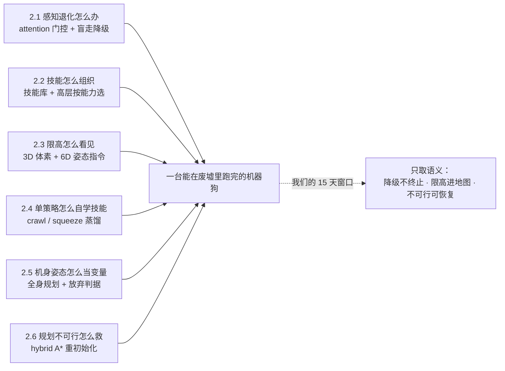

---

## 3. 经典与基座：从 A* 到 RL 训练框架

> 一句话导读：这一组不是「论文精选」，而是我们方案里 plan_grid、TEB 初值、前沿探索、训练基座四类组件的**出处**。读法：先看图，再看「赛场映射」，最后看「边界」。

### 3.1 A*：A Formal Basis for the Heuristic Determination of Minimum Cost Paths

**一句话**：把「最短路搜索」写成可采纳启发式下的一次图搜索，并给出 A* 的形式定义与最优性条件 —— 我们 `plan_grid` 在 costmap 上生成 TEB 初始全局路径的算法出处。
**出处**：[已核实] Hart, Nilsson, Raphael｜1968｜*IEEE TSSC* 4(2):100–107｜DOI `10.1109/TSSC.1968.300136`｜无 arXiv｜无官方仓库（工程实现走 ROS `global_planner`）

**流程图**

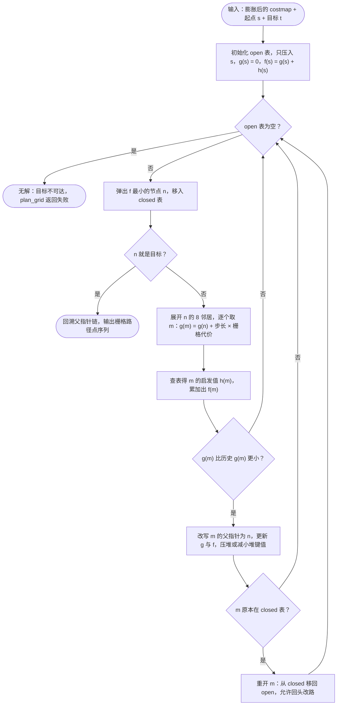

**图里读什么**
1. 真正的状态只有两样：open 表（候选 + f 值）和 closed 表（已定型）。图上所有箭头都是在做「插入 / 降键 / 重开」这三件事，没有别处藏状态。
2. `步长 × 栅格代价` 这一项就是代价流进路径的唯一入口 —— 膨胀层、粗糙度、坡度全写在这里；把它换成 0/1，A* 立刻退化成分层 BFS。
3. h 决定速度也决定最优性：可采纳时 f 是真实代价下界，保证第一次弹出目标即最优；图上「f(m) 更小就改父指针」说明这是带降键的实现，不是一次性访存的贪心。
4. 重开分支是最容易在工程里被删掉、也最该保留的一支：h 不满足一致性时，已进 closed 的节点仍可能被更短路径找到，删了它就直接返回次优路径。
5. 终止只有两个出口。`open 为空` 是「不可达」的**证明**，不是超时也不是失败——它和我们 `start_blocked` 那种「一个终态吃掉整段任务」的语义正好相反。

**赛场映射**：`plan_grid` 全局段（costmap 上的 A* 起终点）；膨胀半径 0.28 m 直接作用在 `栅格代价` 那一项上，也是「估计位姿贴墙 → 起点落入膨胀区」的物理开关。TEB 再换，这一层作为初值来源也要留。
**边界**：8 邻域栅格中心连出的路径是 45° 折线，曲率不连续，必须后处理平滑才喂得动 TEB；不处理动态障碍、不做 3D、不感知限高；栅格一大，重规划频率就撑不住。

### 3.2 Dijkstra：A note on two problems in connexion with graphs

**一句话**：一篇短文同时给出「两点间最短路」与「连通全图的最小生成树」两个问题的算法，前者即无边无启发式的距离传播 —— 我们算「到障碍 / 到目标距离场」和「连通性判定」的出处。
**出处**：[已核实] Dijkstra｜1959｜*Numerische Mathematik* 1(1):269–271｜DOI `10.1007/BF01386390`｜无 arXiv｜无官方仓库

**流程图**

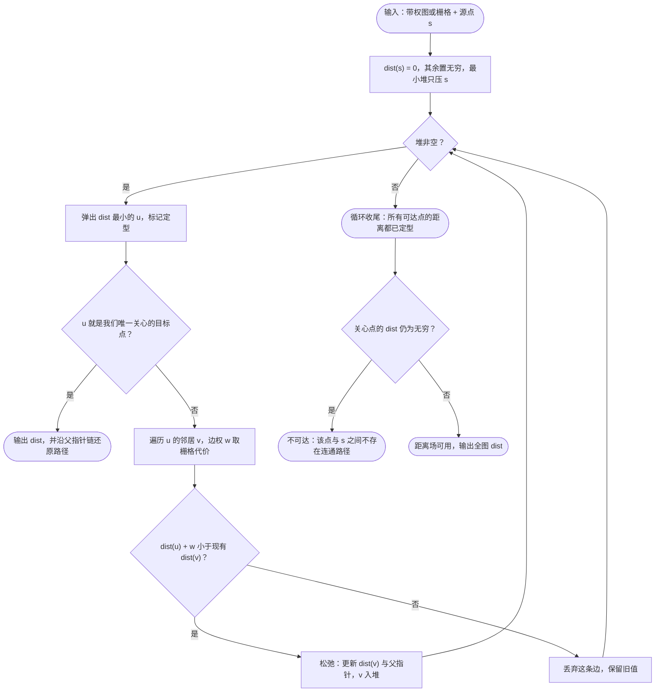

**图里读什么**
1. 图上没有启发式，也没有「估计」：唯一的排序键就是 dist。某个点被弹出的那一刻，它的距离即成终值——这是整篇正确性的全部内容。
2. 与 A\* 的唯一差别是 f = g 而非 g + h。同一张图上把 h 置零就退回 Dijkstra，反过来看 A\* 省掉的正是「全图铺开」这部分工作量。
3. 边权 w 的定义就是它的用途：w = 1 得跳数，w = 栅格 cost 得代价场，w = 到源点的欧氏长度得距离场。我们要的距离场属于第三种。
4. 出口有三种、性质不同：命中关心点可提前收（对应原文的「两点间最短路」问题），堆空则全图定型（对应「距离场」用法），而「dist 仍为无穷」是纯拓扑结论——等于证明不连通，不含时间预算也不含传感器质量。
5. 它和 A\* 摆在一起时该怎么选：Dijkstra 一次算完能回答「任何点」，A\* 一次只回答「到这一个目标」；我们要复用距离场时选前者，要单目标快出路径时选后者。

**赛场映射**：膨胀层外侧距离场（前沿评分、受阻后的撤退方向选择）；「隧道1 过窄应识别并放弃」里通路是否连通的判定；以及没有可用启发式时的全局段兜底。
**边界**：全图扩散、无目标导向，栅格一大就比 A\* 慢一个量级；同样不解动态障碍与 3D 限高；内存与时间都随栅格数线性以上增长，12×10 m 够用，再大要分块。

### 3.3 RRT*：Sampling-based Algorithms for Optimal Motion Planning

**一句话**：先证明 PRM / RRT 只是概率完备而非渐近最优，再提出 PRM\* 与 RRT\*：加入邻域重连后代价几乎必然收敛到最优，计算复杂度只多一个常数因子 —— 我们用它在圆管 / 方涵内做「是否存在可行通路」的存在性判定。
**出处**：[已核实] Karaman, Frazzoli｜2011｜*IJRR* 30(7):846–894｜DOI `10.1177/0278364911406761`｜`arXiv:1105.1186`（arXiv Comments 明确 to appear in IJRR，v1 2011-05-05，76 页）｜无官方仓库

**流程图**

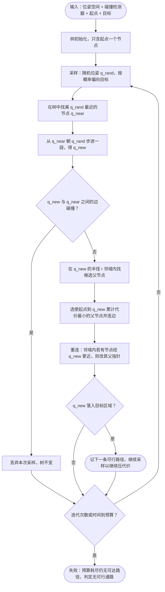

**图里读什么**
1. 结构上是双重循环：外层采样、内层「选父 + 重连」。RRT 只有选父，RRT\* 多出来的重连才是渐近最优的全部来源。
2. 半径 r 是理论落点：r 要随样本数按对数比衰减才保证最优性；工程上固定一个小 r 只是好用，不保证收敛——读这张图时要能分出「可用的实现」与「有保证的算法」。
3. 每一条进入树的边都通过了碰撞检测，所以树本身是一份**可行性证据**，而不只是一条路径候选。这正是它比栅格规划更适合回答「能不能过」的原因。
4. 失败分支是预算耗尽，不是不可达：采不到路径只能说「在给定预算内没找到」，说不了「不存在通路」。这个差别必须写进放弃判据的措辞里。
5. 命中目标后不停止（还会继续降代价）。要停就是「首次可行即停」，那是牺牲最优性换响应时间，是另一种算法。

**赛场映射**：圆管内径 1.0 m、方涵 1.2×0.6 m 的通行性判定，输出「可通行 / 建议放弃」而不是路径；S 弯处不同绕行拓扑的可行侧判断；`start_blocked` 之后判断「换一条路是否还存在」。
**边界**：采样算法没有下界保证；窄通道内采样效率骤降（瓶颈就是 r 与步长）；高维需大量样本；不适合当实时控制器，只宜做低频或离线的可行性判定。

### 3.4 Frontier 探索：A frontier-based approach for autonomous exploration

**一句话**：首次把「前沿 frontier = 已知自由空间与未知空间的边界」定义为探索目标，用「走到最近前沿」驱动地图自主扩张 —— 我们 `--explore` 契约里选点、标记、终止三件事的出处。
**出处**：[已核实] Yamauchi｜1997｜*CIRA'97* pp.146–151｜DOI `10.1109/CIRA.1997.613851`｜无 arXiv｜原始论文无代码，ROS `frontier_exploration` 的实现对应关系未核实

**流程图**

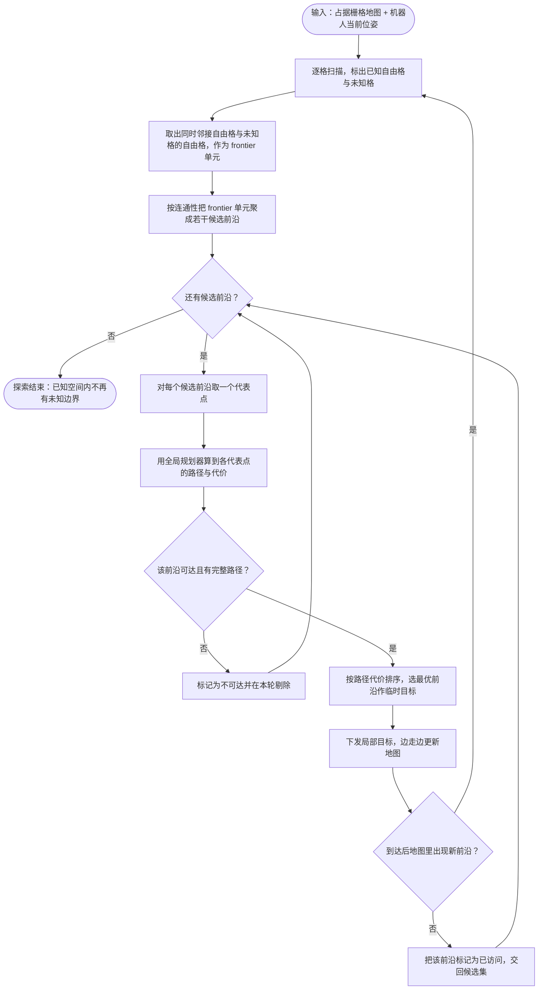

**图里读什么**
1. 输入只有一张占据栅格和当前位姿，输出只有「下一个去哪」，不产生任何速度指令——它天生是决策层。
2. 排序发生在规划之后：所谓「最近的 frontier」是**路径代价**最小，不是几何最近。少算这一步规划，就会去选直线上近、实际被墙挡住的那个。
3. 两个出口性质完全不同：`没有候选前沿` 是探索的自然结束（真结论）；`前沿不可达` 是本轮剔除后继续（可恢复事件）。第二条正是我们缺的语义——单点失败不该终止整段任务。
4. 前沿代表点的取法（质心 / 最近格）决定目标会不会顶到墙上；源文件特别强调该方法能处理狭窄杂乱空间与任意朝向的墙壁，靠的正是每轮重算而不是一次规划到底。
5. 图上没有「已访问但实际没走到」的回退路径：这是原方法的空白，工程实现必须自己补上重试上限与状态回滚。

**赛场映射**：`--explore` 契约（前沿选点、已访问标记、探索终止判据）；12×10 m 废墟内的分区覆盖；S 弯之后新开区域的接入；左廊道选点选到身后这一具体故障的定位基准。
**边界**：不知道前沿后面是否真能走；无朝向 / 视野收益，容易在两条前沿之间来回 thrashing；无成本代价概念，需自加膨胀与重试；1997 年的实现假设是声呐栅格，换到深度相机建图要重做栅格更新。

### 3.5 DWA：The Dynamic Window Approach to Collision Avoidance

**一句话**：把避障写成「在速度空间 (v, ω) 里采样 + 前向仿真 + 加权打分」，只保留一个周期内加减速可达的动态窗口 —— TEB 计算量过大时的降级替代基线。
**出处**：[已核实] Fox, Burgard, Thrun｜1997｜*IEEE RAM* 4(1):23–33｜DOI `10.1109/100.580977`｜无 arXiv｜工程实现 ROS `dwa_local_planner`

**流程图**

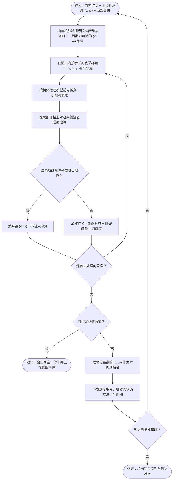

**图里读什么**
1. 唯一真正在流动的量是 (v, ω)：输入是它，窗口是它的可达集，采样是它的离散化，输出还是它。位姿只当仿真起点用，不回写。
2. 动态窗口约束的是执行器不是障碍：上周期速度 + 当前加减速极限 = 本周期候选集。所以它天然不会给出「突然横移」这种物理上做不到的指令。
3. 三个打分项的权重就是全部可调参数：朝向项管走直、间隙项管贴障、速度项管快慢。调参本质是在这三者之间换配额，算法本身没有别的自由度。
4. 最关键的分支是 `可行采样数为零`：窗口为空意味着被围住或缝比机身窄，此时它只会停车，没有倒退、没有换侧、没有重规划——这是它作为降级方案的硬上限。
5. 预测时域只有一段：长于时域的死胡同它看不见。这也是它与 TEB、MPPI 的分水岭，不是调参能补的。

**赛场映射**：分级降级链「TEB → DWA → 停车观察」的中间一级；动态障碍突然切入时的最低成本避让；方涵 / 圆管口前低速试探；`start_blocked` 事件发生时若 TEB 已不可用，DWA 至少能给出一组「不撞」的速度。
**边界**：纯局部，会卡在 U 形陷阱；窗口为空无恢复行为；单拓扑，不做左右换侧；预测轨迹不含四足摆动腿的体积变化。具体权重、预测时域与窗口大小的取值本次未核实（源文件未给出）。

### 3.6 Learning to Walk in Minutes（legged_gym / rsl_rl 训练基座）

**一句话**：在单卡上并行仿真数千个机器人，把 ANYmal 的平地训练压到 4 分钟内、复杂地形 20 分钟，并给出游戏启发的课程学习 —— 我们 `randomization.py` 的参数与整个训练基座的出处。
**出处**：[已核实] Rudin, Hoeller, Reist, Hutter｜CoRL 2021 / PMLR v164:91–100｜`arXiv:2109.11978`（Comments 明确 CoRL 2021 并声明开源训练代码）｜代码 `https://github.com/leggedrobotics/legged_gym` + `https://github.com/leggedrobotics/rsl_rl`（BSD-3，arXiv 声明与官方 README 双重核实）

**流程图**

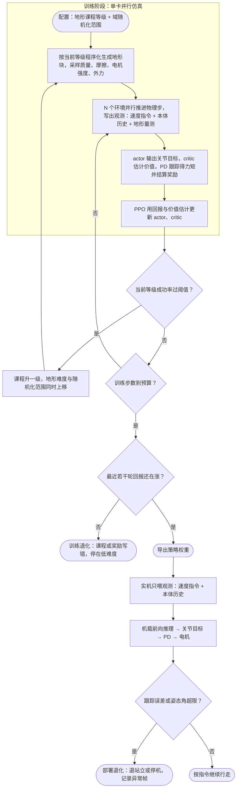

**图里读什么**
1. 参数流动的主线只有一条：课程等级 + 随机化范围 → 环境 → 观测 → 动作 → 奖励 → PPO 更新。「几千个并行」只是把这条线在一个 GPU 步里复制 N 份，线本身没变。
2. 域随机化写在地形生成与物理参数里（质量、摩擦、电机强度、外力），**不写进观测**。策略看到的是指令与本体历史，学到的是鲁棒而不是「识别当前地面是哪种」。
3. 奖励项与地形课程是同一个旋钮的两端：课程给「多难」，奖励给「怎么过去」的偏好。PPO 只看到标量回报，所以改奖励就是改整条学习曲线的形状。
4. 升不升级是闭环判据：成功率够了才升，不够就在同一等级继续刷样本。这也是「几百次随机化采样」成本的真正来源——成本不在网络，在课程判定回环。
5. 两个退化出口要分开归因：训练侧曲线不涨，是课程或奖励写错；部署侧跟踪误差 / 姿态超限，是 sim-to-real 差距在实机厚度上暴露，此时改策略无用，只能改随机化范围。

**赛场映射**：`randomization_sampled.provenance` 的 `vendor_reference` 落到本文档条目；地形课程对应 5 处 4–12 cm 乱石与 0.45 m 坡道；作为 teacher-student / DAgger 蒸馏（3.7–3.9 全部）的公共底座；`rsl_rl` 的观测分组直接对应我们的 ONNX 输入契约。
**边界**：`legged_gym` 需 Isaac Gym Preview + Python 3.6–3.8 + CUDA，本机 Windows / Py3.12 **不支持**，可读代码不能跑；`rsl_rl` 纯 PyTorch、本机最可能跑通（Python 3.9+），Windows + Py3.12 实测未核实；任务只有速度跟踪，不含导航、避障与限高，机身高度指令无原生支持。

### 3.7 Learning Quadrupedal Locomotion over Challenging Terrain

**一句话**：只用本体感知历史流训练一个网络，实现零样本 sim-to-real，并在训练中从未见过的泥雪、碎石动态落脚点、厚植被与流水中保持鲁棒 —— 「本体感知也能过乱石」的实证基座。
**出处**：[已核实] Lee, Hwangbo, Wellhausen, Koltun, Hutter｜2020｜*Science Robotics* 5(47):eabc5986｜`arXiv:2010.11251`｜DOI `10.1126/scirobotics.abc5986`｜官方仓库未核实

**流程图**

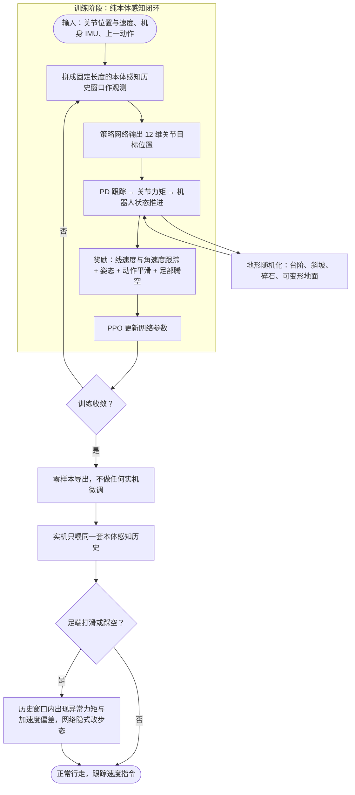

**图里读什么**
1. 观测里没有任何外感知：只有关节、IMU、上一动作。它能在碎石上走，靠的是「踩下去之后从关节力矩和机身加速度读到地面软硬」，不是提前看见。
2. 历史窗口是唯一的记忆：把过去若干步拼成一个向量，等于给策略一个隐式状态估计器，替代了高程图。去掉窗口长度，这套方法立刻失效。
3. 地形随机化不进观测，只在仿真里换地面——策略学到的是「遇到不确定落脚点怎么试」，不是「这是哪种地面」。
4. 奖励里足部腾空与动作平滑两项决定了它不会被训成「拖脚蹭过去」；这也是后面所有 ETH 系工作的奖励基线，改它的收益比改网络结构大。
5. 退化分支落在同一处：打滑 / 踩空没有独立检测模块，全靠历史窗口里的异常力矩被网络内化。所以策略没有「报警」这个动作，只有步态变化——外部要从速度跟踪误差反推它已经退化。

**赛场映射**：弱光 / 扬尘导致外感知失效时的兜底层（配合 §2.1 的 graceful degradation 才完整）；5 处 4–12 cm 乱石与碎石动态落脚点；0.45 m 坡道；训练基座与奖励项直接可借 `legged_gym`。
**边界**：无外感知 → 不能提前避开悬垂障碍、不能识别隧道限高（那属于 3D 表示那一支）；不输出机身高度 / roll-pitch 指令；对状态估计质量高度敏感（本体感知仍需可靠 IMU 与编码器）；官方仓库未核实，复现只能借 3.6 的基座。

### 3.8 RMA: Rapid Motor Adaptation

**一句话**：把「适应」拆成 base policy 与 adaptation module：后者从一段本体历史在线估计环境隐变量 z 并回灌前者，使机器人在亚秒级内适应新地形与载荷（arXiv 摘要原文 fractions of a second；源文件记 0.5 s 历史窗口 / <1 s 适应）—— 我们「在线估计」而非「离线标定」的范式出处。
**出处**：[已核实] Kumar, Fu, Pathak, Malik｜RSS 2021（arXiv Comments 明确）｜`arXiv:2107.04034`｜项目页 `https://ashish-kmr.github.io/rma-legged-robots/`（arXiv 明确）｜训练代码未核实

**流程图**

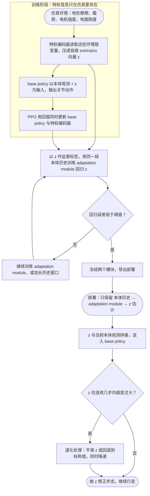

**图里读什么**
1. 两个网络输入不同但对齐在同一个 z 上：特权编码器看的是仿真内部量（摩擦、载荷、电机强度），adaptation module 只能看本体历史，却要回归出同一个 z。这个约束就是全文的核心。
2. z 是低维隐变量，不是地形标签：它不告诉你「这是沙地」，只编码「当前动力学比标称偏软 / 偏重」。所以对没见过的地形也能给出合理外推，但也无法解释成可读参数。
3. 参数流动是单向的：仿真 → 特权编码器 → z → 监督 adaptation module。部署时特权编码器被整只丢掉，图上 `H → I` 就是这条断点，也是 sim-to-real 的全部风险所在。
4. 失败与退化的落点都在 z 上：估计跳变、更新延迟、或输入接近训练分布边缘时，策略动作会抖。工程第一件事是限制 z 的变化率，而不是改策略网络。
5. 没有外感知的入口：它解决的是「地形物理属性未知」，不是「障碍物未知」。后者必须靠视觉 / 高程图，这两件事在图上根本没有交集。

**赛场映射**：Lite2 实机穿越废墟碎石、湿滑地面、草地与载荷变化时的在线适应；不需要事先标定摩擦系数，正好给 `randomization_sampled` 里 `measured_pending` 项一个补法；亚秒级适应对应「进入新地形段不减速」。
**边界**：z 只覆盖训练时随机化的那几类隐变量，悬垂、限高、深坑这类**几何**未知它不知道；无外感知；无姿态 / 高度指令通道；起步瞬间历史窗口为空，是最容易出错的时段；训练代码未核实，只有项目页与视频。

### 3.9 Legged Locomotion in Challenging Terrains using Egocentric Vision

**一句话**：第一个只用单个前向深度相机、不建高程图也不用 VIO 的端到端视觉 locomotion 系统，两阶段训练（scandots 上 RL → 蒸馏成深度策略）通过楼梯、路缘、踏石与沟隙 —— 「视觉可以直接进策略」的证据。
**出处**：[已核实] Agarwal, Kumar, Malik, Pathak｜CoRL 2022 (Oral)，PMLR v205:403–415（arXiv Comments 明确 Oral）｜`arXiv:2211.07638`｜项目页 `https://vision-locomotion.github.io/`（arXiv 明确）｜官方仓库未核实

**流程图**

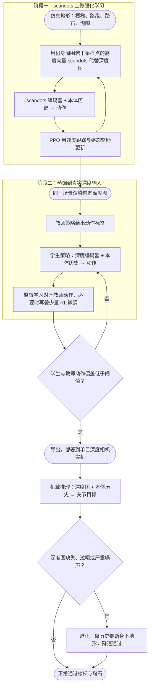

**图里读什么**
1. 阶段一的输入不是真实传感器，而是 scandots（机身周围若干采样点的高度）：这是「为了让训练便宜」的替身，不是最终形态。图上 `A → B` 那一步就把视觉换成了几何采样。
2. 阶段二才把替身换成真传感器：同一场景渲染深度图，学生模仿教师。这是 DAgger 式蒸馏，不是重新跑 RL——RL 的高成本只花一次。
3. 记忆在两阶段里都必须存在：单前向相机看不见身后的后脚，策略只能靠历史推断身下地形。所以「本体历史」不是可选项，是结构性需求。
4. 退化分支只有一个方向：深度缺失 / 过曝 / 噪声时没有「关闭视觉」的显式开关，策略只能靠记忆降速通过。这正是它与 attention 门控融合（见 §2.1）的本质差别。
5. 两阶段的收益直接写在图的结构上：RL 只在低维 scandots 上跑（快、可大规模并行），深度只在监督阶段出现（不必在 RL 里等渲染）。工程上要复现，先复现这条两段式，而不是直接端到端。

**赛场映射**：弱光 / 扬尘导致深度相机质量下降时的降级预期；Lite2 这类小平台上「不建高程图」的算力可行性；5 处乱石 / 踏石与 0.45 m 坡道；若有楼梯与路缘段则直接对应。
**边界**：单前向相机看不到悬垂障碍与限高（属于 3D 表示那一支）；不建图、不做全局规划，只解决「脚怎么迈」；scandots 与真实深度之间的 domain gap 是主要风险；官方 GitHub 未核实，复现需自建仿真渲染管线。

---

## 4. 感知、地形与落脚点：机器狗怎么知道「这一步能不能踩」

> 一句话导读：这一组解决的是同一条链路上的四个不同环节——地形怎么表示（2.5D vs 3D）、表示里怎么带不确定度、落脚点怎么选、踩下去会不会塌。流程图按「建图 → 表征 → 选点 → 承载校验」的顺序看。

### 4.1 Online Foothold Optimization：Perceptive Locomotion in Rough Terrain

**一句话**：把落脚点当成在线优化问题——在实时高程图上为每条腿求局部最优落足位置，再用 terrain-aware contact schedule 把「落哪里」翻译成「什么时候抬、什么时候落」，从而在不越执行器速度上限的前提下踩上约腿长 33% 的台阶与障碍。
**出处**：[已核实] F. Jenelten, T. Miki, A. E. Vijayan, M. Bjelonic, M. Hutter｜2020｜*IEEE RA-L* 5(4):5370–5376｜DOI `10.1109/LRA.2020.3007427`｜代码未核实

**流程图**

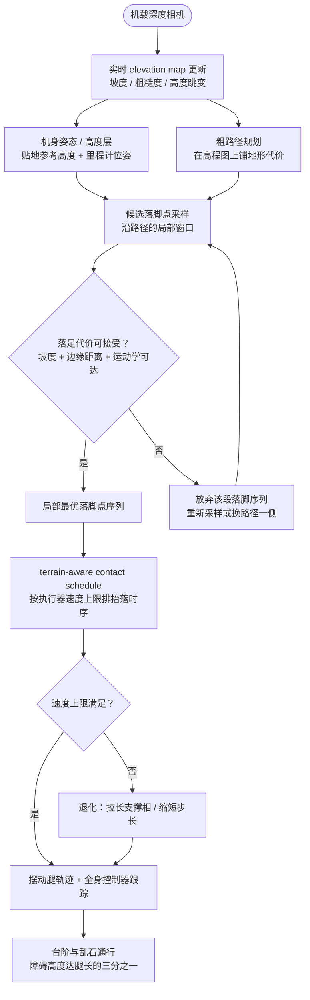

**图里读什么**
1. 两个输入是分开的：地形 B 只提供代价，位姿 C 只提供可达性，落脚点优化在两者交集中求局部最优。任何一边错了，落足就错。
2. **机身高度在这一篇是「跟随量」而不是「决策变量」**——C 由地形给出贴地参考高度后单向传给 E，只参与可达性检查，不被优化。这一点与 4.2、4.6 正相反，是三者最本质的分界。
3. 输出其实有两级：G 是「落哪里」，H 是「什么时候落」。摘要专门点出 contact schedule 是为了对付执行器速度上限——落点选得再好，腿抬不到那么快也是空的。
4. 两条失败分支位置不同：F→M 是几何不可行（踩不了），会重新采样；I→L 是时序不可行（来不及），只放慢不换点，属于「能踩但踩不快」。
5. 性能判据是相对量 33% 腿长，不是绝对高度——这正是它比「能上 22 cm 台阶」更可迁移的地方。

**赛场映射**：5 处 4–12 cm 乱石与 0.45 m 坡道的核心痛点是「踩上去滑不滑、会不会被边缘绊」，对应 F 的坡度与边缘距离项；0.6 m 限高的方涵对应 C 的贴地高度参考——本篇能给「贴着地形走」的高度，但**不会主动压低机身**，压机身要找 4.6。
**边界**：判据是相对腿长，迁移到 Lite2 必须先用自己腿长换算，不能照搬绝对数字；机身姿态不参与优化，圆管内径 1.0 m 这类需要主动下蹲或侧倾的场景它给不出解；无官方代码，复现只能按论文结构自建。

### 4.2 ViTAL：先选落点还是先摆机身，顺序反过来会怎样

**一句话**：指出「按给定落点去优化机身姿态」的既有范式有结构性缺陷——落点够不到时机体已无安全选择；ViTAL 反过来，优化那个「让各腿最有机会够到安全落点」的机身姿态，并用 skills 同时产出落足与姿态。
**出处**：[已核实] Shamel Fahmi, Victor Barasuol, Domingo Esteban, Octavio Villarreal, Claudio Semini｜2023｜*IEEE T-RO* 39(2):885–904｜DOI `10.1109/TRO.2022.3222958`｜arXiv:2212.01246

**流程图**

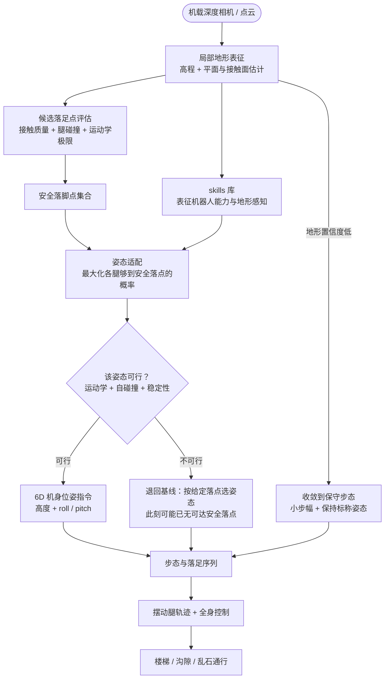

**图里读什么**
1. 图的形状本身就是论点：D（落点）与 E（skills）一起进 F（姿态），而 F 的输出 H **再回头决定 I（落足序列）**。这条回边就是 ViTAL 与基线方法的唯一区别，也是「落点与姿态互相耦合」的图形化表达。
2. **机身位姿是显式规划变量**（H），指令里同时含高度与 roll / pitch，不是跟随量。
3. L 是摘要原文承认的失败模式：姿态一旦不可行就退回基线，而基线在此刻可能已经「没有可达的安全落点」——这是不可恢复的退化，换条路也救不回来。
4. M 是另一类退化：地形本身不可信时，宁可退回标称姿态小步走，也不在噪声上做姿态优化。
5. 90 kg HyQ 与 140 kg HyQReal 两套不同尺度的实机都验证过，说明方法对机体尺寸不敏感。

**赛场映射**：坡道姿态调整与方涵 0.6 m 限高判断直接对应 H——**先问「哪个机身高度能让脚够到地面」，而不是先钉死落点再摆机身**；隧道 1 若出现 0.2 m 级余量不足，G→L 恰好说明「姿态不可行时不该硬挤」。
**边界**：skills 的具体定义与参数只在论文正文，摘要只给到「表征机器人能力与地形感知」这一层，细节未核实；验证平台是 90 / 140 kg 液压四足，Lite2 的刚度与腿长完全不同，落足容差要重标定；代码未核实。

### 4.3 Probabilistic Terrain Mapping：位姿不确定度怎么写进高程图

**一句话**：不依赖外部几何或视觉特征做绝对定位，只用运动学 + 惯性做本体定位，并把定位漂移的协方差与距离传感器噪声一起传播进高程图，使每个栅格输出「高度 + 上下置信界」而不是单一高度值。
**出处**：[已核实] P. Fankhauser, M. Bloesch, M. Hutter｜2018｜*IEEE RA-L* 3(4):3019–3026｜DOI `10.1109/LRA.2018.2849506`｜代码 `https://github.com/anybotics/elevation_mapping`（BSD-3）

**流程图**

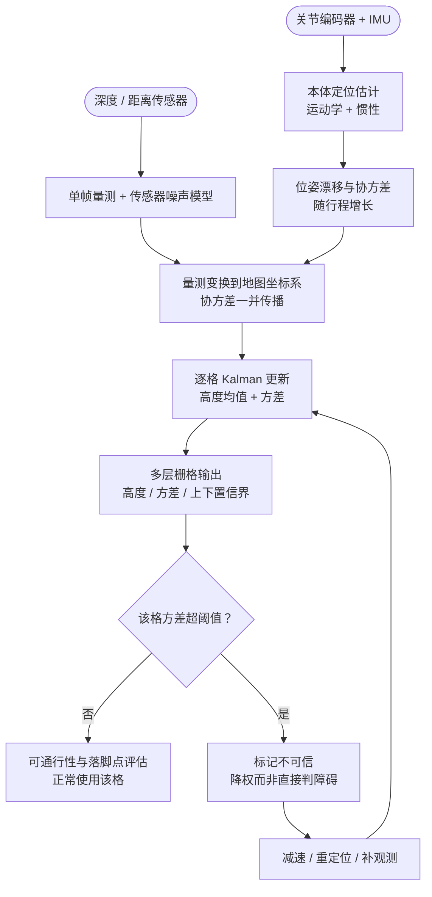

**图里读什么**
1. 关键边是 E→G：定位协方差没有被丢掉，而是**跟着量测一起进地图**。同一个高度读数，位姿越不确定，落进格子后的方差就越大。
2. H 是逐格 Kalman 更新，所以每格存的是分布，I 才可能同时给出均值与上下置信界——不确定性可视化是机制自带，不是后处理加的。
3. L 是全图最重要的一行：方差大的格子**降权**，而不是判成障碍。区分「这里确实有墙」和「这里我不确定」是两件事。
4. M→H 是闭环：不确定就再观测一次，更新会把方差压下去，这是唯一能真正消解不确定的路径。
5. 摘要明确只基于运动学 + 惯性的本体定位，不跟踪外部特征——这既是鲁棒性来源，也意味着长距离仍会漂。

**赛场映射**：这就是「贴墙时膨胀区误判」的文献根——`plan_grid` 用固定 0.28 m 膨胀，等价于假设位姿精确；正确做法是让膨胀半径随该帧位姿协方差变化，贴墙时降低该区域置信度，而不是直接判不可行。弱光 L3 与乱石建图同属这一类。
**边界**：定位来源是本体运动学 + 惯性，真机若接入外部里程计，不确定度模型需重推；网格分辨率与更新频率的实测值未核实；仓库是 ROS C++ 实现，Windows 不可直接跑，可迁移的是「方差层 + 置信界」这套数据结构与判据，不是代码。

### 4.4 Learning Agile Locomotion on Risky Terrains：把速度跟踪改写成导航任务

**一句话**：先在杂乱稀疏踏石上训一个通才策略，再把它微调成各险地的专家策略；并把任务从 velocity tracking 改写成 navigation，用探索策略破解稀疏奖励，最终在 ANYmal-D 上以峰值 ≥ 2.5 m/s 通过稀疏踏石与窄平衡木。
**出处**：[已核实] Chong Zhang, Nikita Rudin, David Hoeller, Marco Hutter｜IROS 2024（arXiv Comments 明确）｜arXiv:2311.10484

**流程图**

```mermaid
flowchart TD
    A(["程序化生成稀疏踏石 / 平衡木地形"]) --> B["通才策略训练<br/>乱序稀疏踏石 + navigation 任务形式"]
    B --> C["探索策略<br/>破解踏石之间的稀疏奖励"]
    C --> D{"训练是否收敛？"}
    D -->|"收敛"| E["专门化策略微调<br/>迁移到更难地形"]
    D -->|"不收敛"| J["降级：只求慢速稳定通过<br/>放弃速度指标"]
    E --> F["ANYmal-D 实机部署<br/>峰值速度 ≥ 2.5 m/s"]
    F --> G["高速通过稀疏踏石 / 窄平衡木"]
    F --> H["失足摔倒 → 回合终止"]
    E -->|"迁移退化"| I["退回通才策略<br/>保住基本可通行性"]
    I --> F
    G -->|"风险升高"| J
```

**图里读什么**
1. 训练是两段式：B 通才 → E 专家。I 是「微调失败退回通才」的保底，工程上等于先保住能走、再谈走快。
2. 把任务改写成 navigation 不是文字游戏：velocity tracking 会约束机器人可采取的行为，navigation 才允许它为落点而改速度——这一改动直接决定 G 能不能成立。
3. C 针对稀疏奖励：踏石之间没有中间奖励，不主动探索就学不到跨步，这条边是整篇能训出来的前提。
4. J 是风险回退：速度是结果不是目标，风险升高就降速——与 4.5 的速度 trade-off 是同一类分支，但触发源不同（这里是摔倒风险，那里是承载探测）。
5. 摘要没有给网络结构与输入细节，别按记忆补；只有「通才 + 微调 + 探索策略」这三件是原文级事实。

**赛场映射**：5 处乱石本质就是离散稀疏落脚点，本篇判据最贴近；≥ 2.5 m/s 说明「稀疏落点 + 高速」可以同时成立，但 12×10 m 场地内速度受弱光与定位限制，不构成直接可比。
**边界**：摘要只写 ANYmal-D 与 ≥ 2.5 m/s，感知输入与策略结构未核实；训练依赖大规模并行仿真，Lite2 侧无法复现训练过程、只能用推理；不要在这篇上外推更快的数字。

### 4.5 Load-bearing Assessment：踩下去会不会塌

**一句话**：只用关节测量评估地形能不能承重——MPC 在稳定性与 probing 约束之间做折中，状态机协调试探性踩踏，检测到可塌陷区就动态换落足点；代价是探测本身拖慢速度（第三方解读，非摘要原文）。
**出处**：[已核实] Vivian S. Medeiros, Giovanni B. Dessy, Thiago Boaventura, Marcelo Becker, Claudio Semini, Victor Barasuol｜2025｜*IEEE RA-L*｜arXiv:2510.21369｜DOI `10.1109/LRA.2025.362624`（与 arXiv Related DOI 字段一致）｜代码未核实

**流程图**

```mermaid
flowchart TD
    A(["规划器给出的目标落脚点"]) --> D["MPC<br/>稳定性 + probing 约束联合优化"]
    B(["支撑腿关节力矩 / 位置测量"]) --> C["承载评估<br/>由关节量测反推地形刚度与下陷"]
    C --> D
    D --> E{"该落足点承载存疑？"}
    E -->|"是"| F["试探性踩踏 probe<br/>轻放 + 逐步加载"]
    E -->|"否"| H["确认承重 → 正常步态继续"]
    F --> G{"加载过程是否异常下陷？"}
    G -->|"否"| H
    G -->|"是"| I["判定可塌陷 → 重选落足点"]
    I --> L["连续探测无可行点<br/>停止并请求绕行"]
    C --> J["安全优先策略<br/>降速 / 缩步幅 / 增大支撑面"]
    J --> K["通行效率下降<br/>probing 显著降低速度（第三方解读）"]
    F --> K
```

**图里读什么**
1. 感知入口是 B——关节力矩与位置，不是相机。这是全文最反直觉的一点：塌陷与否由「腿感受到什么」判断，不需要额外硬件。
2. E 是状态机的分叉：不是每一步都 probe，只有承载存疑时才 probe，否则直接走 H。这条分叉决定了效率下限。
3. F→G 是「轻放 + 逐步加载」，判据是加载过程中是否出现异常下陷；G 的否分支同时给出两条出路——I 重选落足点，L 停止绕行。
4. **速度 trade-off 在图上是两条独立边汇到 K**：J→K 是策略性降速，可调；F→K 是每步探测本身的耗时，是方法固有成本。两者性质不同，别混成一句「probe 慢」。
5. 摘要原文只写「维持稳定性并优先安全」，没有速度损失数字。

**赛场映射**：废墟碎石与楼板不稳的物理承载校验；方涵内若底板松脱，本篇给的是「踩之前先轻试」的状态机语义。工程上可落成：可疑格先低速小幅下压，读关节力矩异常再决定是否承重。
**边界**：实验平台是自制可塌陷平台与岩石地形，不是真实楼板；速度代价的具体数值未核实；probing 需要力矩可控的关节，Lite2 的力控接口能否支撑需实测；代码未核实。

### 4.6 Walking Posture Adaptation：机身姿态本身当成规划变量

**一句话**：把机器人抽象成「可变形包围盒」，用机器人中心的多层高程图同时表达地面与头顶悬垂，再由 CHOMP 在包围盒构型空间里规划平滑轨迹——机身高度与腿展是搜索出来的，不是给定的。
**出处**：[已核实] Russell Buchanan, Tirthankar Bandyopadhyay, Marko Bjelonic, Lorenz Wellhausen, Marco Hutter, Navinda Kottege｜2019｜*IEEE RA-L* 4(2):2148–2155 / ICRA 2019｜arXiv:1901.10863｜DOI `10.1109/LRA.2019.2899664`｜代码未核实

**流程图**

```mermaid
flowchart TD
    subgraph S1["地图层"]
        A(["机载距离传感器"])
        B["机器人中心多层高程图<br/>地面 + 悬垂 + 侧壁"]
    end
    subgraph S2["机身模型层"]
        C["可变形包围盒<br/>标称高 33 cm 宽 82 cm 外扩"]
        D["构型搜索<br/>机身高度 + 侧倾 + 腿展"]
    end
    subgraph S3["规划层"]
        E{"包围盒与多层地图碰撞？"}
        F["CHOMP 平滑轨迹优化"]
        G["机身姿态 / 高度 + 落足序列"]
    end
    A --> B
    B --> E
    C --> D
    D --> E
    E -->|"无碰撞"| F
    F --> G
    G --> H["通过 25 cm 悬垂 / 70 cm 窄缝 / 22 cm 障碍"]
    E -->|"碰撞"| I["换构型：压低机身 / 收窄腿展"]
    I --> D
    D -->|"无可行构型"| J["判定通道不可通过<br/>上报高层规划"]
```

**图里读什么**
1. C 是方法的名字来源：包围盒尺寸本身随姿态变化（下蹲变矮、收腿变窄），于是「机器人能不能过」被改写成「哪个构形的包围盒能过」——**这就是「机身姿态/高度作为规划变量」的具体形态**。
2. B 是**多层**高程图而非单层 2.5D：它能表达头顶的悬垂面，这是 25 cm 悬垂可被规划的前提，也是单层 2.5D 图的结构性盲区。
3. E 是判定核心，D→E 的循环就是构型搜索；I 给出「变形」而不是「放弃」，只有连构型都找不到才进 J。
4. 实机是六足 Weaver，标称 33 cm 高 82 cm 宽；25 cm 悬垂意味着必须把机身压到标称高度的约 76% 以下才能进——这个**比例**才是可迁移判据，不是 25 cm 这个数。
5. 六足而非四足这一点要说清：方法本身与腿数无关，但包围盒与步态生成要按自己平台重做。

**赛场映射**：圆管内径 1.0 m、方涵限高 0.6 m 的通行判据可直接借这个范式——**先算「标称站高 vs 净空」的比例，再决定要不要压机身、压多少**；隧道 1 余量 0.2 m 时，若标称站高超过净空，构型搜索会自然返回不可行，比事后判定更早。
**边界**：验证平台是六足（33 cm / 82 cm），不是四足，包围盒尺寸模型与步态都要重做；CHOMP 在嵌入式平台上的计算量实测值未核实；代码未核实。

### 4.7 Attention-Based Map Encoding：让网络自己决定看地图的哪一块

**一句话**：不再把整张高程图塞进策略网络，而是用 CNN 逐点提局部特征、再以本体状态为 query 做多头注意力，学出「该看哪块未来可落脚区域」，注意力图还能反过来解释网络的地形感知。
**出处**：[已核实作者与编号，venue 未核实] Junzhe He, Chong Zhang, Fabian Jenelten, Ruben Grandia, Moritz Bächer, Marco Hutter｜2025｜venue **未核实**（arXiv Comments 原文为 Original draft prior to peer review）｜arXiv:2506.09588｜代码与项目页未核实

**流程图**

```mermaid
flowchart TD
    A(["机器人中心 2.5D 高程图"]) --> B["逐点 CNN 局部特征提取"]
    C(["本体感知<br/>关节 / IMU 历史"]) --> D["以本体状态为 query 的<br/>多头注意力"]
    B --> D
    D --> E["注意力权重<br/>指向未来可落脚区域"]
    D --> F["地图特征 + 本体特征融合"]
    F --> G["RL 策略网络<br/>输出关节目标"]
    G --> H["稀疏地形上的精确落足与敏捷通行"]
    E --> I["注意力图可视化<br/>可解释网络在看哪"]
    A -->|"缺帧 / 遮挡"| J{"地形输入是否可信？"}
    J -->|"否"| K["退化为本体感知主导<br/>保守步态"]
    K --> G
    E --> L["注意力聚焦错误区域<br/>落足失准或失足"]
```

**图里读什么**
1. D 的「本体状态作 query」是关键设计：地图特征不是全量池化，而是被当前身体状态「问」出来的——同一地形、不同姿态，关注点不同。
2. E 与 I 是同一件事的两面：注意力权重既是控制输入，也是可解释性输出，不需要额外蒸馏一个解释模型。
3. K 是退化路径：地形输入缺失或不可信时，本体 query 仍在，网络自然退回本体主导——这是结构自带的降级，不是外挂开关。
4. L 是风险面：注意力学歪会聚焦到不该踩的区域，且这类错误在注意力图上看得见，可作为调试入口。
5. 摘要给了 12-DoF 四足与 23-DoF 人形两套控制器，说明这套表征与本体自由度解耦。

**赛场映射**：隧道与方涵里高程图被悬垂和侧壁切得支离破碎，全图卷积容易被无关区域稀释；「按本体状态 query 局部」在窄通道里等价于「只关心下一步要踩的那几格」，与 `plan_grid` 的局部窗口思路同源。
**边界**：**venue 未核实**，arXiv 明说这是评审前草稿、后续会有重大修改，引用时必须注明；代码与项目页未核实；摘要未给网络层数与训练规模；「可解释」是作者主张，不能当成已验证的调试工具。

### 4.8 PPL：训练时用点云监督，部署时只带本体感知

**一句话**：爬行空间里本体感知只能推出地面特征、推不出空间特征（头顶多低、侧向多窄），PPL 用训练期的点云特征监督一个状态估计网络，让它额外估计碰撞状态与空间特征，部署阶段不再需要外感知传感器。
**出处**：[已核实，编号需复核] Bida Ma, Nuo Xu, Chenkun Qi, Xin Liu, Yule Mo, Jinkai Wang, Chunpeng Lu｜2025｜Accepted by RA-L（arXiv Comments）｜arXiv:2508.09950（v2 于 2025-12-04 修订；镜像站曾出现 2508.09960，引用前需复核）

**流程图**

```mermaid
flowchart TD
    A(["本体感知历史<br/>关节 / IMU / 上一动作"]) --> B["状态估计网络<br/>碰撞状态 + 地面特征 + 空间特征"]
    C(["训练期点云<br/>极坐标表示 + MLP 提特征"]) --> D["点云特征监督信号"]
    D -->|"监督"| B
    C -->|"离线批量提特征"| I["训练迭代更快<br/>省去在线编码开销"]
    B --> E{"估计误差是否收敛？"}
    E -->|"收敛"| F["RL 策略<br/>输出关节目标"]
    E -->|"不收敛"| D
    F --> G["爬行空间通行<br/>低净空 + 侧向受限"]
    F --> H["碰撞 / 卡死 → 回合终止"]
    F --> J["部署形态：无需外感知传感器"]
    B -->|"空间特征失准"| K["退化为保守爬行或停止<br/>此时不知道头顶还有多少余量"]
```

**图里读什么**
1. 核心是「监督信号来自点云、运行时不带点云」：C→D→B 只存在于训练，J 才是部署形态。这条不对称是全文的工程价值所在。
2. B 的输出有三类：碰撞状态、地面特征、空间特征。少了空间特征就退化成普通本体感知策略——摘要正是把既有方法在 crawl space 的失效归因于此。
3. C 用极坐标表示 + MLP 提特征，图里引出的 I 是「训练更快」，属于工程效率设计而非精度设计，别把它读成主要贡献。
4. E 的否分支回到 D，说明监督是持续校准而不是一次性蒸馏。
5. K 是退化：空间特征失准后只能保守爬行或停——因为此刻机器人不知道自己头顶还剩多少余量，这正是方涵场景最危险的状态。

**赛场映射**：方涵限高 0.6 m 与圆管内径 1.0 m 是典型 crawl space，且弱光与扬尘下外感知不可靠；「训练用点云、部署只用本体」这条路线对 Lite2 很有吸引力，因为它把感知风险整体前移到训练阶段。
**边界**：arXiv 编号存在镜像不一致，引用前必须复核；摘要未写具体机型与可通过的净空数值，实验规模未核实；监督依赖训练期点云的覆盖度，真实废墟上的泛化未核实。

---

## 5. 定位与 SLAM：机器狗在废墟里「我在哪」怎么失效、怎么补救

> 一句话导读：这一组按「几何退化怎么被检测 → 怎么用别的模态补 → 丢了以后怎么找回来」排序。我们真机没有激光雷达，读这组的目的是拿**退化感知与重定位的语义**，不是拿整套栈。

### 5.1 Super Odometry：IMU-centric LiDAR-Visual-Inertial Estimator for Challenging Environments

**一句话**：把 IMU 当主干、视觉与激光当随时可插拔的校正源，用粗到细的递推在扬尘与长走廊里保住位姿不崩。
**出处**：[已核实] Zhao, Zhang, Wang, Nogueira, Scherer｜IROS 2021 pp.8729–8736｜`arXiv:2104.14938`｜正式 DOI 未核实

**流程图**

```mermaid
flowchart TD
    A(["IMU 预积分：高频运动先验"]) --> B["点云去畸变：用先验位姿逐点补偿"]
    B --> C["PCA：邻域协方差 → 特征值 λ1 λ2 λ3"]
    C --> D{"几何特征质量够吗？"}
    D -->|"是"| E["保留边缘与平面特征 进入配准"]
    D -->|"否"| F["判为扬尘稀疏噪点 → 整簇丢弃"]
    E --> G["点面残差 → 迭代求解位姿"]
    F -->|"其余点继续进入配准"| G
    G --> H["退化检测：最小特征值方向不可观"]
    H --> I{"几何退化？"}
    I -->|"否"| N["输出位姿 → 地图与导航"]
    I -->|"是"| J["降权激光观测 放大 IMU 与视觉先验"]
    J --> K{"视觉观测可用？"}
    K -->|"是"| L["视觉惯性里程计补位姿先验"]
    K -->|"否"| M["仅 IMU 递推 + 走廊轴向一维约束"]
    L --> N
    M --> N
```

**图里读什么**
1. 主干是 IMU：三个子模块（IMU 里程计、视觉惯性、激光惯性）都围绕 IMU 状态转，视觉与激光只给位姿先验并约束 IMU bias，不直接接管输出。
2. PCA 分支是抗扬尘的关键：邻域协方差特征值退化成一片散点时不是硬配准，而是整簇丢掉——等价于「先不信任这几百个点」，比事后滤波更早。
3. 退化检测落在特征值上：走廊里最小特征值对应方向不可观，于是降权激光、放大先验。注意这是**权重层面**的处理，不是直接停工。
4. 动态八叉树的开销约为静态 KD-tree 的 10%（摘要原文对比），这是它能实时的原因之一。

**赛场映射**：弱光 + 扬尘 + 圆管/方涵内几何退化三项全命中；更实用的是它给出「退化时该降权谁、不该直接停」的判据——正是我们 `start_blocked` 里「估计位姿贴墙就判死」的反例。长走廊测试中 LIO-SAM 漂移 0.85 m、LOAM 4.15 m，本方法 0.055 m。
**我们真机能不能用**：不能。C++/ROS 栈、以激光雷达为主传感器，我们无 LiDAR、Windows + Python 栈无对应实现。只取语义：PCA 特征质量门控、退化时降权而非停机。
**边界**：核心是三模态紧耦合，缺任一模态（尤其激光）就不是同一套系统；扬尘过滤的具体阈值在正文，摘要未给，本节只写到「整簇丢弃」这层。项目页 `https://superodometry.com/` 存在，代码未核实。

### 5.2 CompSLAM：Complementary Hierarchical Multi-Modal Localization and Mapping

**一句话**：不追求单模态更强，而是让视觉、热成像、深度、惯性、运动学各算一份位姿，靠「谁残差小就信谁」的层次化仲裁在黑暗与粉尘里活下来。
**出处**：[已核实] S. Khattak et al.｜2025｜`arXiv:2505.06483`（期刊/会议版本未核实）｜代码 `https://github.com/leggedrobotics/compslam_subt`

**流程图**

```mermaid
flowchart TD
    A(["输入：视觉 热成像 深度 激光 IMU 腿式运动学"]) --> B["各模态独立里程计 → 位姿 + 协方差"]
    B --> C{"模态间残差与协方差一致？"}
    C -->|"一致"| D["层次化融合：底层观测 → 中层局部地图 → 顶层全局位姿"]
    C -->|"冲突"| E["仲裁：按环境条件重估各模态权重"]
    E --> F["降级：剔除失效模态 只留可用子集"]
    F --> G{"是否还剩至少一个观测源？"}
    G -->|"是"| D
    G -->|"否"| H["声明跟踪丢失 → 冻结地图 → 触发重定位"]
    C -->|"几何自相似"| I["长走廊自相似：热成像与深度补语义 视觉纹理降权"]
    I --> D
    D --> J["多模态子图 + 位姿图节点"]
    J --> K{"检测到回环候选？"}
    K -->|"是"| L["回环验证 → 加入位姿图优化"]
    K -->|"否"| M["输出位姿与地图给规划"]
    L --> M
```

**图里读什么**
1. 冗余是横向的：每个模态都独立出位姿与协方差，融合前先比对，不是把原始数据塞进一个大优化。
2. 仲裁靠环境条件改权重（黑暗中视觉降权、粉尘中激光降权）——这就是「互补」二字的落点。
3. 几何自相似长走廊是单独的失败分支：视觉纹理与几何都区分不了两段相似通道，只能靠热成像/深度这类提供差异的模态，再加回环。
4. 最关键一条：**全部模态失效才允许宣布丢失**，任一个还活着就继续融合。

**赛场映射**：CERBERUS 决赛全部机型（空中/腿式/轮式）都部署了它，并发布 740 m SubT 决赛数据集验证扰动下的鲁棒性；对应我们弱光 + 扬尘 + 圆管/方涵里「某一路外感知突然不可信」的情形。
**我们真机能不能用**：不能直接跑（ROS/C++，且依赖激光与热成像等我们没装的载荷）。只取语义——「多源各出协方差 → 一致性仲裁 → 逐模态降级 → 全失效才停机」，可照搬到我们高程图与里程计的置信度管理。
**边界**：层次化「层」的具体划分与权重更新规则在正文，摘要只给「靠冗余达到鲁棒」的结论；期刊/会议版本未核实，引用按预印本处理。热成像在低照度确实有效，但 Lite2 无热成像载荷，这条只能当方法论。

### 5.3 FAST-LIO：A Fast, Robust LiDAR-inertial Odometry Package by Tightly-Coupled Iterated Kalman Filter

**一句话**：用迭代 EKF 把激光特征点与 IMU 紧耦合，并替换 Kalman 增益的算法形式，让计算量只跟状态维数有关——点再多也不炸。
**出处**：[已核实] W. Xu, F. Zhang｜2021｜IEEE RA-L 6:3317｜`arXiv:2010.08196`｜正式 DOI 未核实｜仓库 `https://github.com/hku-mars/FAST_LIO`（许可条款未核实，存在 GPL 风险）

**流程图**

```mermaid
flowchart TD
    A(["IMU 高频采样"]) --> B["状态传播：名义状态 + 协方差"]
    B --> C["点云去畸变：用传播位姿逐点补偿"]
    C --> D["特征提取：按曲率取面点与角点"]
    D --> E["残差构建：点到面 / 点到线"]
    E --> F["迭代 EKF：每次迭代在当前估计处重新线性化"]
    F --> G{"迭代收敛？"}
    G -->|"否"| F
    G -->|"是"| H["应用新 Kalman 增益公式"]
    H --> I["更新状态与协方差"]
    I --> J["输出高频里程计 + 注册点云"]
    J --> K{"有效特征点过少或几何退化？"}
    K -->|"是"| L["仅靠 IMU 传播 放大输出协方差"]
    K -->|"否"| M["增量更新局部地图"]
    L --> M
```

**图里读什么**
1. 紧耦合的意思是残差直接在状态上线性化，不是先算激光里程计再与 IMU 结果做松耦合平均。
2. 迭代 EKF 的「迭代」是关键：在传播出的位姿附近反复重新线性化，快速运动带来的强非线性被摊平。
3. 新增益公式把复杂度从「量测维数」换成「状态维数」——摘要给的数字是每帧融合 1200+ 有效特征点、单次 iEKF 全部迭代在 25 ms 内（机载计算机）。
4. 失败分支是「点太少/退化」：不退化成乱跳，而是靠 IMU 传播顶住并放大协方差——与 5.1 同一种「降级而非停机」思想。

**赛场映射**：它是后续 FAST-LIO2 等一批 LIO 的前身，几何退化与快速运动下的写法可直接借用；但整套以激光为唯一主动外感知，与我们「没有 LiDAR」的实机冲突。
**我们真机能不能用**：不能。C++/ROS + PCL/Eigen，Windows 不适用；许可条款未核实、存在 GPL 风险，即便将来上 LiDAR 也要先查 LICENSE。
**边界**：25 ms 与 1200 点是摘要所述机载平台上的数字，不能外推到我们平台；它只给里程计，不闭环、不做全局一致性，要建图还得配回环。

### 5.4 LIO-SAM：Tightly-coupled Lidar Inertial Odometry via Smoothing and Mapping

**一句话**：把激光惯性里程计写成因子图，让 IMU 预积分、激光里程计、GPS、回环四类测量以「因子」身份同时进优化，再用滑动窗口的子关键帧压到实时。
**出处**：[已核实] Shan, Englot, Meyers, Wang, Ratti, Rus｜IROS 2020 pp.5135–5142｜DOI 10.1109/IROS45743.2020.9341176｜`arXiv:2007.00258`｜仓库 BSD-3-Clause

**流程图**

```mermaid
flowchart TD
    A(["IMU 原始测量"]) --> B["IMU 预积分因子：含 bias 随机游走"]
    A --> C["点云按预积分位姿去畸变 → 优化初值"]
    C --> D["激光里程计因子：与局部子关键帧配准"]
    D --> E{"配准收敛且非退化？"}
    E -->|"否"| F["该帧降权或剔除 交回预积分维持"]
    E -->|"是"| G["关键帧入选：位移与旋转超阈值才建节点"]
    B --> H["因子图：增量优化"]
    F --> H
    G --> H
    I["GPS 因子：可选绝对约束"] --> H
    J["回环因子：候选关键帧 → ICP 验证"] --> K{"验证通过？"}
    K -->|"否"| L["误匹配 → 丢弃 不进因子图"]
    K -->|"是"| H
    H --> M["滑动窗口：新关键帧只配准固定数量子关键帧 旧帧边缘化"]
    M --> N["输出位姿 + 去畸变点云拼图"]
```

**图里读什么**
1. 四类因子：IMU 预积分（运动先验与去畸变）、激光里程计（局部相对约束）、GPS（绝对约束，室内基本失效）、回环（长距离一致性）。前两类每帧都有，后两类稀疏。
2. 耦合是双向的：预积分给激光配准初值，激光里程计的解反过来估 IMU bias（摘要原话）。
3. 实时靠「局部化」：不与全局地图配准，只与固定数量子关键帧配准并边缘化旧帧——这就是滑动窗口的工程含义。
4. **死胡同倒退为什么能一致**：倒退时前方无新观测，激光里程计因子只提供短时相对约束，误差仍在线性累积；回到走过的区域时，回环因子把当前关键帧钉到历史关键帧上，图优化一次性把整段返程漂移摊回去。没有回环因子，这一段只能靠预积分与局部配准硬扛，越走越偏。
5. 失败分支两处：配准不收敛（该帧降权）与回环误匹配（候选被 ICP 验证否掉，不进图）。

**赛场映射**：12×10 m 全场回环 + 死胡同倒退后的轨迹一致性，正是赛题里「走进去再退出来」的最小闭环；「因子」这个表达更值得借——我们的高频里程计与稀疏纠正（视觉/回环）可用同一心智组织。
**我们真机能不能用**：不能。ROS C++ 实现，无 LiDAR 跑不起来；仓库 BSD-3-Clause 许可友好，但平台不匹配。只取语义：四类因子的分工 + 回环负责长距离一致性。
**边界**：官方实现依赖 9 轴 IMU 且对 IMU 噪声参数敏感（属实现层面约束，本次未在摘要逐项核对）；GPS 因子在废墟室内无效，真正起作用的是回环，没有回环的区域漂移照样累积。

### 5.5 LOAM：Lidar Odometry and Mapping in Real-time

**一句话**：把「里程计」与「建图」拆成两个频率不同的线程——快的只管帧间粗对齐，慢的才做全局精配准，用频率换精度。
**出处**：[已核实] J. Zhang, S. Singh｜RSS 2014｜DOI 10.15607/RSS.2014.X.007｜原始实现未核实（A-LOAM 为社区实现）｜无 arXiv 编号

**流程图**

```mermaid
flowchart TD
    A(["单线或多线激光扫描"]) --> B["按曲率提取边缘点与平面点"]
    B --> C["里程计线程：高频帧间配准 → 粗位姿"]
    C --> D{"帧间运动是否过大？"}
    D -->|"是"| E["特征不足或运动过大 → 用预测位姿兜底"]
    D -->|"否"| F["把去畸变特征交给建图线程"]
    E --> F
    F --> G["建图线程：低频 把特征注册到全局地图"]
    G --> H["精化位姿回吐给里程计线程 作为下一帧初值"]
    H --> C
    G --> I["输出全局地图 + 精化位姿"]
    G --> J{"长走廊 沿轴向几何不可观？"}
    J -->|"是"| K["轴向漂移无人纠正 误差累积"]
    J -->|"否"| I
    K --> I
```

**图里读什么**
1. 两线程的耦合以单向为主、双向修正为辅：里程计线程给建图线程初值与去畸变点云，建图线程回吐精化位姿。
2. 频率分工的代价很明确：里程计线程精度低，只负责「别跟丢」；精度由低频建图线程在大地图上配准拿到。
3. 失败分支：帧间运动过大或特征太少时帧间配准会崩，退回用预测位姿兜底——这是后续所有 LIO 都继承的退化处理雏形。
4. 长走廊是它的著名弱点：沿通道轴向没有可约束几何，两线程都纠不了轴向漂移，源文件 §3.4 引的 4.15 m 就是这个失效模式。

**赛场映射**：它是全部 LIO 的共同基线，读它的价值是「高频/低频分离」这个结构——我们 `navigation_core` 里局部规划高频、全局规划低频，本质是同一种频率分层。
**我们真机能不能用**：不能（C++、需 LiDAR，原始实现未核实）。只取语义：双线程频率分离 + 退化兜底。
**边界**：2014 年工作，无 IMU 紧耦合、无回环，长期漂移必然；边缘/平面提取参数对场景敏感，扬尘下需额外质量门控（回看 5.1）。引用 A-LOAM 时必须说明是社区实现，不是原始实现。

### 5.6 ORB-SLAM3：An Accurate Open-Source Library for Visual, Visual-Inertial and Multi-Map SLAM

**一句话**：ORB 特征 + MAP 估计做视觉惯性 SLAM，并加一套多地图机制——跟丢了不终止，新开一张图，重访旧区域时自动合并。
**出处**：[已核实] C. Campos et al.｜2021｜IEEE T-RO 37(6):1874–1890｜DOI 10.1109/TRO.2021.3075644｜`arXiv:2007.11898`｜GPLv3

**流程图**

```mermaid
flowchart TD
    A(["单目 / 双目 / RGB-D 图像"]) --> B["ORB 特征提取与描述子匹配"]
    B --> C{"当前帧特征与匹配是否足够？"}
    C -->|"否"| D["跟踪失败：进入重定位"]
    C -->|"是"| E["跟踪线程：恒速模型或参考关键帧估计位姿"]
    D --> F{"地点识别成功？"}
    F -->|"是"| E
    F -->|"否"| G["新建地图（多地图之一）继续跟踪"]
    E --> H["局部建图：三角化新点 + 局部 BA"]
    I["IMU 初始化：MAP 估计初速 重力 bias"] --> H
    G --> H
    H --> J{"检测到回环或跨地图共视？"}
    J -->|"是"| K["Sim3 校正 + 位姿图 + 地图合并"]
    J -->|"否"| L["输出位姿与稀疏地图点"]
    K --> M["全局 BA：复用全部历史共视关键帧"]
    M --> L
```

**图里读什么**
1. IMU 初始化本身就是 MAP 估计（摘要明确 even during the IMU initialization phase），不是先粗估再用——这决定了冷启动就有较可靠的尺度与重力。
2. 三线程分工：跟踪（高频出位姿）、局部建图（局部 BA）、回环与全局 BA（低频纠正）。
3. 多地图是它的独有能力：丢失→新建图，重访→合并；摘要给的量化是双目惯导在 EuRoC 平均 3.6 cm、TUM-VI 手持快速运动 9 mm。
4. 失败分支最关键：视觉信息贫乏的长时间段不终止系统，而靠地点识别把地图接回来——这正是「丢了以后怎么找回来」的答案。
5. 输出是稀疏地图点 + 关键帧，不是占据栅格，直接给导航用还需再转。

**赛场映射**：弱光或短时遮挡导致视觉跟踪丢失后的重定位，是我们最可能真实遇到的失效；「丢了不终止、重访能接回」这套语义比它的精度数字更有用。
**我们真机能不能用**：不能（C++ + ROS/OpenCV/Pangolin，Windows 不适用；且纯视觉在废墟弱光下不可靠）。GPLv3 对参赛集成有传染风险，注意。
**边界**：纯视觉在弱光、无纹理（白墙、烟尘）下特征数会掉到无法初始化；输出稀疏特征地图而非可通行栅格；3.6 cm / 9 mm 是 EuRoC 与 TUM-VI 上的数字，不是废墟场景。

### 5.7 RTAB-Map：RTAB-Map as an Open-Source Lidar and Visual SLAM Library

**一句话**：以外观回环 + 记忆管理为核心，把视觉/LiDAR 统一成图优化问题，最后直接吐出导航能吃的 2D/3D 占据栅格。
**出处**：[已核实] M. Labbé, F. Michaud｜2019｜JFR 36(2):416–446｜DOI 10.1002/rob.21831｜仓库 `https://github.com/introlab/rtabmap`（BSD）｜无 arXiv 正式版（源文件注明 `arXiv:2403.06341` 为 2024 后上传，未作依据）

**流程图**

```mermaid
flowchart TD
    A(["RGB-D / 双目 / 激光 输入"]) --> B["前端里程计 → 相邻帧变换"]
    B --> C["建图：节点为关键帧 边为变换 + 外观签名"]
    C --> D["回环检测：词典签名相似度排序"]
    D --> E{"相似度超过阈值？"}
    E -->|"否"| I["位姿图优化：仅里程计边"]
    E -->|"是"| F["几何验证：邻域特征匹配 + RANSAC"]
    F --> G{"验证通过？"}
    G -->|"否"| H["误匹配 → 丢弃该候选"]
    G -->|"是"| I
    I --> J["记忆管理：工作记忆 WM 满则转入长时记忆 LTM"]
    J --> K["重访时从 LTM 检索并重新激活节点 → 再走回环"]
    K --> D
    I --> L["输出 2D/3D 占据栅格 + 点云地图"]
```

**图里读什么**
1. 回环是两级：先靠外观签名（词典）粗筛，再用几何匹配与内点验证细筛，任何一级都不许跳过。
2. 记忆管理解决的是长时间运行内存爆炸：WM 只留近期节点，老的转 LTM，重访时把 LTM 节点重新激活才可能检出回环——「少内存还能长距离回环」的机制就在这。
3. 输出层对我们最实用：直接给 2D/3D 占据栅格，导航端不必自己从点云转。
4. 失败分支两处：回环候选被几何验证否掉（误匹配不进图）；以及跟踪本身丢失——它靠重定位恢复，不靠新开地图，这点与 5.6 不同。

**赛场映射**：源文件把它列为我们方案里「首个建图候选」，正因为占据栅格是导航直接能消费的东西；外观回环 + 记忆管理对应 12×10 m 场地里多次经过同一路口。
**我们真机能不能用**：不能直接跑（ROS + C++/Qt/PCL/g2o，Windows 不适用；真机 `rtabmap_ros` 尚缺，见总体技术方案第 24 行）。BSD 许可友好是加分项。只取语义：两级回环验证 + WM/LTM 记忆管理 + 直接输出占据栅格。
**边界**：正式版覆盖视觉/LiDAR 统一，但强项仍是 RGB-D 室内；我们无 LiDAR，弱光下 RGB-D 深度同样退化。回环依赖外观，废墟重复纹理少时会漏检。

---

## 6. 局部规划与 TEB 谱系：从「重初始化」到「换赛道」

> 一句话导读：我们的 `start_blocked` 卡点，本质是「TEB 拿不到可行初值就进终态」。这一组按「同一赛道的工程修补（TEB 三代）→ 不同赛道的替代（MPPI / 学习式）→ 独立安全层（CBF）」三层排。6.1–6.3 必读，6.4–6.9 选读。

---

### 6.1 TEB 原型：Trajectory modification considering dynamic constraints of autonomous robots

**一句话**：把一条弹性带（位姿序列）加上显式时间维度，用稀疏多目标优化同时求出「走哪、怎么走、何时到」，局部规划从此从「采样选速度」变成「解优化问题」。

**出处**：C. Rösmann, W. Feiten, T. Wösch, F. Hoffmann, T. Bertram｜2012｜ROBOTIK 2012, Munich, pp.74–79｜DOI / arXiv 未核实

**流程图**

```mermaid
flowchart TD
    A(["全局路径 Γ + 当前位姿"]) --> B["初始化：离散为 SE(2) 位姿序列 + 时间间隔 ΔT"]
    B --> C["建超图：顶点为位姿与时间差"]
    C --> D["目标项：贴合全局路径 + 时间最优"]
    C --> E["约束项：障碍距离 速度 加速度 非完整运动学"]
    D --> F["加权多目标合成 稀疏最小二乘"]
    E --> F
    F --> G["迭代求解超图 得到位姿与 ΔT"]
    G --> H{"解收敛且约束全满足？"}
    H -->|"是"| I["按 ΔT 提取本周期可执行速度指令"]
    H -->|"否"| J["回退：保留上一周期可行轨迹"]
    I --> K["下一周期热启动：截断已执行段 + 重接全局路径"]
    J --> K
    J --> L["连续失败：丢弃轨迹 上报不可行"]
    I --> M(["下发给底盘执行"])
```

**图里读什么**
1. 初值只有一条来源：全局路径 + 当前位姿的离散化。**没有第二条候选**，所以初值一旦落进膨胀区，整条链就没有「换个方向再试」的余地。
2. 目标项与约束项是**并列加到同一张超图**上的，靠权重平衡；调参的本质是在「贴路径」与「离障碍远」之间换权。
3. 非完整约束把相邻位姿的朝向差与位移绑死，所以 TEB 天然不能横移，只能「前进 + 转向」——这就是死胡同必须靠**倒退**脱身的原因。
4. 唯一的回退分支是「保留上一周期轨迹」。它假设上一周期是好的；一旦上一周期也贴墙，就退化成连续失败，然后进终态。
5. 超图的边是二元的（位姿–位姿 或 位姿–障碍），这是 6.2 能稀疏化的前提；6.1 自己没做稀疏，所以原型版的重规划频率上不去。

**赛场映射**：方涵 1.2×0.6 m、限高 0.6 m 的通道里，只要能给出合法 SE(2) 初值，TEB 能把轨迹压到膨胀区边界上通过。但我们 `plan_grid` 的起点本身落在 0.28 m 膨胀区时，图里第一步就失败，且没有换侧分支——这就是 `start_blocked` 的祖先形态。

**边界**：不含多拓扑并行、不含不可行恢复；本篇为会议版，DOI 与 arXiv 编号均未核实，引用时只写会议名与页码，不要补 DOI。

---

### 6.2 TEB 工程化：Efficient trajectory optimization using a sparse model

**一句话**：把 TEB 的超图重写成稀疏标量多目标最小二乘并落到 g2o 上，使计算量随位姿数近似线性增长——TEB 能做成实时 ROS 插件的关键工程论文。

**出处**：C. Rösmann et al.｜ECMR 2013, Barcelona, pp.138–143｜DOI 10.1109/ECMR.2013.6698833

**流程图**

```mermaid
flowchart TD
    A(["上一周期轨迹 + 新全局路径"]) --> B["热启动：保留与新路径时间重叠的位姿"]
    B --> C["每个目标与约束各写成一个标量误差项 e_k"]
    C --> D["加权求和为单一最小二乘目标 F"]
    D --> E["求导后 Hessian 只连相邻位姿与障碍近邻"]
    E --> F["稀疏块三对角结构 可用 g2o 直接解"]
    F --> G["Levenberg-Marquardt 迭代下降"]
    G --> H{"是否收敛？"}
    H -->|"是"| I["单次优化耗时随位姿数近线性"]
    H -->|"否"| J["增大阻尼或缩短优化时域再迭代"]
    J --> G
    I --> K["支撑高频重规划 每周期都刷新整条带"]
    K --> L(["下发速度指令"])
    G --> M["兜底：仍不收敛则沿用上一周期可行解"]
```

**图里读什么**
1. 「稀疏」不是数学洁癖，是**能不能实时**的分水岭：误差项只依赖相邻位姿，Hessian 才稀疏，g2o 才能在毫秒级解掉。
2. 它继承了 6.1 的全部结构缺陷，只改了求解效率——**它修的是算得慢，不是算不出**。这一区分对我们很关键：`start_blocked` 不是性能问题，换更快的求解器没有用。
3. 失败分支仍然只有「沿用上一周期」，加了一个「加阻尼再试」，属于数值层面的补救，不是语义层面的恢复。
4. 热启动是默认行为：每周期都拿上一周期的解当初值，这也是为什么障碍突变时它容易陷在旧拓扑里出不来。
5. 若以后要在 `navigation_core` 里自己写轨迹优化，可照这个套路：先列误差项，再看 Hessian 是否稀疏，最后才决定要不要引 g2o；我们规模小，稠密解也够。

**赛场映射**：12×10 m 废墟里障碍密集、且我们只有 500 ms 级重规划预算时，靠的就是这层稀疏化；但它救不了「起点在膨胀区」——这是 6.3 与 RTEB 的活。

**边界**：只讨论求解器与稀疏模型，不讨论恢复语义；DOI 已核实，作者列表源综述与任务只写「et al.」，报告里如需列全作者需另行核实。

---

### 6.3 TEB 多拓扑：Integrated online trajectory planning and optimization in distinctive topologies

**一句话**：障碍让代价函数非凸、存在多个局部最优，作者**并行维护多条不同拓扑（homotopy 类）的候选轨迹一起优化，再按代价切换全局最优**——这是 S 弯换侧、死胡同换侧的直接依据。

**出处**：C. Rösmann, F. Hoffmann, T. Bertram｜2017｜Robotics and Autonomous Systems 88:142–153｜DOI 10.1016/j.robot.2016.11.007

**流程图**

```mermaid
flowchart TD
    A(["全局路径 + 当前位姿 + 局部 costmap"]) --> B["初值生成：按不同绕行方式采样多条候选 homotopy 类"]
    B --> C1["候选 1：从障碍左侧绕"]
    B --> C2["候选 2：从障碍右侧绕"]
    B --> C3["候选 3：更外侧或上方绕行"]
    C1 --> D["各自独立建 TEB 超图 并行优化"]
    C2 --> D
    C3 --> D
    D --> E{"每条候选是否收敛且可行？"}
    E -->|"至少一条可行"| F["按代价横向比较 切换全局最优候选"]
    E -->|"全部不可行"| G["回退：缩短时域或退化为单拓扑重初始化"]
    F --> H["以最优候选作为本周期 TEB 解"]
    G --> I["上报受阻 交上层换目标或倒退"]
    H --> J["下周期保留全部候选 继续并行跟踪"]
    J --> K["拓扑消失或障碍移动：剪枝并补采样新候选"]
    K --> D
```

**图里读什么**
1. **这是整组最重要的一张图**：候选不是串行试错，而是**同一周期内并行优化、再比较**。所以「换侧」的代价是一次并行优化，不是一次重规划失败后的重试。
2. 初值不再是唯一一条：每条候选自带一个拓扑标签（左绕 / 右绕 / 外绕），这就是「初值怎么来」的第二个答案——**从拓扑假设反推初值**。
3. 失败分支有两级：单条候选死掉只剪枝，不影响别的候选；全部死掉才退化为单拓扑重初始化并上报受阻。**这就是把「不可行」从终态改写成事件的结构原型**。
4. 代价比较是逐周期的，所以机器人走到 S 弯中段时可以平滑地从「左绕最优」切到「右绕最优」，不要求一开始就选对。
5. 候选之间不共享优化变量，所以并行是干净的；代价接近时会来回切换（震荡），工程上通常加一个切换迟滞。

**赛场映射**：S 弯净宽 1.2 m，机器人一旦进了错的一侧，单拓扑 TEB 会一路顶到墙再失败；多拓扑让两条绕行同时保活，走不通就换侧。死胡同里同理：一条候选直行、一条候选倒退退出，比较代价后选后者，而不是原地报 `start_blocked`。

**边界**：拓扑候选的生成依赖初始位姿与障碍几何，窄到只剩一条通路时（如方涵 0.6 m 限高段）多拓扑退化为单拓扑，此时要靠 RTEB 式重初始化；本文是期刊版、DOI 已核实，但**没有给出可直接照搬的工程参数**。

---

### 6.4 MPPI（Information-Theoretic MPC）：Information Theoretic Model Predictive Control: Theory and Applications to Autonomous Driving

**一句话**：用 information-theoretic 的 path-integral 推导出「采样 N 条 → 按代价指数加权 → 加权平均更新控制序列」的采样型 MPC，可处理不可微代价、可 GPU 并行，**且不要求好的初值**。

**出处**：Grady Williams, Paul Drews, Brian Goldfain, James M. Rehg, Evangelos A. Theodorou｜2018｜IEEE T-RO 34(6):1603–1622｜DOI 10.1109/TRO.2018.2865891｜arXiv:1707.02342（摘要已抓取核对；arXiv 页面 Comments 仅写 submitted to T-RO，卷期页码照抄源综述）

**流程图**

```mermaid
flowchart TD
    A(["当前状态 + 任意初值序列（可全零或沿用上一周期）"]) --> B["以该序列为均值 采样 N 条控制扰动"]
    B --> C["GPU 并行 rollout 每条候选的前向动力学"]
    C --> D["逐条算代价：到目标 障碍距离 平滑 控制量"]
    D --> E["指数加权：w_i 正比于 exp(-S_i / lambda)"]
    E --> F["加权平均得到新的控制序列 U_new"]
    F --> G["只执行 U_new 的前一小段"]
    G --> H["状态推进 进入下一周期"]
    H --> B
    F --> I{"是否全部候选代价无穷大？"}
    I -->|"是"| J["全撞：减速停车 请求重规划"]
    I -->|"否"| K["热启动：U_new 直接作为下周期采样均值"]
    K --> B
```

**图里读什么**
1. **闭环是「采样 → 加权 → 更新序列 → 只执行前一段 → 再采样」**，不是「选一条最好的走完」。真正下发的是加权平均后的序列，天然带平滑。
2. 「不需要好初值」为什么对我们重要：初值只是**采样分布的均值**，哪怕全零，N 条扰动也会把可行方向采样出来。而 TEB 的初值必须是**逐位姿可行**的轨迹，起点在 0.28 m 膨胀区就直接死。这是两种方法对「初值」的语义差别，正是 `start_blocked` 的分野。
3. 代价函数不需要可微，所以「膨胀区代价」「限高惩罚」「倒车惩罚」可以直接写成查表/布尔项，不必像 TEB 那样写成误差项求导。
4. 失败分支是「全部候选无穷大代价」——它对应的是真的没路，此时减速停车是正确行为，而不是假装规划成功。
5. lambda（温度）是唯一必须调的关键参数：调大接近贪心取最优一条，调小更平滑但反应慢。它决定了「多模态绕行」能不能被保住。

**赛场映射**：圆管（内径 1.0 m）与方涵 0.6 m 限高段，可用「离管壁距离 + 机身高度超限」两条硬代价直接罚掉，不必改动力学模型；死胡同倒退把「倒车速度」当成决策变量即可，无需为倒退单独写一套运动学。12×10 m 废墟里也更容易处理乱石造成的多模态绕行。

**边界**：采样计算量大，本机 Windows + ORT-CPU 环境下几乎不可能实时；它替代的是**规划器语义**，不是我们 15 天窗口内的可行改动。别把它写进「已选定方案」。

---

### 6.5 CBF-QP：Control Barrier Function Based Quadratic Programs for Safety Critical Systems

**一句话**：用 CBF 把「安全」写成控制输入上的不等式约束，与表示性能的 CLF 一起塞进一个实时 QP，得到「名义控制 → 最小修正 → 安全控制」的过滤层。

**出处**：Aaron D. Ames, Xiangru Xu, Jessy W. Grizzle, Paulo Tabuada｜2017｜IEEE TAC 62(8):3861–3876｜DOI 10.1109/TAC.2016.2638961（arXiv Related DOI 一致）｜arXiv:1609.06408

**流程图**

```mermaid
flowchart TD
    A(["上层规划器输出名义控制 u_nom"]) --> B["定义安全集：与障碍的距离保持在 d_safe 以上"]
    B --> C["构造 CBF：h 的导数 + alpha 乘 h 大于等于 0"]
    C --> D["QP 目标：最小化偏离 u_nom 的平方"]
    D --> E["约束：CBF 不等式 + 执行器上下限"]
    E --> F{"QP 是否可行？"}
    F -->|"可行"| G["输出安全控制 u_safe"]
    F -->|"不可行"| H["放宽：只留硬安全约束 求最小制动量"]
    H --> I["仍不可行：紧急停车"]
    G --> J["底盘执行 状态反馈进入下一周期"]
    J --> A
    G --> K["解耦价值：规划器可任意替换 安全层不用改"]
```

**图里读什么**
1. 形状就是三层：**u_nom 进来，QP 做一个最小二乘修正，u_safe 出去**。规划器说什么不重要，只要不违反 CBF 就在安全层被原样放行。
2. 「最小修正」是它最有工程价值的一点：不重规划、不换赛道，只在**速度指令层面**把危险的 3 cm 掰回来。计算量是一个小规模 QP，可以每周期都解。
3. 解耦是硬要求：CBF 约束只依赖**状态与障碍距离**，不依赖 TEB 内部结构，所以能挂在我们现有 `navigation_core` 的控制器输出后面，而不用动规划器。
4. 失败分支有两级：QP 不可行先放宽到最小制动，仍不可行就紧急停车。注意它**永远不会输出违反约束的控制**——这是安全层和规划器最本质的区别。
5. CLF 那一半管性能（往目标走），CBF 那一半管安全；两者冲突时靠松弛变量决定谁让步，工程上一般让性能让步。
6. 对我们的直接含义：它不是规划器，而是在控制层兜住「规划器说能走、实际会撞」这种不一致。

**赛场映射**：隧道口误判（把 0.2 m 窄缝判成可通行）时，CBF 用实测距离否决规划器的直行指令；圆管/方涵限高段可以用机身高度与顶壁距离构造同形式约束；`start_blocked` 场景下如果位姿贴墙、规划器仍给了前进指令（例如上一周期残留），安全层可以直接刹住，避免撞墙。

**边界**：CBF 保证的是**前向不变性**，不保证到达目标；它不解死锁——机器人可以在安全集里原地不动。所以它只能当「最后一道安全约束」，不能当恢复语义用。

---

### 6.6 综述：ROS-Based Navigation and Obstacle Avoidance: A Study of Architectures, Methods, and Trends

**一句话**：一篇 2025 年的 ROS 导航与避障综述，价值不在方法本身，而在它把 TEB 的三条劣势逐条写出，并列出 MPPI 改进谱系与 Nav2 插件组合——是我们「TEB 劣势 → 具体替代论文」的检索地图。

**出处**：Z. Wei, S. Wang, K. Chen, F. Wang｜2025｜Sensors 25(14):4306｜DOI 10.3390/s25144306（本篇摘要未抓到：MDPI 直连返回 403，字段照抄源综述 §3.5）

**流程图**

```mermaid
flowchart TD
    A(["综述的检索地图：ROS 导航与避障的架构 方法 趋势"]) --> B["TEB 劣势 1：依赖全局规划器引导质量"]
    A --> C["TEB 劣势 2：动态场景响应迟滞"]
    A --> D["TEB 劣势 3：依赖倒退机动"]
    B --> E["检索分支：改进全局层 代价地图与路径平滑"]
    C --> F["检索分支：MPPI 谱系 GP-MPPI DRPA-MPPI Hybrid A-MPPI"]
    D --> G["检索分支：双向朝向与 hybrid A 重初始化"]
    E --> H["另一条赛道：端到端学习式局部规划 iPlanner ViPlanner"]
    F --> I["落地形态：Nav2 插件组合与控制器切换策略"]
    G --> I
    H --> I
    I --> J["我们的选型顺序：先修受阻恢复语义 再谈换赛道"]
    J --> K["不采信：综述层面没有可直接复现的实机数字"]
```

**图里读什么**
1. 这张图**不是它的方法图**，而是「问题 → 该去查谁」的索引图。读综述的唯一正确用法是顺着它的劣势条目跳到具体论文，而不是引用它的结论。
2. 三条劣势里，「依赖倒数第一条全局路径质量」直接命中我们 `plan_grid` 给不出好初值的情况；「依赖倒退机动」说明 TEB 生态自己也承认倒车是外挂行为，不是内建能力。
3. MPPI 谱系那一支（GP-MPPI / DRPA-MPPI / Hybrid A-MPPI）是 6.4 的下游产品，说明「换赛道」在社区里已形成谱系，不是孤例。
4. 失败分支是认知层面的：综述只到「趋势」粒度，**不能当作工程参数来源**，别拿它去定 `start_blocked` 的重试次数。
5. 建议的用法顺序：先看它的 TEB 劣势条目 → 顺着 MPPI 谱系查 6.4 及其派生 → 再看 Nav2 的控制器切换机制，这与我们「分级降级链」的想法同源。

**赛场映射**：给研制报告书做「技术路线对比」一节时，这张图可以直接改成一张表：我们的 `start_blocked` 对应哪条劣势、对应哪篇替代论文、代价是什么。12×10 m 废墟与 S 弯的换侧需求都落在「依赖全局路径质量」这一条上。

**边界**：MDPI 本轮抓取被 403 拒绝，**摘要原文未核对**，只按源综述转述；引用时只能写「据该综述」，不能写具体实验数字。

---

### 6.7 iPlanner：Imperative Path Planning

**一句话**：用可微 costmap 提供隐式监督、以双层优化训练，网络从单帧深度直接吐出平滑无碰撞的关键点路径，不需要示范轨迹或标注路径。

**出处**：F. Yang, C. Wang, C. Cadena, M. Hutter｜2023｜RSS 2023 paper 064｜DOI 10.15607/RSS.2023.XIX.064（arXiv Related DOI 一致）｜arXiv:2302.11434｜项目页 https://sairlab.org/iPlanner/（已抓取，页内给出代码仓库 https://github.com/sair-lab/iPlanner）

**流程图**

```mermaid
flowchart TD
    A(["单帧深度图 + 目标位置"]) --> B["感知与规划网络：编码深度与目标"]
    B --> C["预测关键点路径 + 每条路径的碰撞概率"]
    C --> D["可微 costmap：把预测路径投影成代价"]
    D --> E["下层：基于度量的轨迹优化 求平滑避障解"]
    E --> F["上层：任务代价与 fear loss 反传 更新网络权重"]
    F --> B
    C --> G["推理：取最优关键点路径 交给跟踪器"]
    G --> H{"跟踪中碰撞概率超阈值？"}
    H -->|"是"| I["减速 重取深度 重新推理"]
    H -->|"否"| J["继续跟踪 输出速度指令"]
    I --> K["连续无可行输出：停车"]
```

**图里读什么**
1. 训练与推理是**两条不同的路**：训练走「网络 → 可微 costmap → 下层轨迹优化 → 上层反传」的双层回路，推理只走「网络 → 关键点路径」，所以推理极快。
2. 关键在「可微 costmap」这一环：没有它就只能在仿真里标注专家轨迹；有了它，代价函数本身就是监督信号，**这正是它不需要示范数据的原因**。
3. 输出的是**关键点路径**而不是速度，跟踪与避障的第一道判断在跟踪器里；所以它和 TEB 是同一层的东西，可以互换但不能同时用。
4. 失败分支在推理侧：碰撞概率超阈值就减速重推理。注意它**不重规划到更远的目标**，只是重看一帧深度——死胡同里这会导致来回犹豫。
5. 双层优化的下层是「基于度量的轨迹优化」，不是学出来的；所以输出路径的平滑性有几何保证，不是网络凭空猜的。
6. 对我们最现实的用法不是部署，而是借它的接口形状：一帧深度 + 一个目标方向进、一条路径出，这种契约我们自己的局部规划也该写清楚。

**赛场映射**：废墟里乱石导致的高程图破碎、`plan_grid` 给不出好的全局初值，正是它「只要一帧深度 + 一个目标方向」就能工作的场景；对定位噪声鲁棒的宣称（摘要）对应我们弱光下里程计漂移。但 12×10 m 全场与 S 弯换侧仍需全局层给方向，它只负责局部。

**边界**：摘要声明约 4× 快于经典管线、SPL 提升 26–87%，是论文自报数字，我们未复现；单目/单帧深度对学生策略的泛化有限，隧道口的「识别并放弃」不属于它的能力范围。

---

### 6.8 ViPlanner：Visual Semantic Imperative Learning for Local Navigation

**一句话**：在 imperative learning 骨架上加一条 30 类语义流，用可微语义 costmap 把「楼梯可走、灌木不可走」这类语义判断塞进局部规划。

**出处**：P. Roth, J. Nubert, F. Yang, M. Mittal, M. Hutter｜2024｜ICRA 2024（arXiv 页面无 venue 字段，venue 照抄源综述）｜arXiv:2310.00982（摘要已抓取核对；DOI 未独立核实，源综述引作者 BibTeX 为 10.1109/ICRA57147.2024.10610025）｜仓库 https://github.com/leggedrobotics/viplanner（版权保留，非宽松许可）

**流程图**

```mermaid
flowchart TD
    A(["单帧深度图 + RGB 图像"]) --> B["几何流：深度还原局部地形代价"]
    A --> C["语义流：30 类分割 用 RGB 颜色编码可通行性"]
    B --> D["可微语义 costmap：几何与语义融合"]
    C --> D
    D --> E["网络输出通往目标的局部关键点路径"]
    E --> F["下层轨迹优化：平滑 避障 语义代价最小"]
    F --> G["上层任务代价反传 端到端更新权重"]
    G --> E
    E --> H["零样本 sim-to-real：纯仿真训练 真机直接推理"]
    H --> I{"语义是否误判 例如把楼梯当障碍？"}
    I -->|"是"| J["回退：退化为纯几何代价 保守绕行"]
    I -->|"否"| K["下发局部路径给跟踪器"]
    J --> K
```

**图里读什么**
1. 双流是这一篇的全部新意：几何流回答「这里高不高、能不能踩」，语义流回答「这是什么、该不该走」。**只有几何的方法会把楼梯当墙，只有语义的方法会把阴影当地面**。
2. 30 类用 RGB 颜色空间编码可通行性的做法，本质是把「语义等级」压成一个连续代价，这样才能塞进可微 costmap 求导。
3. 训练全在仿真、真机零样本，说明语义代价的标定与真实相机分布对齐得不错；但它对**训练集外的语义类别**没有保证。
4. 失败分支是「语义误判退回纯几何」——这条对我们最有用：当它把圆管/方涵的内壁认成不该走的类别时，退化到几何仍然能过。
5. 30 类监督来自仿真渲染的语义标注，不需要人工标注，这正是它敢「纯仿真训练 + 真机零样本」的底气。

**赛场映射**：方涵 0.6 m 限高段的顶壁在几何上就是「障碍」，语义上应该是「可下蹲通过的顶」——这是 ViPlanner 类方法唯一能超过纯几何的地方；「隧道1 过窄 0.2 m 应识别并放弃」也正好是语义/可通行性判断而非纯几何判断；4–12 cm 乱石被误判为障碍的问题同样对症。

**边界**：仓库为**版权保留（all rights reserved）**，不是宽松许可，参赛集成前必须单独核对并说明；摘要自报语义方法比纯几何降低 38.02% 通行代价，未复现；单帧 + 纯仿真训练在弱光/扬尘下的退化行为论文未覆盖。

---

### 6.9 点云 CBF：Sailing Through Point Clouds: Safe Navigation Using Point Cloud Based Control Barrier Functions

**一句话**：直接用点云构造 CBF（Vessel）做安全过滤，再用预览控制（Mariner）打破局部卡死，得到一个只吃点云、不建图的极轻安全局部规划器——并在 Unitree B1 与 Go2 上验过。

**出处**：B. Dai, R. Khorrambakht, P. Krishnamurthy, F. Khorrami｜2024｜RA-L 9:7731–7738｜DOI 10.1109/LRA.2024.3431870｜arXiv:2403.18206（摘要已抓取核对）

**流程图**

```mermaid
flowchart TD
    A(["原始点云 + 目标方向"]) --> B["Vessel：用缩放因子直接从点云构造 CBF"]
    B --> C["每个近邻点生成一条安全不等式 免建图免拟合"]
    C --> D["名义控制：指向目标的参考速度"]
    D --> E["QP 过滤：同时满足全部点云 CBF 约束"]
    E --> F{"QP 是否可行？"}
    F -->|"可行"| G["输出安全控制 u_safe"]
    F -->|"不可行"| H["点太密或通道过窄：降低期望速度后重解"]
    H --> E
    G --> I["Mariner：预览若干步 提前看未来约束"]
    I --> J{"是否陷入伪平衡 局部卡死？"}
    J -->|"是"| K["预览项注入 打破对称 主动绕出"]
    J -->|"否"| L["作为最终指令下发底盘"]
    K --> L
    L --> M(["与全局规划器集成：接口只吃点云与控制"])
```

**图里读什么**
1. 它把 6.5 的 CBF-QP 从「解析障碍形状」换成「**逐点云点直接写约束**」，省掉建图、拟合、凸分解整条链——这是它能在 Go2 机载算力上跑的原因。
2. 为什么需要 Mariner：纯 CBF 只保证安全、不保证前进，机器人在对称障碍前会停在**伪平衡**点（两侧约束刚好抵消）。预览控制提前看几步，把对称打破。这一点对我们「死胡同里原地不动」的病最对症。
3. 失败分支两级：QP 不可行先降速重解（因为点云约束是逐点的，减速往往就能解出来），仍不可行再靠预览绕行。**它不会输出违反约束的控制**。
4. 接口只有「点云 + 目标方向 + 控制输出」，所以它能挂在任何全局规划器后面——包括我们现在的 A* / 前沿探索输出。
5. 它把两件我们最怕的事拆开处理：安全由 CBF 无条件保证，脱困由预览项负责，而不是指望一个规划器同时把两件事做对。

**赛场映射**：Go2 实机验证这一条直接对应我们线下 Lite2/Go2 实物线；圆管内壁的点云天然是稠密面，逐点 CBF 正好合适；S 弯净宽 1.2 m 处的左右壁约束同时成立，用人造膨胀区反而容易解不出可行 QP；死胡同倒退可由预览项触发，而不是靠规划器报 `start_blocked`。

**边界**：仍是局部方法，**不解决「该往哪走」**，全局层仍要我们自己的 A* 与前沿逻辑；论文没有给 `start_blocked` 这种「起点本身非法」的处理，起点在膨胀区时 QP 无解这一情形需要上层先脱困。

---

> 收口：6.1–6.3 是同一赛道的三代修补，修到 6.3 才第一次出现「多条候选并行 + 换全局最优」，也第一次把「不可行」从终态降级为可选分支；6.4–6.8 是换赛道（采样 / 学习式）；6.5 与 6.9 是可叠加的安全层。对应到我们：**先做受阻恢复语义（6.3 的结构 + RTEB 的重初始化），CBF 安全层（6.5 / 6.9）作为第二阶段，MPPI 与学习式规划器不进 15 天窗口**。

---

## 7. 系统级灾害响应：把前面所有模块拼成一台能在废墟里跑完 40 分钟的机器

> 一句话导读：这一组是「系统」而非「算法」——它们回答的是模块之间怎么仲裁、什么时候放弃、什么时候返航。CERBERUS 三篇是同一个系统的三层视角（系统综述 / 赛道细节 / 事后复盘），建议连续读。

### 7.1 CERBERUS in the DARPA Subterranean Challenge

**一句话**：SubT 冠军系统的纵向三层栈——把「感知重建 → 可通行性 cost map → reachability 导航 → RL locomotion controller」串成一条从传感器到关节力矩的通路，并把「外感知不可信」写成控制器可以自己决定的降级条件。

**出处**：[已核实] M. Tranzatto et al.｜2022｜*Science Robotics* 7(66): eabp9742｜DOI `10.1126/scirobotics.abp9742`｜**无 arXiv 编号**（`2201.07067` 是 7.2 那篇，别混）

**流程图**

```mermaid
flowchart TD
    A(["起点：未知地下环境<br/>粉尘 烟雾 弱光 断联"]) --> B["感知重建：相机 LiDAR 惯性<br/>互补多模态位姿估计"]
    B --> C["GPU 局部高程图<br/>点云配准与几何退化判别"]
    C --> D["可通行性 cost map<br/>坡度 台阶 粗糙度 净空分层"]
    D --> E{"reachability 梯级存在？"}
    E -->|"存在"| F["reachability 导航规划器<br/>生成机身可达航点序列"]
    E -->|"不存在"| G["本层判为不可达<br/>退回上层换目标"]
    F --> H["RL perceptive locomotion controller<br/>把航点转成速度与姿态指令"]
    R["域随机化：外力 质量 摩擦 初速度"] --> S["显式注入外感知噪声<br/>策略自己决定信不信外感知"]
    S --> H
    H --> T{"外感知置信度够不够？"}
    T -->|"够"| U["关节力矩跟踪<br/>按标称速度通过"]
    T -->|"不够"| V["降低外感知权重<br/>退化为本体感知盲走 降速"]
    V --> W{"连续 N 次仍失效？"}
    W -->|"否"| H
    W -->|"是"| X["停车 请求操作员 或 返航起点"]
```

**图里读什么**
1. 感知重建是全栈起点而不是并行支线：位姿估计和局部高程图都是下游输入，位姿一抖，cost map 与 reachability 全部跟着抖。
2. 可通行性 cost map 不是二值障碍图，是分层代价（坡度 / 台阶高度 / 粗糙度 / 净空），所以「能过但代价高」与「不能过」是两个结论：前者继续规划，后者上交换目标。
3. reachability 导航规划器问的是「机身能不能到」，不是「栅格上有没有连通路径」；不可达时它不做兜底，直接把目标退回上层。
4. RL locomotion controller 只跟踪机身级指令，不选路；但外感知退化时它握着降级的最后决定权。
5. 域随机化那一支是整张图的关键：训练时显式注入外感知噪声，等于让策略在仿真里反复经历「传感器在骗我」，部署后它才能自己决定信不信外感知，而不是等上层下命令。
6. 失败分支两级：先降权盲走降速，连续失效才停车请求操作员或返航。

**赛场映射**：弱光 + 扬尘对应第 5 条的外感知噪声注入，正是我们 `lidar.range_noise_m 0.03` 与 `dropout_probability 0.08` 的论文级依据；圆管 1.0 m、方涵 1.2×0.6 m、0.6 m 限高对应第 3 条的机身可达判据，不是栅格连通就放行；5 处乱石与 0.45 m 坡道对应第 2 条的分层 cost map，乱石是「高代价可过」而非障碍；40 分钟时限要求第 6 条的降速盲走必须配限额，否则一次退化吃掉整段预算。

**边界**：本篇是系统综述，不给可直接复现的参数或代码（控制器代码未核实），只能借结构；三层栈依赖 GPU 局部高程图与四足专用 reachability 规划器，Windows + MuJoCo 3.17 + ONNX Runtime CPU 上没有对应实现；「策略自己决定信不信外感知」是训练目标的语义，不是能读出来的门控阈值，别把它写成一个可调开关。

### 7.2 CERBERUS: Autonomous Legged and Aerial Robotic Exploration in the Tunnel and Urban Circuits

**一句话**：同一套 CERBERUS 系统在隧道与城市两条赛道的工程细节——重点不是「四足多强」，而是「什么时候承认四足过不去、把支路交给无人机补位」。

**出处**：[已核实] M. Tranzatto et al.｜2022｜*Field Robotics* 2(1):274–324｜DOI `10.55417/fr.2022011`｜arXiv:2201.07067（已抓 abs 页核对；Comments 原文为 50 pages, 25 figures, Accepted at Field Robotics 2021）

**流程图**

```mermaid
flowchart TD
    A(["起点：隧道赛道与城市赛道入口"]) --> B["ANYmal 四足主力平台<br/>续航与越障优先"]
    B --> C["统一探索路径规划策略<br/>四足与无人机共用同一套目标选择"]
    C --> D["推进到下一个探索前沿"]
    D --> E{"进入支路前的几何判定<br/>净宽 净高 高差 对机体包围盒"}
    E -->|"可容纳机身"| F["四足继续推进并自我定位"]
    E -->|"过窄或地面系统不可达"| G["平台级放弃<br/>该支路标记为地面不可达"]
    G --> H["交给碰撞容忍无人机补位"]
    H --> I["无人机进入并回报目标位置"]
    F --> J{"通信链是否可用？"}
    J -->|"光纤通"| K["地面漫游车高增益天线<br/>光纤回基站"]
    J -->|"光纤断"| L["四足沿途投放 breadcrumb 无线节点<br/>建多跳链路"]
    L --> M{"多跳链路可用？"}
    M -->|"否"| N["该机退出探索<br/>保留本地建图与自主返航"]
    M -->|"是"| K
    K --> O["集中式多机地图优化<br/>统一到 DARPA 坐标系"]
    I --> O
    N --> O
    O --> P["目标位置上报 计分"]
```

**图里读什么**
1. 决策顺序是「先判平台、再判路径」：不是撞上障碍才想起无人机，而是在进入支路前就用净宽 / 净高 / 高差对机体包围盒做平台级判定。
2. 平台级放弃是一个显式状态，不是沉默失败：整条支路被标为地面不可达后不再反复重试，而是切换执行者。
3. 无人机补位的判据来自摘要原文——`spaces too narrow or otherwise unreachable by ground systems`，「窄」与「不可达」是两类问题，不是一类。
4. 通信是独立的一条链：漫游车高增益天线加光纤回基站；光纤断了靠四足投放 breadcrumb 无线节点建多跳。
5. 通信彻底不可用时退路是「该机退出、保留本地建图与自主返航」，这是系统级放弃，不是任务失败——与我们「异常时停止或恢复」同构。
6. 集中式多机地图优化把各机位姿统一到 DARPA 坐标系：上报位置的精度是全局优化出来的，不是单机里程计给的。

**赛场映射**：圆管内径 1.0 m 落在第 1 条的净宽判定边界上，四足标称宽 59 cm 时余量很小；方涵 1.2×0.6 m 是「净宽够但净高不够」，属于几何可通过而机身不可达，正好由第 2 条放弃；隧道1 过窄 0.2 m 要求在进入前就判定，而不是试了才知道；S 弯与死胡同对应「换支路而非原地终态」；40 分钟时限下，补位省的是反复试错的时间，前提是判定足够快。

**边界**：补位需要异构平台，我们只有一台 Lite2，这条策略只能翻译成「标记支路不可达并换支路」，不能翻译成「换平台」；光纤与 breadcrumb 是实物通信方案，仿真里没有对应物，不要写成已实现；集中式多机地图优化在单机上无意义，只保留其单机版本（回环与位姿修正）。

### 7.3 Team CERBERUS Wins the DARPA SubT: Technical Overview and Lessons Learned

**一句话**：冠军系统的完整技术复盘，并在系统总览之外单列失败模式清单——这是三篇里唯一能直接当验收用例表用的一篇。

**出处**：[已核实] M. Tranzatto et al.｜2024｜*Field Robotics* 4(1):249–312｜DOI `10.55417/fr.2024009`｜**arXiv 编号未核实**（二手镜像给出 `2207.04914`，未在 arXiv 官方 abs 页核实，引用时不要写编号）

**流程图**

```mermaid
flowchart TD
    A(["决赛系统上线 三条并行主线<br/>感知 规划 通信"]) --> B{"子系统自检通过？"}
    B -->|"是"| C["按标称策略推进任务"]
    B -->|"否"| D["记入失败模式清单"]
    D --> E["模式一 感知退化<br/>粉尘 烟雾 反光 几何自相似"]
    D --> F["模式二 通信中断<br/>长走廊 拐角 信号衰减"]
    D --> G["模式三 地形超限<br/>湿滑 松散 台阶 悬垂"]
    D --> H["模式四 定位漂移<br/>长走廊累积误差"]
    E --> I["仲裁 多模态冗余加置信度门控"]
    F --> J["仲裁 光纤与 breadcrumb 双路<br/>再退化为完全自主"]
    G --> K["仲裁 降速 换技能 或换平台"]
    H --> L["仲裁 多机地图优化回环修正"]
    I --> M["统一任务状态机"]
    J --> M
    K --> M
    L --> M
    M --> N["四类终态<br/>继续 降级 返航 放弃"]
    N --> O["写入赛后复盘 供下次赛事复用"]
```

**图里读什么**
1. 复盘在系统总览之外单列失败模式清单，所以它天然对应「验收用例」：每条模式都能写成一个可复现的故障注入场景。
2. 四类模式（感知退化 / 通信中断 / 地形超限 / 定位漂移）是按源综述的失败清单归纳出的读法，不是原文的编号分类表；四类各配一条仲裁、不共用通用降级，说明降级粒度必须落在子系统上。
3. 四条仲裁收敛到同一个任务状态机，出口只有「继续 / 降级 / 返航 / 放弃」四种——这正是我们 `start_blocked` 直接跳终态所缺的那层结构。
4. 「通信中断 → 退化为完全自主」与「地形超限 → 换技能或换平台」性质不同：前者不改任务、只改信息来源；后者改任务本身。
5. 定位漂移的仲裁是多机回环修正，单机上退化为回环加位姿协方差自适应膨胀——这条是 0.28 m 固定膨胀区误判的直接解药。
6. 复盘的价值在于它承认失败；写研制报告书时，这一篇是「异常时停止或恢复」最合法的引用。

**赛场映射**：12×10 m 废墟加弱光扬尘对应失败模式一，直接映射到我们的 `lidar.noise_m`、`dropout_probability`、`beam_block_probability`；圆管 / 方涵 / S 弯对应模式三的地形超限，落在「识别并放弃」；死胡同倒车后位姿贴墙对应模式四，落在膨胀区误判；40 分钟时限要求四种终态都能在有限时间内决断，禁止无限重试。

**边界**：arXiv 编号未核实，参考文献表只能写期刊字段或标「未核实」；复盘内容是 2021 年决赛现场的硬件与传感器配置，与我们完全不同，只借结构不借阈值；四类终态里「返航」依赖有起点坐标，我们的 `--course` 有固定起点、`--explore` 没有，不能无差别套用。

### 7.4 GBPlanner: Graph-based Path Planning for Autonomous Robotic Exploration in Subterranean Environments

**一句话**：把「局部探索走到尽头」写成一个可判定的切层事件——死胡同、探索增益耗尽、电量不足三种触发条件都由全局规划器接管，生成返航或重定位路径，这就是我们缺的「受阻恢复语义」的论文原形。

**出处**：[已核实] T. Dang, F. Mascarich, S. Khattak, C. Papachristos, K. Alexis｜2019｜*IROS 2019* pp.3105–3112｜DOI `10.1109/IROS40897.2019.8968151`

**流程图**

```mermaid
flowchart TD
    A(["起点：矿道入口 无先验地图"]) --> B["全局规划器<br/>维护探索图与探索空间边缘"]
    B --> C["选定下一个探索目标"]
    C --> D["局部规划器<br/>局部体积内做 RRG 随机图扩展"]
    D --> E["候选路径按探索增益打分<br/>增益看新增可探索体积与代价之比"]
    E --> F["执行最优局部路径<br/>边推进边重规划下一段"]
    F --> G{"触发切层条件？"}
    G -->|"局部走到 dead-end 矿道尽头"| H["局部增益耗尽"]
    G -->|"增益不再增加"| H
    G -->|"电量低于返航阈值"| I["电量不足"]
    G -->|"否"| B
    H --> J["切全局规划器<br/>重定位到探索空间边缘"]
    I --> K["切全局规划器<br/>生成返航起点路径"]
    J --> L["沿全局路径导航<br/>到达后恢复局部规划"]
    L --> B
    K --> M{"返航路径可行？"}
    M -->|"可行"| N["返航并停机"]
    M -->|"不可行"| O["停在已知自由空间<br/>停止探索并上报操作员"]
```

**图里读什么**
1. 架构是**分叉式**的：全局层只管「去哪」（探索图 + 探索空间边缘），局部层只管「怎么去」（局部 RRG 扩展）；两层职责不重叠，谁也不替谁兜底。
2. 局部规划器的打分是**探索增益**而非路径长度，增益按新增可通行体积除以路径代价算——所以「走得通但拿不到新信息」的路会被判为低价值，这正是 S 弯绕错一侧仍能自救的原因。
3. 触发切层的三个条件全部显式且可计算：**局部走到 dead-end（矿道尽头）、探索增益不再增加、电量低于返航阈值**。这三条就是 `start_blocked` 该长成的样子。
4. 切层后的动作不是「再试一次」，而是**生成一条新路径**：增益耗尽 → 重定位到探索空间边缘；电量不足 → 返航起点。方向由触发条件决定，不是一个通用 fallback。
5. 全局层握有终止权：连返航路径都不可行时，停在已知自由空间并上报操作员，而不是继续消耗。
6. 恢复是有上限的：全局层接管一次就换掉目标，本地不会对着同一个不可达目标无限重试——与笔记第 120 行「恢复必须有限次并留下事件记录」一致。

**赛场映射**：死胡同（左廊道尽头）对应第 3 条的 dead-end 触发，翻译成「换前沿」而不是进入终态；新前沿选到机器人身后属于「增益耗尽 + 目标不可达」的混合，由全局层重定位到未探索边缘；S 弯绕错一侧靠第 2 条增益打分压低高代价候选、由全局层换支路；40 分钟时限与到点停车正是第 4 条返航分支，也是赛题「到点停车」的文献级对应；圆管与方涵这类长走廊化空间，切层频率会明显高于矿井主巷道。

**边界**：2019 年矿井场景，单机、无动态障碍、通信假设理想，比 12×10 m 废墟更「走廊化」，S 弯密集场景要额外保留拓扑候选；源综述里的「500 ms 重规划 3 m 轨迹」是 Buchanan 2021 的数字，不是本篇，别混引；未核实到官方代码仓库，只能借语义不能借实现。

### 7.5 Heterogeneous Robot Teams with Unified Perception and Autonomy (Team CSIRO Data61)

**一句话**：异构机器人队共享同一套感知与自主接口，靠两个专门的防失败行为——Gaps Planner 过窄缝、Orientation Correction 防倾覆——把「物理上差点过不去」变成可管理的失败而不是翻车。

**出处**：[已核实] N. Kottege et al.｜2024｜*Field Robotics* 4:313–359｜DOI `10.55417/fr.2024010`｜arXiv:2302.13230（已抓 abs 页核对；arXiv 页标题全称为 Heterogeneous robot teams with unified perception and autonomy，2023-02 提交）

**流程图**

```mermaid
flowchart TD
    A(["起点：决赛场地<br/>烟雾 窄门 湿滑 动态障碍"]) --> B["统一感知与自主栈<br/>异构平台共享同一套接口"]
    B --> C["导航层常规局部规划"]
    C --> D{"前方几何判定"}
    D -->|"净宽小于阈值"| E["Gaps Planner<br/>为窄通道与门洞生成穿越路径"]
    D -->|"地面倾斜或松软"| F["Orientation Correction<br/>修姿态保住支撑多边形"]
    D -->|"动态障碍封堵路径"| G["重规划 换侧 或限时等待"]
    D -->|"无障碍"| H["按标称速度推进"]
    E --> I{"找到可行穿越？"}
    I -->|"找到"| J["低速穿过窄缝"]
    I -->|"没有"| K["判为不可通行 换支路"]
    F --> L{"姿态修正量在界内？"}
    L -->|"在界内"| J
    L -->|"超界"| M["停车 后退 重新选路"]
    J --> N["返回统一自主栈继续探索"]
    K --> N
    M --> N
    G --> N
    H --> N
    N --> O["检测目标并上报位置计分"]
```

**图里读什么**
1. 两个防失败行为挂在导航层同一个分叉上，不是两个独立模块：先判几何（净宽 / 倾斜 / 是否被动态障碍封堵），再决定调谁。
2. **Gaps Planner** 的语义是「窄缝是一类可解问题」，不是「窄缝等于障碍」：它为窄通道与门洞专门生成穿越路径，但也带自己的失败出口——找不到就判不可通行、换支路。
3. **Orientation Correction** 的语义是「姿态是可修的」：倾斜或松软地形上先修机身姿态、保住支撑多边形，而不是直接放弃这段；修正量超界才停车后退重选。
4. 四条分支最后都收敛回统一自主栈——说明防失败行为的返回值是「新状态」，不是「终止」，这一点和我们现有终态设计正相反。
5. 摘要原文列出的赛题难点包括「会移动封堵路径的动态障碍」，对应处理是重规划 / 换侧 / 限时等待，不是硬闯。
6. 整篇前提是「统一感知与自主」：异构平台共享接口，所以换平台与换行为是同一层决策。

**赛场映射**：圆管 1.0 m 与方涵 1.2×0.6 m 对应 Gaps Planner，但 0.6 m 限高是净高问题，Gaps Planner 管净宽，限高还得靠蹲伏与低姿态；S 弯加窄门洞对应穿越路径生成；5 处乱石、0.45 m 坡道、湿滑对应 Orientation Correction 的姿态修正；动态障碍封堵对应重规划与限时等待，40 分钟时限下必须给等待设上限；弱光扬尘属于上游感知退化，本篇不作为重点。

**边界**：异构多机加「只允许一名人类监督员」的设定与我们单机、无实时操作员不同，共享控制部分不能照搬；Gaps Planner 与 Orientation Correction 在论文层面没给出可直接复现的判据阈值，我们只能借「存在这两个行为」的结构，阈值须自行标定并记 `sim_assumed`；我们没有空中平台，「换平台」只能退化为「换支路」。

### 7.6 Robotic Urban Search and Rescue: A Survey from the Control Perspective

**一句话**：把 USAR 拆成四层控制问题的综述——低层地形控制、中层 3D 建图、高层半自主任务分配、系统层多机协调；它不给方法选型，但给出「我们的赛题落在哪一格」的坐标系。

**出处**：[已核实] Y. Liu, G. Nejat｜2013｜*JIRS* 72(2):147–165｜DOI `10.1007/s10846-013-9822-x`

**流程图**

```mermaid
flowchart TD
    A(["USAR 任务<br/>在废墟中搜索并定位受害者"]) --> B["低层 地形与运动控制<br/>不平地面 楼梯 碎石 窄缝"]
    A --> C["中层 USAR 三维建图与定位<br/>SLAM 与多传感器融合"]
    A --> D["高层 半自主人机任务分配<br/>共享控制与操作员监督"]
    A --> E["系统层 多机器人高层控制<br/>任务分解 通信 协调"]
    B --> F["我们的落点 主战场<br/>12×10 m 废墟 乱石 坡道 圆管 方涵"]
    C --> G["我们的落点 部分覆盖<br/>在线栅格建图 前沿探索 弱光扬尘"]
    D --> H["我们的落点 被压缩<br/>无实时操作员 监督前置到赛前"]
    E --> I["我们明确不做<br/>单机运行 这一格空缺"]
    F --> J["失效 打滑 卡死 侧翻"]
    G --> K["失效 定位漂移 地图失真"]
    H --> L["失效 无人在环 异常无人裁决"]
    J --> M["必须自带受阻恢复与放弃判据"]
    K --> M
    L --> N["由任务状态机与 40 分钟时限兜底"]
    I --> O["标为已知边界 不写进报告书能力项"]
```

**图里读什么**
1. 四层是**问题分解**不是实现分层：同一台机器人在四层上都有职责，任何一层缺失，在赛场上都统一表现为「整机不行」。
2. 低层问「这一步踩得稳不稳」，中层问「我在哪、哪里还没看过」，高层问「人给什么、机器自主到什么程度」，系统层问「多台怎么分工」——四个问句互不替代。
3. 我们的落点被压在第一、二层，这是赛题决定的：12×10 m、单机、40 分钟、无实时操作员。
4. 半自主那一格我们只保留「赛前设定、赛中不干预」，等于把共享控制压缩成任务状态机——这叫覆盖，不叫实现，写报告时要区分。
5. 多机那一格我们明确不做；标成已知边界比含糊地说「可扩展」更诚实，也更符合诚信材料的要求。
6. 每层都挂了一个失效模式，最后两格收敛到同一句结论：「必须自带受阻恢复」，正是我们当前 `start_blocked` 跳终态所缺的东西。

**赛场映射**：12×10 m 废墟、5 处 4–12 cm 乱石、0.45 m 坡道落在第一格主战场；圆管 / 方涵 / S 弯落在第一格与第二格交界，既要过得去也要知道哪里没看过；弱光扬尘是第二格的输入退化；40 分钟与到点停车是第三格被压缩后的产物（状态机 + 时限）；死胡同加位姿贴墙是典型的第一格失效，需要恢复语义而非终态。

**边界**：2013 年综述，早于深度强化学习与 SubT 时代，只给问题框架、不给方法选型依据；四层分解里没有独立的「通信」层（默认多机通信可用），而我们的废墟有断联风险，这一格得靠 7.2 与 7.3 补；综述不提供任何量化阈值，不能当参数来源。

---

## 8. 2024–2026 前沿与国内可直连资料：哪些是趋势，哪些现在能用

> 一句话导读：这一组的作用不是「技术选型」，而是①判断趋势（VLA / 导航基础模型 / 仿真基座）②给研制报告书提供**国内可直连**的引用来源。凡是 venue 或编号存疑的，只能当线索，不进正式参考文献。

### 8.1 NaVILA: Legged Robot Vision-Language-Action Model for Navigation

**一句话**：不把语言指令一步翻译到 12 个关节，而是让 VLA 只输出「前进 75 cm」这类**带空间量的中层语言动作**，再交给视觉 RL locomotion 策略执行——这就是「高层选路 / 低层走路」两层解耦的文献依据。
**出处**：[已核实] A.-C. Cheng, Y. Ji, Z. Yang, Z. Gongye, X. Zou, J. Kautz, E. Bıyık, H. Yin, S. Liu, X. Wang（UC San Diego / USC / NVIDIA）｜2024-12-05 v1 / 2025-02-17 v2｜项目页标 RSS 2025（arXiv Comments 字段只写项目页，未写会议）｜`arXiv:2412.04453`｜项目页 `https://navila-bot.github.io/`

**流程图**

```mermaid
flowchart TD
    A(["自然语言指令 + 头部 RGB 相机"]) --> B["VLM 高层：微调为 VLA，输出中层语言动作"]
    B --> C["解析为离散原语：前进 75 cm、左转 30 度"]
    C --> D["视觉 locomotion RL 策略：深度障碍感知 + 本体历史"]
    D --> E["12 维关节目标 → PD 控制器 → 力矩"]
    E --> F(["到达 / 任务继续"])
    F -->|"未到达，取新一帧观测"| B
    B --> G{"中层动作是否可执行？"}
    G -->|"否：前方高于台阶极限或被废墟封死"| H["原语被低层策略静默放大或撞停"]
    H --> I["失败：无显式受阻回声，高层不知道低层做不到"]
    D --> J["VLN-CE-Isaac 基准：IsaacLab 里接真实低层控制做评测"]
    J --> K(["Habitat 的 R2R-CE / RxR-CE 上可比"])
```

**图里读什么**
1. `B` 是整篇的核心：VLA 的输出空间是**语言**而非动作，所以能力边界被明确切成两段——VLA 只负责「去哪、走多远」，不负责抬腿。
2. `C → D` 是接口契约。项目页把代码拆成两个仓库（VLA 侧与 low-level 侧），说明这层接口在工程上真的是可分离的，不是论文里的写法。
3. `G/H/I` 是我们最该抄的一条：中层语言原语**没有回传执行失败的能力**。高层说「前进 75 cm」，低层被限高逼停时，失败信息不会自动回到高层——死胡同与隧道口必须在高层显式判。
4. `J` 说明它的评测不是只用竞技场式成功率，而是在 IsaacLab 里接真实低层控制（VLN-CE-Isaac），比纯 Habitat 的「理想控制器」更接近我们要面对的问题。

**赛场映射**：直接支撑我们「高层选路 + 低层走路」的分工写进研制报告书。低层策略在训练期直接用 LiDAR 与环境交互（项目页明确「未使用 teacher-student 蒸馏」），这条可以为我们「不做特权蒸馏、直接以感知做 RL」的取舍提供依据。
**边界**：实机平台是 Unitree Go2、G1 与 Booster T1，本项目是 Go2，可直接类比；但论文的场景是室内外**开阔** VLN，不是限高 0.6 m 的方涵，也没有「过窄应放弃」的判据。`G/H/I` 那条缺口是我们要自己补的，不能算它解决了。

### 8.2 MuJoCo Playground

**一句话**：一套「MJX / MuJoCo Warp 并行训练 → 策略导出 → 实机零样本迁移」的全开源基座，是这批前沿里**唯一与我们 MuJoCo 3.17 生态同源**的工程出口。
**出处**：[已核实] K. Zakka, B. Tabanpour, Q. Liao, M. Haiderbhai, S. Holt, J. Y. Luo, A. Allshire, E. Frey, K. Sreenath, L. A. Kahrs, C. Sferrazza, Y. Tassa, P. Abbeel（13 人）｜2025-02-12 v1（无 v2）｜arXiv Comments 无会议字段，官方 README 印证属 **RSS 2025**（「RSS 2025 benchmark suite」），奖项等级「Outstanding Demo Paper」本轮未找到可核实页面｜`arXiv:2502.08844`｜`https://github.com/google-deepmind/mujoco_playground`（**Apache-2.0**，README 已核实）

**流程图**

```mermaid
flowchart TD
    A(["MJCF 模型 + 任务定义：locomotion / manipulation"]) --> B["物理后端二选一：MJX（JAX）或 MuJoCo Warp"]
    B --> C["GPU 上批量并行环境（数千 env 同时跑）"]
    C --> D["PPO 训练：JAX PPO 或 RSL-RL"]
    D --> E{"奖励收敛且域随机化覆盖足够？"}
    E -->|"否：调奖励 / 扩地形与随机化"| C
    E -->|"是"| F["策略 checkpoint（JAX 或 PyTorch）"]
    F --> G["ONNX 导出：源文件称有参考流程，本轮两份 README 均未见明确说明"]
    G --> H(["ONNX Runtime CPU 推理：与竞赛契约同构"])
    F --> I["实机零样本部署：state 与 pixel 输入都声称可迁移"]
    I --> J{"实机与仿真的接触 / 执行器误差"}
    J -->|"超预期"| K["零样本失效，需 sysid 或再微调"]
    C --> L["平台限制：论文版 rss2025 要求 CUDA 12 jax，新版 main 的 CPU 路径只列 macOS / Linux"]
```

**图里读什么**
1. `B → C` 是它区别于 legged_gym 的关键：物理引擎本身并行化（MJX / Warp），不依赖 Isaac Gym 那套 Python 3.6–3.8 + CUDA 的老栈。
2. `F → G → H` 是我们唯一关心的链路。**但必须诚实**：论文与仓库 README 都只写到「训练 + 部署」，ONNX 导出在本轮抓到的两份 README 里都没有明确步骤，这条要按「未核实」处理。
3. `L` 是现实约束：论文对应的 `rss2025/` 那版要求 CUDA 12 的 jax，README 明写 `pip install "jax[cuda12]"`；新版 main 已重写为 PyTorch + reaf-sim，虽给了 CPU 路径（`make sync-cpu`），但平台只列 macOS / Linux。**Windows + CPU-only + MuJoCo 3.17 的组合，官方未声明支持。**
4. 四足环境确实有（README 明确 quadruped 与 bipedal locomotion），但 Go1 / Go2 / Spot 的逐个机型清单与 Joystick / 跌倒恢复任务名，本轮未在 README 正文中逐项核实。

**赛场映射**：与我们 MuJoCo 3.17 + ORT CPU 的距离是「同引擎、不同栈」——MJCF 资产与建模习惯可以复用，训练栈（JAX/CUDA）不能直接搬。**结论：读它的环境定义与奖励设计，不指望在本机跑通训练。**
**边界**：Apache-2.0 友好，但训练侧 GPU 依赖是硬门槛；本机 CPU-only、Windows 支持未核实。仓库已于 2026 重写（main 为 PyTorch/reaf-sim，论文版退到 `rss2025/`），引用时务必写清版本，否则半年后别人复现不了。

### 8.3 NavDP: Learning Sim-to-Real Navigation Diffusion Policy

**一句话**：把「生成候选轨迹」与「给候选轨迹打分」塞进**同一个 Transformer**，用仿真里的特权信息监督 critic，纯仿真训练即可零样本迁移到真机。
**出处**：[已核实] W. Cai, J. Peng, Y. Yang, Y. Zhang, M. Wei, H. Wang, Y. Chen, T. Wang, J. Pang（9 人）｜2025-05-13 v1 / 2025-12-24 v3｜会议信息未在 arXiv Comments 出现｜`arXiv:2505.08712`｜完整标题为 *NavDP: Learning Sim-to-Real Navigation Diffusion Policy with Privileged Information Guidance*｜项目页 `https://wzcai99.github.io/navigation-diffusion-policy.github.io`

**流程图**

```mermaid
flowchart TD
    A(["仅局部 RGB-D 观测（无地图、无全局位姿）"]) --> B["统一 Transformer 主干"]
    B --> C["轨迹生成头：一次采样多条候选局部轨迹"]
    B --> D["轨迹评价头：给每条候选预测 critic 值"]
    C --> D
    D --> E["对比候选打分 → 取 critic 最高的一条"]
    E --> F["输出局部路径点 / 速度指令"]
    F --> G["底层控制器执行"]
    P(["仿真特权信息：真值位姿、障碍距离、碰撞标签"]) -->|"只用于训练期监督"| D
    T(["仿真数据管线：超 100 万米航程、3000 个场景"]) -->|"训练数据"| B
    E --> H{"局部极小：长走廊 / 死胡同 / 前方全堵"}
    H -->|"是"| I["无全局层可回退，只能原地抖动或贴墙"]
    I --> J["失败模式：本文未覆盖受阻恢复语义"]
```

**图里读什么**
1. `C → D` 是「生成 + 判别」合体，也是它能甩开级联式 modular 框架的原因：不需要人工调 costmap 权重，也不需要大量真机示范。
2. `P` 是超关键的一行：**特权信息只用于训练**（给 critic 当标签），部署时只用 RGB-D。这条正是我们「仿真里可以作弊、部署时必须干净」的纪律。
3. `T` 是数据规模：摘要写 **over one million meters / 3,000 scenes**。源文件里的「363.2 km / 1244 场景」与摘要不一致，**以摘要为准**，源文件数字按未核实处理。
4. `H/I/J` 是它的天花板：输入被限定为局部 RGB-D，天然没有全局拓扑，长走廊与死胡同属于它的盲区——和我们 `start_blocked` 的痛点撞在一起。

**赛场映射**：可作「如果不做全局规划、只做反应式避障」的性能上界参考；也提醒我们：纯局部策略的死胡同问题不是调参能解决的，必须有全局层或受阻恢复。
**边界**：只在仿真里训练，摘要声称跨环境与跨本体零样本，但**未逐项列出四足 / 轮式 / 人形的具体机型**（源文件那三位一体的说法属二手概括）。它是趋势标尺，不是我们 15 天内能复现的方案。

### 8.4 NavFoM: Embodied Navigation Foundation Model

**一句话**：把四足、无人机、轮式、车辆的数据混在一起训一个**跨本体跨任务**的导航基础模型，用 identifier token 抹平相机配置与时间跨度的差异。
**出处**：[已核实] J. Zhang, A. Li, Y. Qi, M. Li, J. Liu, S. Wang, H. Liu, G. Zhou, Y. Wu, X. Li, Y. Fan, W. Li, Z. Chen, F. Gao, Q. Wu, Z. Zhang, H. Wang（17 人）｜2025-09-15 v1 / 2025-09-16 v2｜arXiv Comments 只有项目页，**会议录用信息未核实**｜`arXiv:2509.12129`｜项目页 `https://pku-epic.github.io/NavFoM-Web/`

**流程图**

```mermaid
flowchart TD
    A(["异构本体输入：四足 / 无人机 / 轮式 / 车辆"]) --> B["统一 token 化：多相机图像 patch + 语言指令"]
    B --> C["identifier token：编码相机视角与本体的对应关系"]
    C --> D["identifier token：编码任务的时间跨度与导航视野"]
    D --> E["token 预算受限下的动态采样策略"]
    E --> F["统一导航 Transformer"]
    F --> G["输出：局部航点 / 动作"]
    G --> H(["执行并进入下一观测"])
    T(["800 万条导航样本：VLN、找物、目标跟踪、自动驾驶"]) -->|"混合训练"| F
    G --> I{"遇训练分布外的几何约束"}
    I -->|"是：限高 0.6 m 的方涵、圆管内径 1.0 m"| J["训练集里没有对应本体与场景，泛化未验证"]
    J --> K["失败风险：输出航点物理不可达，模型自己不知道"]
```

**图里读什么**
1. `C/D` 是它唯一真正的技术贡献点：不同机器人的相机数量、安装位置、任务时长都不一样，用 token 把这两类差异显式标出来，模型才可能共用一套权重。
2. `E` 是工程约束的诚实呈现：真实部署有 token 上限，所以对观测 token 做动态采样——这说明它已经在为「算力受限」做妥协。
3. `T` 是它的体量：800 万样本，覆盖四类任务。**这是趋势判断的证据，不是可复现的配方。**
4. `I/J/K` 是我们必须写进报告的边界：跨本体泛化不等于跨**几何约束**泛化，限高与窄通道它没有对应训练分布。

**赛场映射**：写「导航基础模型是 2025 年的明确趋势」时用它；同时用它反证——**趋势不等于可用**，我们不可能在赛前训练或微调这类模型。
**边界**：会议录用信息未核实，只有 arXiv 预印本。绝对不要把「800 万样本 / 跨本体」当成我们方案的可行性依据。

### 8.5 Robot Squid Game（SQUID）

**一句话**：程序化生成四类隧道截面（Triangle / Circle / Half-Circle / Gap），每类训一个特权专家，再用 DAgger 把四个专家蒸馏成一个只吃**深度图 + 本体历史**的学生策略——圆管 / 方涵隧道最精准的论文级对应之一。
**出处**：[已核实] A. H. Raj, D. Das, X. Xiao（George Mason University 计算机系）｜2026-05-13 v1｜**venue 未核实**（arXiv Comments 无会议字段）｜`arXiv:2605.13665`｜**代码 / 项目页未核实**（抓取到的摘要页与 HTML 全文均未给仓库链接）｜SQUID = Skill-fused Quadrupedal locomotion Using Imitation and Distillation

**流程图**

```mermaid
flowchart TD
    A(["地形生成器：程序化生成四类隧道截面"]) --> B["Triangle 等边三角 / Circle 整圆 / Half-Circle 半圆 / Gap 中央空档加侧台"]
    B --> C["难度参数连续缩放：边长、半径、间隙宽度、侧台角、坡度过渡"]
    C --> D["四个特权专家策略，各专精一类隧道"]
    D --> E["专家观测：本体 + 108 维地形高度网格 + 特权真值"]
    E --> F["12 维关节目标 → PD 控制器 → 力矩"]
    C --> G["学生策略：深度图 + 本体历史（部署时的真实输入）"]
    D -->|"隧道类别标签 c_t"| H["DAgger：学生自行 rollout，按 c_t 查询匹配专家要纠正"]
    G --> H
    H --> I["类别均衡回放缓冲，防止偏向单一截面"]
    I -->|"迭代采集与更新"| G
    G --> J(["实机部署：仅深度 + 本体，无特权信息"])
    B --> K{"四类截面是否覆盖真实废墟"}
    K -->|"否：倾斜顶板、杂物、不规则坍塌"| L["sim-to-real 仍有 gap，摘要自承是几何原语"]
```

**图里读什么**
1. `A → C` 是它的第一贡献：**截面可参数化**。Triangle 靠边长缩短加随机旋转、Circle 靠半径递减、Half-Circle 靠 Z 法向随机翻转、Gap 靠间隙变宽与侧台角增大。这正好覆盖我们圆管（内径 1.0 m）与方涵（1.2×0.6 m）的两个自由度：**净宽**与**限高**。
2. `D → E` 是特权专家的作弊点：108 维地形高度网格是仿真真值，真机上根本拿不到。所以才需要 `H` 的蒸馏。
3. `H → I` 是工程上最值得抄的细节：**按隧道类别查询匹配专家** + **类别均衡采样**。如果只用一个专家或不做类别均衡，多个几何的技能会互相覆盖——论文的消融项里就有「单教师 vs 多教师」。
4. `J` 是最终形态：深度 + 本体历史，与我们 Go2 的传感配置形态一致。
5. `K/L` 是它自己承认的边界：四类截面只是**几何原语**，用来表征尖角、净空变化、基底倾斜、旋转不对称四类因素，不代表真实废墟的全部复杂度。

**赛场映射**：**这是本组最重要的一篇**。它给出了一条我们可以照抄的方法论链：先程序化造隧道 → 每类训专家 → 蒸馏成单策略。即使不复现，也足以支撑报告书里「隧道类地形应做课程化程序生成而非固定地图」的论证。
**边界（必须写进报告）**：**venue 未核实、代码与项目页未核实**，只能当线索，不进正式参考文献。此外：①实机平台型号在抓取到的章节中未确认；②摘要未逐条给出成功率与碰撞率数字，不要凭印象填；③它解决的是「能过去」，没有解决「该不该过去」——过窄判断仍需我们自己的规则层。

### 8.6 Parkour in the Wild

**一句话**：多专家蒸馏出统一 foundation policy，再用 RL 在更广地形集（含真实 3D 扫描）上微调，并允许**反复微调**扩展到新地形，深度图作外感知，ANYmal D 实机验证。
**出处**：[已核实] N. Rudin, J. He, J. Aurand, M. Hutter｜2025-05-16 v1｜**会议信息未核实**（arXiv Comments 无字段）｜`arXiv:2505.11164`｜完整标题为 *Parkour in the Wild: Learning a General and Extensible Agile Locomotion Policy Using Multi-expert Distillation and RL Fine-tuning*

**流程图**

```mermaid
flowchart TD
    A(["地形课程：按地形类型分别训练专家"]) --> B["多个地形专用专家策略"]
    B --> C["DAgger 蒸馏：多专家 → 单一 foundation policy"]
    C --> D["RL 微调：更广地形集，含真实 3D 扫描数据"]
    D --> E{"是否还有新地形要覆盖"}
    E -->|"有：采集该地形 3D 扫描"| F["重复微调，扩展同一策略"]
    F --> D
    E -->|"否"| G["部署策略：深度图外感知 + 本体"]
    G --> H(["ANYmal D 实机：敏捷且鲁棒地通过复杂环境"])
    D --> I["失效条件：新地形无扫描数据可采"]
    I --> J["退回蒸馏前能力，分布外地形性能下降"]
    A --> K{"专家数量与覆盖"}
    K -->|"地形类别缺失"| L["蒸馏后策略在该类地形上无对应技能"]
```

**图里读什么**
1. `A → C` 与 SQUID 同构（多专家 + DAgger），差别在它蒸馏的是**跨地形技能**而非跨隧道截面，且多了一步 `D` 的 RL 微调。
2. `E → F` 是标题里 "Extensible" 的实义：**框架可扩展**，不是策略天生全能。新地形靠「采扫描 + 再微调」，这条对我们很重要——它说明「一次训练通吃」是伪需求。
3. `I/J` 是它的真实成本：微调依赖该地形的 3D 扫描。**没有扫描就没有扩展**，这是野外部署的硬约束。
4. `K/L` 提醒专家覆盖度决定蒸馏上限：地形类别缺失时，蒸馏不可能无中生有。

**赛场映射**：摘要开头就点名 search and rescue 与 space exploration，与我们赛题同语境。可用来论证「先分技能再合并」的路线，以及「预留再微调接口」的工程建议。
**边界**：会议信息未核实；算力与训练时长未在摘要中给出，属于典型 ETH 系重资产工作，**不可复现**。另外它的深度图输入与我们 Go2 的头部相机形态接近，但本体是 ANYmal D（更大更重），动力学差异不能忽略。

### 8.7 《面向不同粗糙程度地面的四足机器人自适应控制方法》

**一句话**：模型与学习融合的分层控制：上层决策、下层执行，LSTM 在线估计地面特性并调质心高度，奖励里加**单次落足点偏差惩罚**，在 Isaac Gym 里把 μ=0.05 的极低摩擦也跑住了。
**出处**：[已核实] 张楠杰、陈玉全、季茂沁、孙运康、王冰（河海大学人工智能与自动化学院，常州）｜《自动化学报》2025, 51(7): 1585–1598｜DOI `10.16383/j.aas.c240738`｜**国内直连全文开放**：`https://www.aas.net.cn/article/doi/10.16383/j.aas.c240738`（收稿 2024-11-14，录用 2025-03-05，网络出版 2025-04-30）

**流程图**

```mermaid
flowchart TD
    A(["上层决策层：速度、步态、质心高度、抬腿高度指令"]) --> B["相位变量映射为期望接触状态"]
    B --> C["接触状态用双曲正切连续化，替代二值离散"]
    C --> D["执行层：PPO 策略输出 12 维关节目标"]
    A --> E["LSTM 地面特性实时估计网络：输入本体历史"]
    E --> F["质心位置自适应调整：高度与俯仰"]
    F --> D
    D --> G["PD → 关节力矩"]
    D --> H["奖励项之单次落足点偏差惩罚：评估连续滑动"]
    H -->|"足端滑动被抑制"| D
    G --> I["Isaac Gym：μ 从 1.0 到 0.05，速度 1.5 / 2.0 m/s"]
    I --> J{"足端滑动距离是否仍超阈"}
    J -->|"是"| E
    J -->|"否"| K(["稳定高速通行"])
    I --> L["局限：仅仿真验证，无实机；真实地面材质与接触模型差异未覆盖"]
```

**图里读什么**
1. `C` 是一个容易被忽略但很实用的点：把离散的 0/1 接触判断换成双曲正切连续描述，消掉相位切换瞬间的力矩冲击。表格里对比了二值离散与双曲正切在四种步态下的表现。
2. `E → F` 是「自适应」的实体：LSTM 从本体历史估地面特性，然后**只调质心位置**（高度/俯仰），不动步态结构。这种「小动作、低风险」的自适应很适合我们。
3. `H` 是奖励设计的巧思：不直接罚脚滑速度，而是罚**单次落足点与期望落足点的偏差**，用一次性事件评估连续滑动状态。
4. `I/J` 给出可引用的数字：μ=0.05 时质心高度调整 0.0610 m，维持 1.4284 m/s，足端滑动 0.308 ± 0.0050 cm（表 6 中该行滑动写作 0.308 ± 0.015 cm，引用时以摘要为准并注明来源）。
5. `L` 是必须写清的边界：**Isaac Gym 仿真，无实机**。

**赛场映射**：三项直接可用：①摩擦/地面特性随机化的参数依据（`randomization_sampled.provenance` 的 `vendor_reference` 可以落到这篇）；②「极低摩擦 + 需要保持速度」这一工况的量化参考；③落足点偏差惩罚这一奖励项可以直接翻译成我们 `randomization.py` / 奖励项里的候选。
**边界**：只有仿真，没有实机；且是**运动控制**层论文，与导航避障无关。国内直连、全文开放、中文写作，是这一组里最适合作为报告书正式引用的两篇之一。

### 8.8 《基于多模态信息融合的四足机器人避障方法》

**一句话**：把本体感知与外部传感做多模态融合，用 Transformer 层 + 注意力机制过滤传感信息，再做避障决策——这是我们能直接下载、直接引用的国内避障向工作。
**出处**：吕友豪、贾袁骏、庄圆、董琦｜《工程科学学报》2024, 46(8): 1426–1433｜DOI `10.13374/j.issn2095-9389.2023.07.01.002`｜**国内直连**：`https://cje.ustb.edu.cn/article/doi/10.13374/j.issn2095-9389.2023.07.01.002`｜本轮仅核到 DOI 指向该刊同名文章页，**摘要与正文因站内安全验证（反爬）未取到，实验数字与网络细节均未核实**

**流程图**

```mermaid
flowchart TD
    A(["本体感知：关节角与角速度、IMU、足端接触"]) --> C["多模态特征编码"]
    B(["外部传感：深度 / 视觉 / 测距观测"]) --> C
    C --> D["Transformer 层：跨模态自注意力融合"]
    D --> E["注意力过滤：抑制噪声通道与冗余时序"]
    E --> F["策略头：避障动作 / 速度指令"]
    F --> G["四足底层执行"]
    S(["仿真训练：不平坦地形 + 动态障碍"]) -->|"训练工况"| D
    G --> H{"传感器退化：弱光、扬尘、反光"}
    H -->|"是"| I["注意力权重失真，融合退化为不可信输入"]
    I --> J["需降级：降速 / 退回本体盲走"]
    E --> K{"是否把 4–12 cm 凸起误判为障碍"}
    K -->|"是"| L["过度保守，反复绕行或原地停"]
```

**图里读什么**
1. `A + B → C → D` 的骨架就是「多模态融合」：把本体状态与外部传感放在同一注意力空间里做联合表征，而不是事后加权平均。
2. `E` 是它与普通融合的区别：**注意力同时起过滤作用**，能压低噪声传感通道的权重——这与我们弱光、扬尘的工况直接相关。
3. `I/J` 是这套机制的反面：注意力靠数据分布学出来，传感器整体退化时权重本身也失真，所以必须配一条降级策略（对标 Miki 2022 的 graceful degradation）。
4. `K/L` 是我们要提防的第二个失败模式：把 4–12 cm 的可跨越凸起当成障碍，导致过度保守。这正是 ViPlanner 那类语义可通行性工作要解决的问题。

**赛场映射**：可作为「多模态融合 + 注意力过滤」技术路线的国内引用；也支撑报告书里「传感融合要带降级策略」的论证。相比国外论文，它的优势是**评委可直接访问、中文表述一致**。
**边界（重要）**：本轮**未取到摘要**，图是据综述源文件的描述重建的，不是据原文逐节核对。引用前必须自行下载原文核对：①是否真的是 Transformer 而非 CNN+注意力；②外部传感具体包含哪几路；③实验数字。在核对完成前，它只能算「国内可直连的线索」，不能当已核实文献写进参考文献表。

### 8.9 《基于深度强化学习的四足机器人决策算法研究》

**一句话**：面向救灾 / 消防救援导航，在 PyBullet 里搭**无地图**避障仿真，用 MPC 把每步动作简化为「旋转 + 直线」，以此打通 DRL 决策与四足底层控制。
**出处**：张苏晨（华南理工大学，导师刘富春）｜硕士学位论文 2024｜**正文全文获取途径未核实**（源文件只给高校图书馆检索页，本轮未能定位可访问全文）｜学位论文非同行评议文献

**流程图**

```mermaid
flowchart TD
    A(["任务设定：救灾 / 消防救援场景下的无地图避障导航"]) --> B["PyBullet 仿真环境：四种场景配置"]
    B --> C["DRL 智能体：观测 → 高层离散动作"]
    C --> D["动作简化：每步只允许旋转 + 直线"]
    D --> E["MPC 跟踪该简化动作，输出底层控制"]
    E --> F["四足在仿真中运动，返回新观测"]
    F --> G["回报：到达目标 / 碰撞 / 超时"]
    G --> C
    C --> H{"训练是否收敛"}
    H -->|"否：换奖励函数重训"| I["两种奖励函数对比"]
    I --> C
    H -->|"是"| J(["输出避障决策策略"])
    D --> K["结构性局限：动作被压成旋转加直线，连续动态避障与限高通过未验证"]
```

**图里读什么**
1. `D` 是全文最关键的工程取舍：**把连续控制问题降维成「转向 + 直行」的离散决策**，这样 DRL 的动作空间才小到能训。这是典型的「先跑通再优化」，也正是我们需要警惕的地方。
2. `E` 用 MPC 承接简化动作，等于把「决策」与「执行」切开，思路和我们「高层选路 + 低层走路」同源，但粗粒度差很多。
3. `B` 的「无地图」是双刃剑：省掉 SLAM 与建图，但也失去全局一致性，无法处理死胡同返航与隧道口放弃判断。
4. `H/I` 的两种奖励函数对比说明这类工作主要靠奖励工程推进，鲁棒性论证较弱。
5. `K` 是它不能覆盖的部分：圆管内径 1.0 m、方涵限高 0.6 m 这类**需要机身姿态调整**的通过性，被「旋转 + 直线」的动作抽象直接排除了。

**赛场映射**：只能作背景与对标——说明「国内硕士层面已经在做无地图 DRL 避障」，可用于综述段落；对我们的方案没有可直接搬的模块。
**边界**：**正文获取途径未核实**，作者、导师、年份、单位来自源文件，未独立核实；学位论文非同行评议，**只做线索，不进正式参考文献**。特别提醒：不要用它支撑任何「四足 + DRL + 废墟」的技术判断，它的动作抽象与我们的需求不在同一层面。

---

## 9. 横切对比：把前八节压成三张决策图

> 一句话导读：前八节是「一篇一篇看懂」，这一节是「一堆论文怎么选」。三张图分别对应我们三个真实的决策点：**地图怎么表征**、**局部规划器用谁**、**受阻了怎么恢复**。第三张是我们当前卡点的直接产物。

### 9.1 决策图一：地形怎么表征（2.5D 高程图 / 3D 体素 / 直接深度端到端）

```mermaid
flowchart TD
    A(["赛场事实：圆管内径 1.0 m<br/>方涵 1.2×0.6 m 限高 0.6 m<br/>乱石 4–12 cm · 坡道 0.45 m"]) --> B{"通道存在顶壁/悬垂，<br/>即限高是瓶颈？"}

    B -->|"否，只有地面起伏"| C["2.5D 高程图够用"]
    C --> C1["Fankhauser 2018：加方差层<br/>表达位姿不确定度"]
    C --> C2["Jenelten 2020：局部最优落脚点"]
    C --> C3["Zhang 2024：稀疏踏石精确落足"]
    C1 --> OUT1(["输出：栅格高度 + 可通行代价"])

    B -->|"是，圆管/方涵/塌落楼板"| D["2.5D 结构性盲区<br/>悬垂障碍在图上不产生数据点"]
    D --> E["必须升级表征"]
    E --> E1["3D 体素 + 6D 姿态指令<br/>Miki 2024 ICRA"]
    E --> E2["可变形包围盒 + 多层高程图<br/>Buchanan 2019"]
    E --> E3["机身位姿当规划变量<br/>Buchanan 2021 JFR"]
    E1 --> OUT2(["输出：空间净空 + 机身姿态序列"])

    B -->|"都判不准，且算力受限"| F["放弃显式地图，直接深度 → 策略"]
    F --> F1["Zhuang 2023：crawl + squeeze<br/>免高程图"]
    F --> F2["Agarwal 2022：单前向深度相机"]
    F --> F3["Ma 2025 PPL：点云监督本体估计<br/>低能见度"]
    F1 --> OUT3(["输出：关节动作，无可解释地图"])

    OUT1 --> G{"限高仍是硬约束？"}
    G -->|"是"| H["在 2.5D 之上补一层<br/>顶部净空高度图（最小改动）"]
    G -->|"否"| I(["直接进规划层"])
    H --> I
```

**读这张图的结论**：我们同时有「乱石 + 坡道」和「圆管 + 方涵限高」，属于**必须双表征**的场景。工程上最低成本的解法不是上 3D 体素，而是**在现有 2.5D 高程图旁再挂一张「顶部净空图」**——同一套 `plan_grid` 代码，多一个通道。这条建议的依据是 §2.3（限高盲区）+ §4.3（方差层可扩展）。

### 9.2 决策图二：局部规划器用谁

```mermaid
flowchart TD
    A(["局部避障需求"]) --> B{"有可靠的全局路径初值？"}
    B -->|"有"| C["TEB 谱系起步"]
    C --> C1["Rösmann 2012：时间维 + 稀疏多目标"]
    C1 --> C2{"解不可行 / 卡在错误一侧？"}
    C2 -->|"否"| OK1(["输出控制量"])
    C2 -->|"是"| C3["Rösmann 2017：多 homotopy 并行<br/>换侧不重算"]
    C2 -->|"是"| C4["Kulathunga 2025 RTEB：<br/>hybrid A* 重初始化 + 双向朝向"]
    C3 --> OK1
    C4 --> OK1

    B -->|"没有 / 初值本身不可信"| D["采样类或无初值方法"]
    D --> D1["Williams 2018 MPPI：<br/>采样 N 条加权，天然多模态"]
    D --> D2["iPlanner 2023：单帧深度直出路径"]
    D --> D3["ViPlanner 2024：语义可通行性<br/>楼梯算可过、0.2 m 窄口算不可过"]

    C -->|"计算量超预算"| E["降级链：TEB → DWA → 停车观察"]
    E --> E1["Fox 1997 DWA：轻量基线"]

    OK1 --> S["安全层：CBF-QP 过滤"]
    D1 --> S
    D2 --> S
    D3 --> S
    E1 --> S
    S --> S1["Ames 2017：CLF 性能 + CBF 前向不变性"]
    S --> S2["Dai 2024：点云 CBF，Go2 实机验证"]
    S1 --> OUT(["安全控制量"])
    S2 --> OUT
    S -->|"QP 无可行解"| X(["停车 + 上报"])
```

**读这张图的结论**：**不要一上来换 MPPI 或学习式规划**。RTEB（§2.6）给出的路径是「留在 TEB 生态里，用另一个算法救它」，工程风险远低于换赛道。CBF-QP（§6.5/§6.9）是唯一可以**独立于规划器**加的一层，也是唯一有 Go2 实机验证的（§6.9）。

### 9.3 决策图三：`start_blocked` 恢复流程（文献版）

> 这是我们当前卡点的直接产物。综述 §4 第一行写的症状是：**前沿选到机器人身后 + 估计位姿贴墙 → `plan_grid` 起点落在 0.28 m 膨胀区 → 直接进入终态 `start_blocked`，整段任务终止**。文献里这件事从来不是终态。

```mermaid
flowchart TD
    A(["规划请求：起点 s + 目标 g"]) --> B{"s 落在膨胀区 /<br/>无可通行邻格？"}
    B -->|"否"| C["正常规划：全局 A* / RRT*"]
    C --> D["局部 TEB 优化"]
    D --> E{"解运动学可行？"}
    E -->|"是"| F(["下发轨迹"])
    E -->|"否"| G["RTEB 式重初始化<br/>hybrid A* 生成可行轨迹 + 软约束平滑"]

    B -->|"是"| H["记录事件：start_blocked<br/>写 recovery_log"]
    H --> I{"恢复次数 < 上限 N？"}
    I -->|"否"| X(["终态：上报不可达<br/>交上层换目标或返航"])
    I -->|"是"| J["脱困：沿最近自由格方向<br/>短距离移动，优先后退"]
    J --> K["重采样位姿 → 重建初值"]
    K --> L{"初值现在合法？"}
    L -->|"否"| I
    L -->|"是"| C

    G --> M{"生成成功？"}
    M -->|"是"| F
    M -->|"否"| N{"换拓扑 / 换侧可行？"}
    N -->|"是"| D
    N -->|"否"| X

    R[("recovery_log：<br/>事件类型 / 次数 / 位姿 / 结果")] -.-> H
    R -.-> X
```

**这张图的四条边，正好是我们要写的四段代码语义（不是代码本身）**：

| 边 | 文献出处 | 语义 | 为什么必须有 |
|---|---|---|---|
| `B` 的「是」分支 → `H` | Kulathunga 2025 §2.6 | 把 `start_blocked` 从**终态**改成**可恢复事件** | 现在一次贴墙就整段任务终止，赛题「异常时停止或恢复」直接失分 |
| `H → I` | 我们自己的边界条件 | 恢复次数上限 N + 事件记账 | 防止无限重试把「真的不可达」伪装成「还在努力」，对应笔记第 120 行的要求 |
| `J → K` | RTEB 双向朝向 §2.6 | 脱困允许**后退** | 起点在膨胀区时，唯一可行方向常常是身后 |
| `M/N → X` | GBPlanner §7.4 + Buchanan 2021 §2.5 | 局部无解 → 交给全局层重定位/返航 | 死胡同不是「失败」，是「该换层了」 |

**这条链的风险点**：脱困动作会改变真实位姿，而我们是**在仿真里改的**（MuJoCo）。仿真里后退可能撞上没建模的墙体，实机上后退可能踩空。所以恢复动作必须有独立的碰撞检查，不能直接复用规划器的 costmap——这一点文献里 RTEB 没讲，是我们的空白（见 9.4）。

### 9.4 三张图之外：文献给不了我们的三件事

1. **恢复动作本身的安全校验**：RTEB 假设机器人可以「后退脱困」，没讨论脱困过程中撞到什么。我们的场地有 0.28 m 膨胀区紧贴墙体，后退 20 cm 就可能出界。
2. **前端状态机与规划器的责任划分**：CERBERUS（§7）用 GBPlanner 做层间仲裁，但它是有全局图探索的系统；我们只有 frontier 探索 + TEB，层间仲裁要自己定。
3. **限高判定的数值口径**：Buchanan 2021 给了「站高 80 cm vs 开口 60 cm」的范式（§2.5），但「余量留多少算安全」没有通用公式——这是要我们实机测的，属于 `measured_pending`。

---

## 10. 引用边界：这份文档能拿去写报告书吗

### 10.1 可以，但必须守住三条

1. **只引 `[已核实]`**。本文件所有「出处」行的字段都照抄综述，综述标「未核实」的（如 TEB 2012 的 DOI、FAST-LIO 正式 DOI、SQUID 的 venue）在这里仍然是「未核实」，**不要因为读起来顺畅就当成已确认**。
2. **图是解读，不是原文**。流程图是把论文方法压成机制后的**我们的理解**，报告里引用时必须写「据 X 方法整理」而不是「X 论文第 N 节」——因为我们没有逐句核对原文的图号与公式。
3. **二手解读单独标注**。凡综述里标「第三方解读」的内容（例如 Medeiros 2025 的 probing 降速、Miki 2024 的 `collapsed building` 部署、DreamWaQ++ 的细节），本文件同样标注，进报告时要么标「据第三方解读」，要么不写。

### 10.2 与其他文档的分工（不要混写）

| 文档 | 回答什么 | 与本文件的关系 |
|---|---|---|
| `plan/四足机器人导航避障文献综述与选型建议.md` | 引谁、为什么、可信度 | 本文件的**字段底座**，冲突时以它为准 |
| 本文件 | 每篇内部怎么转、怎么选 | 综述的**机制层补充** |
| `plan/2026-11-12-autonomy-randomization.md` | 当前工程卡点与实测 | §9.3 的问题来源 |
| `总体技术方案.md` | 系统设计 | 选型落地的下游 |

### 10.3 明确不要做的事

- 不要把本文件里的**流程图当成实现方案**。图里画的 `hybrid A* 重初始化` 是语义占位，真要做要评估 15 天窗口。
- 不要把「Lite2 实物线」的文献结论搬到**线上 ONNX 评测**上。线上提交物是 `go2-agent-v1` / `go2-detection-v1` 两个模型，环境是 MuJoCo 3.17.0 + Unitree Go2 + ONNX Runtime 1.31.1 CPU，与本文件讨论的导航栈共享的是**任务语义**，不是模型。
- 不要补全本文与综述里保留的「未核实」。空白是刻意的。

---

## 11. 核对记录：本次逐篇复核中发现的字段修正

> 一句话导读：逐篇画图的过程等于把 54 条文献重读了一遍，确实翻出**若干与综述不一致的地方**。结论以这里为准，综述那几处需要回改。**没有一条是「推测补全」**——每一条都写了证据来源。

### 11.1 需要回改综述的 3 处

| # | 位置 | 综述原文 | 本次核对结果 | 建议动作 |
|---|---|---|---|---|
| 1 | §3.7 NavDP | 「363.2 km / 1244 场景」 | arXiv **v3**（2025-12-24）摘要原文为 `over one million meters of navigation experience across 3,000 scenes`；v1 提交于 2025-05-13，v2 2025-05-15，v3 2025-12-24 | 按「超过 100 万米 / 3000 场景」引用；若坚持旧数字须注明来源版本，否则属数字不一致 |
| 2 | §3.7 MuJoCo Playground | 「`RSS 2025` Outstanding Demo Paper」＋「Go2 locomotion + ONNX 导出/部署参考」 | arXiv 该条**无 Comments 字段**；GitHub README 可印证属 RSS 2025，但**「Outstanding Demo Paper」这一奖项等级未核实**；且两份 README 里**都没有 ONNX 导出流程**；仓库 2026 已重写为 PyTorch 实现，论文版退到 `rss2025/` 目录 | 奖项降级为「RSS 2025（奖项等级未核实）」；「ONNX 导出参考」这条用途删掉或标未核实 |
| 3 | §3.7 SQUID | 综述列入「venue 未核实」并行 | arXiv `2605.13665` **本次抓取成功**：2026-05-13 提交，George Mason University；SQUID 全称 **S**kill-fused **Q**uadrupedal locomotion **U**sing **I**mitation and **D**istillation；四类隧道截面为 Triangle / Circle / Half-Circle / Gap；专家观测 108 维地形网格、12 维关节目标经 PD；DAgger + 隧道类别标签查询匹配专家 + 类别均衡回放；学生输入为深度图 + 本体历史 | venue / 代码 / 实机型号仍「未核实」，但摘要级事实可升级为已核实 |

### 11.2 需要守住的 4 处（核对后确认「确实不能写实」）

| # | 条目 | 状态 | 说明 |
|---|---|---|---|
| 4 | CERBERUS Lessons Learned 2024 的 arXiv 编号 | **未核实** | 二手镜像给 `2207.04914`，arXiv 官方 abs 页未核实到；本文档与综述都不写编号 |
| 5 | 《基于多模态信息融合的四足机器人避障方法》（工程科学学报 2024） | **摘要未核实** | 期刊站点有安全验证（反爬），只核到标题与 DOI 指向该刊同名文章；本文档 §8.8 的流程图是**据综述描述重建**，引用前必须自行下载原文核对 |
| 6 | 《基于深度强化学习的四足机器人决策算法研究》（张苏晨 硕士论文 2024） | **正文未核实** | 仅高校图书馆检索页；只当线索 |
| 7 | NavFoM / Parkour in the Wild 的会议录用信息 | **未核实** | arXiv 页面无 venue 字段 |

### 11.3 工程字段核对（与本仓库代码对齐）

流程图里的「赛场映射」段引用了下面这些**本仓库真实存在**的配置键，已逐个在代码里核实，不是编的：

| 引用处 | 字段 | 实际位置 | 值 |
|---|---|---|---|
| §7.1 §7.3 | `lidar.range_noise_m` | `lite2_sim/config/randomization/sim2real_v1.json` | 区间 `[0.0, 0.03]`（综述与本文引用的是**上限** 0.03） |
| §7.1 §7.3 | `lidar.dropout_probability` | 同上 | 区间 `[0.0, 0.08]`（上限 0.08） |
| §7.3 | `lidar.beam_block_probability` | 同上 | 区间 `[0.0, 0.05]` |
| §7.1 | 参数来源标签 | `randomization.py` / `sim2real_v1.json` | `sim_assumed` / `vendor_reference` / `measured_pending` 三档 |

> 注意：`sim2real_v1.json` 里 `lidar.dropout_probability` 的 provenance 标的是 **`measured_pending`**，也就是说这个数**还没有实测回填**。写报告书时不能把它写成「实测值」，只能写「仿真假设区间」。

### 11.4 只改了渲染、没改语义的 1 处

§4.1 的流程图节点原写作「障碍高度达腿长 33%」，因 Mermaid 标签里 `%` 存在渲染风险，图表内改为「腿长的三分之一」；正文说明保持「33% 腿长」原样。**数值不变，仅图表写法调整。**

---

## 附录 A：篇目总表（54 篇）

| 节 | 篇目 | 类型 | 本队用途 |
|---|---|---|---|
| 2.1 | Miki 2022 Science Robotics | 感知融合 | 降级语义 |
| 2.2 | Hoeller 2024 ANYmal Parkour | 分层导航 | 技能库组织 |
| 2.3 | Miki 2024 ICRA 3D confined | 限高 | 3D 表征 + 6D 指令 |
| 2.4 | Zhuang 2023 Robot Parkour | 技能学习 | crawl / squeeze |
| 2.5 | Buchanan 2021 JFR 全身规划 | 全身规划 | 通行/放弃判据 |
| 2.6 | Kulathunga 2025 RTEB | 局部规划 | **start_blocked 解法** |
| 3.1–3.5 | A* / Dijkstra / RRT* / Frontier / DWA | 经典 | 全局与降级基线 |
| 3.6 | Rudin 2021 legged_gym | 训练基座 | 域随机化来源 |
| 3.7–3.9 | Lee 2020 / RMA / Agarwal 2022 | 课件基线 | 报告书理论依据 |
| 4.1–4.8 | 落脚点 / 地形 / 限高 / 承载 | 感知地形 | 限高与落足 |
| 5.1–5.7 | Super Odometry / CompSLAM / FAST-LIO / LIO-SAM / LOAM / ORB-SLAM3 / RTAB-Map | 定位 | 只取退化语义 |
| 6.1–6.3 | TEB 三代 | 局部规划 | 多拓扑 / 稀疏优化 |
| 6.4–6.9 | MPPI / CBF-QP / Wei 综述 / iPlanner / ViPlanner / Dai CBF | 规划替代与安全层 | 选型边界 |
| 7.1–7.6 | CERBERUS ×3 / GBPlanner / CSIRO / USAR 综述 | 系统级 | 恢复与放弃语义 |
| 8.1–8.9 | VLA / 仿真基座 / 国内资料 | 前沿与引用 | 趋势 + 国内直连 |

> 说明：§2 与 §3.2 中 Miki 2022 重复出现，总表按一篇计。合计 6 + 9 + 8 + 7 + 9 + 6 + 9 = 54。

## 附录 B：这份文档是怎么做出来的（可复核）

1. **字段底座**：全部作者/年份/venue/arXiv/DOI 抄自 `plan/四足机器人导航避障文献综述与选型建议.md`，不新增字段。
2. **逐篇核对**：有 arXiv 编号的篇目逐条抓 `https://arxiv.org/abs/<id>` 的 abstract、Comments、Journal reference 核对；抓不到的（国内期刊反爬、硕士论文）标「未核实」而不是补全。
3. **机器校验**（两个脚本都在 `tmp/` 下，可重跑）：
   - `tmp/validate_mermaid.py`：检查 59 张流程图的渲染风险——首行格式、`subgraph`/`end` 配对、**标签是否全部加引号**、标签内是否含 `; # % |`、边标签是否加引号、是否有 `style`/`classDef` 等禁用关键字。当前 **59 图 0 错误**。
   - `tmp/crosscheck_citations.py`：把全部分片里的 arXiv 编号与 DOI 抽出来，与综述逐条比对，任何「综述里没有的编号」都会被报出来（当前唯一 1 条 `2403.06341` 经查是综述第 135 行已出现的 RTAB-Map 编号，属正常）。
4. **人工复核**：章节编号 2.1→8.9 连续、每篇四块（一句话 / 出处 / 流程图 / 图里读什么 + 赛场映射 + 边界）齐全、每篇至少一条失败或退化分支。

> 复核命令（Windows / PowerShell，本机已装 python）：
> ```powershell
> python F:\airace\tmp\validate_mermaid.py F:\airace\tmp\flownotes\*.md
> python F:\airace\tmp\crosscheck_citations.py
> ```
