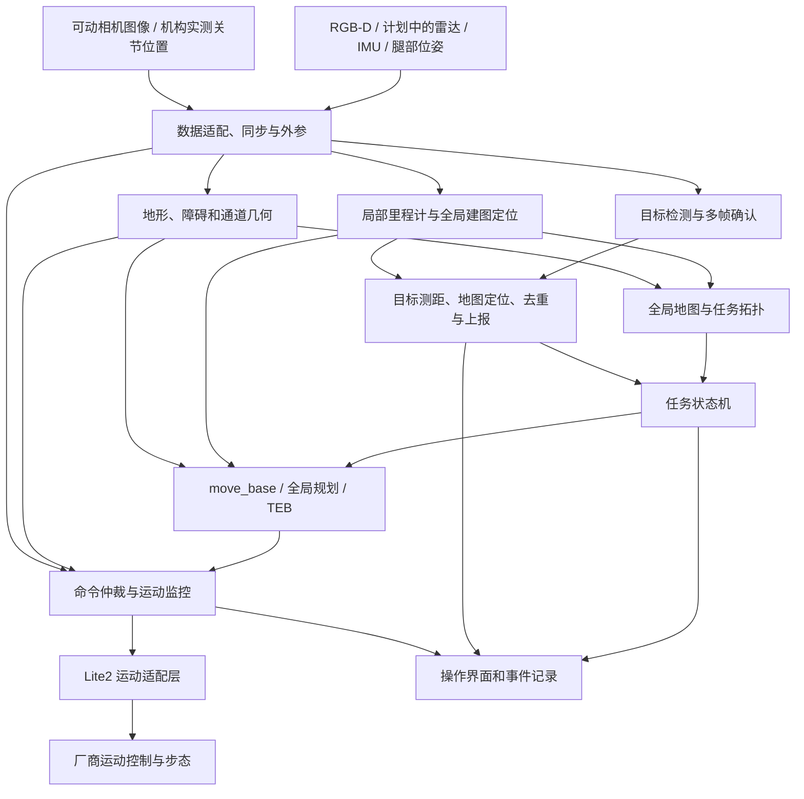
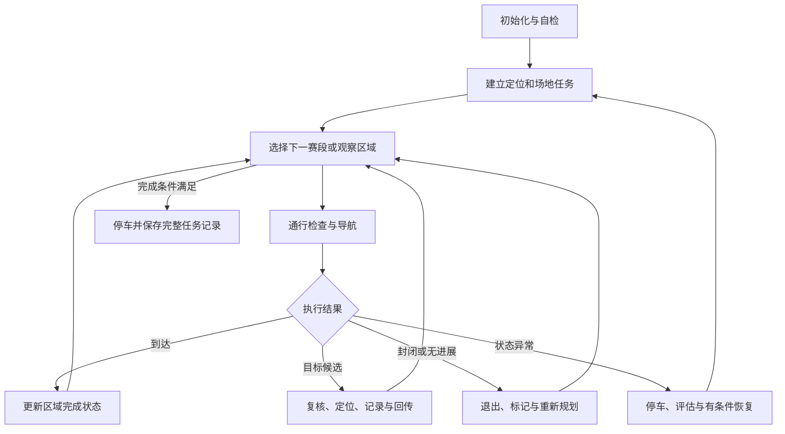
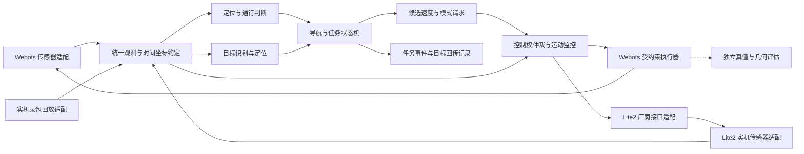

# “废墟智援”四足机器人总体技术方案

版本 v1.3，更新于 2026 年 11 月 12 日。记录 MuJoCo 模型、速度级在线建图导航，以及 Lite2 实机迁移接口。本版新增第 3.1–3.3 节：导航层次划分与范式选型，依据 10 篇顶刊方案整合结论确定，不改变既有软件选型。

本方案同时覆盖运动控制与路径规划、预设生命目标识别两项核心任务。依据本地赛题材料、Lite2 厂商手册、本聊天此前的实机读取结果，以及用户新提供的场景效果图制定。官方平台开放后，按正式场地配置和接口修订。

用户已明确后续加入激光雷达，型号待定，并提出可伸缩折叠机构搭载相机的设想。本版将雷达列入计划配置，将可动相机列入需验证收益与通行影响的增强模块。

## 1. 当前基础与开发判断

### 1.1 已掌握的信息

| 项目 | 已有证据 | 对方案的影响 |
| --- | --- | --- |
| 机器人 | 绝影 Lite2 专业版，手机操作已由用户验证 | 使用厂商步态与上层运动接口 |
| 运动主机 | 前序 SSH 读取为 192.168.1.120，x86_64，Ubuntu 16.04，厂商运动程序运行中 | 通过适配层调用运动控制 |
| 感知主机 | 前序 SSH 读取为 192.168.1.103，Jetson Xavier NX，Ubuntu 18.04，ROS1 Melodic | 企业赛开发基线沿用现有 ROS1 环境 |
| AI 环境 | Python 3.6、CUDA 10.2、TensorRT 7.1，已有 PyTorch 和 OpenCV | 训练端和部署端分别管理依赖，先验证模型转换兼容性 |
| 深度相机 | 已枚举并短时采集 RealSense D435I 的 RGB 与对齐深度 | 以 RGB-D 作为近场几何和目标测距主输入 |
| 其他感知 | 已发现广角相机设备，手册列出超声波模组 | 广角视野、超声波安装覆盖及有效输出继续盘点 |
| 激光雷达 | 当前设备未配备，用户计划后续加入，型号未定 | 当前用 RGB-D 开发，预留三维雷达、IMU 与腿部状态接入 |
| 可动相机机构 | 用户提出伸缩、折叠相机机构，结构与行程待定 | 评估观察收益、动态外参、收拢净空和负载稳定性 |
| 机载软件 | 已发现 move_base、TEB、DWA、robot_localization、octomap_server 和厂商高度图工程 | 复用现有组件，按数据链路逐个验证 |
| 视觉建图 | 实机查询尚缺 rtabmap_ros | RGB-D 全局定位与建图属于待实现、待测能力 |
| 本体模型 | 本地 RAR 含 URDF 和网格，已解析出 12 个转动关节及惯性、碰撞元素 | 可作为仿真建模起点，继续接入并验证步态控制 |
| 仿真资源 | MuJoCo 3.17.0 已完成 Lite2 模型、用户确认的参考场地和传感器基线；两个场景各3次验收通过，17项回归通过；已有 Webots 共享导航运行记录 | 下一阶段将共享导航核心接入 MuJoCo，再开展实机回放与 Lite2 运动适配验收 |

厂商产品手册给出的站立尺寸为 540 × 315 × 355 mm、整机约 10 kg。建图和碰撞检测使用实测机身、腿部摆动及外接设备的整体包络，通道阈值在此基础上加入定位、测距和控制误差余量。

### 1.2 当前能力的验证范围

此前已经完成双主机信息读取、部分状态协议核对、相机短时采集。软件自主行走、停止请求的端到端效果、运动中的定位和图像质量均待分段实测。

相机采样来自趴卧姿态，画面主要为近距离地板，该样本的有效深度比例约 28%。站立、坡道、转弯、弱光和管道内需要分别采集。传感器同步、深度单位、安装外参、运动模糊及有效观测距离进入第一阶段验收。

本轮补查感知主机时 SSH 连接中断，系统版本与已安装组件依据此前读取结果。现场重连后核对软件清单和进程状态，并保存版本记录。

### 1.3 总体路线

**厂商步态与运动接口 + 雷达/IMU/腿部状态定位 + RGB-D 近场几何 + 固定与可动视觉观测 + 通行约束导航 + 目标识别回传。**

分阶段实施。现有 RGB-D、IMU 和腿部位姿先支撑数据与最小闭环开发，雷达到位后优先评估雷达定位建图。可动相机在基础自主任务通过后接入，先验证停车展开观察。

开发工作集中在数据适配、定位、地形与通道判断、任务调度和目标信息闭环。机载运行锁定兼容现有系统的组件版本。开发电脑承担训练、仿真、录包分析与操作界面。

## 2. 按参考场地拆解任务

### 2.1 对场地图的使用方式

新提供的效果图展示了围墙、弯曲窄通道、中央封闭支路、多处碎石及右侧管道结构。两处 H 标记的正式含义、具体起终点位置和全部几何尺寸等待场地配置表确认。

本地赛题附录给出 12 × 10 m 参考场地，主线为起点、坡道、S 弯、死胡同分岔、乱石区、隧道区、终点。附录提到五处乱石、一个应识别并放弃的过窄隧道、圆管和方涵，实际规格以赛题组后续材料为准。

设计采用三级表示。

1. 任务层记录必经区域、目标搜索要求和完成条件。
2. 拓扑层记录区域、入口、分岔、可选通路及其状态。
3. 几何层根据实时地图计算具体路径、速度和通行条件。

现场墙体、入口、乱石或目标变化时，更新场地配置并在线检查通路。区域目标由地图坐标或在线检测结果生成，每段行动通过状态反馈闭环结束。

### 2.2 各赛段的实现和验收

| 赛段 | 主要输入与判断 | 计划动作 | 核查证据 |
| --- | --- | --- | --- |
| 起点与初始化 | 本体状态、时间同步、传感器质量、定位初值 | 自检后进入自主任务 | 启动日志、模式确认、坐标系检查 |
| 上下坡 | 深度地面坡度、机身姿态、地面连续性 | 按实测边界限速并请求对应厂商步态，越过坡顶后重新判断地面 | 上下坡通过率、姿态、滑移、停止距离 |
| 狭窄通道和 S 弯 | 墙面距离、机身及摆腿包络、转弯余量 | 低速规划姿态连续的路径，分段调整朝向 | 最小侧向余量、碰撞、振荡和接管次数 |
| 分岔和死胡同 | 通路连通性、前进进度、可用退路 | 标记封闭支路，受控退出并重选路径 | 判断位置、退出路径、后向观测、恢复耗时 |
| 乱石越障 | 高度变化、坡度、粗糙度、落差和未知区域 | 选择能力范围内的跨越路径，调用已验证步态 | 每处必经障碍的通过记录、机身稳定性 |
| 过窄隧道 | 入口及内部可观测截面、宽高、运动包络 | 在入口外判为不可通行并选择允许的替代路线 | 截面测量、拒绝原因、替代路径 |
| 圆管和方涵 | 连续净空、侧壁、入口边缘和内部地面 | 对进入、行进及退出分别进行通行检查 | 全段空间余量、碰撞、定位及深度有效率 |
| 动态避障 | 当前障碍距离、观测时效、运动趋势 | 减速、停车、等待或重新规划 | 最小间距、响应延迟、恢复成功率 |
| 目标搜索与终点 | 任务覆盖、目标记录、终点条件 | 完成识别和上报，保存任务结果 | 召回、误报、定位误差、回传记录、全程视频 |

乱石试验包含规则要求的必经越障。任务层根据正式规则标记必经区域，规划层在区域内寻找可执行路径。对于超过实测本体能力的必经障碍，在集成早期形成能力差距记录和解决方案。

### 2.3 应对现场修改

统一场地配置记录区域边界、通道宽高、坡度、障碍分布、目标类别与位置范围、动态障碍脚本和光照条件。配置带版本号，跟随运行日志保存。

测试时主动改变 S 弯宽度、分岔封闭位置、碎石布局、隧道净空、目标位置和动态障碍出现时刻。保留一组独立布局作为验收集，检查同一算法版本的适应性。

若允许预建图和已知任务点，使用初始地图并在线修正。若要求未知环境探索，采用可达前沿与区域覆盖生成下一观测点。地图或定位发生较大变化时，重新校验当前路径和已记录目标的位置。

## 3. 系统架构和软件选型



| 功能 | 当前选型 | 使用条件 |
| --- | --- | --- |
| 通信框架 | ROS1 Melodic | 与现有驱动、导航和机载系统兼容 |
| 全局导航 | move_base，采用 A* 或 Dijkstra 基线 | 地图、TF、里程计和碰撞包络先通过检查 |
| 局部规划 | 优先验证已安装 TEB | 按实际横移、后退和转向能力配置 |
| 局部状态估计 | 腿部位姿、机身 IMU，候选 robot_localization | 量纲、时间、协方差及输入相关性验证后融合 |
| 当前 RGB-D 建图定位 | RTAB-Map 的 Melodic 兼容版本作为候选 | 服务雷达到位前的验证，按实测结果决定后续用途 |
| 雷达到位后的定位建图 | 优先评估现有厂商雷达工程，必要时验证兼容的雷达惯性方案 | 核对雷达型号、点时间戳、IMU、回环与重定位能力 |
| 局部地形 | 厂商高度图工程优先评估，补充必要的通行判断 | 先核对输入、依赖和控制输出路径 |
| 三维空间 | 深度点云及局部体素/截面查询 | 保留地面、顶面及未知区域的区别 |
| 目标识别 | 与正式目标类别匹配的轻量检测模型 | 依据独立测试和旧版部署环境选择具体模型 |
| 推理部署 | 优先验证现有 PyTorch，随后评估 TensorRT 加速 | 在 NX 上检查算子兼容、精度和端到端延迟 |
| 任务组织 | 单一轻量状态机 | 明确每个动作的进入、退出、超时和恢复条件 |

ROS1 navigation 提供 move_base、代价地图和规划组件。TEB 的动态障碍预测需要对应参数和有效障碍运动信息，开发中分别验收基础避障与预测避障。上表各功能在导航层次中的归属见第 3.1 节。[ROS1 navigation](https://github.com/ros-planning/navigation/tree/melodic-devel)、[TEB Melodic 配置](https://github.com/rst-tu-dortmund/teb_local_planner/blob/melodic-devel/cfg/TebLocalPlannerReconfigure.cfg)

RTAB-Map 的 Melodic 启动配置支持 RGB-D 输入、视觉里程计和外部里程计接入，适合作为本项目第一个建图候选。实际可用性通过本机数据和场地测试决定。[RTAB-Map Melodic 配置](https://github.com/introlab/rtabmap_ros/blob/melodic-devel/launch/rtabmap.launch)

### 3.1 导航层次划分与范式选型

本节回答“用哪一类架构”。依据 10 篇顶刊（Science Robotics、IEEE T-RO、IJRR，2022–2026）的方案整合结果，结论是**采用分层式范式：全局/拓扑层 → 局部几何层 → 速度级执行层，并外挂一层安全接管层**。端到端策略、技能库分层强化学习、学习式局部规划器均不作为主线；其中学习式局部规划只列为中期可选升级。

零散的方法优劣不作依据，以下四条约束是决策理由，任何一条变化都需要重新评估选型。

1. **接口约束**：厂商只开放步态模式与速度级接口，本项目能自主实现的最底层是速度指令。关节级策略、全身力矩优化类方案在机载侧没有可部署出口，只能停留在仿真。
2. **算力与周期约束**：机载为 Jetson Xavier NX，控制周期 20 Hz，开发机同时承担训练与仿真。大规模强化学习的训练、验证、迁移与回归周期与备赛窗口不匹配。
3. **可验证性约束**：赛题按赛段验收（必经区域、目标回传、碰撞、接管），要求中间量可查、可回放。分层架构的代价图、路径、速度指令、接管记录都能落盘并逐帧核对，端到端策略给不出等价证据。
4. **实证约束**：2026-11-12 的 `sim2real_v1` 结果为 10 次 4 次成功，失败集中于 `goal_blocked`×5 与 `stalled`×1，碰撞为 0。该分布指向代价建模与恢复行为不足，不是策略端到端程度不足。

据此，把导航切成五层。频率按现有 20 Hz 控制周期与 2 Hz 全局重规划推导，不引入新周期。

| 层 | 职责 | 建议频率 | 上游输入 | 下游输出 | 本项目实现方式 |
| --- | --- | --- | --- | --- | --- |
| L0 本体运动 | 步态执行与姿态，**不自行实现** | 厂商内部 | 速度与模式指令 | 关节运动 | 厂商步态，只做能力标定与监控 |
| L1 速度执行与仲裁 | 指令合成、限幅、超时、看门狗、控制权切换 | 20 Hz | 导航候选速度、本体与安控状态 | 唯一 `cmd_vel` | 第 4.1 节适配层与运动监控 |
| L2 几何与局部层 | 通行代价地图、局部轨迹、局部避障 | 5–10 Hz | 代价地图、局部地形、定位等级 | 局部轨迹与速度候选 | move_base/TEB、厂商高度图、第 4.3 节地形图 |
| L3 拓扑与任务层 | 区域、分岔、死胡同、必经点、目标搜索、赛后记录 | 1–2 Hz，事件驱动 | 任务拓扑、通路状态、任务反馈 | 阶段目标与允许通路 | 第 2.1 节三级表示、单一状态机 |
| L4 安全与降级层（外挂） | 任意时刻接管：限速、停车、后退、重定位、放弃通行 | 与 L1 同周期 | 障碍距离、定位等级、传感器时效、指令状态 | 接管标志与降级动作 | 新增，独立于导航逻辑 |

与顶刊的对应关系需要说明：文献中常见的 20/100/400 Hz 划分来自自建力矩控制，本项目最低可控层是速度，因此层次收敛为上述五层，**深度应集中在 L2 与 L3**，不向底层运动学下探。

### 3.2 三项落地改造

按投入产出排序，三项都在现有组件内实现，不更换软件栈。

1. **通行代价层（2.5D）**。当前平面代价只有占用与空闲二值，坡道、乱石、管涵这类“能过但代价高”的地形表达不出来，容易被整块判死（对应 `goal_blocked`）。改为在 layered costmap 中叠加坡度、净空、粗糙度、观测质量与定位质量加权代价。
   - 验收：坡道与乱石区不再整块不可达；`goal_blocked` 失败次数下降；同一布局重复运行结果一致。
2. **能力边界进规划**。把实测的坡度上限、越障高度、最小通道宽高、后退距离、停止距离写成能力表，作为 L2/L3 的硬约束，而不是等触碰或卡住再处理。
   - 验收：过窄隧道在入口外 100% 判为不可通行并给出替代路线；方涵与圆管按全段净空分段检查。
3. **接管式安全层（L4）**。独立于导航逻辑，检测传感器超时、定位跳变、指令过期、障碍逼近与接管控权，执行限速、停车、后退或重定位。
   - 验收：接管次数、触发原因、恢复耗时进入评测表；本体故障与感知主机故障两个场景各有记录。

### 3.3 阶段安排与明确不做的部分

- **W2–W3**：先做 L2 通行代价层与 L3 恢复行为（死胡同受控退出、`stalled` 检测后重规划），目标是把 `sim2real_v1` 的 4/10 拉起来。
- **P1**：加 L4 安全层，按第 9.1 节的 8/10 内部门槛统计，接管与恢复计入证据。
- **中期可选项（有余力再做，属加分不属于骨架）**：L2 局部规划换学习式规划器；或用在线自监督可通行性替代手工代价权重。
- **本版明确不采用**：端到端视觉运动策略、技能库分层强化学习、语言/大模型高层、关节级力矩控制。理由见 3.1，若厂商开放关节级或底层接口，再重新评估。

方案依据见 10 篇顶刊整合材料（Science Robotics 6 篇、IEEE T-RO 3 篇、IJRR 1 篇，DOI 逐条经 Crossref 核实）：Miki 2022 `10.1126/scirobotics.abk2822`、Hoeller 2024 `10.1126/scirobotics.adi7566`、Lee 2024 `10.1126/scirobotics.adi9641`、He 2025 `10.1126/scirobotics.adv3604`、Kim 2025 `10.1126/scirobotics.ads6192`、Kang 2026 `10.1126/scirobotics.adz7397`、Grandia 2023 `10.1109/TRO.2023.3275384`、Zhang 2026 `10.1109/TRO.2025.3645885`、Lin 2026 `10.1109/TRO.2025.3644957`、Bjelonic 2026 `10.1177/02783649261459628`。逐篇机制、创新与局限见[顶刊方案思维导图](四足机器狗导航_顶刊方案思维导图.html)与[导图大纲](四足机器狗导航_顶刊方案思维导图.md)，分轨证据见 [A](../research/A.md)、[B](../research/B.md)、[C](../research/C.md)。该材料中 Kang 2026 的 arXiv 编号与个别团队归属未完全核实，正文引用以期刊 DOI 为准。

## 4. 运动接口、定位与地图

### 4.1 先建立可靠的运动和状态接口

使用唯一的 Lite2 运动写入进程，接收经仲裁、限速和监控的指令。导航、调试工具、手机及原厂程序之间的控制权切换必须有明确状态和确认。

此前读取发现原厂 ROS 桥接启动文件同时包含状态接收和速度发送。系统中也曾存在跟随节点注册的 `/cmd_vel` 发布者。集成时先盘点所有速度来源，把导航输出重映射到专用路径，只有获得控制权的适配层连接运动主机。

原厂接口中已经发现需要适配的具体差异。

| 接口事实 | 工程处理 |
| --- | --- |
| `/leg_odom` 为 `geometry_msgs/PoseWithCovarianceStamped` | 按位姿消息接入估计器，导航所需 Odometry 由已验证的状态估计链路提供 |
| 原厂桥接会发布 `odom → base_link` TF | 为每条 TF 指定唯一发布者，并处理原厂输出与融合输出的所有权 |
| 腿部位姿中的朝向与 TF 的三维姿态处理不同 | 统一坐标定义，保留用于相机投影和地形判断的完整横滚、俯仰与偏航 |
| 已读取状态、电量等协议字段与手册存在差异 | 将固件版本、报文长度、字段单位和解析测试一起冻结 |
| 部分动作接口为状态切换命令，速度存在持续生效行为 | 发命令前后检查真实状态，设置超时、幂等条件及停车确认 |

首先验证低速前进、转向、零速度、取消任务、控制权交接与停止请求。横移、后退、坡道模式和机身高度调整分别建立能力记录。

运动监控位于速度发送前的最后一级，检查本体故障、定位质量、传感器超时、障碍距离、姿态、相机机构状态和通信状态。上层失联时由机载适配进程执行已验证的停车策略。进程退出及感知主机故障时的本体行为也要单独测试并记录。

停止距离由实际速度、端到端延迟和本体制动过程测得，再与定位及障碍误差一起确定停车区。手机停止操作和程序停止操作分别验收，保留现场监护与隔离区域。

### 4.2 定位分为连续运动估计和全局地图修正

以下为现有传感器阶段的实现顺序，雷达接入按第 4.4 节调整主定位来源。

1. 校验腿部位姿、机身 IMU 的轴向、频率、单位、协方差和时间戳，建立连续局部里程计基线。
2. 采集同步 RGB-D、CameraInfo、机身状态和 TF，在开发端回放评估 RGB-D 里程计与 RTAB-Map。
3. 对比直线、转弯、坡道、少纹理墙面、弱光和短时遮挡下的漂移与失效情况，确定融合输入。
4. 全局建图或定位输出 `map → odom`，局部估计输出 `odom → base_link`，固定安装关系由标定文件管理，可动机构按关节实测状态计算变换。
5. 给定位状态增加可用、退化、失效等级，任务层据此执行减速、重观测、暂停或重定位。

每一测量来源只融合可解释且经验证的分量。腿部位姿、机身姿态和视觉估计可能共享上游信息，需要检查相关性。未知速度、缺失协方差和失效数据都要有显式状态。

D435I 的内置 IMU 在此前相机测试配置中未启用。第一版先使用已读取的机身 IMU，后续根据时间同步和外参测试决定是否引入相机 IMU。

相机定位和地形投影始终使用完整三维机身姿态。平面规划使用水平投影及相应包络，坐标变换在同一时间基准下查询。

### 4.3 环境保留三种表示

- 平面占据与代价地图负责墙体、连通性、全局路径和局部避障。
- 局部地形图记录地面高度、坡度、粗糙度、台阶、落差、观测质量和更新时间。
- 三维点云或体素保留侧壁、顶面和通道截面，供隧道净空及全身包络检查。

有效深度观测用于更新几何，缺测区保留未知状态。地图清除操作依据有效观测和射线可见性执行。坡顶、管道入口及遮挡后方需要重新观测。

厂商高度图工程已有文件基础，后续检查相机和超声波依赖、坐标系、过滤逻辑、命令发布路径，再确定复用范围。现成的局部辅助避障作为独立基线测试。

### 4.4 后续激光雷达接入

当前按三维雷达预留几何与定位接口，具体选型仍待确定。选型检查点包括垂直视场、近距离盲区、点云密度、逐点时间信息、IMU 数据、ROS1/ARM 驱动、功耗、接口及安装后的总高度。二维雷达的应用范围按扫描平面的覆盖能力另行评估。

雷达刚性安装在机身或稳定基座，标定其与 IMU、机身及固定相机的关系。可动相机机构的伸展和折叠需要同时检查雷达视场遮挡与机身自反射。

优先核对现有厂商雷达 SLAM 工程能否支持选定型号。需要新建链路时，FAST-LIO 可列为候选，其原始项目列出 Ubuntu 18.04、ROS Melodic 等运行条件，并要求正确处理雷达与 IMU 外参及逐点时间信息。接入前仍需验证具体雷达驱动和 NX 上的构建、频率与资源占用。[FAST-LIO 原始项目](https://github.com/hku-mars/FAST_LIO)

分别验收雷达惯性里程计、地图生成、回环修正和重定位。全局闭环功能按所选完整链路落实，统一管理 `map → odom` 与 `odom → base_link` 的发布权。腿部状态、机身 IMU 和视觉数据根据相关性及质量接入。

雷达主要服务较大范围几何、定位和障碍更新，RGB-D 负责经实测覆盖的近场地面、目标测距及细部几何。通过各高度和方向的覆盖测试，确定隧道顶面、足前近处与后退方向的感知组合。

## 5. 地形通行与自主路径规划

### 5.1 两层规划及通行约束

全局规划在可通行地图中选择区域和路径。局部规划根据最新几何输出速度，通行模块持续检查预测路径上的坡度、起伏、落差、净空和运动包络。

地图代价包含距离障碍、地形困难度和观测不确定性。硬性禁止条件独立保留。任务状态机结合规则给出的必经赛段、剩余搜索区域和路径可达性选择下一目标。

初版由 TEB 承担已验证平面运动的局部规划，厂商控制器执行具体步态。地形模块输出可走区域、速度限制和步态请求。厂商步态的乱石与坡道能力通过实测建立边界。本节两层的层次归属、建议频率与验收口径见第 3.1、3.2 节。

### 5.2 狭窄空间与死胡同

窄通道按机身、四腿摆动和转向的整体包络检查。通道入口设置观察与对正位置，转弯过程限制横向偏移和角速度。

死胡同退出保存进入时的轨迹、观测和可用余量，并持续核对后方空间。前视相机的后向覆盖是当前待解决项。需先盘点广角相机和超声波的安装朝向，再决定是否补充后向测距或采用经验证的重观测动作。

历史轨迹提供退路先验，后向有效观测用于检查新出现的障碍。后方动态障碍、狭窄空间转身和原路倒退分别设置验收场景。各恢复动作均要求对应方向的感知、可执行空间及停止余量。

### 5.3 乱石、坡道与隧道

乱石区提取相对地面高度、连续支撑区域、局部坡度和落差。每类必经障碍按尺寸、分布、表面和步态记录通过情况，形成能力表。对超出边界或观测不足的路径，任务层转入重新观察、改选可行路径或记录不可达。

坡道需要联合深度地面与 IMU 估计，坡顶和坡底检查地面转折。速度和步态切换包含状态确认与等待时间。

隧道检查从入口到出口的可观测通行空间。圆管按机器人各高度处的有效截面宽度计算，方涵同时检查宽度、顶面和地面。低姿态通行依赖厂商实际支持的模式、对应运动包络、传感器视野和稳定性测试。每次进入前满足停车、退出和定位条件。

### 5.4 动态避障

第一版使用深度几何完成障碍进入减速区、停车区、等待与重规划闭环，记录障碍出现到运动响应的时间。雷达到位后加入相应几何观测，并按各自有效范围融合障碍信息。

随后加入多帧障碍关联和速度估计，为 TEB 提供带时间戳的动态障碍输入。评估横穿、迎面、突然出现和暂时遮挡四类情况。运动预测与近场停车监控同时运行，观测过期时收紧运动权限。

## 6. 目标识别、定位与信息回传

### 6.1 目标定义与模型选择

当前缺少官方生命目标样例、类别和判定方式。第一版接口支持目标类别配置，正式识别模型由样例决定。

| 官方目标形式 | 对应实现 |
| --- | --- |
| 人员、人体模型或特定外观目标 | 对应类别检测，必要时采集数据微调 |
| 标牌、图案或专用标记 | 按规则使用图案检测或标记识别 |
| 温度、呼吸等专门信号目标 | 将热成像或对应信号传感器列入硬件需求，并单独验证 |

等待样例期间可用临时可见目标联调完整数据流程，测试报告单独标明类别和用途。正式成绩评估使用官方目标定义。

在开发电脑训练并冻结模型、预处理、类别表和阈值。先在 NX 验证现有推理环境，再评估兼容 TensorRT 7.1 的导出路径，并在目标 NX 上构建与测试引擎。模型选择同时考虑漏检、误报、弱光、运动模糊以及与建图并行运行时的延迟。

数据按采集片段或场景划分训练、验证、测试集。目标位置、背景、尺度、遮挡和光照覆盖参考场地与独立变更布局。

### 6.2 识别到地图位置的闭环

```text
RGB 检测 → 多帧确认 → 对齐深度中的有效目标区域
         → 相机三维点 → 同时刻的机身及地图坐标变换
         → 目标关联与去重 → 证据保存 → 操作端显示和确认回传
```

对已校正并完成深度对齐的像素，使用相机内参和稳健深度反投影。深度从目标内部区域筛选，结合有效率、空间聚类或掩膜降低背景干扰。

三维坐标按以下关系变换，时间 t 对应同步后的图像观测，q(t) 为相机机构的实测关节位置。固定相机使用标定后的固定变换，可动相机使用随关节状态更新的变换。

```text
p_camera = depth × inverse(K) × [u, v, 1]
p_map = T_map_base(t) × T_base_camera(q(t)) × p_camera
```

外参、深度尺度和目标位置定义分别校验。深度缺失时输出测距无效状态，任务层安排重观测。全局定位退化时保留观测证据和可用的相对位置，待重定位后更新地图坐标。

同一目标通过多帧和空间位置关联。地图闭环修正后，依据保存的观测位姿或关键帧重新计算坐标，更新原目标记录。目标位置误差以独立测量或仿真评估真值为准。

### 6.3 搜索与回传

行进中持续检测，疑似目标触发有条件的停车或观察位姿调整。观察点满足可达、可停车和相机可见条件，完成复核后恢复原任务。记录已观察区域和仍受遮挡区域，满足规则允许的覆盖要求。

每条目标记录至少包含任务 ID、稳定目标 ID、类别、观测时间、坐标系、地图版本、位置、定位质量、检测置信度、RGB 证据、有效深度统计、观测时机器人姿态及上报状态。

操作端展示地图上的目标、截图、状态和失败原因。本地先保存，随后发送并等待确认，断线后按记录 ID 补传和去重。实时视频、地图显示和日志按资源预算运行，控制链路保持独立调度。

弱光试验覆盖曝光、光照变化、深度有效率与运动模糊。是否使用辅助照明按规则和现有硬件确定。

### 6.4 可伸缩折叠相机机构

该机构的潜在收益集中在主动观察。相机升高可获得新的俯视视角，向下俯仰可检查近处目标与入口，转向或局部伸出可增加侧向观察机会。收益取决于真实墙高、目标位置、可见角度和允许的机构运动空间。

规划采用固定近地感知与可动巡视相机的分工。用于定位的雷达保持刚性安装，可动相机主要承担目标搜索、复核、证据采集及通道观察。相机需要输出三维目标位置时，配置对应深度或经过标定的测距配合。

机构以低位收拢、有限行程升降和必要的转向自由度为设计目标。先根据目标遮挡和隧道净空确定所需行程，再确定结构、驱动和线缆路径。整套载荷计入相机、机构、驱动、电源和线缆，结合重心、坡道姿态、摆动和停止过程测试允许的展开范围。

Lite2 手册列出最大负载 7.5 kg，并注明理想环境条件。实际机构按整机运动表现确定可用质量和重心边界，安装固定点及供电条件按厂商资料核实。

相机外参随机构动作变化，需要实际关节角或升降位置反馈，并与图像同步。URDF 描述机构运动学，实测 JointState 驱动相应 TF，另测折叠重复性、间隙和挠曲造成的误差。ROS1 robot_state_publisher 通过 joint_states 更新关节变换，可作为这条链路的基础。[ROS1 robot_state_publisher](https://github.com/ros/robot_state_publisher/blob/melodic-devel/src/joint_state_listener.cpp)

第一版使用以下动作闭环。

```text
选择可停车观察位置 → 停车确认 → 检查机构运动空间
→ 展开到已标定姿态 → 等待稳定并采集 → 识别、测距和回传
→ 收拢并确认位置 → 更新整机包络 → 继续导航
```

隧道进入前检查收拢状态及实际总高度，展开时检查机构的完整扫掠空间。机构状态未知、回收失败或位置反馈过期时，任务转入停车和处置状态。行进中展开作为后续独立试验项，先验证晃动、图像质量与本体稳定性。

相机转向后的后方观察能力，以及后退过程中持续有效的后方覆盖分别验收。

以同一批目标和布局比较机构收拢、多个已标定观察姿态下的可见目标数、召回、定位误差、观察耗时及通行成功率，再确定比赛使用策略。

## 7. 任务状态与模块接口

### 7.1 任务状态机



异常恢复设置最大次数、超时和失败出口。暂停、取消和控制权转移具有独立状态，恢复前重新核对本体、定位、传感器与路径。

### 7.2 建议接口草案

以下是待实现的接口约定，实际主题名在代码集成时冻结。

| 模块 | 主要输入 | 主要输出与约定 |
| --- | --- | --- |
| robot_bridge | 受监控速度、模式和停止请求 | 带时间戳的本体状态、腿部位姿、IMU及命令确认 |
| localization | 原始位姿、IMU、同步 RGB-D | 标准 Odometry、TF、地图、定位质量 |
| traversability | 深度/点云、完整姿态、本体包络 | 地形代价、净空判断、限速与通行状态 |
| navigation | 地图、位姿、目标、通行约束 | 导航候选速度、到达/失败/取消反馈 |
| perception | RGB、深度、CameraInfo、同步 TF、可动相机实际姿态 | 目标观测、地图位置、质量与证据 |
| camera_mechanism | 观察姿态请求、展开空间和本体状态 | 实测关节位置、到位/收拢状态、动态 TF 与故障 |
| mission_manager | 模块反馈、任务配置和健康状态 | 唯一任务目标、模式请求和任务事件 |
| motion_guard | 候选速度、本体与定位状态、障碍 | 最终速度、停车状态和触发原因 |
| operator_view | 地图、状态、目标和事件 | 运行显示、结果核验与规则允许的操作请求 |

速度链路建议为 `navigation → /rescue/cmd_vel_candidate → 仲裁与监控 → robot_bridge`。适配层检查消息时效和控制权，厂商发送入口只有一个。

图像、位姿与 IMU 统一时间基准和坐标系。导航使用 move_base 的目标、反馈和取消接口，模式请求包含目标状态及确认。运行日志覆盖输入质量、控制输出、状态切换和目标记录。

### 7.3 分工建议

按四类工作包组织，具体人员随团队实际情况分配。

- 本体与集成负责状态协议、运动适配、停止、控制权和系统启动。
- 定位与导航负责数据同步、TF、RGB-D 建图、规划及地形通行。
- 目标感知负责数据集、推理部署、测距定位和目标关联。
- 仿真与测试负责参数化场景、变更布局、回归统计、演示与材料。

每个模块指定一个交付负责人，接口联调使用同一组录包和配置版本。队伍人数较少时合并角色，并保留统一集成负责人。

## 8. 官方平台开放前后的仿真路线

### 8.0 建模优先的实施顺序

主线采用 Lite2 上层自主系统，实机通过厂商速度与模式接口执行运动。MuJoCo 第一阶段建立厂商模型、参考场地和传感器采集基线，后续接入共享导航、速度响应与实机适配。启动与环境重建见 [MuJoCo 工程说明](../lite2_sim/README.md)。

2026年11月12日，用户确认参考图布局和两处修订。场地按12×10 m比例重建蛇形砖墙、U形端头、五处碎石、H地标、左侧球体与蓝色标记。左上角包含上坡、过渡平台和下坡，坡高暂设0.34 m。圆筒右侧为南北贯通涵洞，净宽1.00 m、净高0.76 m，顶部盖板厚0.09 m。确认状态与原图哈希写入场景配置，尺寸仍来源于图像估算。

MuJoCo 模型包含12个转动关节、12个位置执行器和浮动基座，首阶段由同位姿 mocap 夹具及焊接约束固定机身。配置物理步长2 ms、目标更新周期20 ms、持姿PD初值40/2。RGB-D、IMU和理想多层雷达完成采集与自动检查。涵洞贯通及斜坡表面高度由独立射线回归核对。验收结果见 [基线验收记录](../lite2_sim/mujoco/acceptance.json)。

Webots 与 MuJoCo 共用导航会话、观测合同、scan-to-map、A*、可达前沿探索及任务状态。MuJoCo 通过带加减速和停车延迟的 mocap 速度执行器更新本体位置，并通过 IMU 倾角补偿组织化雷达点云。观测地形记录高度、坡度与净空，规划和跟踪使用估计位姿，真实位姿用于仿真执行及独立评分。

首个导航交付从空地图出发，到达指定位置并停车1秒。场景默认目标为右上停机坪，支持坐标覆盖、无窗口运行和固定随机种子。默认规划栅格0.05 m，前进速度上限0.15 m/s、转向上限0.4 rad/s，控制20 Hz、雷达10 Hz、全局重规划2 Hz。导航结果保存地图、地形、输入、速度、估计及真实轨迹，输入回放逐帧核对状态与指令。故障场景覆盖取消、超时、雷达失联、定位失效及临时障碍。

2026年11月12日，用户授权修正左上坡道出口。出口改为沿蛇形通道斜向落地，保留其他布局。几何尺寸、0.28 m全局规划半径、局部朝向矩形包络、15°坡度阈值、0.08 m高度突变阈值及速度响应属于仿真假设，真实四足接触和越障能力由后续试验确定。实机迁移依次核对雷达与IMU数据、回放录包、核对厂商控制通道及单位，再实测速度响应和停车距离。相机外参、传感器特性和本体越障能力通过各自的实机测试建立依据。

### 8.1 现有模型的用途

本地 `LiteV2版模型文件.rar` 含 `MiniLiteV2_Rsm.urdf` 及网格。解析结果为 14 个 link、12 个转动关节和 1 个固定关节，已有部分惯性及碰撞描述。模型导入后逐项核对质量、惯量、关节轴与限位、足端接触、碰撞体、摩擦、相机安装和传感器视野。

加入雷达和相机机构后，扩展模型的质量、惯量、关节、碰撞体及传感器安装描述，同时测试机构收拢、展开和故障姿态。

当前模型用于几何通行、传感器覆盖和上层自主算法验证。运动学执行加入速度、加速度和停车延迟限制。坡道滑移、足端接触稳定性及乱石实际越障能力，通过厂商控制器的实机分段测试建立证据。

Webots 的 URDF 转换工具可作为导入途径，导入及控制器联调分别验收。[Cyberbotics URDF 转换工具](https://github.com/cyberbotics/urdf2webots)

### 8.2 平台待开放阶段

本地起步工程已实现厂商模型导入、12 个关节反馈、424 × 240 RGB-D、惯性数据、2.22 m 标定板测距检查，以及模拟雷达、占据栅格 scan-to-map、障碍膨胀、已知空闲区 A*、可达前沿探索和周期性重规划。第一批共享接口已拆分为观测合同、导航规划/控制核心、Webots 适配、独立评估及 guarded ROS1 Twist 适配。工程入口见 [lite2_sim](../lite2_sim/README.md)。

历史单层运行 `20261109_214858_a9df7c` 到达目标，随后的 16 层运行 `20261109_220648_c33249` 在起点返回 `no_path`。本次修正本机 Python 分层距离图读取、自回波过滤、近水平清空射线及路径对角穿格检查，加入 0.10 m 软规划余量并调整跟踪前视距离。暂定自过滤包络及所有运行参数随配置保存。

最新建图 `20261110_165033_efacc6` 融合 554 帧，87.46% 栅格有观测，行进约 15.042 m，估计终点误差约 0.056 m，独立真值误差约 0.112 m，真值误差满足 0.25 m 仿真容差，记录 0 次碰撞拦截。核心 11 项回归、标定场检查、废墟场景加载检查及导航批处理均通过。每次运行保存配置、完整共享核心源码快照与首帧原始点云。[最新建图摘要](../lite2_sim/runs/20261110_165033_efacc6/navigation_summary.json)、[最新 SLAM 地图](../lite2_sim/runs/20261110_165033_efacc6/slam_map.png)

已保存的 Webots 导航运行采用监督器驱动的平面运动学简化，Lite2 关节姿态固定；算法未实现回环检测和位姿图优化，也没有目标识别、足端接触或越障动力学。雷达型号、实机外参和场地尺寸待确认，仿真结果只证明软件链路已连通。

先完成与具体仿真器耦合较小的工作。

1. 在录制数据上验证同步、定位候选、地形判断、识别和回传。
2. 用参数化地图验证分岔、封闭通道、动态障碍和任务状态切换。
3. 按官方测量更新已有坡道、S 弯、分岔、乱石和管道组件的尺寸配置。
4. 接入速度级仿真运动与厂商实机接口，分别验证上层闭环和实际通行表现。

本地以厂商 URDF 管理本体参数，在 MuJoCo 中建立模型与传感器基线，并通过共享几何描述管理 Webots 对照场景。官方平台开放后按其模型格式与控制接口接入参考场景。

### 8.3 官方平台开放后

获取场地配置表、机器人模型、传感器主题、控制方式、初始化流程、目标样例和评分接口。按官方资源建立仿真适配层，上层任务、规划、识别和结果格式保持同一套接口约定。

评估数据分为地图级算法、模拟传感器、受约束运动学执行和真机测试四层，各自记录验证范围与结论。仿真真值用于误差评估，正式运行输入按规则配置。

### 8.4 随机变化与迁移检查

改变几何尺寸、摩擦、照明、传感器噪声、深度缺失、通信延迟、目标位置和障碍时序。每次测试保存随机种子、参数、软件版本和原始日志。

从本地参考场转入官方场景时，依次核对尺度、坐标系、机器人运动包络、相机参数、输入时序、控制语义和任务结束条件。

本地已落地可执行的随机化基础设施：`config/randomization/` 提供 `ideal`（全零基线）、`sim2real_v1` 与 `sim2real_aggressive` 剖面，参数写成区间或定值；`navigation_core/randomization.py` 用独立 `numpy` Generator 按 `(profile, seed)` 采样，同种子逐字节可复现且不污染全局随机状态；参数来源标记为 `sim_assumed`、`vendor_reference` 或 `measured_pending`。覆盖的随机过程包括雷达测距噪声/偏置/丢点/波束遮挡/整帧丢包/扫描延迟，里程计比例误差、噪声、偏航零偏与打滑，IMU 倾角噪声，指令延迟、加速度比例与线速度增益误差，以及初始位姿误差。每次随机化运行把 `randomization_profile` 写入 `config_snapshot.json`，采样值写入 `randomization.json` 与 `navigation_summary.json.randomization`，profile 文件进入 `source_snapshot/`；`tools/run_monte_carlo.py` 按种子并发执行并汇总成功率、真值误差分布、逐段通过率、失败原因、碰撞与恢复计数，支持 `--min-pass-rate` 门槛。随机化只作用于传感器与执行器模型，评分始终使用独立真值；实机测量到位后逐项替换 `measured_pending` 参数。

### 8.5 Sim-to-real 的当前基线与优先修复

本轮完成 MuJoCo 模型与传感器基线，并复用已有 Webots 工程中的上层导航核心。实机运动通过厂商速度与模式接口执行。迁移对象包括任务状态、观测处理、通行约束、导航和目标回传，仿真执行与 Lite2 厂商协议分别由适配层承接。

| 当前证据 | 对迁移的影响 | 先完成的工作 |
| --- | --- | --- |
| 历史起点 `no_path` 已复现并修复分层读取、自回波与扫描清空逻辑；当前规划不自动移动受阻目标 | 固定姿态自过滤包络仍是暂定值，须按实机外形测量 | 核对实测包络，继续扩充窄口与贴墙回归 |
| 观测合同、规划/控制核心、Webots 观测与运动学执行适配、地图导出及独立评估已拆分 | 本地二维核心可供 ROS 后端复用；真实传感器录包回放仍未接入 | 采集 RGB-D、IMU、腿部里程计与 TF 后做可重复回放 |
| 到达、停滞、停车与路径命令护栏使用估计位姿及已知空闲地图；真值只用于 Webots 执行互锁和独立评估 | Webots 碰撞互锁仍依赖模拟执行器，不能代表实机安全链路 | 在 Lite2 上单独验收命令看门狗、急停、失联停车与单一速度发布者 |
| 当前初始 `odom_pose`、`slam_pose` 复制配置起点，地图范围来自场地配置 | 初始化使用已知起点和场地先验 | 显式记录初始化方式，单独验收实机起点设置和允许的地图先验 |
| 当前速度为前进与偏航，机身高度固定，执行时直接更新夹具位置 | 速度响应、横移、三维地形姿态及停车过程待补齐 | 先验证前进和转向合同，再按实测能力加入其他轴与模式 |
| 多层扫描已修正分层读取，过滤自身回波，以近水平射线清空，JSON 无效数值改为 `null` | 固定世界高度带及暂定自过滤包络仍需扩展 | 增加完整外参和姿态处理，继续核对坡面、顶面和遮挡语义 |
| 已具备可复现随机化剖面与蒙特卡洛聚合：传感器噪声/偏置/丢点/遮挡/整帧丢包/延迟、里程计比例误差与零偏、打滑、IMU 噪声、指令延迟与加速度/增益误差、初始位姿误差 | 迁移前可用同一 seed 复现失败样本，用区间覆盖测量不确定度；实机测量前多数参数来源仍是假设 | 用实机录包替换 `measured_pending` 参数，并把随机化注入真实传感器回放链路 |

普通路径只经过已观测空闲格，路径简化与速度候选也检查未知区域和对角穿格。未知目标时只前往可达前沿，原始目标不变；起点受阻、目标受阻、地图不连通和观测不足分别输出状态。真实终点误差由评估器单独记录，不进入导航决策。[当前规划与执行代码](../lite2_sim/controllers/sensor_capture/navigation.py)、[共享规划器](../lite2_sim/controllers/sensor_capture/navigation_core/planner.py)、[最新保存地图](../lite2_sim/runs/20261110_165033_efacc6/slam_map.pgm)

### 8.6 共享软件与适配边界

以下为拟实现的连接关系，ROS1 集成沿用第 7.2 节接口草案。



单次运行选择一种执行后端。仿真执行器可使用模拟内部位姿计算运动和几何接触，评估器可读取完整场景并统计误差。导航、运动监控和任务进展通过统一观测接口取得输入。目标的场景标签由评估器用于核对检测与定位结果。

第一轮拆分优先复用现有 `OccupancyGrid`、扫描处理、路径输出和运行目录。`run.py` 继续承担入口，Webots API 留在模拟适配层，新增模块按接口职责随工作包实现。

### 8.7 第一版接口冻结项

下表为实现合同。首次支持 `vx` 和 `wz`，横移、后退、高度和步态能力由各后端显式声明，并经过相应方向感知与实机测试后开放。

| 对象 | 必须约定的内容 | 验收方式 |
| --- | --- | --- |
| 速度请求 | `frame_id=base_link`，X 前、Y 左、Z 上，平移 m/s、偏航 rad/s，命令来源、控制会话、序号、采样时间和有效期 | 正向直行与转向检查轴向和单位，验证重复、乱序、过期及旧会话命令的处理 |
| 控制权 | 唯一发送者、授权来源、控制会话与租约、接管和归还状态 | 并发来源冲突、主动取消、上层退出和进程重启时记录完整状态变化 |
| 命令时效 | 消息时间用于数据关联，机载单调时钟用于接收与租约计时，限制发送到接收的数据年龄 | 延迟消息、失联、时钟跳变和回放暂停触发预定行为，重连后显式重新取得控制权 |
| 模式与停车 | 模式请求带目标状态、请求 ID、确认和超时，区分命令接收、零速度发送和实际停止 | 用独立状态或测量确认停车，记录取消到零输出及实际停稳的时间 |
| 执行端失联 | 核验运动主机或厂商控制器独立于感知进程的指令超时机制，记录速度持续生效的条件及停止路径 | 分别测试发送进程退出、感知主机掉线和网络中断，以实际停稳记录确认执行端看门狗覆盖范围 |
| 本体状态 | 带时间戳的模式、故障、控制权、估计运动、有效性和数据来源 | 状态缺失、过期或模式不匹配时产生明确事件，未知字段保留未知状态 |
| 观测 | RGB、深度、内参、扫描/点云、IMU、腿部位姿的采样时间、接收时间、坐标、单位和质量 | 同一录包可重复回放，缺帧、无回波、无效深度及初始化均有确定语义 |
| TF 与标定 | `map → odom → base_link → sensor` 的唯一发布者、完整旋转和平移、标定版本 | 检查已知距离与朝向，拒绝跨时间错配，按实测机构位置更新可动相机外参 |
| 任务与结果 | 导航目标、反馈、取消、失败原因，目标观测 ID、证据、坐标和回传确认 | 取消后停止，断网保存与恢复补传保持同一观测 ID，重启后恢复已有记录 |

当前配置的 0.22 m/s、0.65 rad/s、0.28 m 圆半径和 0.45 m 前向停车阈值作为仿真占位参数记录。实机限速、整机包络、命令周期与有效期由测量结果和可用观测共同确定。厂商协议的轴向、缩放、模式与状态字段在 Lite2 适配层逐项映射，并与固件及协议版本绑定。

### 8.8 按依赖推进的工作包

| 顺序 | 工作内容与代码落点 | 完成条件 |
| --- | --- | --- |
| W0 复现与观测修复 | **基本完成**：保留配置、完整源码快照、首帧点云与地图/轨迹/摘要；此前分层读取、自回波与起点失败已回归 | 待补源码哈希、完整时序录包和真实整机自过滤包络 |
| W1 输入与执行拆分 | **第一批完成**：观测合同、已知空闲区规划/前沿探索、估计位姿控制、Webots 执行适配、独立真值评估；附带 guarded ROS1 Twist 速度适配器 | 11 项核心回归通过；现有传感器检查及废墟导航批处理通过；实机/ROS 环境未实测 |
| W2 受约束运动 | 当前有速度限幅、命令有效期、取消、未知区候选护栏和 Webots 碰撞互锁；加减速响应、惯性、整体包络与转向扫掠模型待补 | 直线、转向、贴墙、窄口、旋转碰撞、过期、取消和控制权变化均有预期输出 |
| W3 实机数据回放 | 接入 RGB-D、CameraInfo、机身 IMU、腿部位姿及 TF，离线检查标定、同步与定位 | 保存站立和经验证的低速运动数据，量化延迟、有效深度、漂移和失效，打通现有传感器输入链路 |
| W4 Lite2 执行适配 | 已准备单一发布者/运动模式门控、限速与命令看门狗的 ROS1 Twist 适配器及参数模板；尚未连接设备 | 在设备侧核对发布者、模式、低速前进、转向、停止、进程失效与重连，记录实测停止距离 |
| W-Go2 线上封装（并行） | 已找到 Unitree 官方 MuJoCo/ONNX 工具链及一个 BSD-3 Go2 平地 ONNX 候选；后者声明不含 gait phase、动作缩放为 0.5。赛事场景和输入合同未验收 | 对照官方任务包核对资源哈希、观测映射、12 关节输出、CPU 推理和正式场景多回合表现后再冻结 |
| W5 最小任务与分段迁移 | 导航连接目标观测、深度定位、事件记录和回传，加入任务区域与必经条件 | 仿真和实机分别完成短距离导航、停车观察、目标保存回传及任务结束，并记录失败样本 |
| W6 组合与变化验收 | 按第 2 节串联单项赛段，测试布局、光照、动态障碍及数据异常 | 固定布局和独立变更布局分别统计成功率、碰撞、接管、误差及恢复结果 |

W1 第一批已完成。近期转入 W2 速度响应与命令停止模型，并准备 W3 静态采集和离线回放。运动采集依赖控制权与停车先行验收；W4 必须在 Lite2 上核对发布者、模式和停止看门狗。雷达到位时补充驱动、时序与外参，再执行 W3 至 W5。Go2 线上模型须等赛事冻结资源包及控制器完成许可和接口核对后再封装与验收。

平面基线通过后，坡道与隧道的模拟传感器验证增加沿场地几何变化的高度、横滚和俯仰，以及三维整机包络检查。乱石和坡道的运动能力由厂商控制器实测记录约束，按尺寸和模式建立可通行能力表。

### 8.9 分级验收与迁移差距闭环

| 验收级别 | 必须提供的证据 | 允许进入的下一步 |
| --- | --- | --- |
| G0 可复现仿真 | **已通过本地基线**：配置与源码快照、首帧原始观测、导航摘要；已修复 `no_path`，现有传感器入口和批处理可重跑 | 受约束速度执行和变化测试 |
| G1 可迁移软件闭环 | 统一接口、输入来源审计、整体包络、指令过期与取消行为、路径与任务事件 | 实机录包回放及适配联调 |
| G2 实机数据闭环 | 时间、TF、标定、数据质量、定位退化与机载资源记录 | 低速自主导航准备 |
| G3 实机运动闭环 | 控制权、轴向、限速、状态确认、实际停车、发送进程失效和失联/重启结果 | 有限范围的自主任务与单项赛段 |
| G4 实机任务闭环 | 导航、目标定位回传、任务完成与恢复记录，固定及变化布局的重复测试 | 组合任务和正式交付验收 |

G2 与 G3 均通过后进入实机自主任务。取消、指令过期、无路径、定位失效、目标不可达、传感器中断、控制权变化和重连均列为独立用例。仅到达终点的仿真记录用于导航子系统验收，完整任务同时核查必经区域、目标结果、碰撞和人工介入记录。

迁移调参按测量差距推进。将相机外参、有效深度范围、观测延迟、速度增益、启动死区、转向响应、停车距离和定位误差分别写入参数来源记录，标明厂商参考、实测范围或临时值。随后在仿真中使用对应范围及边界条件回归，每次保留参数版本和独立测试结果。

雷达未到位期间，模拟雷达支持算法接口和场景验证，现有 RGB-D、机身 IMU 与腿部位姿的数据链路单独验收。相机机构先用实测收拢外形进入碰撞包络，停车展开观察在姿态反馈与动态外参验收后加入任务。

## 9. 实施阶段与验收门槛

按依赖关系推进，正式提交日期进入排期后，再将以下阶段倒排至比赛。每阶段保留可复现的演示和数据。

| 阶段 | 主要工作 | 进入下一阶段的证据 |
| --- | --- | --- |
| M 建模基础 | 本体校核，参数化场地，传感器与载荷建模，碰撞和观测几何检查 | 模型参数来源、整体包络、通道尺寸及传感器几何验证记录 |
| P0 数据和控制基础 | 核对环境，录制同步数据，标定，验证运动、停车与控制交接 | 可回放数据、状态解析、低速动作和停止记录 |
| P1 最小自主闭环 | 已修正多层雷达建图并重跑导航到达目标，继续完成受约束执行与接口，再接入目标识别、定位与回传 | 可复现导航回归、控制与停车记录，以及含目标回传的完整视频与日志 |
| P2 单项赛段 | 坡道、S 弯、死胡同、必经乱石、过窄入口、圆管/方涵、动态障碍分别测试 | 每项通过条件、失败原因及能力边界 |
| P3 组合与现场变化 | 串联全部赛段，改变布局、目标和光照，注入传感器/网络异常 | 独立布局的重复运行统计和恢复记录 |
| P4 官方场景与交付 | 接入正式平台和目标，回归测试，冻结版本，完成答辩材料 | 官方任务结果、测试报告、源代码与模型、演示材料 |

雷达到位后，先完成驱动、外参、时间同步与定位测试，再重新验收 P1 的最小自主闭环。相机机构按静态标定、停车展开观测、组合任务依次接入，单独统计它带来的识别收益与耗时。

官方平台开放与本地开发并行推进。正式平台接入后优先核对任务与数据接口，再执行差异测试。

### 9.1 统一记录指标

2026-11-13，用户选择方案 B。`dead_end_exit` 保留退出位置检查点，删除 `reverse` 强制倒车属性，死胡同封闭观测仍需通过 `branch_closed` 证据核验。种子 42、43、45 全部完成当前 7 段课程，0 碰撞、0 倒车指令，耗时分别为 333.5、328.75、347.75 秒，终点误差分别为 0.178、0.134、0.184 m。130 项回归通过。结果覆盖速度级 MuJoCo 仿真，实机步态验证待完成。[方案 B 课程验收](../lite2_sim/mujoco/course_acceptance.json)

| 能力 | 指标 |
| --- | --- |
| 完整任务 | 完成次数/总次数、总耗时、人工接管、碰撞、跌倒及任务失败原因 |
| 通行 | 各赛段通过率、最小通行余量、轨迹偏差、姿态、滑移和退出耗时 |
| 动态避障 | 发现至响应延迟、最小间距、停车距离、等待/重规划结果 |
| 定位 | 路径漂移、重定位误差、失效时长、坐标变换时效 |
| 目标识别 | 独立场景召回率、精确率、单位任务误报数、弱光和遮挡分组结果 |
| 目标定位 | 独立真值下的位置误差分布、测距有效率、重复上报和漏报 |
| 回传 | 端到端延迟、断网保存、恢复补传、确认及去重结果 |
| 相机机构 | 收拢外形、姿态重复性、展开稳定时间、目标可见率提升、动态外参误差及收回成功率 |
| 机载运行 | 控制与感知实际频率、延迟分位数、CPU/GPU/内存、温度及持续运行表现 |
| 随机化鲁棒性 | 各 profile 成功率、真值误差分布（均值/标准差/极值）、逐段通过率、失败原因直方图、碰撞与恢复次数 |

建议内部阶段门槛为代表性任务连续 10 次测试至少完成 8 次，并逐次记录碰撞、接管和失败原因。该数字属于内部工程目标，赛事合格线按正式评分确定。最终测试应同时覆盖固定基线布局与独立变更布局；固定基线与 `sim2real_v1` 随机化各统计一组，后者用于迁移前热身，不等同实机验收。

2026-11-12 实测状态（如实记录，不达标项即当前缺口）：`sensor_lab` 单目标导航在理想基线下通过（终点真实误差 0.093 m、45 s 停车、0 碰撞）；`ruins_reference` 单目标导航未到点，卡在坡道走廊；连续 9 段课程链路未跑通（ramp 首段坡道内侧墙角点碰撞）。`sim2real_v1` 随机化下 `sensor_lab` 单目标导航 10 次成功率 4/10（真值误差均值 1.95 m，失败原因 `goal_blocked`×5、`stalled`×1，0 碰撞），未达 8/10 内部门槛；该结果说明当前控制对传感器噪声与初始位姿误差偏敏感，是迁移前最需要补的鲁棒性缺口。探索模式在 `sensor_lab` 行驶 80.75 m、整合 7519 帧后以 `stalled` 终止，未收敛到 `map_complete`，但地图与真值一致性良好（机身经过栅格误标占据比 1.4e-4）。

坡度、越障高度、最小通道宽高、后退距离、速度和感知距离均从产品参考、现场约束与实测结果共同确定。

### 9.2 优先解决的能力缺口

| 缺口 | 最早验证阶段 | 决策依据 |
| --- | --- | --- |
| 多层建图已恢复，完整时序记录与实物自过滤包络待补齐 | W0 / G0 | 配置、源码、首帧点云、重复运行与实测包络 |
| W1 估计位姿与真值评估已分离；速度与停车响应仍是运动学简化，Lite2 速度适配未在设备验证 | W2–W4 / G1–G3 | 加速度/制动模型、ROS 发布者与模式确认、实机失联停车及停止距离 |
| 运动控制及停止闭环待验证 | P0 | 命令确认、实际停车与控制交接结果 |
| 运动中的 RGB-D 定位待建立 | P0–P1 | 数据质量、漂移、弱光、NX 资源占用 |
| 新雷达型号及定位链路待确定 | 选型与设备到位后 | 三维覆盖、驱动、时间信息、外参、NX 兼容和定位表现 |
| 相机机构收益与动态外参待验证 | 基础自主闭环通过后 | 遮挡改善、质量与重心、收拢净空、姿态反馈和误差 |
| 死胡同后退的后方覆盖待确认 | P0–P2 | 现有传感器朝向、有效范围和动态障碍测试 |
| 必经乱石与隧道通行边界待测 | P2 | 实测包络、厂商模式、接触稳定性 |
| 官方场景及速度级接口待接入 | 本地建模起持续推进 | 输入输出、控制语义、感知和运动验证范围 |
| 通行代价层（2.5D）与恢复行为未实现，`goal_blocked`/`stalled` 是当前主因 | W2–W3 | 第 3.2、3.3 节与 9.1 节实测分布 |
| 接管式安全层（L4）与接管证据缺失 | P1 | 第 3.2、3.3 节，接管次数与恢复耗时进评测 |
| 目标类别和位置判定待明确 | 正式样例发布后立即处理 | 数据样例、坐标定义、容差和传感器要求 |

## 10. 近期的具体顺序

截至 2026 年 11 月 10 日，W1 第一批共享接口和规划修正已完成；11 项核心回归、两个 Webots 场景检查及废墟导航批处理通过，最新真值终点误差为 0.112 m。接下来按第 8.8 节推进 W2 受约束速度执行和 W3 实机数据回放；完整时序录包、实物包络、Lite2 ROS 停止与 Go2 线上控制器仍待各自环境验收。下列步骤保留依赖关系，各项完成度以实际证据更新。

### 第一步完成模型校核与场地初版

复用已有 Lite2 URDF，核对本体尺寸、典型姿态、整体碰撞包络及相机安装。按参考图在 Webots 建立尺寸可修改的坡道、S 弯、分岔、乱石和管道场景，标注占位参数和正式配置的对应关系。

这一阶段形成可打开的机器人与场地模型、模型参数表及几何检查记录，并明确速度级运动与厂商接口约定。

### 第二步完成数据与接口基线

整理环境版本和启动关系，核对相机安装、广角/超声波朝向和有效数据。记录同步 RGB-D、CameraInfo、机身 IMU、腿部位姿及 TF，检查站立与低速运动的数据质量。运动采集在控制权、停止与现场监护通过验收后进行。

这一阶段形成可回放的数据、标定结果、输入质量统计，以及运动和停止的验证记录。

### 第三步完成一个最小自主任务

Webots 临时场景已完成多层模拟雷达建图与导航；W1 接口和规划回归通过。下一步补速度响应与实机传感器录包，之后接入目标检测、深度定位、信息保存与回传。实机迁移要求传感器回放与控制停止两条链路均通过验收，雷达到位后补驱动、外参与时序，并按实际定位链路验收回环或全局优化。

随后将目标识别与路径跟踪合并为完整闭环，再作为后续赛段的回归基线。当前平面运动学演示不代表真实四足运动能力。

### 第四步按地形逐项增加难度

先验证坡道和窄 S 弯，再处理死胡同退出、必经乱石、隧道净空和动态障碍。定位、目标搜索和信息记录贯穿各赛段。每增加一项地形，重复最小闭环并检查新增失败。

雷达和相机机构按到位时间接入上述阶段，分别通过定位回归与主动观察对比后加入比赛候选版本。

## 11. 交付材料和待确认事项

### 11.1 对应赛题的交付

- 项目研制报告包含需求、架构、算法、接口、团队贡献、测试数据和能力边界。
- 演示视频与实物图片覆盖从启动、自主通行到目标回传的完整过程。
- 数字化仿真模型、场地配置、源代码、依赖版本、模型权重及仿真测试报告可以复现。
- 5 分钟答辩材料呈现任务结果、关键失败与改进、定量对比和个人分工。
- 知识产权说明列出厂商控制器、开源软件、预训练模型、自采数据与团队新增部分的来源和许可。

可选研究改进点为结合地形、净空和定位质量约束导航，并用多帧观测提高目标定位可靠性。使用同一组独立场景，对基础系统和加入改进后的系统比较任务成功率、碰撞、定位误差、误报和耗时。

### 11.2 等待正式资料补齐的配置

1. 官方平台入口、模型包、传感器及控制接口、评分与终止条件。
2. 最终场地尺寸、坡度、通道与隧道截面、乱石尺度、必经区域和起终点。
3. 生命目标类别、样例、位置定义、定位容差和回传格式。
4. 预建图、已知任务点、初始化辅助、传感器增配、照明和人工接管规则。
5. 动态障碍和弱光的具体设置，以及“模型在线训练”的独立验收要求。
6. 各阶段权重、重试次数、材料与现场提交截止时间。

这些事项作为独立配置和接入条件管理，当前推进数据、接口、最小闭环和单项能力开发。

## 12. 资料依据

### 本地赛题和设备资料

- 赛题文字提取文件为 [competition-extracted.txt](../tmp/pdfs/competition-extracted.txt)，核心任务在第 3 页，设备与资源在第 4 页，场地参考在第 6 页。对应页面渲染保存在同一目录。
- [Lite2 专业版产品手册 V2.0.4](<../resources/绝影机器人资料/绝影机器人资料/绝影lite2资料（探索版 专业版）/绝影Lite2产品手册/绝影Lite2专业版产品手册V2.0.4.pdf>) 提供本体规格和配置参考，尺寸对应 PDF 第 6 页。
- [Lite2 感知开发手册 V2.1.11](<../resources/绝影机器人资料/绝影机器人资料/绝影lite2资料（探索版 专业版）/绝影Lite2感知开发手册/绝影Lite2感知开发手册 V2.1.11.pdf>) 提供 NX、RGB-D、局部高度图及 ROS 桥接参考，重点为 PDF 第 3–7、23–24 页。
- [Lite2 软件接口文档 V1.2.3](<../resources/绝影机器人资料/绝影机器人资料/绝影lite2资料（探索版 专业版）/绝影Lite2软件接口文档/绝影Lite2软件接口文档V1.2.3.pdf>) 提供运动、状态与通信协议，结合实机报文及原厂源码核对。
- [LiteV2 模型包](<../resources/绝影机器人资料/绝影机器人资料/绝影lite2资料（探索版 专业版）/绝影Lite2模型文件/LiteV2版模型文件.rar>) 提供 URDF 与网格。
- 用户提供的场景效果图用于区域形态参考，现场调整按正式配置与观测处理。
- 本聊天此前的 SSH、状态协议与相机读取用于确认实机基础，后续用可复现录包和测试日志持续补齐证据。

### 开源组件一手资料

- [ROS1 navigation Melodic 分支](https://github.com/ros-planning/navigation/tree/melodic-devel)
- [TEB Melodic 配置与参数定义](https://github.com/rst-tu-dortmund/teb_local_planner/blob/melodic-devel/cfg/TebLocalPlannerReconfigure.cfg)
- [RTAB-Map Melodic 启动配置](https://github.com/introlab/rtabmap_ros/blob/melodic-devel/launch/rtabmap.launch)
- [Cyberbotics URDF 转 Webots 工具](https://github.com/cyberbotics/urdf2webots)
- [FAST-LIO 原始项目](https://github.com/hku-mars/FAST_LIO)
- [ROS1 robot_state_publisher 的关节状态与变换处理](https://github.com/ros/robot_state_publisher/blob/melodic-devel/src/joint_state_listener.cpp)

所有组件的具体版本在兼容性与端到端测试后冻结，随源代码、配置和运行记录交付。
