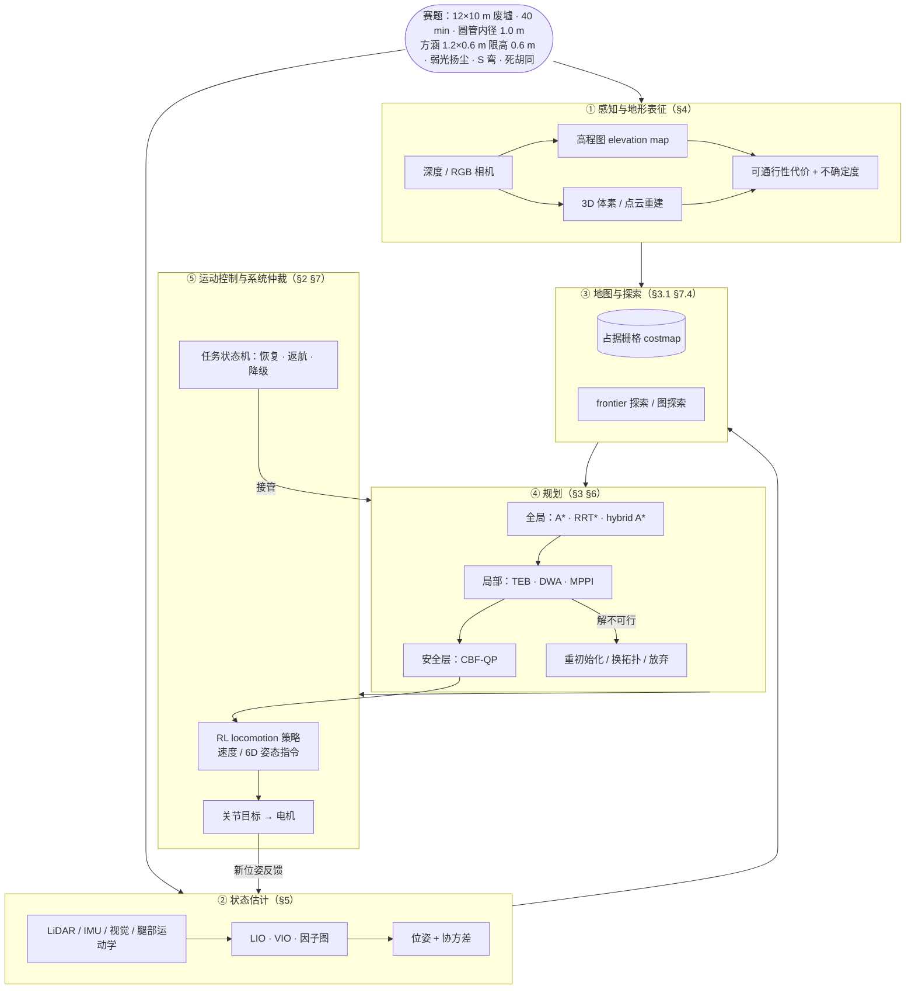
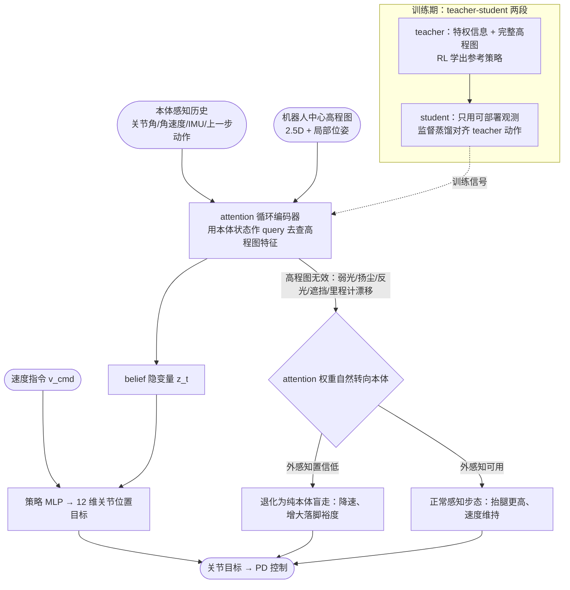
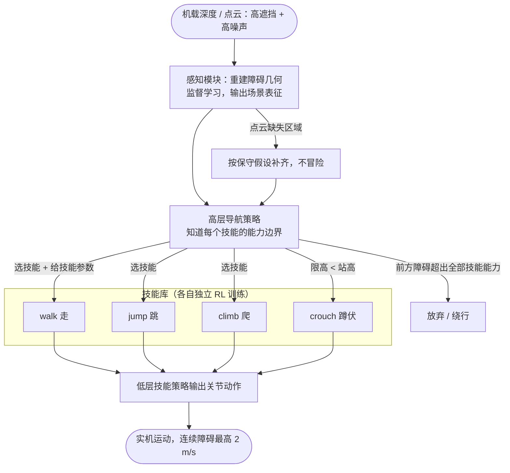
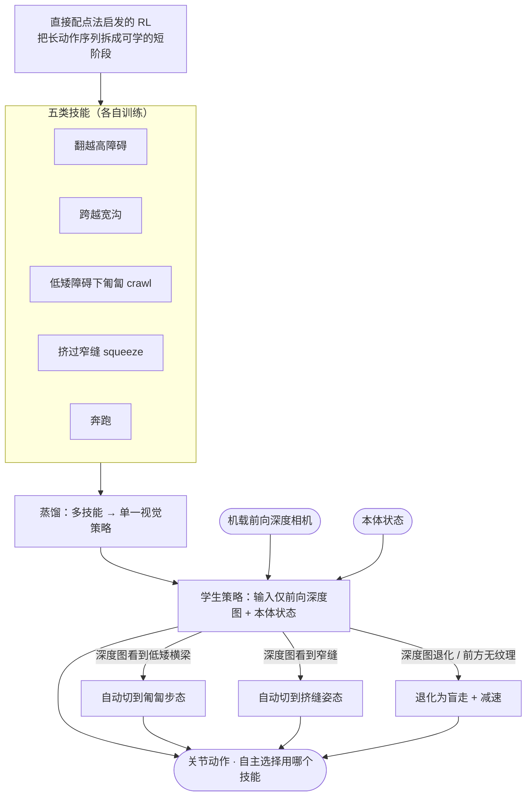
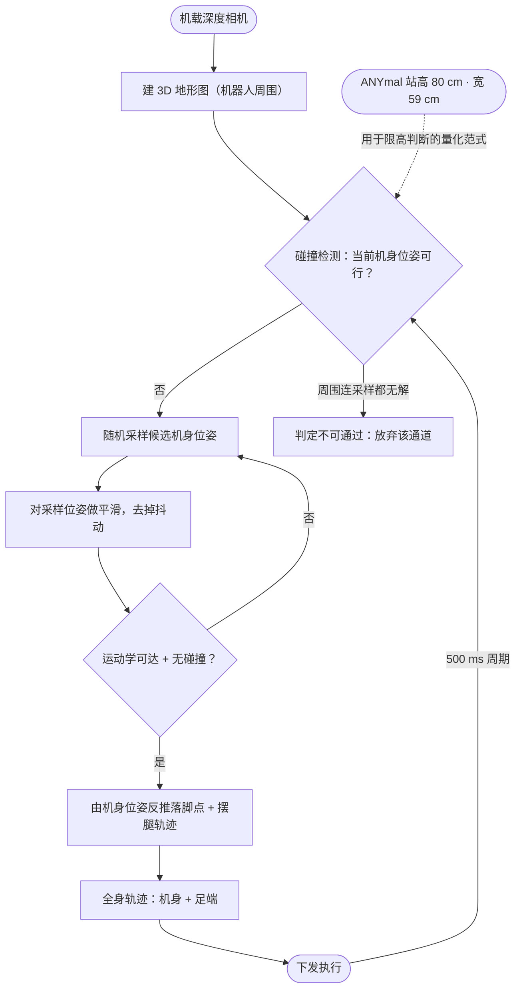
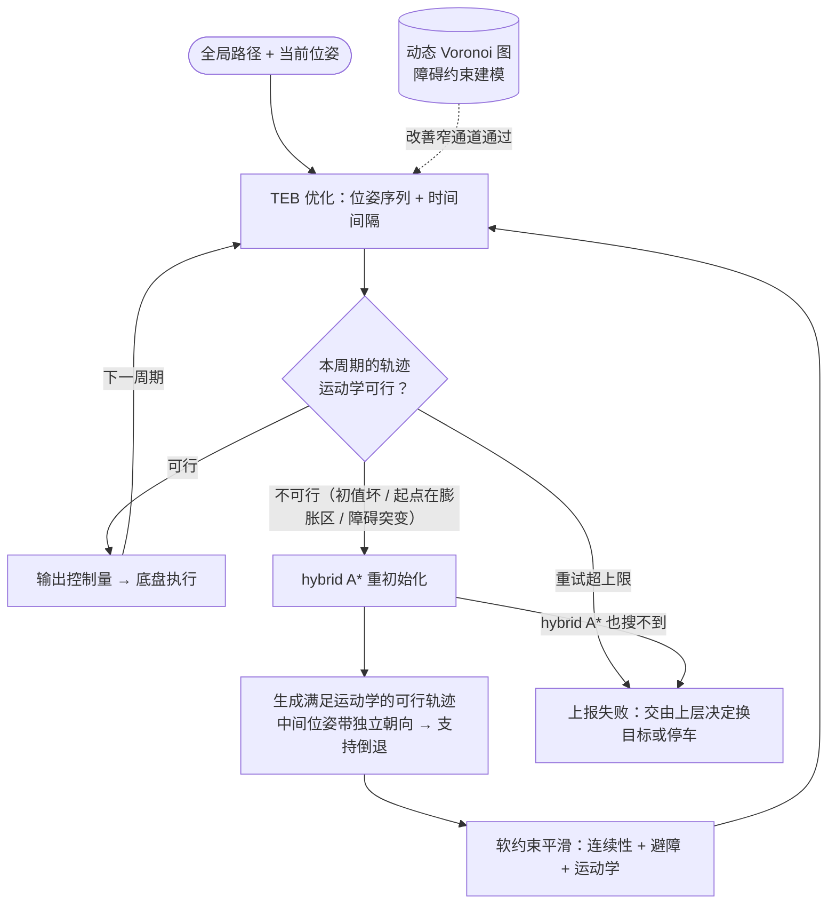
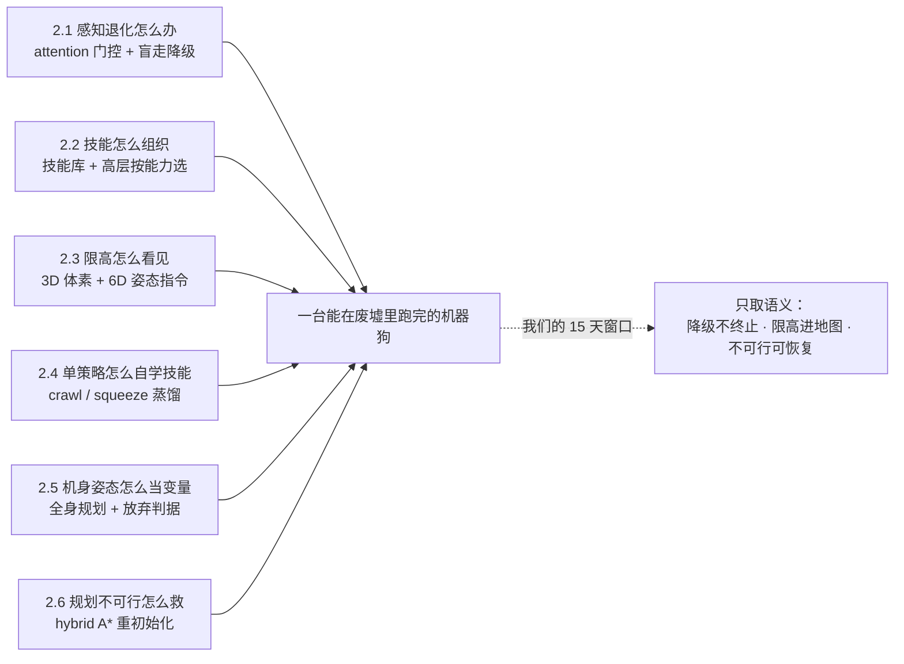

# 四足机器狗导航避障：逐篇论文流程图讲解

版本 v1.0｜2026-11-12｜配套文档：`plan/四足机器人导航避障文献综述与选型建议.md`（下称「综述」）

---

## 0. 这份文档是什么，怎么读

### 0.1 定位

综述回答「**该引谁、为什么**」；这份文档回答「**那篇论文内部到底怎么转起来的**」。

- 每一篇给**一张流程图**，画的是「输入 → 每个模块吃掉什么、吐出什么 → 输出」，不是论文标题的方框搬运。
- 每张图后面固定四段：`图里读什么`（节点为什么存在）、`赛场映射`（落到我们 12×10 m 废墟赛道的哪一处）、`边界`（什么条件下它不成立）。
- **字段纪律沿用综述**：作者/年份/venue/arXiv/DOI 全部照抄综述的已核实字段；综述写「未核实」的，这里也写「未核实」，不补全、不推测。本文件不新增任何未标源的字段。

### 0.2 三条读法（按你的目的选一条，不要从头读到尾）

| 目的 | 读哪些 | 大约耗时 |
|---|---|---|
| **15 天工程落地**（当前 `start_blocked` 卡点） | §2.6 RTEB → §7.4 GBPlanner → §6.3 TEB 多拓扑 → §9.3 恢复流程 | 40 分钟 |
| **写研制报告书的理论依据** | §1 论文地图 → §2 六篇必读 → §4、§6 两组的「边界」段 | 2 小时 |
| **补算法底子** | §3（经典与基线）→ §5（定位）→ §6（规划）顺序读 | 半天 |

### 0.3 图例约定

| 形状 | 含义 |
|---|---|
| `(["圆角"])` | 外部输入 / 最终输出（传感器、指令、动作） |
| `["方框"]` | 一个处理模块（网络、优化器、状态机节点） |
| `{"菱形"}` | 判断 / 分支条件 |
| `[("圆柱")]` | 持久化数据（地图、栅格、日志、事件表） |

全文的**失败分支统一画在下侧或右侧**，用「失败 / 退化 / 放弃 / 回退」字样标注——这是本队最需要的一类边，不要跳过。

### 0.4 编号体系

- §2 必读 6 篇（Lead 亲写，最重要）
- §3 经典与基座 9 篇｜§4 感知/地形/落脚点 8 篇｜§5 定位与 SLAM 7 篇
- §6 局部规划与 TEB 谱系 9 篇｜§7 系统级灾害响应 6 篇｜§8 前沿与国内资料 9 篇
- §9 横切对比（把前八节压成 3 张决策图）｜§10 引用边界

合计 **54 篇**（含 §3.2 与 §2.1 的重复项已去重）。

---

## 1. 先看全局：这 54 篇落在同一条链路的哪里

### 1.1 五层论文地图



### 1.2 这张图暴露的三件事

1. **文献量分布极不均匀**：④规划层和 ①感知层各十几篇，②状态估计 7 篇，但**⑤里的「系统仲裁 / 恢复语义」只有 §7 那 6 篇**——而这正是我们 `start_blocked` 卡住的地方。文献不缺，是我们没把 §7 的语义接进代码。
2. **两条完全不同的技术路线在图里是并联的**：上支（高程图 → costmap → TEB，经典机器人栈，我们现在的 `navigation_core` 走这条）和下支（原始深度 → RL 策略直出关节，§2.1/§2.4/§8.1 走这条）。两者不是替代关系，是「同一台狗上的两层」，混着用要先定接口。
3. **限高这一维只有三篇真正覆盖**：§2.3（3D 体素 + 6D 指令）、§2.4（crawl / squeeze）、§4.6（可变形包围盒）。2.5D 高程图对悬垂障碍是**结构性盲区**，不是精度问题。

### 1.3 章节索引

| 章节 | 内容 | 篇数 | 对应我们方案的哪块 |
|---|---|---|---|
| §2 | 必读 6 篇 | 6 | 理论主干 |
| §3 | 经典与基座：A* → RL 训练框架 | 9 | `plan_grid` / TEB 初值 / 前沿探索 / 训练基座 |
| §4 | 感知、地形与落脚点 | 8 | 高程图 / 限高 / 承载 / 落足 |
| §5 | 定位与 SLAM | 7 | 退化感知 / 重定位（真机无 LiDAR，只取语义） |
| §6 | 局部规划与 TEB 谱系 | 9 | `start_blocked` 恢复 / S 弯换侧 |
| §7 | 系统级灾害响应 | 6 | 任务状态机 / 放弃判据 / 返航 |
| §8 | 前沿与国内资料 | 9 | 趋势判断 + 国内可直连引用 |
| §9 | 横切对比 | — | 三张决策图 |
| §10 | 引用边界 | — | 写报告书时的红线 |

---

## 2. 必读 6 篇

> 一句话导读：这 6 篇是「机器狗在废墟里能不能靠得住」的六块拼图——**感知退化怎么办（2.1）、技能库怎么组织（2.2）、限高怎么看见（2.3）、单个策略怎么自学技能（2.4）、机身姿态怎么当规划变量（2.5）、规划器不可行怎么救（2.6）**。2.6 直接对应我们当前卡点，可以最后读但必须读。

### 2.1 Learning robust perceptive locomotion for quadrupedal robots in the wild

**一句话**：用 attention 把「本体感知历史」和「高程图」融成一个 belief 隐变量，让策略在外感知失效时**自己学会忽略它**，平滑退化为盲走，而不是崩掉。

**出处**：[已核实] Takahiro Miki, Joonho Lee, Jemin Hwangbo, Lorenz Wellhausen, Vladlen Koltun, Marco Hutter｜2022｜*Science Robotics* 7(62): eabk2822｜`arXiv:2201.08117`｜DOI `10.1126/scirobotics.abk2822`｜官方代码仓库未核实

**流程图**



**图里读什么**

1. **不是「融合」而是「门控」**：attention 的作用是让网络自己决定这一帧高程图信几分。硬编码的加权融合在传感器坏掉时会持续灌噪声，门控式融合会做减法。
2. **训练和部署的观测不一样**：teacher 看特权信息，student 只看能上机的量，两点之间靠蒸馏对齐。这是 ETH 系（2.2/2.3/2.4 同源）的标准套路。
3. **两个出口都在图里**：同一个网络同一套权重，输出的是「感知步态」还是「盲走步态」，取决于隐变量 z_t 落哪边，没有显式的模式切换开关——所以退化是**平滑**的，这才是野外能用的原因。
4. 阿尔卑斯 1 小时徒步（按人类徒步推荐时间走完）是这套设计最强的验收：全程光照/地形都在变。

**赛场映射**：弱光 L3 挑战、废墟扬尘、坡道乱石处深度相机短暂失效——这三点在我们的赛道上不是「可能发生」，是「必然发生」。工程上直接对应 `navigation_core` 里「感知帧不可信时降速 + 继续走」而不是「停车等感知」，也就是把「传感器异常」从**终止条件**降级为**降级条件**。

**边界**：①它是端到端策略，不可解释、不能直接改「哪一步不信高程图」；②训练需要 Isaac Gym 级算力，我们 15 天做不出来；③论文的「graceful degradation」是**训练出来的统计行为**，不保证覆盖我们这种「相机被灰浆糊住」的极端样本。**用法建议：取它的设计语义（门控 + 降级 + 降速），不取它的模型。**

### 2.2 ANYmal Parkour: Learning Agile Navigation for Quadrupedal Robots

**一句话**：全学习式三层——感知模块从严重遮挡的噪声点云重建障碍、运动模块提供走/跳/爬/蹲伏技能库、高层策略按场景**选技能并规划**，实机连续障碍 2 m/s。

**出处**：[已核实] David Hoeller, Nikita Rudin, Dhionis Sako, Marco Hutter｜arXiv 2023-06 / 期刊 2024-03｜*Science Robotics* 9(88): eadi7566｜`arXiv:2306.14874`｜DOI `10.1126/scirobotics.adi7566`｜项目页 `https://sites.google.com/leggedrobotics.com/agile-navigation`｜官方代码仓库未核实

**流程图**



**图里读什么**

1. **高层知道低层的能力**：高层策略的观测里包含各技能的可执行性，所以它不是「盲目选」，而是「按能力分配」。这是分层相对端到端的核心优势，也是我们能借鉴的组织方式。
2. **crouch 是独立技能，不是参数的连续变化**：蹲伏被当成一个离散技能训练，说明「限高通行」在技能空间里就该占一格，而不是让速度策略去硬凑。
3. **感知模块是单独监督训练的**，不靠 RL 端到端学重建——所以它能处理「高度遮挡」：先补全几何，再决策。
4. **不需要专家示范、不需要离线计算、不需要先验环境**，这是它对 field robotics 最实际的贡献。

**赛场映射**：与 12×10 m 废墟救援在**系统级**最贴合的一篇：crouch ↔ 方涵 0.6 m 限高；高层技能选择 ↔ S 弯/死胡同的方向决策；感知重建 ↔ 乱石堆与遮挡；2 m/s ↔ 40 分钟时限内的通行效率。写研制报告书时，「分层 + 技能库」这一段可以直接引它。

**边界**：①纯仿真训练，sim-to-real 靠域随机化，实机换平台（我们 Lite2 与 ANYmal 差一个量级）需要重训；②技能库是**离线确定**的，赛场上遇到库里没有的地形就是没有；③整套要 GPU 训练，15 天不可复制。**取结构，不取权重。**

### 2.3 Learning to walk in confined spaces using 3D representation

**一句话**：明确指出 **2.5D 高程图对顶部悬垂障碍是盲的**，改用 3D 体素；低层稳健跟随 6D 指令（含机身高度、roll/pitch），高层基于 3D 空间感知规划姿态，从悬垂障碍下钻过去。

**出处**：[已核实] Takahiro Miki, Joonho Lee, Lorenz Wellhausen, Marco Hutter｜2024｜*ICRA 2024*（arXiv Comments: Accepted to ICRA 2024）｜`arXiv:2403.00187`

**流程图**

```mermaid
flowchart TD
    A(["L1 任务层：目标点 / 方向"]) --> H["高层策略：3D 空间感知"]
    V[("3D 体素表征<br/>机器人周围体素占用")] --> H
    H -->|"输出 6D 指令"| L["低层策略：稳健跟随 6D 指令"]
    P(["本体感知历史"]) --> L
    L --> O(["关节动作"])

    subgraph C6["6D 指令的六维"]
        C1["前进速度"]
        C2["横移速度"]
        C3["偏航角速度"]
        C4["机身高度"]
        C5["roll"]
        C6["pitch"]
    end
    H -.-> C6
    C6 -.-> L

    G["程序化地形生成器<br/>碎石 / 不稳定台阶 / 倾斜顶部结构"] -->|"训练环境"| H
    G -->|"训练环境"| L

    H -->|"前方体素净空 < 当前机身高度"| D1["输出低机身高度 + 侧倾的 6D 指令"]
    D1 --> L
    H -->|"净空连蹲伏都不够"| D2["放弃该通道，回上层改目标"]
    V -->|"体素稀疏 / 观测缺失"| D3["保守假设：视为有障碍"]
    D3 --> H
```

**图里读什么**

1. **「高度」进了指令空间**：6D 指令里的机身高度、roll、pitch 是策略要跟踪的量——这意味着「蹲下来」不再是失败，而是一个正常的控制目标。这是与 2.5D 方案最本质的区别。
2. **3D 体素是必需的，不是升级选项**：2.5D 高程图对每个 XY 只存一个高度值，悬垂障碍在它上面**根本不产生数据点**。圆管顶壁、方涵顶板、塌落楼板全都落在盲区里。
3. **低层只负责「跟随」，高层负责「想」**：分工让低层可以在多种地形上保持稳健（同一个低层策略重复用），高层换任务不用重训低层。
4. **程序化地形生成器是隐藏的关键**：训练分布决定了策略会不会在「半坍塌楼板」上崩，这直接影响我们做 MuJoCo 场景随机化时的设计。

**赛场映射**：**圆管（内径 1.0 m）+ 方涵（1.2×0.6 m，限高 0.6 m）+ 隧道限高最对口的一篇**。落到工程上是三件事：①`terrain_map.npz` 若只有单层高度，就必然判不出限高，需要补一层「顶部净空」；②规划器输出要能带「机身高度指令」；③姿态不能再当常数。

**边界**：①3D 体素的内存与算力开销比 2.5D 高一个档，我们机上（Lite2 级别）不一定扛得住；②它验证在 ANYmal-C/D（站高约 80 cm、体宽约 60 cm），我们的狗更小，「蹲伏」的绝对余量不同；③第三方提到在模拟 `collapsed building` 上部署，这属于**第三方解读**，不是摘要原文，报告里引用要标明。

### 2.4 Robot Parkour Learning

**一句话**：用受 direct collocation 启发的 RL 生成五类跑酷技能（含 **crawling beneath low barriers** 与 **squeezing through thin slits**），蒸馏成一个**只用前向深度相机**的端到端视觉策略，两台低成本四足实机自主选技能。

**出处**：[已核实] Ziwen Zhuang, Zipeng Fu, Jianren Wang, Christopher Atkeson, Soeren Schwertfeger, Chelsea Finn, Hang Zhao｜2023｜*CoRL 2023 (Oral)*（arXiv Comments 明确）｜`arXiv:2309.05665`｜项目页 `https://robot-parkour.github.io`｜仓库 `https://github.com/ZiwenZhuang/parkour` 由第三方资料指向，仓库本身未抓取核实

**流程图**



**图里读什么**

1. **crawl 与 squeeze 是论文级原文术语**（摘要明写 `crawling beneath low barriers`、`squeezing through thin slits`），不是我们的引申——这是写报告时最硬的一句话。
2. **只用前向深度相机，不用高程图、不用 VIO、不用动物动作参考数据**：对算力受限平台意义极大，我们 Lite2 的感知配置比 ANYmal 简单一个档次，这一篇是「低配也能干」的证据。
3. **技能不是被调度器选的，是被策略自己学的**：蒸馏后没有显式状态机，「看到横梁就趴下」是端到端学出来的反应。好处是反应快，坏处是**不可解释、无法插规则**。
4. 两台**不同**低成本实机都能跑通，说明策略不是对某一台机器的过拟合。

**赛场映射**：crawl + squeeze 是圆管/方涵隧道**最直接的论文级对应**；单一策略自主选技能可用于 S 弯 + 死胡同的连续决策；免高程图适合我们这种算力受限的小平台。如果只能引一篇来支撑「机器狗可以趴着过方涵」，引它。

**边界**：①它解决的是「单个障碍的通过」，不是「在未知废墟里找路」——没有全局导航、没有探索、没有回环，和我们的任务层级不同；②匍匐是固定高度假设，方涵 0.6 m 是否够它爬，要看具体机型，论文没给我们的平台结论；③仓库未核实，复现风险高；④我们 15 天内不可能重训这套。

### 2.5 Perceptive whole-body planning for multilegged robots in confined spaces

**一句话**：把**机身位姿当规划变量**——机载深度建 3D 地形图，随机采样机身位姿并平滑，同时生成机身位姿、落脚点与摆腿轨迹，满足运动学与碰撞约束，在线 500 ms 重规划 3 m 轨迹。

**出处**：[已核实] R. Buchanan et al.（L. Wellhausen, M. Bjelonic, T. Bandyopadhyay, N. Kottege, M. Hutter）｜2021｜*Journal of Field Robotics* 38(1): 68–84｜DOI `10.1002/rob.21974`（ETH Research Collection、OpenAIRE、CSIRO、Google Scholar 四处一致）｜无 arXiv｜官方代码仓库未核实

**流程图**



**图里读什么**

1. **机身位姿是决策变量**：不是「先选落脚点再摆机身」，而是「先定机身能待在哪，再验腿能不能落地」。方向反了，窄空间就过不去。
2. **随机采样 + 平滑**：采样保证覆盖多模态解（左倾/右倾都能过），平滑保证轨迹能用——这是它相对纯采样的工程优势。
3. **有明确的「放弃」出口**：连采样都无解就判不可通过。我们「隧道1 过窄 0.2 m 应识别并放弃」的判据，就是这一条的工程翻译。
4. **50 cm 一支的余量关系是量化范式**：站高 80 cm、宽 59 cm 的机器过 60 cm 开口——余量只有 1 cm 级。我们算「圆管 1.0 m 能不能过」时应该照这个格式写：`机体外廓（含腿摆幅）vs 通道最窄净空`，而不是拍脑袋。

**赛场映射**：直接对应「隧道1 过窄 0.2 m 应识别并放弃」「圆管 1.0 m」「方涵 1.2×0.6 m」的**通行/放弃判据**。这是六篇里唯一一篇把「过不去怎么办」写成算法的。

**边界**：①计算量大（随机采样 + 平滑 + 全身轨迹），机载算力要求高，500 ms/3 m 已经是优化后的结果；②需要高质量 3D 地形图，弱光扬尘下建图退化会直接传导成规划失败；③它假设地形是**静态**的，坍塌中的废墟不满足。

### 2.6 Resilient Timed Elastic Band Planner (RTEB)

**一句话**：正面回答「**初始规划器的解变得不可行怎么办**」——每个周期检查轨迹可行性，不可行就用 hybrid A* 生成可行轨迹 + 软约束平滑，**重新初始化 TEB**；窄通道用动态 Voronoi 改善，中间位姿带独立朝向支持**前进/倒退双向**。

**出处**：[已核实] G. Kulathunga, A. Yilmaz, Z. Huang, I. Hroob, …, M. Hanheide｜2025｜*Journal of Field Robotics* 42(7): 3902–3917｜DOI `10.1002/rob.22602`｜`arXiv:2412.03174`｜代码未核实（论文声明基于 ROS2 navigation stack 验证）

**流程图**



**图里读什么**

1. **「不可行」被当成一个可处理的中间状态，不是终态**：这是整篇论文对我们最值钱的一句话。我们现在的 `start_blocked` 恰恰是把「不可行」写成了终态。
2. **重初始化用的是另一种算法**：TEB 是局部优化（依赖初值），hybrid A* 是带运动学约束的搜索（不依赖初值）。用搜索救优化，是这条链的设计核心。
3. **双向朝向**：中间位姿各自带朝向，允许倒退。死胡同里「倒着出来」在数学上是合法的轨迹，不需要特殊状态。
4. **动态 Voronoi 是窄通道的关键**：Voronoi 图让轨迹倾向走通道中线，天然避免贴墙擦碰——我们「S 弯净宽 1.2 m」的通行质量直接受益。
5. 论文表格明确列出 TEB 的三个缺陷：挑战环境成功率低、朝向受限、窄缝处理差。这给了我们「为什么改」的引用依据。

**赛场映射**：死胡同倒退 + S 弯净宽 1.2 m + 隧道口识别放弃 + TEB 两大劣势，**一篇全中**。它就是我们 `start_blocked` 阻塞的答案本体：把「起点落在 0.28 m 膨胀区」→ 短距脱困 → 重生成初值 → 再规划，这条流程有文献级先例。

**边界**：①需要 ROS2 navigation stack 环境，我们 Windows + MuJoCo 栈要**翻译语义**而不是移植代码；②hybrid A* 重初始化本身有计算峰值，实时性靠工程调；③它不解决「通道根本不可通过」——那种情况仍要上层放弃；④代码未核实，无法直接借用。

### 2.7 六篇的关系（一张图收口）

