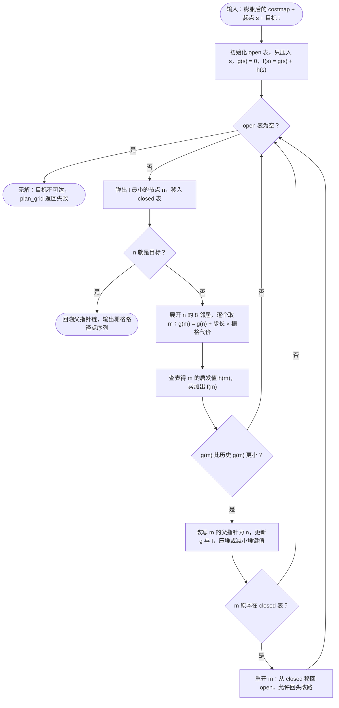
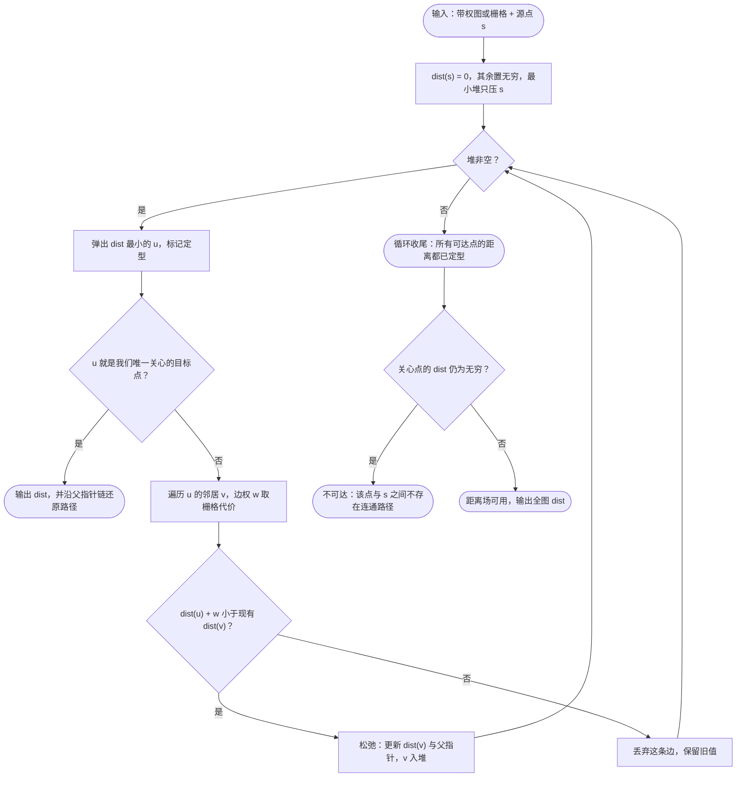
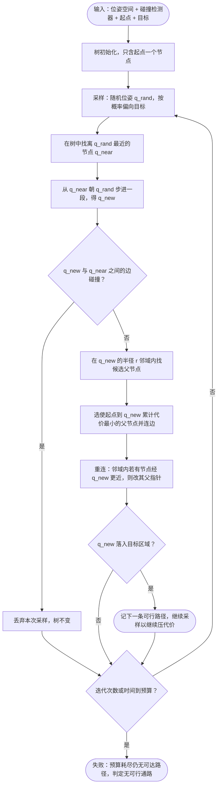
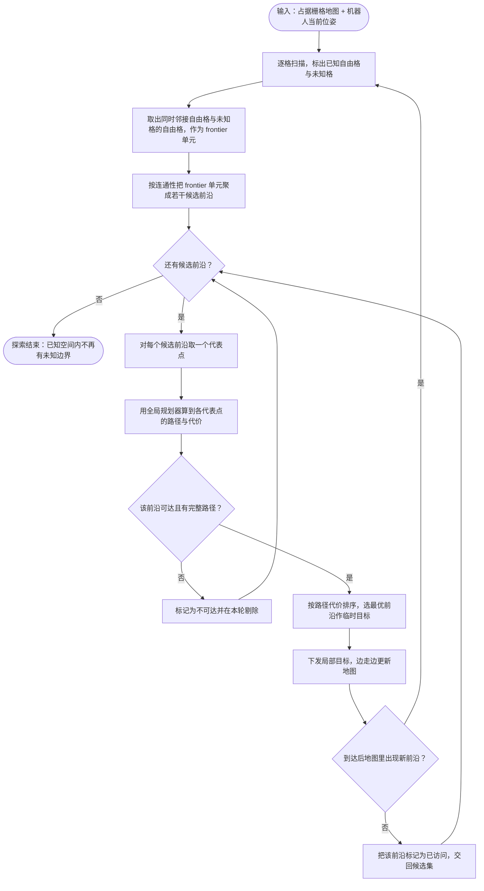
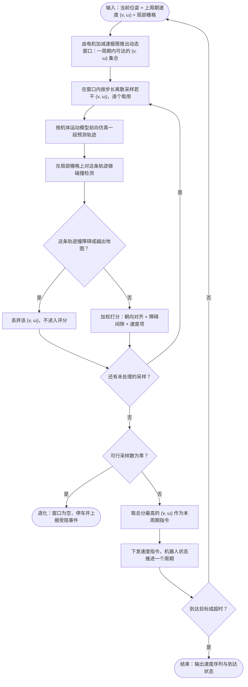
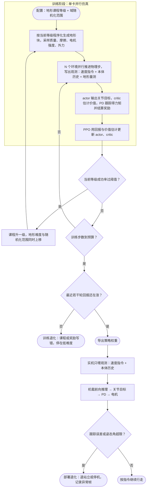
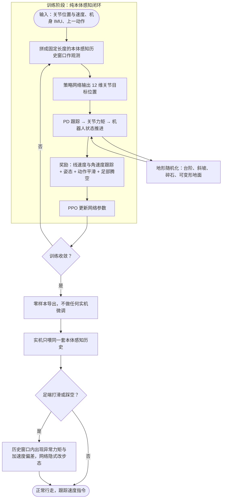
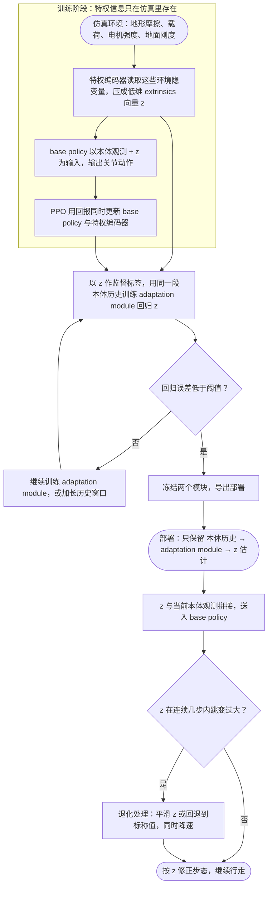
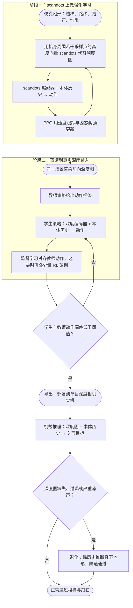

## 3. 经典与基座：从 A* 到 RL 训练框架

> 一句话导读：这一组不是「论文精选」，而是我们方案里 plan_grid、TEB 初值、前沿探索、训练基座四类组件的**出处**。读法：先看图，再看「赛场映射」，最后看「边界」。

### 3.1 A*：A Formal Basis for the Heuristic Determination of Minimum Cost Paths

**一句话**：把「最短路搜索」写成可采纳启发式下的一次图搜索，并给出 A* 的形式定义与最优性条件 —— 我们 `plan_grid` 在 costmap 上生成 TEB 初始全局路径的算法出处。
**出处**：[已核实] Hart, Nilsson, Raphael｜1968｜*IEEE TSSC* 4(2):100–107｜DOI `10.1109/TSSC.1968.300136`｜无 arXiv｜无官方仓库（工程实现走 ROS `global_planner`）

**流程图**

**图里读什么**
1. 真正的状态只有两样：open 表（候选 + f 值）和 closed 表（已定型）。图上所有箭头都是在做「插入 / 降键 / 重开」这三件事，没有别处藏状态。
2. `步长 × 栅格代价` 这一项就是代价流进路径的唯一入口 —— 膨胀层、粗糙度、坡度全写在这里；把它换成 0/1，A* 立刻退化成分层 BFS。
3. h 决定速度也决定最优性：可采纳时 f 是真实代价下界，保证第一次弹出目标即最优；图上「f(m) 更小就改父指针」说明这是带降键的实现，不是一次性访存的贪心。
4. 重开分支是最容易在工程里被删掉、也最该保留的一支：h 不满足一致性时，已进 closed 的节点仍可能被更短路径找到，删了它就直接返回次优路径。
5. 终止只有两个出口。`open 为空` 是「不可达」的**证明**，不是超时也不是失败——它和我们 `start_blocked` 那种「一个终态吃掉整段任务」的语义正好相反。

**赛场映射**：`plan_grid` 全局段（costmap 上的 A* 起终点）；膨胀半径 0.28 m 直接作用在 `栅格代价` 那一项上，也是「估计位姿贴墙 → 起点落入膨胀区」的物理开关。TEB 再换，这一层作为初值来源也要留。
**边界**：8 邻域栅格中心连出的路径是 45° 折线，曲率不连续，必须后处理平滑才喂得动 TEB；不处理动态障碍、不做 3D、不感知限高；栅格一大，重规划频率就撑不住。

### 3.2 Dijkstra：A note on two problems in connexion with graphs

**一句话**：一篇短文同时给出「两点间最短路」与「连通全图的最小生成树」两个问题的算法，前者即无边无启发式的距离传播 —— 我们算「到障碍 / 到目标距离场」和「连通性判定」的出处。
**出处**：[已核实] Dijkstra｜1959｜*Numerische Mathematik* 1(1):269–271｜DOI `10.1007/BF01386390`｜无 arXiv｜无官方仓库

**流程图**

**图里读什么**
1. 图上没有启发式，也没有「估计」：唯一的排序键就是 dist。某个点被弹出的那一刻，它的距离即成终值——这是整篇正确性的全部内容。
2. 与 A\* 的唯一差别是 f = g 而非 g + h。同一张图上把 h 置零就退回 Dijkstra，反过来看 A\* 省掉的正是「全图铺开」这部分工作量。
3. 边权 w 的定义就是它的用途：w = 1 得跳数，w = 栅格 cost 得代价场，w = 到源点的欧氏长度得距离场。我们要的距离场属于第三种。
4. 出口有三种、性质不同：命中关心点可提前收（对应原文的「两点间最短路」问题），堆空则全图定型（对应「距离场」用法），而「dist 仍为无穷」是纯拓扑结论——等于证明不连通，不含时间预算也不含传感器质量。
5. 它和 A\* 摆在一起时该怎么选：Dijkstra 一次算完能回答「任何点」，A\* 一次只回答「到这一个目标」；我们要复用距离场时选前者，要单目标快出路径时选后者。

**赛场映射**：膨胀层外侧距离场（前沿评分、受阻后的撤退方向选择）；「隧道1 过窄应识别并放弃」里通路是否连通的判定；以及没有可用启发式时的全局段兜底。
**边界**：全图扩散、无目标导向，栅格一大就比 A\* 慢一个量级；同样不解动态障碍与 3D 限高；内存与时间都随栅格数线性以上增长，12×10 m 够用，再大要分块。

### 3.3 RRT*：Sampling-based Algorithms for Optimal Motion Planning

**一句话**：先证明 PRM / RRT 只是概率完备而非渐近最优，再提出 PRM\* 与 RRT\*：加入邻域重连后代价几乎必然收敛到最优，计算复杂度只多一个常数因子 —— 我们用它在圆管 / 方涵内做「是否存在可行通路」的存在性判定。
**出处**：[已核实] Karaman, Frazzoli｜2011｜*IJRR* 30(7):846–894｜DOI `10.1177/0278364911406761`｜`arXiv:1105.1186`（arXiv Comments 明确 to appear in IJRR，v1 2011-05-05，76 页）｜无官方仓库

**流程图**

**图里读什么**
1. 结构上是双重循环：外层采样、内层「选父 + 重连」。RRT 只有选父，RRT\* 多出来的重连才是渐近最优的全部来源。
2. 半径 r 是理论落点：r 要随样本数按对数比衰减才保证最优性；工程上固定一个小 r 只是好用，不保证收敛——读这张图时要能分出「可用的实现」与「有保证的算法」。
3. 每一条进入树的边都通过了碰撞检测，所以树本身是一份**可行性证据**，而不只是一条路径候选。这正是它比栅格规划更适合回答「能不能过」的原因。
4. 失败分支是预算耗尽，不是不可达：采不到路径只能说「在给定预算内没找到」，说不了「不存在通路」。这个差别必须写进放弃判据的措辞里。
5. 命中目标后不停止（还会继续降代价）。要停就是「首次可行即停」，那是牺牲最优性换响应时间，是另一种算法。

**赛场映射**：圆管内径 1.0 m、方涵 1.2×0.6 m 的通行性判定，输出「可通行 / 建议放弃」而不是路径；S 弯处不同绕行拓扑的可行侧判断；`start_blocked` 之后判断「换一条路是否还存在」。
**边界**：采样算法没有下界保证；窄通道内采样效率骤降（瓶颈就是 r 与步长）；高维需大量样本；不适合当实时控制器，只宜做低频或离线的可行性判定。

### 3.4 Frontier 探索：A frontier-based approach for autonomous exploration

**一句话**：首次把「前沿 frontier = 已知自由空间与未知空间的边界」定义为探索目标，用「走到最近前沿」驱动地图自主扩张 —— 我们 `--explore` 契约里选点、标记、终止三件事的出处。
**出处**：[已核实] Yamauchi｜1997｜*CIRA'97* pp.146–151｜DOI `10.1109/CIRA.1997.613851`｜无 arXiv｜原始论文无代码，ROS `frontier_exploration` 的实现对应关系未核实

**流程图**

**图里读什么**
1. 输入只有一张占据栅格和当前位姿，输出只有「下一个去哪」，不产生任何速度指令——它天生是决策层。
2. 排序发生在规划之后：所谓「最近的 frontier」是**路径代价**最小，不是几何最近。少算这一步规划，就会去选直线上近、实际被墙挡住的那个。
3. 两个出口性质完全不同：`没有候选前沿` 是探索的自然结束（真结论）；`前沿不可达` 是本轮剔除后继续（可恢复事件）。第二条正是我们缺的语义——单点失败不该终止整段任务。
4. 前沿代表点的取法（质心 / 最近格）决定目标会不会顶到墙上；源文件特别强调该方法能处理狭窄杂乱空间与任意朝向的墙壁，靠的正是每轮重算而不是一次规划到底。
5. 图上没有「已访问但实际没走到」的回退路径：这是原方法的空白，工程实现必须自己补上重试上限与状态回滚。

**赛场映射**：`--explore` 契约（前沿选点、已访问标记、探索终止判据）；12×10 m 废墟内的分区覆盖；S 弯之后新开区域的接入；左廊道选点选到身后这一具体故障的定位基准。
**边界**：不知道前沿后面是否真能走；无朝向 / 视野收益，容易在两条前沿之间来回 thrashing；无成本代价概念，需自加膨胀与重试；1997 年的实现假设是声呐栅格，换到深度相机建图要重做栅格更新。

### 3.5 DWA：The Dynamic Window Approach to Collision Avoidance

**一句话**：把避障写成「在速度空间 (v, ω) 里采样 + 前向仿真 + 加权打分」，只保留一个周期内加减速可达的动态窗口 —— TEB 计算量过大时的降级替代基线。
**出处**：[已核实] Fox, Burgard, Thrun｜1997｜*IEEE RAM* 4(1):23–33｜DOI `10.1109/100.580977`｜无 arXiv｜工程实现 ROS `dwa_local_planner`

**流程图**

**图里读什么**
1. 唯一真正在流动的量是 (v, ω)：输入是它，窗口是它的可达集，采样是它的离散化，输出还是它。位姿只当仿真起点用，不回写。
2. 动态窗口约束的是执行器不是障碍：上周期速度 + 当前加减速极限 = 本周期候选集。所以它天然不会给出「突然横移」这种物理上做不到的指令。
3. 三个打分项的权重就是全部可调参数：朝向项管走直、间隙项管贴障、速度项管快慢。调参本质是在这三者之间换配额，算法本身没有别的自由度。
4. 最关键的分支是 `可行采样数为零`：窗口为空意味着被围住或缝比机身窄，此时它只会停车，没有倒退、没有换侧、没有重规划——这是它作为降级方案的硬上限。
5. 预测时域只有一段：长于时域的死胡同它看不见。这也是它与 TEB、MPPI 的分水岭，不是调参能补的。

**赛场映射**：分级降级链「TEB → DWA → 停车观察」的中间一级；动态障碍突然切入时的最低成本避让；方涵 / 圆管口前低速试探；`start_blocked` 事件发生时若 TEB 已不可用，DWA 至少能给出一组「不撞」的速度。
**边界**：纯局部，会卡在 U 形陷阱；窗口为空无恢复行为；单拓扑，不做左右换侧；预测轨迹不含四足摆动腿的体积变化。具体权重、预测时域与窗口大小的取值本次未核实（源文件未给出）。

### 3.6 Learning to Walk in Minutes（legged_gym / rsl_rl 训练基座）

**一句话**：在单卡上并行仿真数千个机器人，把 ANYmal 的平地训练压到 4 分钟内、复杂地形 20 分钟，并给出游戏启发的课程学习 —— 我们 `randomization.py` 的参数与整个训练基座的出处。
**出处**：[已核实] Rudin, Hoeller, Reist, Hutter｜CoRL 2021 / PMLR v164:91–100｜`arXiv:2109.11978`（Comments 明确 CoRL 2021 并声明开源训练代码）｜代码 `https://github.com/leggedrobotics/legged_gym` + `https://github.com/leggedrobotics/rsl_rl`（BSD-3，arXiv 声明与官方 README 双重核实）

**流程图**

**图里读什么**
1. 参数流动的主线只有一条：课程等级 + 随机化范围 → 环境 → 观测 → 动作 → 奖励 → PPO 更新。「几千个并行」只是把这条线在一个 GPU 步里复制 N 份，线本身没变。
2. 域随机化写在地形生成与物理参数里（质量、摩擦、电机强度、外力），**不写进观测**。策略看到的是指令与本体历史，学到的是鲁棒而不是「识别当前地面是哪种」。
3. 奖励项与地形课程是同一个旋钮的两端：课程给「多难」，奖励给「怎么过去」的偏好。PPO 只看到标量回报，所以改奖励就是改整条学习曲线的形状。
4. 升不升级是闭环判据：成功率够了才升，不够就在同一等级继续刷样本。这也是「几百次随机化采样」成本的真正来源——成本不在网络，在课程判定回环。
5. 两个退化出口要分开归因：训练侧曲线不涨，是课程或奖励写错；部署侧跟踪误差 / 姿态超限，是 sim-to-real 差距在实机厚度上暴露，此时改策略无用，只能改随机化范围。

**赛场映射**：`randomization_sampled.provenance` 的 `vendor_reference` 落到本文档条目；地形课程对应 5 处 4–12 cm 乱石与 0.45 m 坡道；作为 teacher-student / DAgger 蒸馏（3.7–3.9 全部）的公共底座；`rsl_rl` 的观测分组直接对应我们的 ONNX 输入契约。
**边界**：`legged_gym` 需 Isaac Gym Preview + Python 3.6–3.8 + CUDA，本机 Windows / Py3.12 **不支持**，可读代码不能跑；`rsl_rl` 纯 PyTorch、本机最可能跑通（Python 3.9+），Windows + Py3.12 实测未核实；任务只有速度跟踪，不含导航、避障与限高，机身高度指令无原生支持。

### 3.7 Learning Quadrupedal Locomotion over Challenging Terrain

**一句话**：只用本体感知历史流训练一个网络，实现零样本 sim-to-real，并在训练中从未见过的泥雪、碎石动态落脚点、厚植被与流水中保持鲁棒 —— 「本体感知也能过乱石」的实证基座。
**出处**：[已核实] Lee, Hwangbo, Wellhausen, Koltun, Hutter｜2020｜*Science Robotics* 5(47):eabc5986｜`arXiv:2010.11251`｜DOI `10.1126/scirobotics.abc5986`｜官方仓库未核实

**流程图**

**图里读什么**
1. 观测里没有任何外感知：只有关节、IMU、上一动作。它能在碎石上走，靠的是「踩下去之后从关节力矩和机身加速度读到地面软硬」，不是提前看见。
2. 历史窗口是唯一的记忆：把过去若干步拼成一个向量，等于给策略一个隐式状态估计器，替代了高程图。去掉窗口长度，这套方法立刻失效。
3. 地形随机化不进观测，只在仿真里换地面——策略学到的是「遇到不确定落脚点怎么试」，不是「这是哪种地面」。
4. 奖励里足部腾空与动作平滑两项决定了它不会被训成「拖脚蹭过去」；这也是后面所有 ETH 系工作的奖励基线，改它的收益比改网络结构大。
5. 退化分支落在同一处：打滑 / 踩空没有独立检测模块，全靠历史窗口里的异常力矩被网络内化。所以策略没有「报警」这个动作，只有步态变化——外部要从速度跟踪误差反推它已经退化。

**赛场映射**：弱光 / 扬尘导致外感知失效时的兜底层（配合 §2.1 的 graceful degradation 才完整）；5 处 4–12 cm 乱石与碎石动态落脚点；0.45 m 坡道；训练基座与奖励项直接可借 `legged_gym`。
**边界**：无外感知 → 不能提前避开悬垂障碍、不能识别隧道限高（那属于 3D 表示那一支）；不输出机身高度 / roll-pitch 指令；对状态估计质量高度敏感（本体感知仍需可靠 IMU 与编码器）；官方仓库未核实，复现只能借 3.6 的基座。

### 3.8 RMA: Rapid Motor Adaptation

**一句话**：把「适应」拆成 base policy 与 adaptation module：后者从一段本体历史在线估计环境隐变量 z 并回灌前者，使机器人在亚秒级内适应新地形与载荷（arXiv 摘要原文 fractions of a second；源文件记 0.5 s 历史窗口 / <1 s 适应）—— 我们「在线估计」而非「离线标定」的范式出处。
**出处**：[已核实] Kumar, Fu, Pathak, Malik｜RSS 2021（arXiv Comments 明确）｜`arXiv:2107.04034`｜项目页 `https://ashish-kmr.github.io/rma-legged-robots/`（arXiv 明确）｜训练代码未核实

**流程图**

**图里读什么**
1. 两个网络输入不同但对齐在同一个 z 上：特权编码器看的是仿真内部量（摩擦、载荷、电机强度），adaptation module 只能看本体历史，却要回归出同一个 z。这个约束就是全文的核心。
2. z 是低维隐变量，不是地形标签：它不告诉你「这是沙地」，只编码「当前动力学比标称偏软 / 偏重」。所以对没见过的地形也能给出合理外推，但也无法解释成可读参数。
3. 参数流动是单向的：仿真 → 特权编码器 → z → 监督 adaptation module。部署时特权编码器被整只丢掉，图上 `H → I` 就是这条断点，也是 sim-to-real 的全部风险所在。
4. 失败与退化的落点都在 z 上：估计跳变、更新延迟、或输入接近训练分布边缘时，策略动作会抖。工程第一件事是限制 z 的变化率，而不是改策略网络。
5. 没有外感知的入口：它解决的是「地形物理属性未知」，不是「障碍物未知」。后者必须靠视觉 / 高程图，这两件事在图上根本没有交集。

**赛场映射**：Lite2 实机穿越废墟碎石、湿滑地面、草地与载荷变化时的在线适应；不需要事先标定摩擦系数，正好给 `randomization_sampled` 里 `measured_pending` 项一个补法；亚秒级适应对应「进入新地形段不减速」。
**边界**：z 只覆盖训练时随机化的那几类隐变量，悬垂、限高、深坑这类**几何**未知它不知道；无外感知；无姿态 / 高度指令通道；起步瞬间历史窗口为空，是最容易出错的时段；训练代码未核实，只有项目页与视频。

### 3.9 Legged Locomotion in Challenging Terrains using Egocentric Vision

**一句话**：第一个只用单个前向深度相机、不建高程图也不用 VIO 的端到端视觉 locomotion 系统，两阶段训练（scandots 上 RL → 蒸馏成深度策略）通过楼梯、路缘、踏石与沟隙 —— 「视觉可以直接进策略」的证据。
**出处**：[已核实] Agarwal, Kumar, Malik, Pathak｜CoRL 2022 (Oral)，PMLR v205:403–415（arXiv Comments 明确 Oral）｜`arXiv:2211.07638`｜项目页 `https://vision-locomotion.github.io/`（arXiv 明确）｜官方仓库未核实

**流程图**

**图里读什么**
1. 阶段一的输入不是真实传感器，而是 scandots（机身周围若干采样点的高度）：这是「为了让训练便宜」的替身，不是最终形态。图上 `A → B` 那一步就把视觉换成了几何采样。
2. 阶段二才把替身换成真传感器：同一场景渲染深度图，学生模仿教师。这是 DAgger 式蒸馏，不是重新跑 RL——RL 的高成本只花一次。
3. 记忆在两阶段里都必须存在：单前向相机看不见身后的后脚，策略只能靠历史推断身下地形。所以「本体历史」不是可选项，是结构性需求。
4. 退化分支只有一个方向：深度缺失 / 过曝 / 噪声时没有「关闭视觉」的显式开关，策略只能靠记忆降速通过。这正是它与 attention 门控融合（见 §2.1）的本质差别。
5. 两阶段的收益直接写在图的结构上：RL 只在低维 scandots 上跑（快、可大规模并行），深度只在监督阶段出现（不必在 RL 里等渲染）。工程上要复现，先复现这条两段式，而不是直接端到端。

**赛场映射**：弱光 / 扬尘导致深度相机质量下降时的降级预期；Lite2 这类小平台上「不建高程图」的算力可行性；5 处乱石 / 踏石与 0.45 m 坡道；若有楼梯与路缘段则直接对应。
**边界**：单前向相机看不到悬垂障碍与限高（属于 3D 表示那一支）；不建图、不做全局规划，只解决「脚怎么迈」；scandots 与真实深度之间的 domain gap 是主要风险；官方 GitHub 未核实，复现需自建仿真渲染管线。