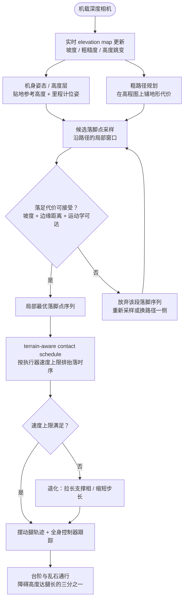
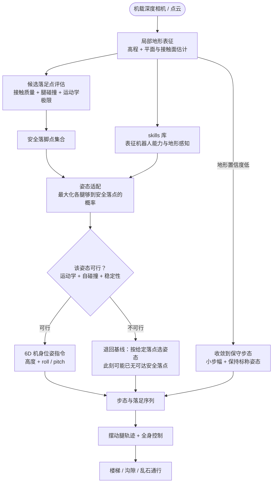
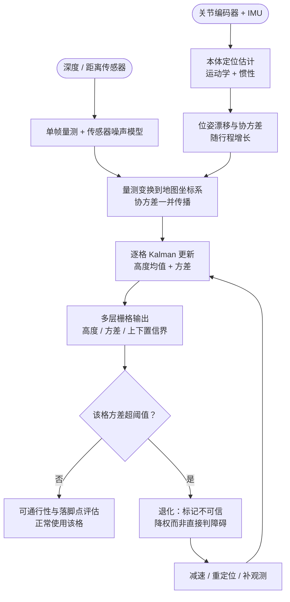
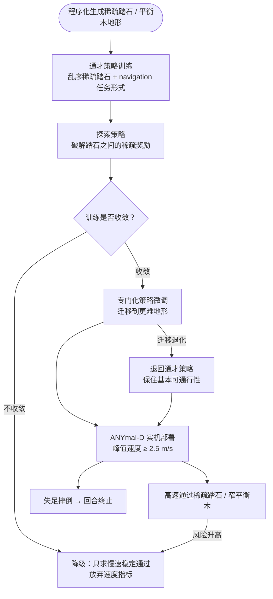
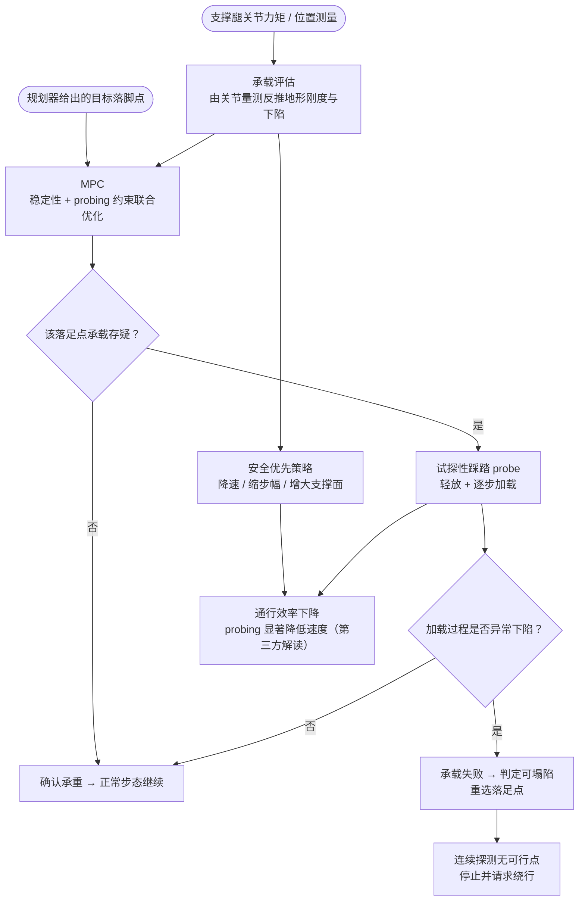
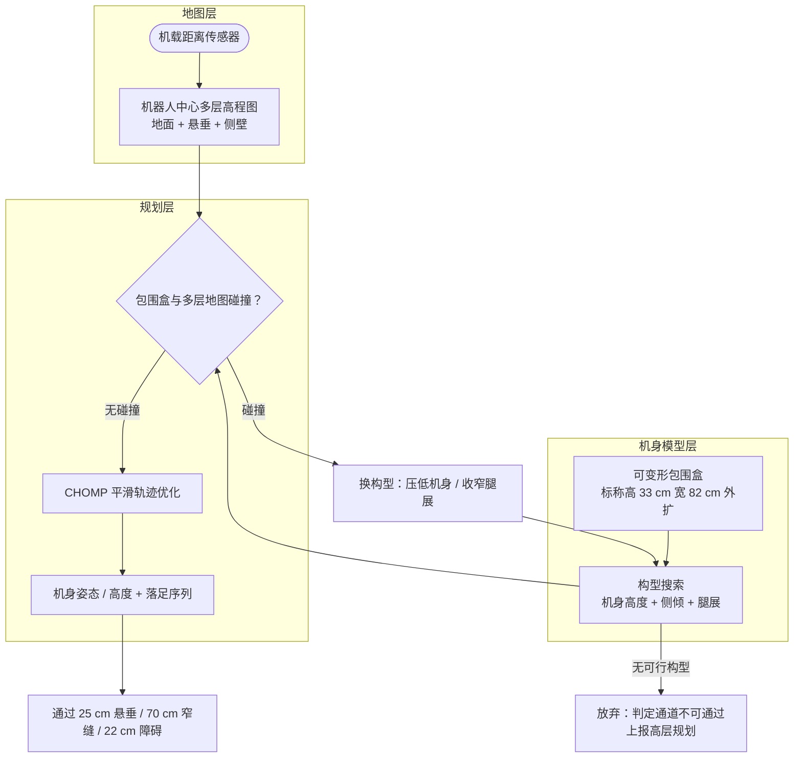
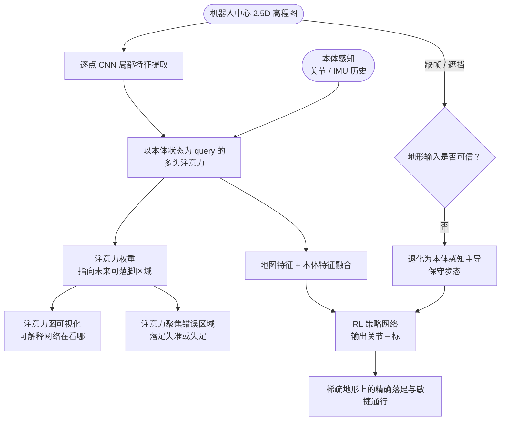
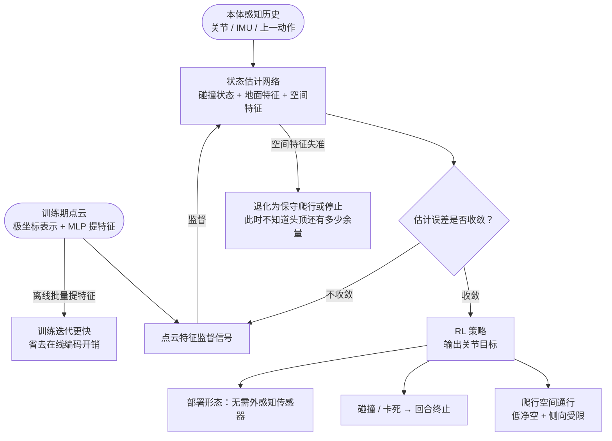

## 4. 感知、地形与落脚点：机器狗怎么知道「这一步能不能踩」

> 一句话导读：这一组解决的是同一条链路上的四个不同环节——地形怎么表示（2.5D vs 3D）、表示里怎么带不确定度、落脚点怎么选、踩下去会不会塌。流程图按「建图 → 表征 → 选点 → 承载校验」的顺序看。

### 4.1 Online Foothold Optimization：Perceptive Locomotion in Rough Terrain

**一句话**：把落脚点当成在线优化问题——在实时高程图上为每条腿求局部最优落足位置，再用 terrain-aware contact schedule 把「落哪里」翻译成「什么时候抬、什么时候落」，从而在不越执行器速度上限的前提下踩上约腿长 33% 的台阶与障碍。
**出处**：[已核实] F. Jenelten, T. Miki, A. E. Vijayan, M. Bjelonic, M. Hutter｜2020｜*IEEE RA-L* 5(4):5370–5376｜DOI `10.1109/LRA.2020.3007427`｜代码未核实

**流程图**

**图里读什么**
1. 两个输入是分开的：地形 B 只提供代价，位姿 C 只提供可达性，落脚点优化在两者交集中求局部最优。任何一边错了，落足就错。
2. **机身高度在这一篇是「跟随量」而不是「决策变量」**——C 由地形给出贴地参考高度后单向传给 E，只参与可达性检查，不被优化。这一点与 4.2、4.6 正相反，是三者最本质的分界。
3. 输出其实有两级：G 是「落哪里」，H 是「什么时候落」。摘要专门点出 contact schedule 是为了对付执行器速度上限——落点选得再好，腿抬不到那么快也是空的。
4. 两条失败分支位置不同：F→M 是几何不可行（踩不了），会重新采样；I→L 是时序不可行（来不及），只放慢不换点，属于「能踩但踩不快」。
5. 性能判据是相对量 33% 腿长，不是绝对高度——这正是它比「能上 22 cm 台阶」更可迁移的地方。

**赛场映射**：5 处 4–12 cm 乱石与 0.45 m 坡道的核心痛点是「踩上去滑不滑、会不会被边缘绊」，对应 F 的坡度与边缘距离项；0.6 m 限高的方涵对应 C 的贴地高度参考——本篇能给「贴着地形走」的高度，但**不会主动压低机身**，压机身要找 4.6。
**边界**：判据是相对腿长，迁移到 Lite2 必须先用自己腿长换算，不能照搬绝对数字；机身姿态不参与优化，圆管内径 1.0 m 这类需要主动下蹲或侧倾的场景它给不出解；无官方代码，复现只能按论文结构自建。

### 4.2 ViTAL：先选落点还是先摆机身，顺序反过来会怎样

**一句话**：指出「按给定落点去优化机身姿态」的既有范式有结构性缺陷——落点够不到时机体已无安全选择；ViTAL 反过来，优化那个「让各腿最有机会够到安全落点」的机身姿态，并用 skills 同时产出落足与姿态。
**出处**：[已核实] Shamel Fahmi, Victor Barasuol, Domingo Esteban, Octavio Villarreal, Claudio Semini｜2023｜*IEEE T-RO* 39(2):885–904｜DOI `10.1109/TRO.2022.3222958`｜arXiv:2212.01246

**流程图**

**图里读什么**
1. 图的形状本身就是论点：D（落点）与 E（skills）一起进 F（姿态），而 F 的输出 H **再回头决定 I（落足序列）**。这条回边就是 ViTAL 与基线方法的唯一区别，也是「落点与姿态互相耦合」的图形化表达。
2. **机身位姿是显式规划变量**（H），指令里同时含高度与 roll / pitch，不是跟随量。
3. L 是摘要原文承认的失败模式：姿态一旦不可行就退回基线，而基线在此刻可能已经「没有可达的安全落点」——这是不可恢复的退化，换条路也救不回来。
4. M 是另一类退化：地形本身不可信时，宁可退回标称姿态小步走，也不在噪声上做姿态优化。
5. 90 kg HyQ 与 140 kg HyQReal 两套不同尺度的实机都验证过，说明方法对机体尺寸不敏感。

**赛场映射**：坡道姿态调整与方涵 0.6 m 限高判断直接对应 H——**先问「哪个机身高度能让脚够到地面」，而不是先钉死落点再摆机身**；隧道 1 若出现 0.2 m 级余量不足，G→L 恰好说明「姿态不可行时不该硬挤」。
**边界**：skills 的具体定义与参数只在论文正文，摘要只给到「表征机器人能力与地形感知」这一层，细节未核实；验证平台是 90 / 140 kg 液压四足，Lite2 的刚度与腿长完全不同，落足容差要重标定；代码未核实。

### 4.3 Probabilistic Terrain Mapping：位姿不确定度怎么写进高程图

**一句话**：不依赖外部几何或视觉特征做绝对定位，只用运动学 + 惯性做本体定位，并把定位漂移的协方差与距离传感器噪声一起传播进高程图，使每个栅格输出「高度 + 上下置信界」而不是单一高度值。
**出处**：[已核实] P. Fankhauser, M. Bloesch, M. Hutter｜2018｜*IEEE RA-L* 3(4):3019–3026｜DOI `10.1109/LRA.2018.2849506`｜代码 `https://github.com/anybotics/elevation_mapping`（BSD-3）

**流程图**

**图里读什么**
1. 关键边是 E→G：定位协方差没有被丢掉，而是**跟着量测一起进地图**。同一个高度读数，位姿越不确定，落进格子后的方差就越大。
2. H 是逐格 Kalman 更新，所以每格存的是分布，I 才可能同时给出均值与上下置信界——不确定性可视化是机制自带，不是后处理加的。
3. L 是全图最重要的一行：方差大的格子**降权**，而不是判成障碍。区分「这里确实有墙」和「这里我不确定」是两件事。
4. M→H 是闭环：不确定就再观测一次，更新会把方差压下去，这是唯一能真正消解不确定的路径。
5. 摘要明确只基于运动学 + 惯性的本体定位，不跟踪外部特征——这既是鲁棒性来源，也意味着长距离仍会漂。

**赛场映射**：这就是「贴墙时膨胀区误判」的文献根——`plan_grid` 用固定 0.28 m 膨胀，等价于假设位姿精确；正确做法是让膨胀半径随该帧位姿协方差变化，贴墙时降低该区域置信度，而不是直接判不可行。弱光 L3 与乱石建图同属这一类。
**边界**：定位来源是本体运动学 + 惯性，真机若接入外部里程计，不确定度模型需重推；网格分辨率与更新频率的实测值未核实；仓库是 ROS C++ 实现，Windows 不可直接跑，可迁移的是「方差层 + 置信界」这套数据结构与判据，不是代码。

### 4.4 Learning Agile Locomotion on Risky Terrains：把速度跟踪改写成导航任务

**一句话**：先在杂乱稀疏踏石上训一个通才策略，再把它微调成各险地的专家策略；并把任务从 velocity tracking 改写成 navigation，用探索策略破解稀疏奖励，最终在 ANYmal-D 上以峰值 ≥ 2.5 m/s 通过稀疏踏石与窄平衡木。
**出处**：[已核实] Chong Zhang, Nikita Rudin, David Hoeller, Marco Hutter｜IROS 2024（arXiv Comments 明确）｜arXiv:2311.10484

**流程图**

**图里读什么**
1. 训练是两段式：B 通才 → E 专家。I 是「微调失败退回通才」的保底，工程上等于先保住能走、再谈走快。
2. 把任务改写成 navigation 不是文字游戏：velocity tracking 会约束机器人可采取的行为，navigation 才允许它为落点而改速度——这一改动直接决定 G 能不能成立。
3. C 针对稀疏奖励：踏石之间没有中间奖励，不主动探索就学不到跨步，这条边是整篇能训出来的前提。
4. J 是风险回退：速度是结果不是目标，风险升高就降速——与 4.5 的速度 trade-off 是同一类分支，但触发源不同（这里是摔倒风险，那里是承载探测）。
5. 摘要没有给网络结构与输入细节，别按记忆补；只有「通才 + 微调 + 探索策略」这三件是原文级事实。

**赛场映射**：5 处乱石本质就是离散稀疏落脚点，本篇判据最贴近；≥ 2.5 m/s 说明「稀疏落点 + 高速」可以同时成立，但 12×10 m 场地内速度受弱光与定位限制，不构成直接可比。
**边界**：摘要只写 ANYmal-D 与 ≥ 2.5 m/s，感知输入与策略结构未核实；训练依赖大规模并行仿真，Lite2 侧无法复现训练过程、只能用推理；不要在这篇上外推更快的数字。

### 4.5 Load-bearing Assessment：踩下去会不会塌

**一句话**：只用关节测量评估地形能不能承重——MPC 在稳定性与 probing 约束之间做折中，状态机协调试探性踩踏，检测到可塌陷区就动态换落足点；代价是探测本身拖慢速度（第三方解读，非摘要原文）。
**出处**：[已核实] Vivian S. Medeiros, Giovanni B. Dessy, Thiago Boaventura, Marcelo Becker, Claudio Semini, Victor Barasuol｜2025｜*IEEE RA-L*｜arXiv:2510.21369｜DOI `10.1109/LRA.2025.362624`（与 arXiv Related DOI 字段一致）｜代码未核实

**流程图**

**图里读什么**
1. 感知入口是 B——关节力矩与位置，不是相机。这是全文最反直觉的一点：塌陷与否由「腿感受到什么」判断，不需要额外硬件。
2. E 是状态机的分叉：不是每一步都 probe，只有承载存疑时才 probe，否则直接走 H。这条分叉决定了效率下限。
3. F→G 是「轻放 + 逐步加载」，判据是加载过程中是否出现异常下陷；G 的否分支同时给出两条出路——I 重选落足点，L 停止绕行。
4. **速度 trade-off 在图上是两条独立边汇到 K**：J→K 是策略性降速，可调；F→K 是每步探测本身的耗时，是方法固有成本。两者性质不同，别混成一句「probe 慢」。
5. 摘要原文只写「维持稳定性并优先安全」，没有速度损失数字。

**赛场映射**：废墟碎石与楼板不稳的物理承载校验；方涵内若底板松脱，本篇给的是「踩之前先轻试」的状态机语义。工程上可落成：可疑格先低速小幅下压，读关节力矩异常再决定是否承重。
**边界**：实验平台是自制可塌陷平台与岩石地形，不是真实楼板；速度代价的具体数值未核实；probing 需要力矩可控的关节，Lite2 的力控接口能否支撑需实测；代码未核实。

### 4.6 Walking Posture Adaptation：机身姿态本身当成规划变量

**一句话**：把机器人抽象成「可变形包围盒」，用机器人中心的多层高程图同时表达地面与头顶悬垂，再由 CHOMP 在包围盒构型空间里规划平滑轨迹——机身高度与腿展是搜索出来的，不是给定的。
**出处**：[已核实] Russell Buchanan, Tirthankar Bandyopadhyay, Marko Bjelonic, Lorenz Wellhausen, Marco Hutter, Navinda Kottege｜2019｜*IEEE RA-L* 4(2):2148–2155 / ICRA 2019｜arXiv:1901.10863｜DOI `10.1109/LRA.2019.2899664`｜代码未核实

**流程图**

**图里读什么**
1. C 是方法的名字来源：包围盒尺寸本身随姿态变化（下蹲变矮、收腿变窄），于是「机器人能不能过」被改写成「哪个构形的包围盒能过」——**这就是「机身姿态/高度作为规划变量」的具体形态**。
2. B 是**多层**高程图而非单层 2.5D：它能表达头顶的悬垂面，这是 25 cm 悬垂可被规划的前提，也是单层 2.5D 图的结构性盲区。
3. E 是判定核心，D→E 的循环就是构型搜索；I 给出「变形」而不是「放弃」，只有连构型都找不到才进 J。
4. 实机是六足 Weaver，标称 33 cm 高 82 cm 宽；25 cm 悬垂意味着必须把机身压到标称高度的约 76% 以下才能进——这个**比例**才是可迁移判据，不是 25 cm 这个数。
5. 六足而非四足这一点要说清：方法本身与腿数无关，但包围盒与步态生成要按自己平台重做。

**赛场映射**：圆管内径 1.0 m、方涵限高 0.6 m 的通行判据可直接借这个范式——**先算「标称站高 vs 净空」的比例，再决定要不要压机身、压多少**；隧道 1 余量 0.2 m 时，若标称站高超过净空，构型搜索会自然返回不可行，比事后判定更早。
**边界**：验证平台是六足（33 cm / 82 cm），不是四足，包围盒尺寸模型与步态都要重做；CHOMP 在嵌入式平台上的计算量实测值未核实；代码未核实。

### 4.7 Attention-Based Map Encoding：让网络自己决定看地图的哪一块

**一句话**：不再把整张高程图塞进策略网络，而是用 CNN 逐点提局部特征、再以本体状态为 query 做多头注意力，学出「该看哪块未来可落脚区域」，注意力图还能反过来解释网络的地形感知。
**出处**：[已核实作者与编号，venue 未核实] Junzhe He, Chong Zhang, Fabian Jenelten, Ruben Grandia, Moritz Bächer, Marco Hutter｜2025｜venue **未核实**（arXiv Comments 原文为 Original draft prior to peer review）｜arXiv:2506.09588｜代码与项目页未核实

**流程图**

**图里读什么**
1. D 的「本体状态作 query」是关键设计：地图特征不是全量池化，而是被当前身体状态「问」出来的——同一地形、不同姿态，关注点不同。
2. E 与 I 是同一件事的两面：注意力权重既是控制输入，也是可解释性输出，不需要额外蒸馏一个解释模型。
3. K 是退化路径：地形输入缺失或不可信时，本体 query 仍在，网络自然退回本体主导——这是结构自带的降级，不是外挂开关。
4. L 是风险面：注意力学歪会聚焦到不该踩的区域，且这类错误在注意力图上看得见，可作为调试入口。
5. 摘要给了 12-DoF 四足与 23-DoF 人形两套控制器，说明这套表征与本体自由度解耦。

**赛场映射**：隧道与方涵里高程图被悬垂和侧壁切得支离破碎，全图卷积容易被无关区域稀释；「按本体状态 query 局部」在窄通道里等价于「只关心下一步要踩的那几格」，与 `plan_grid` 的局部窗口思路同源。
**边界**：**venue 未核实**，arXiv 明说这是评审前草稿、后续会有重大修改，引用时必须注明；代码与项目页未核实；摘要未给网络层数与训练规模；「可解释」是作者主张，不能当成已验证的调试工具。

### 4.8 PPL：训练时用点云监督，部署时只带本体感知

**一句话**：爬行空间里本体感知只能推出地面特征、推不出空间特征（头顶多低、侧向多窄），PPL 用训练期的点云特征监督一个状态估计网络，让它额外估计碰撞状态与空间特征，部署阶段不再需要外感知传感器。
**出处**：[已核实，编号需复核] Bida Ma, Nuo Xu, Chenkun Qi, Xin Liu, Yule Mo, Jinkai Wang, Chunpeng Lu｜2025｜Accepted by RA-L（arXiv Comments）｜arXiv:2508.09950（v2 于 2025-12-04 修订；镜像站曾出现 2508.09960，引用前需复核）

**流程图**

**图里读什么**
1. 核心是「监督信号来自点云、运行时不带点云」：C→D→B 只存在于训练，J 才是部署形态。这条不对称是全文的工程价值所在。
2. B 的输出有三类：碰撞状态、地面特征、空间特征。少了空间特征就退化成普通本体感知策略——摘要正是把既有方法在 crawl space 的失效归因于此。
3. C 用极坐标表示 + MLP 提特征，图里引出的 I 是「训练更快」，属于工程效率设计而非精度设计，别把它读成主要贡献。
4. E 的否分支回到 D，说明监督是持续校准而不是一次性蒸馏。
5. K 是退化：空间特征失准后只能保守爬行或停——因为此刻机器人不知道自己头顶还剩多少余量，这正是方涵场景最危险的状态。

**赛场映射**：方涵限高 0.6 m 与圆管内径 1.0 m 是典型 crawl space，且弱光与扬尘下外感知不可靠；「训练用点云、部署只用本体」这条路线对 Lite2 很有吸引力，因为它把感知风险整体前移到训练阶段。
**边界**：arXiv 编号存在镜像不一致，引用前必须复核；摘要未写具体机型与可通过的净空数值，实验规模未核实；监督依赖训练期点云的覆盖度，真实废墟上的泛化未核实。