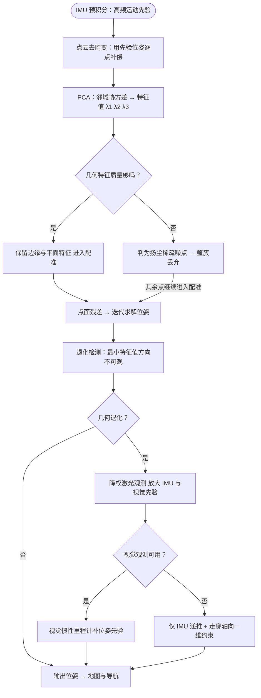
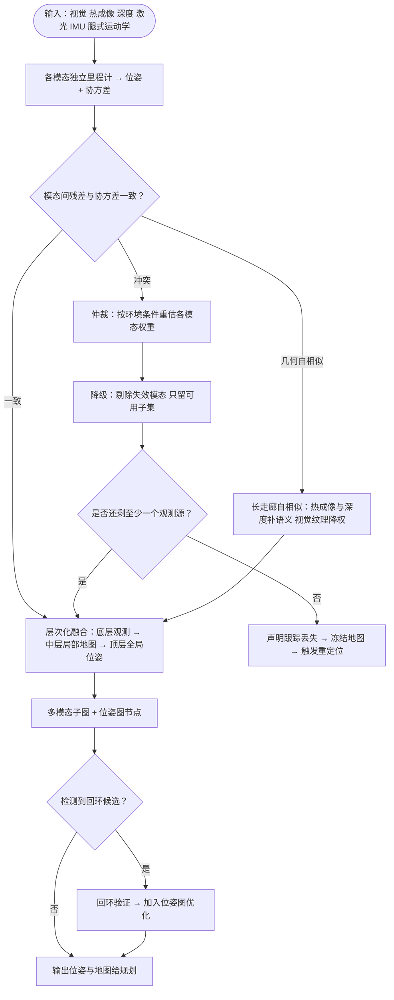
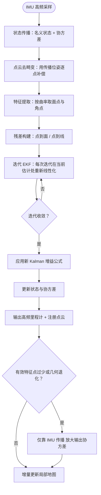
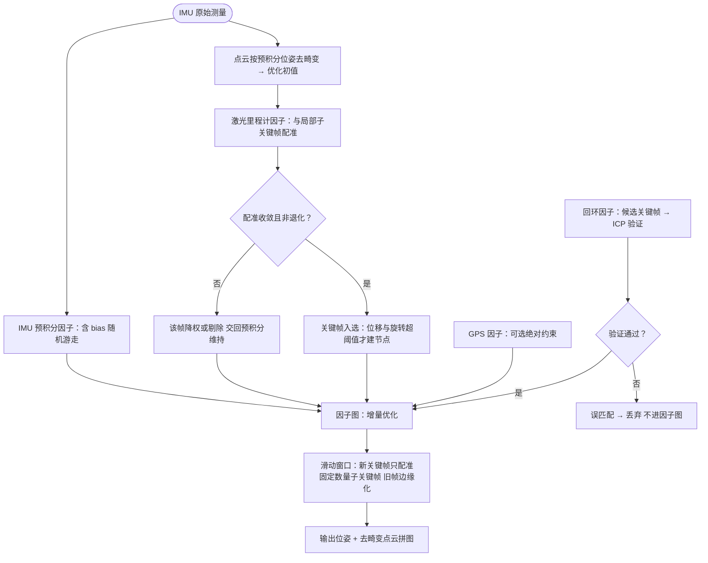
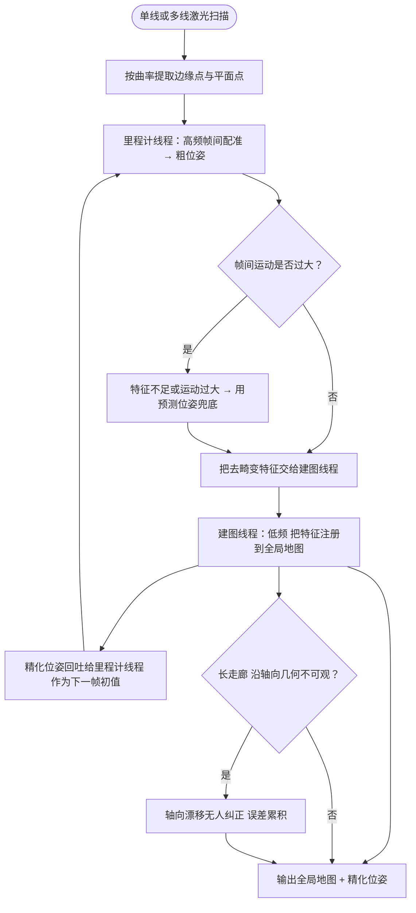
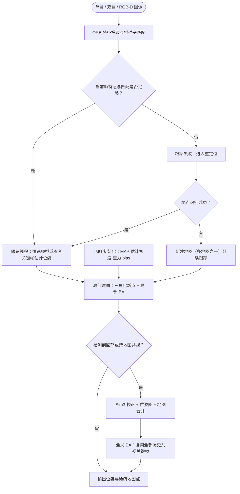
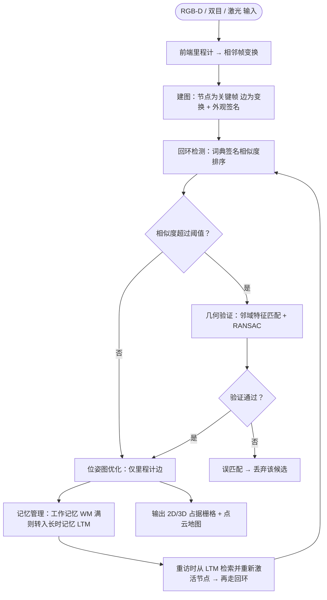

## 5. 定位与 SLAM：机器狗在废墟里「我在哪」怎么失效、怎么补救

> 一句话导读：这一组按「几何退化怎么被检测 → 怎么用别的模态补 → 丢了以后怎么找回来」排序。我们真机没有激光雷达，读这组的目的是拿**退化感知与重定位的语义**，不是拿整套栈。

### 5.1 Super Odometry：IMU-centric LiDAR-Visual-Inertial Estimator for Challenging Environments

**一句话**：把 IMU 当主干、视觉与激光当随时可插拔的校正源，用粗到细的递推在扬尘与长走廊里保住位姿不崩。
**出处**：[已核实] Zhao, Zhang, Wang, Nogueira, Scherer｜IROS 2021 pp.8729–8736｜`arXiv:2104.14938`｜正式 DOI 未核实

**流程图**

**图里读什么**
1. 主干是 IMU：三个子模块（IMU 里程计、视觉惯性、激光惯性）都围绕 IMU 状态转，视觉与激光只给位姿先验并约束 IMU bias，不直接接管输出。
2. PCA 分支是抗扬尘的关键：邻域协方差特征值退化成一片散点时不是硬配准，而是整簇丢掉——等价于「先不信任这几百个点」，比事后滤波更早。
3. 退化检测落在特征值上：走廊里最小特征值对应方向不可观，于是降权激光、放大先验。注意这是**权重层面**的处理，不是直接停工。
4. 动态八叉树的开销约为静态 KD-tree 的 10%（摘要原文对比），这是它能实时的原因之一。

**赛场映射**：弱光 + 扬尘 + 圆管/方涵内几何退化三项全命中；更实用的是它给出「退化时该降权谁、不该直接停」的判据——正是我们 `start_blocked` 里「估计位姿贴墙就判死」的反例。长走廊测试中 LIO-SAM 漂移 0.85 m、LOAM 4.15 m，本方法 0.055 m。
**我们真机能不能用**：不能。C++/ROS 栈、以激光雷达为主传感器，我们无 LiDAR、Windows + Python 栈无对应实现。只取语义：PCA 特征质量门控、退化时降权而非停机。
**边界**：核心是三模态紧耦合，缺任一模态（尤其激光）就不是同一套系统；扬尘过滤的具体阈值在正文，摘要未给，本节只写到「整簇丢弃」这层。项目页 `https://superodometry.com/` 存在，代码未核实。

### 5.2 CompSLAM：Complementary Hierarchical Multi-Modal Localization and Mapping

**一句话**：不追求单模态更强，而是让视觉、热成像、深度、惯性、运动学各算一份位姿，靠「谁残差小就信谁」的层次化仲裁在黑暗与粉尘里活下来。
**出处**：[已核实] S. Khattak et al.｜2025｜`arXiv:2505.06483`（期刊/会议版本未核实）｜代码 `https://github.com/leggedrobotics/compslam_subt`

**流程图**

**图里读什么**
1. 冗余是横向的：每个模态都独立出位姿与协方差，融合前先比对，不是把原始数据塞进一个大优化。
2. 仲裁靠环境条件改权重（黑暗中视觉降权、粉尘中激光降权）——这就是「互补」二字的落点。
3. 几何自相似长走廊是单独的失败分支：视觉纹理与几何都区分不了两段相似通道，只能靠热成像/深度这类提供差异的模态，再加回环。
4. 最关键一条：**全部模态失效才允许宣布丢失**，任一个还活着就继续融合。

**赛场映射**：CERBERUS 决赛全部机型（空中/腿式/轮式）都部署了它，并发布 740 m SubT 决赛数据集验证扰动下的鲁棒性；对应我们弱光 + 扬尘 + 圆管/方涵里「某一路外感知突然不可信」的情形。
**我们真机能不能用**：不能直接跑（ROS/C++，且依赖激光与热成像等我们没装的载荷）。只取语义——「多源各出协方差 → 一致性仲裁 → 逐模态降级 → 全失效才停机」，可照搬到我们高程图与里程计的置信度管理。
**边界**：层次化「层」的具体划分与权重更新规则在正文，摘要只给「靠冗余达到鲁棒」的结论；期刊/会议版本未核实，引用按预印本处理。热成像在低照度确实有效，但 Lite2 无热成像载荷，这条只能当方法论。

### 5.3 FAST-LIO：A Fast, Robust LiDAR-inertial Odometry Package by Tightly-Coupled Iterated Kalman Filter

**一句话**：用迭代 EKF 把激光特征点与 IMU 紧耦合，并替换 Kalman 增益的算法形式，让计算量只跟状态维数有关——点再多也不炸。
**出处**：[已核实] W. Xu, F. Zhang｜2021｜IEEE RA-L 6:3317｜`arXiv:2010.08196`｜正式 DOI 未核实｜仓库 `https://github.com/hku-mars/FAST_LIO`（许可条款未核实，存在 GPL 风险）

**流程图**

**图里读什么**
1. 紧耦合的意思是残差直接在状态上线性化，不是先算激光里程计再与 IMU 结果做松耦合平均。
2. 迭代 EKF 的「迭代」是关键：在传播出的位姿附近反复重新线性化，快速运动带来的强非线性被摊平。
3. 新增益公式把复杂度从「量测维数」换成「状态维数」——摘要给的数字是每帧融合 1200+ 有效特征点、单次 iEKF 全部迭代在 25 ms 内（机载计算机）。
4. 失败分支是「点太少/退化」：不退化成乱跳，而是靠 IMU 传播顶住并放大协方差——与 5.1 同一种「降级而非停机」思想。

**赛场映射**：它是后续 FAST-LIO2 等一批 LIO 的前身，几何退化与快速运动下的写法可直接借用；但整套以激光为唯一主动外感知，与我们「没有 LiDAR」的实机冲突。
**我们真机能不能用**：不能。C++/ROS + PCL/Eigen，Windows 不适用；许可条款未核实、存在 GPL 风险，即便将来上 LiDAR 也要先查 LICENSE。
**边界**：25 ms 与 1200 点是摘要所述机载平台上的数字，不能外推到我们平台；它只给里程计，不闭环、不做全局一致性，要建图还得配回环。

### 5.4 LIO-SAM：Tightly-coupled Lidar Inertial Odometry via Smoothing and Mapping

**一句话**：把激光惯性里程计写成因子图，让 IMU 预积分、激光里程计、GPS、回环四类测量以「因子」身份同时进优化，再用滑动窗口的子关键帧压到实时。
**出处**：[已核实] Shan, Englot, Meyers, Wang, Ratti, Rus｜IROS 2020 pp.5135–5142｜DOI 10.1109/IROS45743.2020.9341176｜`arXiv:2007.00258`｜仓库 BSD-3-Clause

**流程图**

**图里读什么**
1. 四类因子：IMU 预积分（运动先验与去畸变）、激光里程计（局部相对约束）、GPS（绝对约束，室内基本失效）、回环（长距离一致性）。前两类每帧都有，后两类稀疏。
2. 耦合是双向的：预积分给激光配准初值，激光里程计的解反过来估 IMU bias（摘要原话）。
3. 实时靠「局部化」：不与全局地图配准，只与固定数量子关键帧配准并边缘化旧帧——这就是滑动窗口的工程含义。
4. **死胡同倒退为什么能一致**：倒退时前方无新观测，激光里程计因子只提供短时相对约束，误差仍在线性累积；回到走过的区域时，回环因子把当前关键帧钉到历史关键帧上，图优化一次性把整段返程漂移摊回去。没有回环因子，这一段只能靠预积分与局部配准硬扛，越走越偏。
5. 失败分支两处：配准不收敛（该帧降权）与回环误匹配（候选被 ICP 验证否掉，不进图）。

**赛场映射**：12×10 m 全场回环 + 死胡同倒退后的轨迹一致性，正是赛题里「走进去再退出来」的最小闭环；「因子」这个表达更值得借——我们的高频里程计与稀疏纠正（视觉/回环）可用同一心智组织。
**我们真机能不能用**：不能。ROS C++ 实现，无 LiDAR 跑不起来；仓库 BSD-3-Clause 许可友好，但平台不匹配。只取语义：四类因子的分工 + 回环负责长距离一致性。
**边界**：官方实现依赖 9 轴 IMU 且对 IMU 噪声参数敏感（属实现层面约束，本次未在摘要逐项核对）；GPS 因子在废墟室内无效，真正起作用的是回环，没有回环的区域漂移照样累积。

### 5.5 LOAM：Lidar Odometry and Mapping in Real-time

**一句话**：把「里程计」与「建图」拆成两个频率不同的线程——快的只管帧间粗对齐，慢的才做全局精配准，用频率换精度。
**出处**：[已核实] J. Zhang, S. Singh｜RSS 2014｜DOI 10.15607/RSS.2014.X.007｜原始实现未核实（A-LOAM 为社区实现）｜无 arXiv 编号

**流程图**

**图里读什么**
1. 两线程的耦合以单向为主、双向修正为辅：里程计线程给建图线程初值与去畸变点云，建图线程回吐精化位姿。
2. 频率分工的代价很明确：里程计线程精度低，只负责「别跟丢」；精度由低频建图线程在大地图上配准拿到。
3. 失败分支：帧间运动过大或特征太少时帧间配准会崩，退回用预测位姿兜底——这是后续所有 LIO 都继承的退化处理雏形。
4. 长走廊是它的著名弱点：沿通道轴向没有可约束几何，两线程都纠不了轴向漂移，源文件 §3.4 引的 4.15 m 就是这个失效模式。

**赛场映射**：它是全部 LIO 的共同基线，读它的价值是「高频/低频分离」这个结构——我们 `navigation_core` 里局部规划高频、全局规划低频，本质是同一种频率分层。
**我们真机能不能用**：不能（C++、需 LiDAR，原始实现未核实）。只取语义：双线程频率分离 + 退化兜底。
**边界**：2014 年工作，无 IMU 紧耦合、无回环，长期漂移必然；边缘/平面提取参数对场景敏感，扬尘下需额外质量门控（回看 5.1）。引用 A-LOAM 时必须说明是社区实现，不是原始实现。

### 5.6 ORB-SLAM3：An Accurate Open-Source Library for Visual, Visual-Inertial and Multi-Map SLAM

**一句话**：ORB 特征 + MAP 估计做视觉惯性 SLAM，并加一套多地图机制——跟丢了不终止，新开一张图，重访旧区域时自动合并。
**出处**：[已核实] C. Campos et al.｜2021｜IEEE T-RO 37(6):1874–1890｜DOI 10.1109/TRO.2021.3075644｜`arXiv:2007.11898`｜GPLv3

**流程图**

**图里读什么**
1. IMU 初始化本身就是 MAP 估计（摘要明确 even during the IMU initialization phase），不是先粗估再用——这决定了冷启动就有较可靠的尺度与重力。
2. 三线程分工：跟踪（高频出位姿）、局部建图（局部 BA）、回环与全局 BA（低频纠正）。
3. 多地图是它的独有能力：丢失→新建图，重访→合并；摘要给的量化是双目惯导在 EuRoC 平均 3.6 cm、TUM-VI 手持快速运动 9 mm。
4. 失败分支最关键：视觉信息贫乏的长时间段不终止系统，而靠地点识别把地图接回来——这正是「丢了以后怎么找回来」的答案。
5. 输出是稀疏地图点 + 关键帧，不是占据栅格，直接给导航用还需再转。

**赛场映射**：弱光或短时遮挡导致视觉跟踪丢失后的重定位，是我们最可能真实遇到的失效；「丢了不终止、重访能接回」这套语义比它的精度数字更有用。
**我们真机能不能用**：不能（C++ + ROS/OpenCV/Pangolin，Windows 不适用；且纯视觉在废墟弱光下不可靠）。GPLv3 对参赛集成有传染风险，注意。
**边界**：纯视觉在弱光、无纹理（白墙、烟尘）下特征数会掉到无法初始化；输出稀疏特征地图而非可通行栅格；3.6 cm / 9 mm 是 EuRoC 与 TUM-VI 上的数字，不是废墟场景。

### 5.7 RTAB-Map：RTAB-Map as an Open-Source Lidar and Visual SLAM Library

**一句话**：以外观回环 + 记忆管理为核心，把视觉/LiDAR 统一成图优化问题，最后直接吐出导航能吃的 2D/3D 占据栅格。
**出处**：[已核实] M. Labbé, F. Michaud｜2019｜JFR 36(2):416–446｜DOI 10.1002/rob.21831｜仓库 `https://github.com/introlab/rtabmap`（BSD）｜无 arXiv 正式版（源文件注明 `arXiv:2403.06341` 为 2024 后上传，未作依据）

**流程图**

**图里读什么**
1. 回环是两级：先靠外观签名（词典）粗筛，再用几何匹配与内点验证细筛，任何一级都不许跳过。
2. 记忆管理解决的是长时间运行内存爆炸：WM 只留近期节点，老的转 LTM，重访时把 LTM 节点重新激活才可能检出回环——「少内存还能长距离回环」的机制就在这。
3. 输出层对我们最实用：直接给 2D/3D 占据栅格，导航端不必自己从点云转。
4. 失败分支两处：回环候选被几何验证否掉（误匹配不进图）；以及跟踪本身丢失——它靠重定位恢复，不靠新开地图，这点与 5.6 不同。

**赛场映射**：源文件把它列为我们方案里「首个建图候选」，正因为占据栅格是导航直接能消费的东西；外观回环 + 记忆管理对应 12×10 m 场地里多次经过同一路口。
**我们真机能不能用**：不能直接跑（ROS + C++/Qt/PCL/g2o，Windows 不适用；真机 `rtabmap_ros` 尚缺，见总体技术方案第 24 行）。BSD 许可友好是加分项。只取语义：两级回环验证 + WM/LTM 记忆管理 + 直接输出占据栅格。
**边界**：正式版覆盖视觉/LiDAR 统一，但强项仍是 RGB-D 室内；我们无 LiDAR，弱光下 RGB-D 深度同样退化。回环依赖外观，废墟重复纹理少时会漏检。
