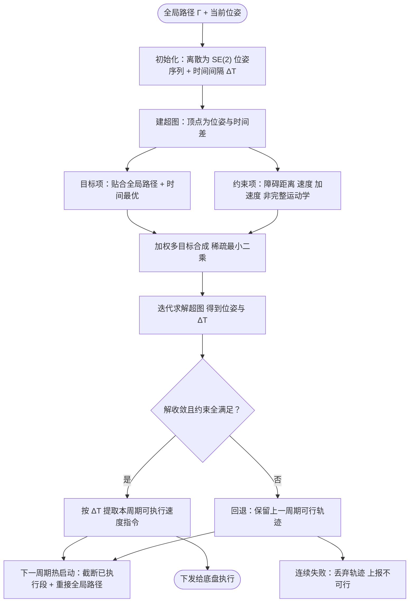
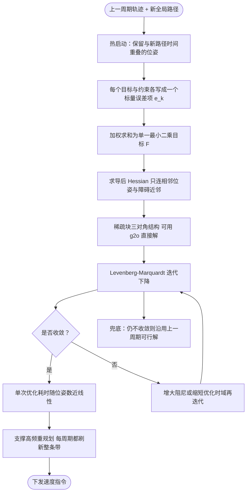
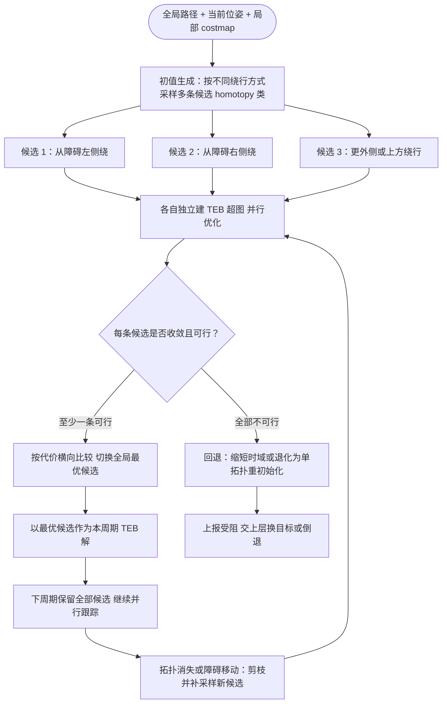
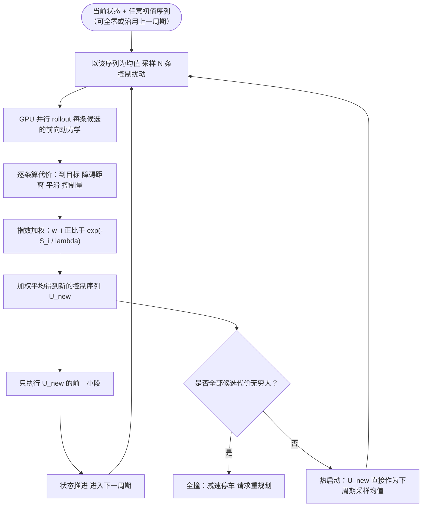
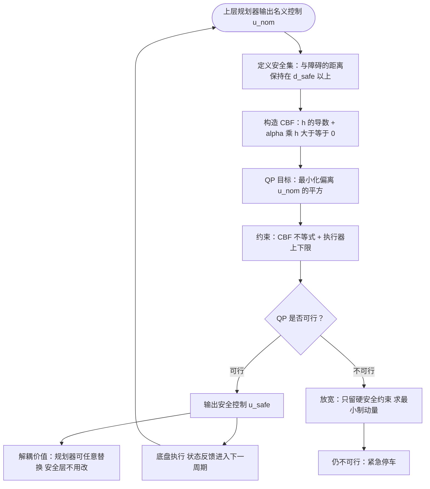
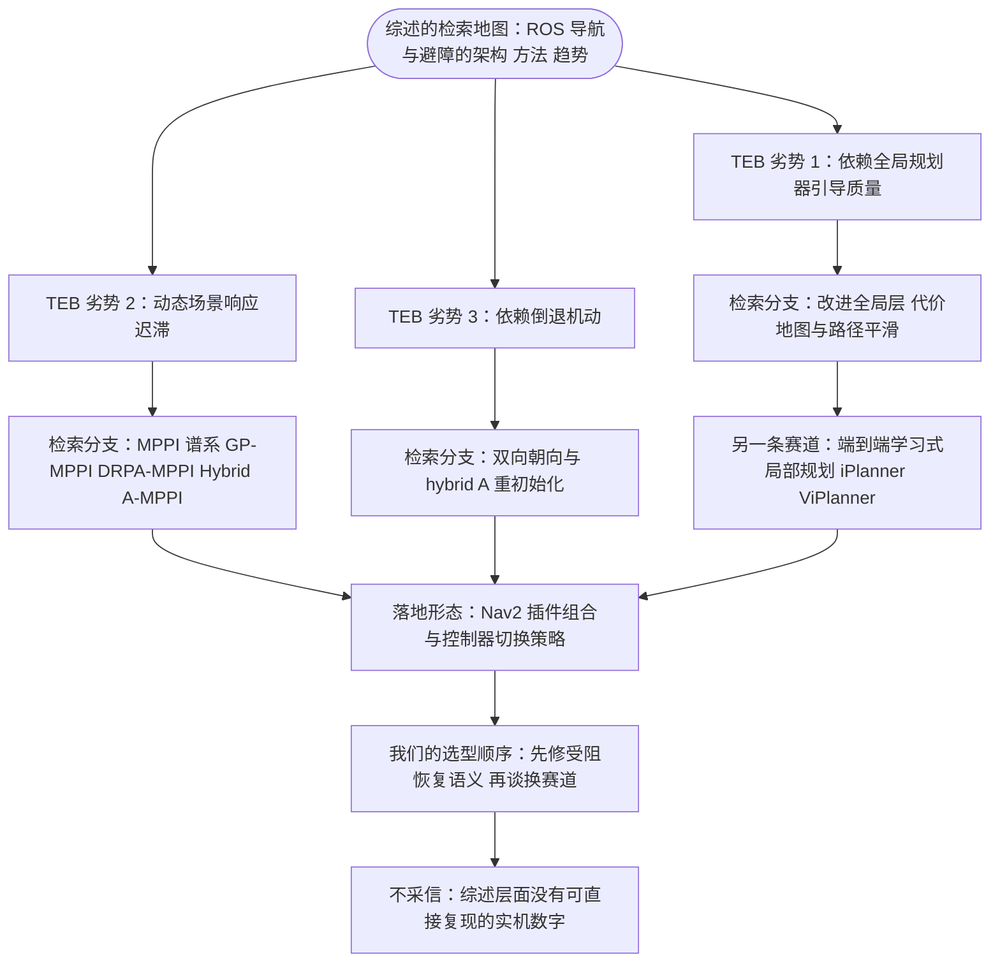
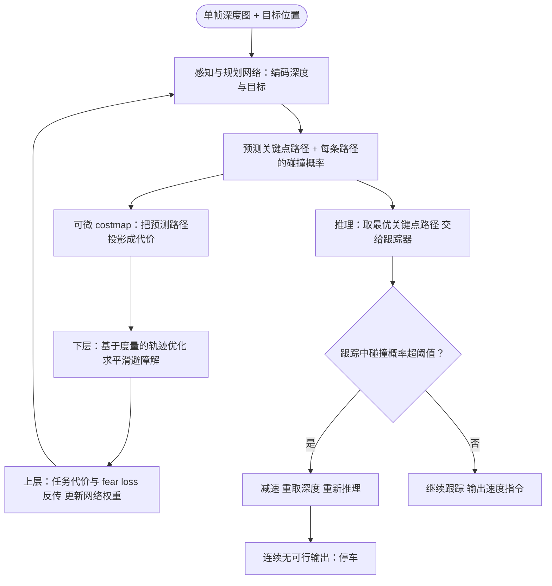
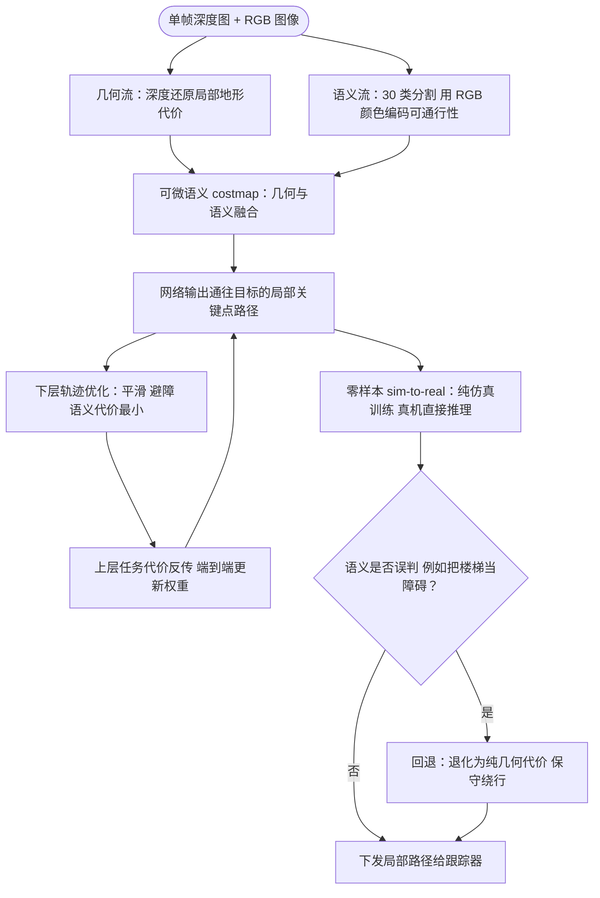
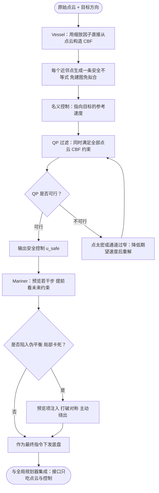

## 6. 局部规划与 TEB 谱系：从「重初始化」到「换赛道」

> 一句话导读：我们的 `start_blocked` 卡点，本质是「TEB 拿不到可行初值就进终态」。这一组按「同一赛道的工程修补（TEB 三代）→ 不同赛道的替代（MPPI / 学习式）→ 独立安全层（CBF）」三层排。6.1–6.3 必读，6.4–6.9 选读。

---

### 6.1 TEB 原型：Trajectory modification considering dynamic constraints of autonomous robots

**一句话**：把一条弹性带（位姿序列）加上显式时间维度，用稀疏多目标优化同时求出「走哪、怎么走、何时到」，局部规划从此从「采样选速度」变成「解优化问题」。

**出处**：C. Rösmann, W. Feiten, T. Wösch, F. Hoffmann, T. Bertram｜2012｜ROBOTIK 2012, Munich, pp.74–79｜DOI / arXiv 未核实

**流程图**

**图里读什么**
1. 初值只有一条来源：全局路径 + 当前位姿的离散化。**没有第二条候选**，所以初值一旦落进膨胀区，整条链就没有「换个方向再试」的余地。
2. 目标项与约束项是**并列加到同一张超图**上的，靠权重平衡；调参的本质是在「贴路径」与「离障碍远」之间换权。
3. 非完整约束把相邻位姿的朝向差与位移绑死，所以 TEB 天然不能横移，只能「前进 + 转向」——这就是死胡同必须靠**倒退**脱身的原因。
4. 唯一的回退分支是「保留上一周期轨迹」。它假设上一周期是好的；一旦上一周期也贴墙，就退化成连续失败，然后进终态。
5. 超图的边是二元的（位姿–位姿 或 位姿–障碍），这是 6.2 能稀疏化的前提；6.1 自己没做稀疏，所以原型版的重规划频率上不去。

**赛场映射**：方涵 1.2×0.6 m、限高 0.6 m 的通道里，只要能给出合法 SE(2) 初值，TEB 能把轨迹压到膨胀区边界上通过。但我们 `plan_grid` 的起点本身落在 0.28 m 膨胀区时，图里第一步就失败，且没有换侧分支——这就是 `start_blocked` 的祖先形态。

**边界**：不含多拓扑并行、不含不可行恢复；本篇为会议版，DOI 与 arXiv 编号均未核实，引用时只写会议名与页码，不要补 DOI。

---

### 6.2 TEB 工程化：Efficient trajectory optimization using a sparse model

**一句话**：把 TEB 的超图重写成稀疏标量多目标最小二乘并落到 g2o 上，使计算量随位姿数近似线性增长——TEB 能做成实时 ROS 插件的关键工程论文。

**出处**：C. Rösmann et al.｜ECMR 2013, Barcelona, pp.138–143｜DOI 10.1109/ECMR.2013.6698833

**流程图**

**图里读什么**
1. 「稀疏」不是数学洁癖，是**能不能实时**的分水岭：误差项只依赖相邻位姿，Hessian 才稀疏，g2o 才能在毫秒级解掉。
2. 它继承了 6.1 的全部结构缺陷，只改了求解效率——**它修的是算得慢，不是算不出**。这一区分对我们很关键：`start_blocked` 不是性能问题，换更快的求解器没有用。
3. 失败分支仍然只有「沿用上一周期」，加了一个「加阻尼再试」，属于数值层面的补救，不是语义层面的恢复。
4. 热启动是默认行为：每周期都拿上一周期的解当初值，这也是为什么障碍突变时它容易陷在旧拓扑里出不来。
5. 若以后要在 `navigation_core` 里自己写轨迹优化，可照这个套路：先列误差项，再看 Hessian 是否稀疏，最后才决定要不要引 g2o；我们规模小，稠密解也够。

**赛场映射**：12×10 m 废墟里障碍密集、且我们只有 500 ms 级重规划预算时，靠的就是这层稀疏化；但它救不了「起点在膨胀区」——这是 6.3 与 RTEB 的活。

**边界**：只讨论求解器与稀疏模型，不讨论恢复语义；DOI 已核实，作者列表源综述与任务只写「et al.」，报告里如需列全作者需另行核实。

---

### 6.3 TEB 多拓扑：Integrated online trajectory planning and optimization in distinctive topologies

**一句话**：障碍让代价函数非凸、存在多个局部最优，作者**并行维护多条不同拓扑（homotopy 类）的候选轨迹一起优化，再按代价切换全局最优**——这是 S 弯换侧、死胡同换侧的直接依据。

**出处**：C. Rösmann, F. Hoffmann, T. Bertram｜2017｜Robotics and Autonomous Systems 88:142–153｜DOI 10.1016/j.robot.2016.11.007

**流程图**

**图里读什么**
1. **这是整组最重要的一张图**：候选不是串行试错，而是**同一周期内并行优化、再比较**。所以「换侧」的代价是一次并行优化，不是一次重规划失败后的重试。
2. 初值不再是唯一一条：每条候选自带一个拓扑标签（左绕 / 右绕 / 外绕），这就是「初值怎么来」的第二个答案——**从拓扑假设反推初值**。
3. 失败分支有两级：单条候选死掉只剪枝，不影响别的候选；全部死掉才退化为单拓扑重初始化并上报受阻。**这就是把「不可行」从终态改写成事件的结构原型**。
4. 代价比较是逐周期的，所以机器人走到 S 弯中段时可以平滑地从「左绕最优」切到「右绕最优」，不要求一开始就选对。
5. 候选之间不共享优化变量，所以并行是干净的；代价接近时会来回切换（震荡），工程上通常加一个切换迟滞。

**赛场映射**：S 弯净宽 1.2 m，机器人一旦进了错的一侧，单拓扑 TEB 会一路顶到墙再失败；多拓扑让两条绕行同时保活，走不通就换侧。死胡同里同理：一条候选直行、一条候选倒退退出，比较代价后选后者，而不是原地报 `start_blocked`。

**边界**：拓扑候选的生成依赖初始位姿与障碍几何，窄到只剩一条通路时（如方涵 0.6 m 限高段）多拓扑退化为单拓扑，此时要靠 RTEB 式重初始化；本文是期刊版、DOI 已核实，但**没有给出可直接照搬的工程参数**。

---

### 6.4 MPPI（Information-Theoretic MPC）：Information Theoretic Model Predictive Control: Theory and Applications to Autonomous Driving

**一句话**：用 information-theoretic 的 path-integral 推导出「采样 N 条 → 按代价指数加权 → 加权平均更新控制序列」的采样型 MPC，可处理不可微代价、可 GPU 并行，**且不要求好的初值**。

**出处**：Grady Williams, Paul Drews, Brian Goldfain, James M. Rehg, Evangelos A. Theodorou｜2018｜IEEE T-RO 34(6):1603–1622｜DOI 10.1109/TRO.2018.2865891｜arXiv:1707.02342（摘要已抓取核对；arXiv 页面 Comments 仅写 submitted to T-RO，卷期页码照抄源综述）

**流程图**

**图里读什么**
1. **闭环是「采样 → 加权 → 更新序列 → 只执行前一段 → 再采样」**，不是「选一条最好的走完」。真正下发的是加权平均后的序列，天然带平滑。
2. 「不需要好初值」为什么对我们重要：初值只是**采样分布的均值**，哪怕全零，N 条扰动也会把可行方向采样出来。而 TEB 的初值必须是**逐位姿可行**的轨迹，起点在 0.28 m 膨胀区就直接死。这是两种方法对「初值」的语义差别，正是 `start_blocked` 的分野。
3. 代价函数不需要可微，所以「膨胀区代价」「限高惩罚」「倒车惩罚」可以直接写成查表/布尔项，不必像 TEB 那样写成误差项求导。
4. 失败分支是「全部候选无穷大代价」——它对应的是真的没路，此时减速停车是正确行为，而不是假装规划成功。
5. lambda（温度）是唯一必须调的关键参数：调大接近贪心取最优一条，调小更平滑但反应慢。它决定了「多模态绕行」能不能被保住。

**赛场映射**：圆管（内径 1.0 m）与方涵 0.6 m 限高段，可用「离管壁距离 + 机身高度超限」两条硬代价直接罚掉，不必改动力学模型；死胡同倒退把「倒车速度」当成决策变量即可，无需为倒退单独写一套运动学。12×10 m 废墟里也更容易处理乱石造成的多模态绕行。

**边界**：采样计算量大，本机 Windows + ORT-CPU 环境下几乎不可能实时；它替代的是**规划器语义**，不是我们 15 天窗口内的可行改动。别把它写进「已选定方案」。

---

### 6.5 CBF-QP：Control Barrier Function Based Quadratic Programs for Safety Critical Systems

**一句话**：用 CBF 把「安全」写成控制输入上的不等式约束，与表示性能的 CLF 一起塞进一个实时 QP，得到「名义控制 → 最小修正 → 安全控制」的过滤层。

**出处**：Aaron D. Ames, Xiangru Xu, Jessy W. Grizzle, Paulo Tabuada｜2017｜IEEE TAC 62(8):3861–3876｜DOI 10.1109/TAC.2016.2638961（arXiv Related DOI 一致）｜arXiv:1609.06408

**流程图**

**图里读什么**
1. 形状就是三层：**u_nom 进来，QP 做一个最小二乘修正，u_safe 出去**。规划器说什么不重要，只要不违反 CBF 就在安全层被原样放行。
2. 「最小修正」是它最有工程价值的一点：不重规划、不换赛道，只在**速度指令层面**把危险的 3 cm 掰回来。计算量是一个小规模 QP，可以每周期都解。
3. 解耦是硬要求：CBF 约束只依赖**状态与障碍距离**，不依赖 TEB 内部结构，所以能挂在我们现有 `navigation_core` 的控制器输出后面，而不用动规划器。
4. 失败分支有两级：QP 不可行先放宽到最小制动，仍不可行就紧急停车。注意它**永远不会输出违反约束的控制**——这是安全层和规划器最本质的区别。
5. CLF 那一半管性能（往目标走），CBF 那一半管安全；两者冲突时靠松弛变量决定谁让步，工程上一般让性能让步。
6. 对我们的直接含义：它不是规划器，而是在控制层兜住「规划器说能走、实际会撞」这种不一致。

**赛场映射**：隧道口误判（把 0.2 m 窄缝判成可通行）时，CBF 用实测距离否决规划器的直行指令；圆管/方涵限高段可以用机身高度与顶壁距离构造同形式约束；`start_blocked` 场景下如果位姿贴墙、规划器仍给了前进指令（例如上一周期残留），安全层可以直接刹住，避免撞墙。

**边界**：CBF 保证的是**前向不变性**，不保证到达目标；它不解死锁——机器人可以在安全集里原地不动。所以它只能当「最后一道安全约束」，不能当恢复语义用。

---

### 6.6 综述：ROS-Based Navigation and Obstacle Avoidance: A Study of Architectures, Methods, and Trends

**一句话**：一篇 2025 年的 ROS 导航与避障综述，价值不在方法本身，而在它把 TEB 的三条劣势逐条写出，并列出 MPPI 改进谱系与 Nav2 插件组合——是我们「TEB 劣势 → 具体替代论文」的检索地图。

**出处**：Z. Wei, S. Wang, K. Chen, F. Wang｜2025｜Sensors 25(14):4306｜DOI 10.3390/s25144306（本篇摘要未抓到：MDPI 直连返回 403，字段照抄源综述 §3.5）

**流程图**

**图里读什么**
1. 这张图**不是它的方法图**，而是「问题 → 该去查谁」的索引图。读综述的唯一正确用法是顺着它的劣势条目跳到具体论文，而不是引用它的结论。
2. 三条劣势里，「依赖倒数第一条全局路径质量」直接命中我们 `plan_grid` 给不出好初值的情况；「依赖倒退机动」说明 TEB 生态自己也承认倒车是外挂行为，不是内建能力。
3. MPPI 谱系那一支（GP-MPPI / DRPA-MPPI / Hybrid A-MPPI）是 6.4 的下游产品，说明「换赛道」在社区里已形成谱系，不是孤例。
4. 失败分支是认知层面的：综述只到「趋势」粒度，**不能当作工程参数来源**，别拿它去定 `start_blocked` 的重试次数。
5. 建议的用法顺序：先看它的 TEB 劣势条目 → 顺着 MPPI 谱系查 6.4 及其派生 → 再看 Nav2 的控制器切换机制，这与我们「分级降级链」的想法同源。

**赛场映射**：给研制报告书做「技术路线对比」一节时，这张图可以直接改成一张表：我们的 `start_blocked` 对应哪条劣势、对应哪篇替代论文、代价是什么。12×10 m 废墟与 S 弯的换侧需求都落在「依赖全局路径质量」这一条上。

**边界**：MDPI 本轮抓取被 403 拒绝，**摘要原文未核对**，只按源综述转述；引用时只能写「据该综述」，不能写具体实验数字。

---

### 6.7 iPlanner：Imperative Path Planning

**一句话**：用可微 costmap 提供隐式监督、以双层优化训练，网络从单帧深度直接吐出平滑无碰撞的关键点路径，不需要示范轨迹或标注路径。

**出处**：F. Yang, C. Wang, C. Cadena, M. Hutter｜2023｜RSS 2023 paper 064｜DOI 10.15607/RSS.2023.XIX.064（arXiv Related DOI 一致）｜arXiv:2302.11434｜项目页 https://sairlab.org/iPlanner/（已抓取，页内给出代码仓库 https://github.com/sair-lab/iPlanner）

**流程图**

**图里读什么**
1. 训练与推理是**两条不同的路**：训练走「网络 → 可微 costmap → 下层轨迹优化 → 上层反传」的双层回路，推理只走「网络 → 关键点路径」，所以推理极快。
2. 关键在「可微 costmap」这一环：没有它就只能在仿真里标注专家轨迹；有了它，代价函数本身就是监督信号，**这正是它不需要示范数据的原因**。
3. 输出的是**关键点路径**而不是速度，跟踪与避障的第一道判断在跟踪器里；所以它和 TEB 是同一层的东西，可以互换但不能同时用。
4. 失败分支在推理侧：碰撞概率超阈值就减速重推理。注意它**不重规划到更远的目标**，只是重看一帧深度——死胡同里这会导致来回犹豫。
5. 双层优化的下层是「基于度量的轨迹优化」，不是学出来的；所以输出路径的平滑性有几何保证，不是网络凭空猜的。
6. 对我们最现实的用法不是部署，而是借它的接口形状：一帧深度 + 一个目标方向进、一条路径出，这种契约我们自己的局部规划也该写清楚。

**赛场映射**：废墟里乱石导致的高程图破碎、`plan_grid` 给不出好的全局初值，正是它「只要一帧深度 + 一个目标方向」就能工作的场景；对定位噪声鲁棒的宣称（摘要）对应我们弱光下里程计漂移。但 12×10 m 全场与 S 弯换侧仍需全局层给方向，它只负责局部。

**边界**：摘要声明约 4× 快于经典管线、SPL 提升 26–87%，是论文自报数字，我们未复现；单目/单帧深度对学生策略的泛化有限，隧道口的「识别并放弃」不属于它的能力范围。

---

### 6.8 ViPlanner：Visual Semantic Imperative Learning for Local Navigation

**一句话**：在 imperative learning 骨架上加一条 30 类语义流，用可微语义 costmap 把「楼梯可走、灌木不可走」这类语义判断塞进局部规划。

**出处**：P. Roth, J. Nubert, F. Yang, M. Mittal, M. Hutter｜2024｜ICRA 2024（arXiv 页面无 venue 字段，venue 照抄源综述）｜arXiv:2310.00982（摘要已抓取核对；DOI 未独立核实，源综述引作者 BibTeX 为 10.1109/ICRA57147.2024.10610025）｜仓库 https://github.com/leggedrobotics/viplanner（版权保留，非宽松许可）

**流程图**

**图里读什么**
1. 双流是这一篇的全部新意：几何流回答「这里高不高、能不能踩」，语义流回答「这是什么、该不该走」。**只有几何的方法会把楼梯当墙，只有语义的方法会把阴影当地面**。
2. 30 类用 RGB 颜色空间编码可通行性的做法，本质是把「语义等级」压成一个连续代价，这样才能塞进可微 costmap 求导。
3. 训练全在仿真、真机零样本，说明语义代价的标定与真实相机分布对齐得不错；但它对**训练集外的语义类别**没有保证。
4. 失败分支是「语义误判退回纯几何」——这条对我们最有用：当它把圆管/方涵的内壁认成不该走的类别时，退化到几何仍然能过。
5. 30 类监督来自仿真渲染的语义标注，不需要人工标注，这正是它敢「纯仿真训练 + 真机零样本」的底气。

**赛场映射**：方涵 0.6 m 限高段的顶壁在几何上就是「障碍」，语义上应该是「可下蹲通过的顶」——这是 ViPlanner 类方法唯一能超过纯几何的地方；「隧道1 过窄 0.2 m 应识别并放弃」也正好是语义/可通行性判断而非纯几何判断；4–12 cm 乱石被误判为障碍的问题同样对症。

**边界**：仓库为**版权保留（all rights reserved）**，不是宽松许可，参赛集成前必须单独核对并说明；摘要自报语义方法比纯几何降低 38.02% 通行代价，未复现；单帧 + 纯仿真训练在弱光/扬尘下的退化行为论文未覆盖。

---

### 6.9 点云 CBF：Sailing Through Point Clouds: Safe Navigation Using Point Cloud Based Control Barrier Functions

**一句话**：直接用点云构造 CBF（Vessel）做安全过滤，再用预览控制（Mariner）打破局部卡死，得到一个只吃点云、不建图的极轻安全局部规划器——并在 Unitree B1 与 Go2 上验过。

**出处**：B. Dai, R. Khorrambakht, P. Krishnamurthy, F. Khorrami｜2024｜RA-L 9:7731–7738｜DOI 10.1109/LRA.2024.3431870｜arXiv:2403.18206（摘要已抓取核对）

**流程图**

**图里读什么**
1. 它把 6.5 的 CBF-QP 从「解析障碍形状」换成「**逐点云点直接写约束**」，省掉建图、拟合、凸分解整条链——这是它能在 Go2 机载算力上跑的原因。
2. 为什么需要 Mariner：纯 CBF 只保证安全、不保证前进，机器人在对称障碍前会停在**伪平衡**点（两侧约束刚好抵消）。预览控制提前看几步，把对称打破。这一点对我们「死胡同里原地不动」的病最对症。
3. 失败分支两级：QP 不可行先降速重解（因为点云约束是逐点的，减速往往就能解出来），仍不可行再靠预览绕行。**它不会输出违反约束的控制**。
4. 接口只有「点云 + 目标方向 + 控制输出」，所以它能挂在任何全局规划器后面——包括我们现在的 A* / 前沿探索输出。
5. 它把两件我们最怕的事拆开处理：安全由 CBF 无条件保证，脱困由预览项负责，而不是指望一个规划器同时把两件事做对。

**赛场映射**：Go2 实机验证这一条直接对应我们线下 Lite2/Go2 实物线；圆管内壁的点云天然是稠密面，逐点 CBF 正好合适；S 弯净宽 1.2 m 处的左右壁约束同时成立，用人造膨胀区反而容易解不出可行 QP；死胡同倒退可由预览项触发，而不是靠规划器报 `start_blocked`。

**边界**：仍是局部方法，**不解决「该往哪走」**，全局层仍要我们自己的 A* 与前沿逻辑；论文没有给 `start_blocked` 这种「起点本身非法」的处理，起点在膨胀区时 QP 无解这一情形需要上层先脱困。

---

> 收口：6.1–6.3 是同一赛道的三代修补，修到 6.3 才第一次出现「多条候选并行 + 换全局最优」，也第一次把「不可行」从终态降级为可选分支；6.4–6.8 是换赛道（采样 / 学习式）；6.5 与 6.9 是可叠加的安全层。对应到我们：**先做受阻恢复语义（6.3 的结构 + RTEB 的重初始化），CBF 安全层（6.5 / 6.9）作为第二阶段，MPPI 与学习式规划器不进 15 天窗口**。