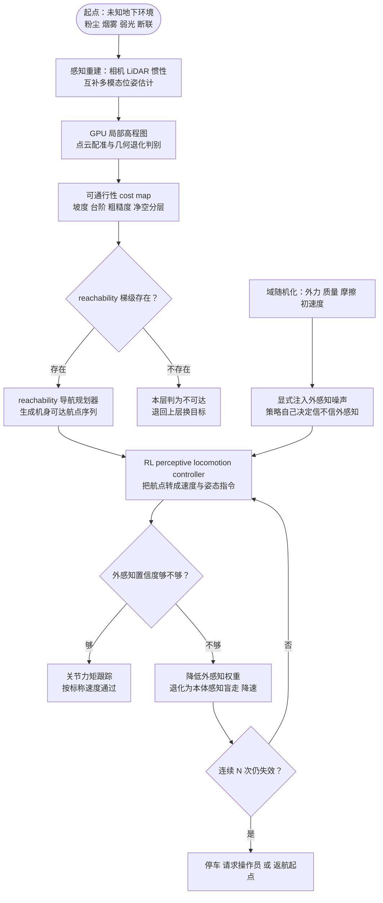
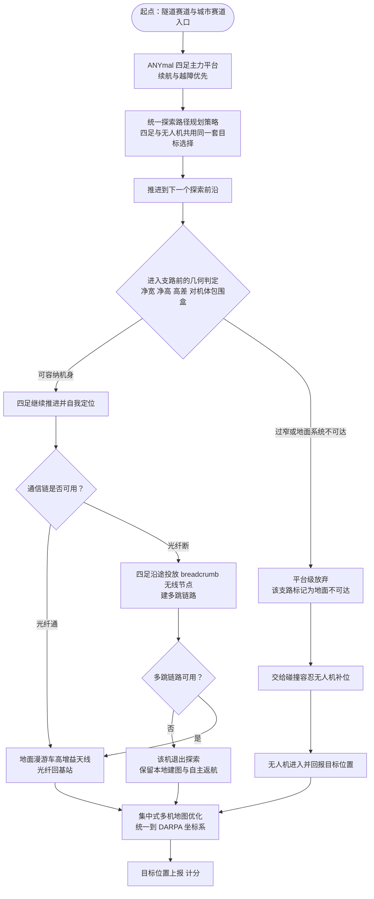
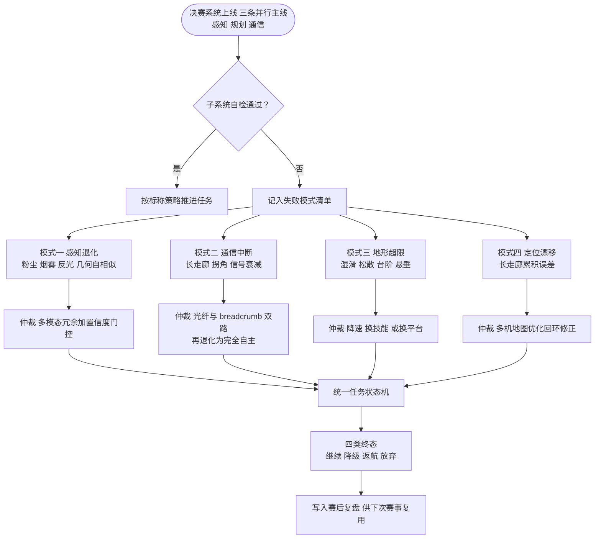
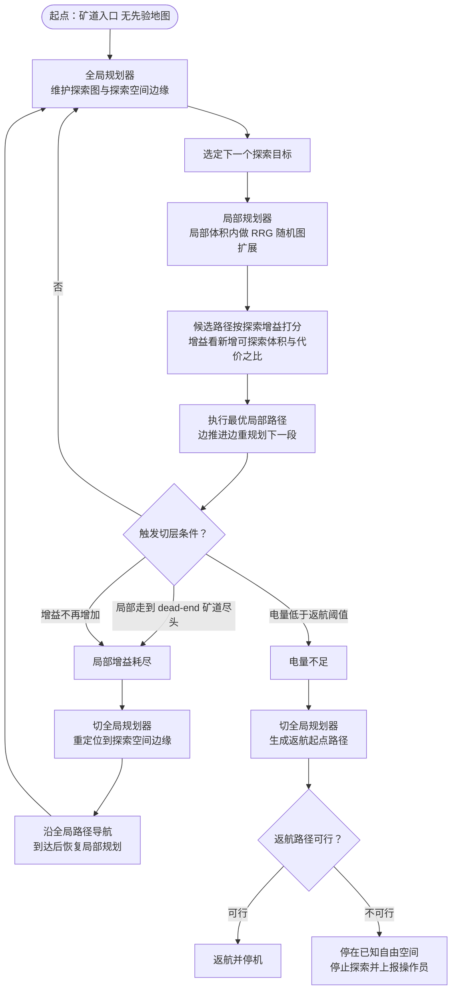
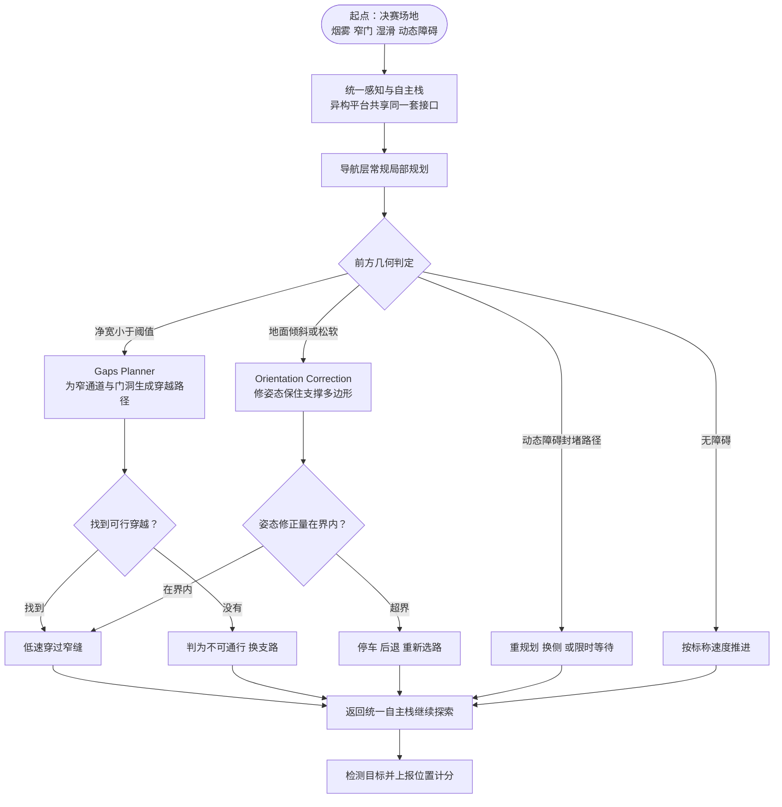
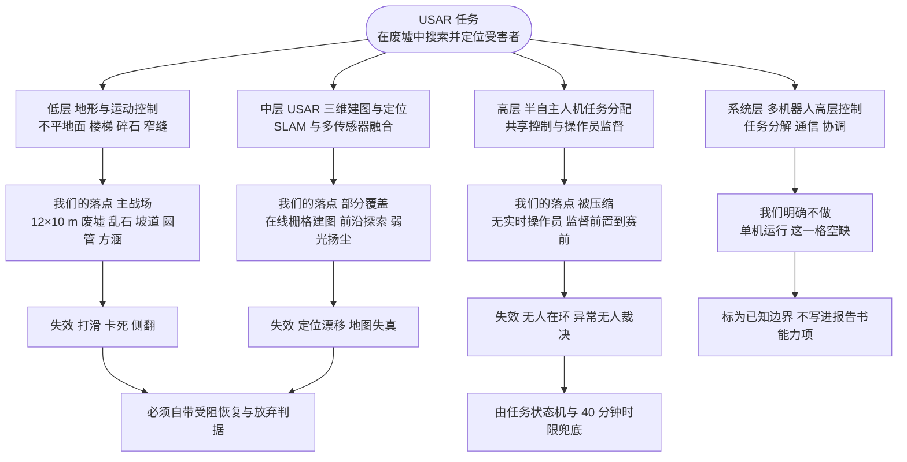

## 7. 系统级灾害响应：把前面所有模块拼成一台能在废墟里跑完 40 分钟的机器

> 一句话导读：这一组是「系统」而非「算法」——它们回答的是模块之间怎么仲裁、什么时候放弃、什么时候返航。CERBERUS 三篇是同一个系统的三层视角（系统综述 / 赛道细节 / 事后复盘），建议连续读。

### 7.1 CERBERUS in the DARPA Subterranean Challenge

**一句话**：SubT 冠军系统的纵向三层栈——把「感知重建 → 可通行性 cost map → reachability 导航 → RL locomotion controller」串成一条从传感器到关节力矩的通路，并把「外感知不可信」写成控制器可以自己决定的降级条件。

**出处**：[已核实] M. Tranzatto et al.｜2022｜*Science Robotics* 7(66): eabp9742｜DOI `10.1126/scirobotics.abp9742`｜**无 arXiv 编号**（`2201.07067` 是 7.2 那篇，别混）

**流程图**

**图里读什么**
1. 感知重建是全栈起点而不是并行支线：位姿估计和局部高程图都是下游输入，位姿一抖，cost map 与 reachability 全部跟着抖。
2. 可通行性 cost map 不是二值障碍图，是分层代价（坡度 / 台阶高度 / 粗糙度 / 净空），所以「能过但代价高」与「不能过」是两个结论：前者继续规划，后者上交换目标。
3. reachability 导航规划器问的是「机身能不能到」，不是「栅格上有没有连通路径」；不可达时它不做兜底，直接把目标退回上层。
4. RL locomotion controller 只跟踪机身级指令，不选路；但外感知退化时它握着降级的最后决定权。
5. 域随机化那一支是整张图的关键：训练时显式注入外感知噪声，等于让策略在仿真里反复经历「传感器在骗我」，部署后它才能自己决定信不信外感知，而不是等上层下命令。
6. 失败分支两级：先降权盲走降速，连续失效才停车请求操作员或返航。

**赛场映射**：弱光 + 扬尘对应第 5 条的外感知噪声注入，正是我们 `lidar.range_noise_m 0.03` 与 `dropout_probability 0.08` 的论文级依据；圆管 1.0 m、方涵 1.2×0.6 m、0.6 m 限高对应第 3 条的机身可达判据，不是栅格连通就放行；5 处乱石与 0.45 m 坡道对应第 2 条的分层 cost map，乱石是「高代价可过」而非障碍；40 分钟时限要求第 6 条的降速盲走必须配限额，否则一次退化吃掉整段预算。

**边界**：本篇是系统综述，不给可直接复现的参数或代码（控制器代码未核实），只能借结构；三层栈依赖 GPU 局部高程图与四足专用 reachability 规划器，Windows + MuJoCo 3.17 + ONNX Runtime CPU 上没有对应实现；「策略自己决定信不信外感知」是训练目标的语义，不是能读出来的门控阈值，别把它写成一个可调开关。

### 7.2 CERBERUS: Autonomous Legged and Aerial Robotic Exploration in the Tunnel and Urban Circuits

**一句话**：同一套 CERBERUS 系统在隧道与城市两条赛道的工程细节——重点不是「四足多强」，而是「什么时候承认四足过不去、把支路交给无人机补位」。

**出处**：[已核实] M. Tranzatto et al.｜2022｜*Field Robotics* 2(1):274–324｜DOI `10.55417/fr.2022011`｜arXiv:2201.07067（已抓 abs 页核对；Comments 原文为 50 pages, 25 figures, Accepted at Field Robotics 2021）

**流程图**

**图里读什么**
1. 决策顺序是「先判平台、再判路径」：不是撞上障碍才想起无人机，而是在进入支路前就用净宽 / 净高 / 高差对机体包围盒做平台级判定。
2. 平台级放弃是一个显式状态，不是沉默失败：整条支路被标为地面不可达后不再反复重试，而是切换执行者。
3. 无人机补位的判据来自摘要原文——`spaces too narrow or otherwise unreachable by ground systems`，「窄」与「不可达」是两类问题，不是一类。
4. 通信是独立的一条链：漫游车高增益天线加光纤回基站；光纤断了靠四足投放 breadcrumb 无线节点建多跳。
5. 通信彻底不可用时退路是「该机退出、保留本地建图与自主返航」，这是系统级放弃，不是任务失败——与我们「异常时停止或恢复」同构。
6. 集中式多机地图优化把各机位姿统一到 DARPA 坐标系：上报位置的精度是全局优化出来的，不是单机里程计给的。

**赛场映射**：圆管内径 1.0 m 落在第 1 条的净宽判定边界上，四足标称宽 59 cm 时余量很小；方涵 1.2×0.6 m 是「净宽够但净高不够」，属于几何可通过而机身不可达，正好由第 2 条放弃；隧道1 过窄 0.2 m 要求在进入前就判定，而不是试了才知道；S 弯与死胡同对应「换支路而非原地终态」；40 分钟时限下，补位省的是反复试错的时间，前提是判定足够快。

**边界**：补位需要异构平台，我们只有一台 Lite2，这条策略只能翻译成「标记支路不可达并换支路」，不能翻译成「换平台」；光纤与 breadcrumb 是实物通信方案，仿真里没有对应物，不要写成已实现；集中式多机地图优化在单机上无意义，只保留其单机版本（回环与位姿修正）。

### 7.3 Team CERBERUS Wins the DARPA SubT: Technical Overview and Lessons Learned

**一句话**：冠军系统的完整技术复盘，并在系统总览之外单列失败模式清单——这是三篇里唯一能直接当验收用例表用的一篇。

**出处**：[已核实] M. Tranzatto et al.｜2024｜*Field Robotics* 4(1):249–312｜DOI `10.55417/fr.2024009`｜**arXiv 编号未核实**（二手镜像给出 `2207.04914`，未在 arXiv 官方 abs 页核实，引用时不要写编号）

**流程图**

**图里读什么**
1. 复盘在系统总览之外单列失败模式清单，所以它天然对应「验收用例」：每条模式都能写成一个可复现的故障注入场景。
2. 四类模式（感知退化 / 通信中断 / 地形超限 / 定位漂移）是按源综述的失败清单归纳出的读法，不是原文的编号分类表；四类各配一条仲裁、不共用通用降级，说明降级粒度必须落在子系统上。
3. 四条仲裁收敛到同一个任务状态机，出口只有「继续 / 降级 / 返航 / 放弃」四种——这正是我们 `start_blocked` 直接跳终态所缺的那层结构。
4. 「通信中断 → 退化为完全自主」与「地形超限 → 换技能或换平台」性质不同：前者不改任务、只改信息来源；后者改任务本身。
5. 定位漂移的仲裁是多机回环修正，单机上退化为回环加位姿协方差自适应膨胀——这条是 0.28 m 固定膨胀区误判的直接解药。
6. 复盘的价值在于它承认失败；写研制报告书时，这一篇是「异常时停止或恢复」最合法的引用。

**赛场映射**：12×10 m 废墟加弱光扬尘对应失败模式一，直接映射到我们的 `lidar.noise_m`、`dropout_probability`、`beam_block_probability`；圆管 / 方涵 / S 弯对应模式三的地形超限，落在「识别并放弃」；死胡同倒车后位姿贴墙对应模式四，落在膨胀区误判；40 分钟时限要求四种终态都能在有限时间内决断，禁止无限重试。

**边界**：arXiv 编号未核实，参考文献表只能写期刊字段或标「未核实」；复盘内容是 2021 年决赛现场的硬件与传感器配置，与我们完全不同，只借结构不借阈值；四类终态里「返航」依赖有起点坐标，我们的 `--course` 有固定起点、`--explore` 没有，不能无差别套用。

### 7.4 GBPlanner: Graph-based Path Planning for Autonomous Robotic Exploration in Subterranean Environments

**一句话**：把「局部探索走到尽头」写成一个可判定的切层事件——死胡同、探索增益耗尽、电量不足三种触发条件都由全局规划器接管，生成返航或重定位路径，这就是我们缺的「受阻恢复语义」的论文原形。

**出处**：[已核实] T. Dang, F. Mascarich, S. Khattak, C. Papachristos, K. Alexis｜2019｜*IROS 2019* pp.3105–3112｜DOI `10.1109/IROS40897.2019.8968151`

**流程图**

**图里读什么**
1. 架构是**分叉式**的：全局层只管「去哪」（探索图 + 探索空间边缘），局部层只管「怎么去」（局部 RRG 扩展）；两层职责不重叠，谁也不替谁兜底。
2. 局部规划器的打分是**探索增益**而非路径长度，增益按新增可通行体积除以路径代价算——所以「走得通但拿不到新信息」的路会被判为低价值，这正是 S 弯绕错一侧仍能自救的原因。
3. 触发切层的三个条件全部显式且可计算：**局部走到 dead-end（矿道尽头）、探索增益不再增加、电量低于返航阈值**。这三条就是 `start_blocked` 该长成的样子。
4. 切层后的动作不是「再试一次」，而是**生成一条新路径**：增益耗尽 → 重定位到探索空间边缘；电量不足 → 返航起点。方向由触发条件决定，不是一个通用 fallback。
5. 全局层握有终止权：连返航路径都不可行时，停在已知自由空间并上报操作员，而不是继续消耗。
6. 恢复是有上限的：全局层接管一次就换掉目标，本地不会对着同一个不可达目标无限重试——与笔记第 120 行「恢复必须有限次并留下事件记录」一致。

**赛场映射**：死胡同（左廊道尽头）对应第 3 条的 dead-end 触发，翻译成「换前沿」而不是进入终态；新前沿选到机器人身后属于「增益耗尽 + 目标不可达」的混合，由全局层重定位到未探索边缘；S 弯绕错一侧靠第 2 条增益打分压低高代价候选、由全局层换支路；40 分钟时限与到点停车正是第 4 条返航分支，也是赛题「到点停车」的文献级对应；圆管与方涵这类长走廊化空间，切层频率会明显高于矿井主巷道。

**边界**：2019 年矿井场景，单机、无动态障碍、通信假设理想，比 12×10 m 废墟更「走廊化」，S 弯密集场景要额外保留拓扑候选；源综述里的「500 ms 重规划 3 m 轨迹」是 Buchanan 2021 的数字，不是本篇，别混引；未核实到官方代码仓库，只能借语义不能借实现。

### 7.5 Heterogeneous Robot Teams with Unified Perception and Autonomy (Team CSIRO Data61)

**一句话**：异构机器人队共享同一套感知与自主接口，靠两个专门的防失败行为——Gaps Planner 过窄缝、Orientation Correction 防倾覆——把「物理上差点过不去」变成可管理的失败而不是翻车。

**出处**：[已核实] N. Kottege et al.｜2024｜*Field Robotics* 4:313–359｜DOI `10.55417/fr.2024010`｜arXiv:2302.13230（已抓 abs 页核对；arXiv 页标题全称为 Heterogeneous robot teams with unified perception and autonomy，2023-02 提交）

**流程图**

**图里读什么**
1. 两个防失败行为挂在导航层同一个分叉上，不是两个独立模块：先判几何（净宽 / 倾斜 / 是否被动态障碍封堵），再决定调谁。
2. **Gaps Planner** 的语义是「窄缝是一类可解问题」，不是「窄缝等于障碍」：它为窄通道与门洞专门生成穿越路径，但也带自己的失败出口——找不到就判不可通行、换支路。
3. **Orientation Correction** 的语义是「姿态是可修的」：倾斜或松软地形上先修机身姿态、保住支撑多边形，而不是直接放弃这段；修正量超界才停车后退重选。
4. 四条分支最后都收敛回统一自主栈——说明防失败行为的返回值是「新状态」，不是「终止」，这一点和我们现有终态设计正相反。
5. 摘要原文列出的赛题难点包括「会移动封堵路径的动态障碍」，对应处理是重规划 / 换侧 / 限时等待，不是硬闯。
6. 整篇前提是「统一感知与自主」：异构平台共享接口，所以换平台与换行为是同一层决策。

**赛场映射**：圆管 1.0 m 与方涵 1.2×0.6 m 对应 Gaps Planner，但 0.6 m 限高是净高问题，Gaps Planner 管净宽，限高还得靠蹲伏与低姿态；S 弯加窄门洞对应穿越路径生成；5 处乱石、0.45 m 坡道、湿滑对应 Orientation Correction 的姿态修正；动态障碍封堵对应重规划与限时等待，40 分钟时限下必须给等待设上限；弱光扬尘属于上游感知退化，本篇不作为重点。

**边界**：异构多机加「只允许一名人类监督员」的设定与我们单机、无实时操作员不同，共享控制部分不能照搬；Gaps Planner 与 Orientation Correction 在论文层面没给出可直接复现的判据阈值，我们只能借「存在这两个行为」的结构，阈值须自行标定并记 `sim_assumed`；我们没有空中平台，「换平台」只能退化为「换支路」。

### 7.6 Robotic Urban Search and Rescue: A Survey from the Control Perspective

**一句话**：把 USAR 拆成四层控制问题的综述——低层地形控制、中层 3D 建图、高层半自主任务分配、系统层多机协调；它不给方法选型，但给出「我们的赛题落在哪一格」的坐标系。

**出处**：[已核实] Y. Liu, G. Nejat｜2013｜*JIRS* 72(2):147–165｜DOI `10.1007/s10846-013-9822-x`

**流程图**

**图里读什么**
1. 四层是**问题分解**不是实现分层：同一台机器人在四层上都有职责，任何一层缺失，在赛场上都统一表现为「整机不行」。
2. 低层问「这一步踩得稳不稳」，中层问「我在哪、哪里还没看过」，高层问「人给什么、机器自主到什么程度」，系统层问「多台怎么分工」——四个问句互不替代。
3. 我们的落点被压在第一、二层，这是赛题决定的：12×10 m、单机、40 分钟、无实时操作员。
4. 半自主那一格我们只保留「赛前设定、赛中不干预」，等于把共享控制压缩成任务状态机——这叫覆盖，不叫实现，写报告时要区分。
5. 多机那一格我们明确不做；标成已知边界比含糊地说「可扩展」更诚实，也更符合诚信材料的要求。
6. 每层都挂了一个失效模式，最后两格收敛到同一句结论：「必须自带受阻恢复」，正是我们当前 `start_blocked` 跳终态所缺的东西。

**赛场映射**：12×10 m 废墟、5 处 4–12 cm 乱石、0.45 m 坡道落在第一格主战场；圆管 / 方涵 / S 弯落在第一格与第二格交界，既要过得去也要知道哪里没看过；弱光扬尘是第二格的输入退化；40 分钟与到点停车是第三格被压缩后的产物（状态机 + 时限）；死胡同加位姿贴墙是典型的第一格失效，需要恢复语义而非终态。

**边界**：2013 年综述，早于深度强化学习与 SubT 时代，只给问题框架、不给方法选型依据；四层分解里没有独立的「通信」层（默认多机通信可用），而我们的废墟有断联风险，这一格得靠 7.2 与 7.3 补；综述不提供任何量化阈值，不能当参数来源。