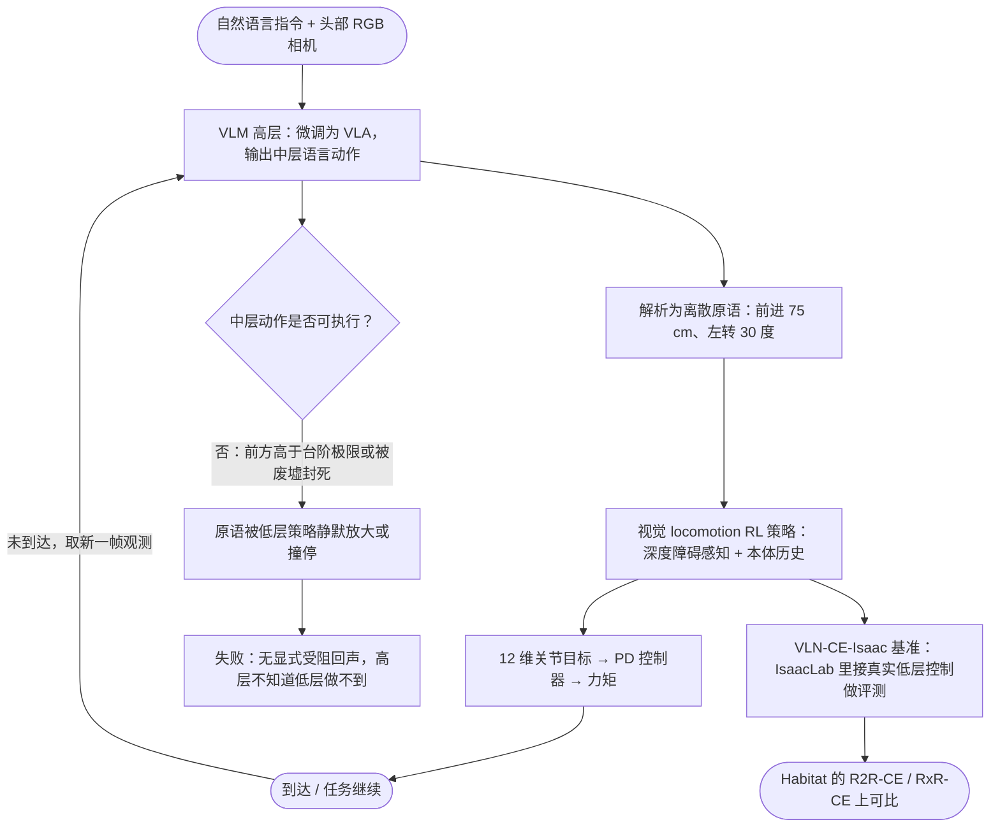
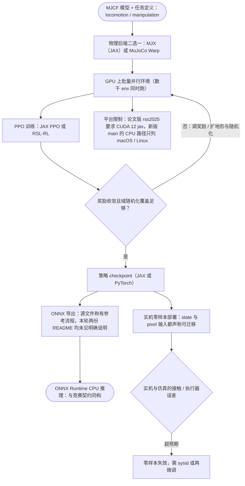
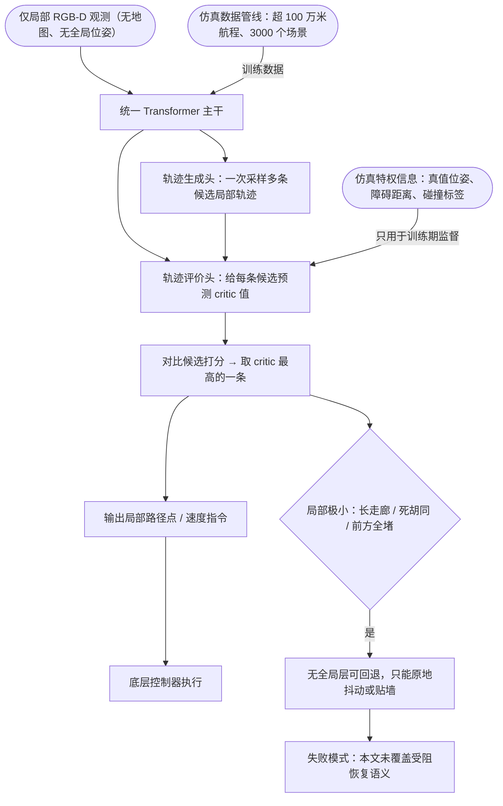
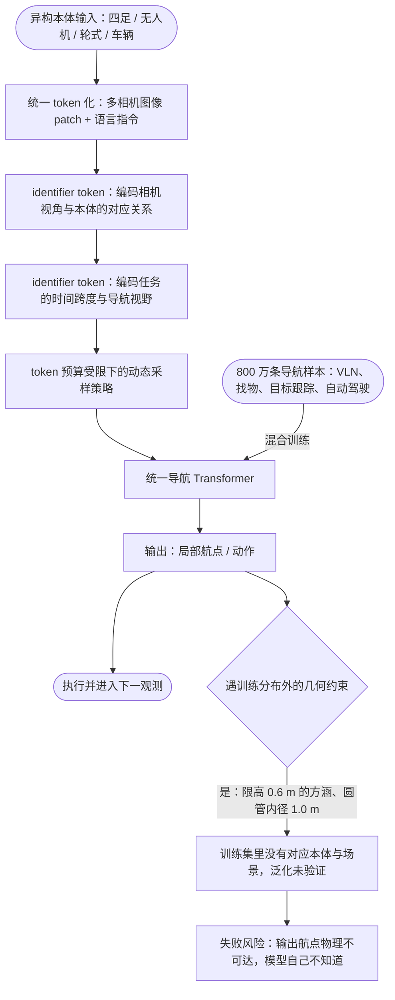
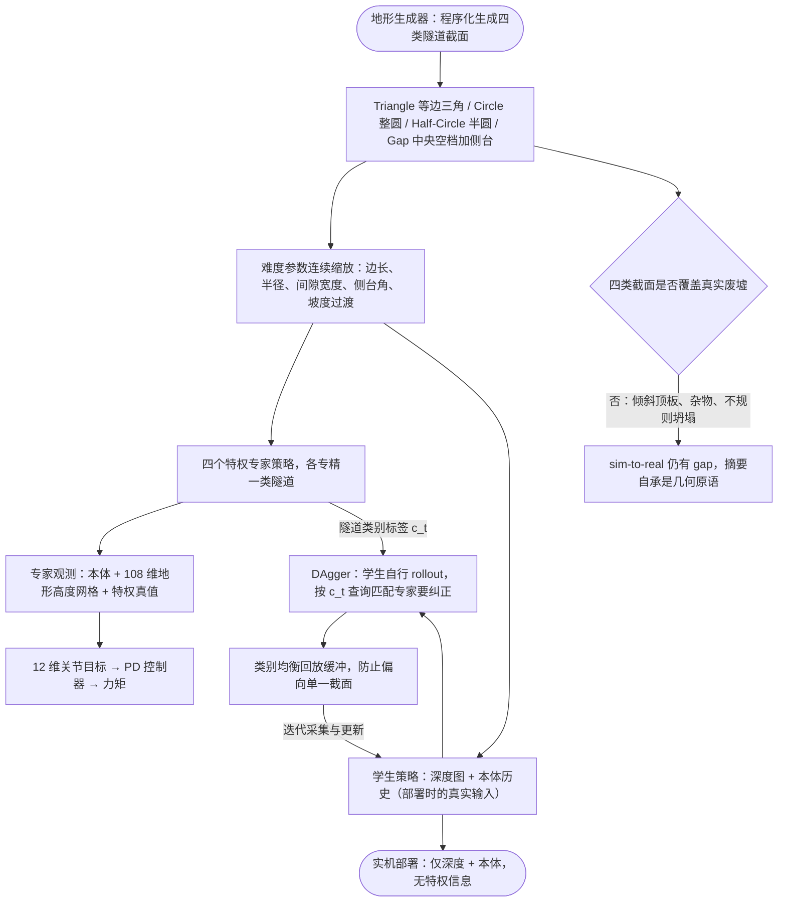
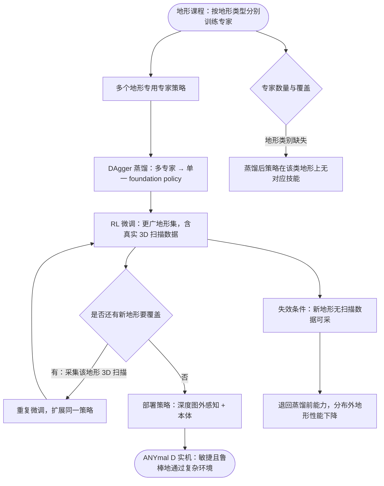
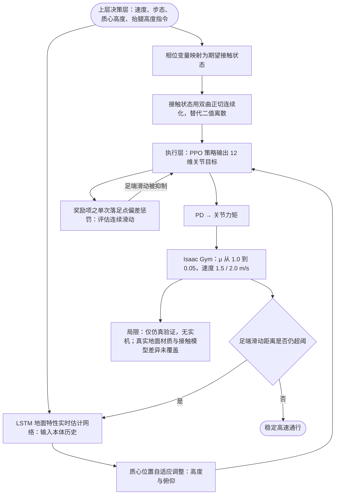
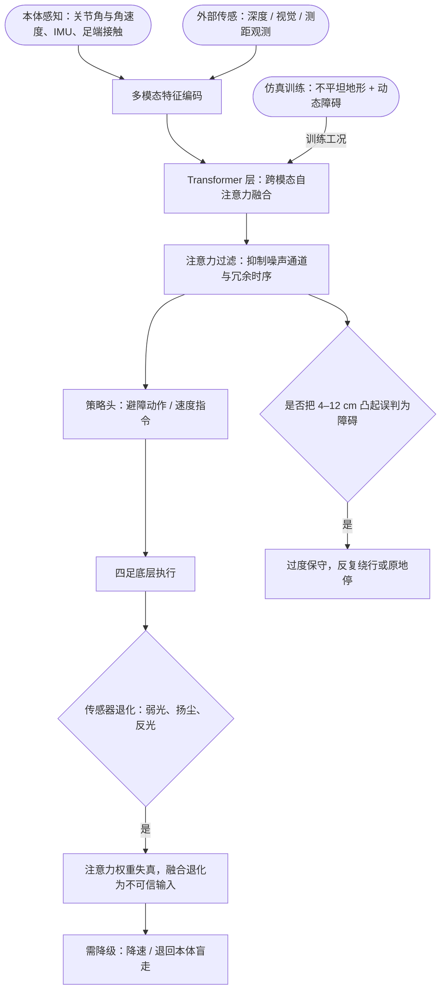
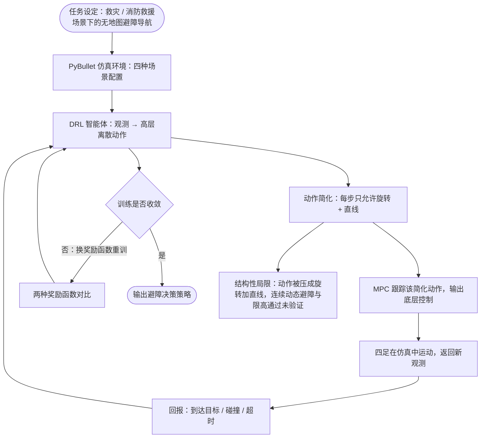

## 8. 2024–2026 前沿与国内可直连资料：哪些是趋势，哪些现在能用

> 一句话导读：这一组的作用不是「技术选型」，而是①判断趋势（VLA / 导航基础模型 / 仿真基座）②给研制报告书提供**国内可直连**的引用来源。凡是 venue 或编号存疑的，只能当线索，不进正式参考文献。

### 8.1 NaVILA: Legged Robot Vision-Language-Action Model for Navigation

**一句话**：不把语言指令一步翻译到 12 个关节，而是让 VLA 只输出「前进 75 cm」这类**带空间量的中层语言动作**，再交给视觉 RL locomotion 策略执行——这就是「高层选路 / 低层走路」两层解耦的文献依据。
**出处**：[已核实] A.-C. Cheng, Y. Ji, Z. Yang, Z. Gongye, X. Zou, J. Kautz, E. Bıyık, H. Yin, S. Liu, X. Wang（UC San Diego / USC / NVIDIA）｜2024-12-05 v1 / 2025-02-17 v2｜项目页标 RSS 2025（arXiv Comments 字段只写项目页，未写会议）｜`arXiv:2412.04453`｜项目页 `https://navila-bot.github.io/`

**流程图**

**图里读什么**
1. `B` 是整篇的核心：VLA 的输出空间是**语言**而非动作，所以能力边界被明确切成两段——VLA 只负责「去哪、走多远」，不负责抬腿。
2. `C → D` 是接口契约。项目页把代码拆成两个仓库（VLA 侧与 low-level 侧），说明这层接口在工程上真的是可分离的，不是论文里的写法。
3. `G/H/I` 是我们最该抄的一条：中层语言原语**没有回传执行失败的能力**。高层说「前进 75 cm」，低层被限高逼停时，失败信息不会自动回到高层——死胡同与隧道口必须在高层显式判。
4. `J` 说明它的评测不是只用竞技场式成功率，而是在 IsaacLab 里接真实低层控制（VLN-CE-Isaac），比纯 Habitat 的「理想控制器」更接近我们要面对的问题。

**赛场映射**：直接支撑我们「高层选路 + 低层走路」的分工写进研制报告书。低层策略在训练期直接用 LiDAR 与环境交互（项目页明确「未使用 teacher-student 蒸馏」），这条可以为我们「不做特权蒸馏、直接以感知做 RL」的取舍提供依据。
**边界**：实机平台是 Unitree Go2、G1 与 Booster T1，本项目是 Go2，可直接类比；但论文的场景是室内外**开阔** VLN，不是限高 0.6 m 的方涵，也没有「过窄应放弃」的判据。`G/H/I` 那条缺口是我们要自己补的，不能算它解决了。

### 8.2 MuJoCo Playground

**一句话**：一套「MJX / MuJoCo Warp 并行训练 → 策略导出 → 实机零样本迁移」的全开源基座，是这批前沿里**唯一与我们 MuJoCo 3.17 生态同源**的工程出口。
**出处**：[已核实] K. Zakka, B. Tabanpour, Q. Liao, M. Haiderbhai, S. Holt, J. Y. Luo, A. Allshire, E. Frey, K. Sreenath, L. A. Kahrs, C. Sferrazza, Y. Tassa, P. Abbeel（13 人）｜2025-02-12 v1（无 v2）｜arXiv Comments 无会议字段，官方 README 印证属 **RSS 2025**（「RSS 2025 benchmark suite」），奖项等级「Outstanding Demo Paper」本轮未找到可核实页面｜`arXiv:2502.08844`｜`https://github.com/google-deepmind/mujoco_playground`（**Apache-2.0**，README 已核实）

**流程图**

**图里读什么**
1. `B → C` 是它区别于 legged_gym 的关键：物理引擎本身并行化（MJX / Warp），不依赖 Isaac Gym 那套 Python 3.6–3.8 + CUDA 的老栈。
2. `F → G → H` 是我们唯一关心的链路。**但必须诚实**：论文与仓库 README 都只写到「训练 + 部署」，ONNX 导出在本轮抓到的两份 README 里都没有明确步骤，这条要按「未核实」处理。
3. `L` 是现实约束：论文对应的 `rss2025/` 那版要求 CUDA 12 的 jax，README 明写 `pip install "jax[cuda12]"`；新版 main 已重写为 PyTorch + reaf-sim，虽给了 CPU 路径（`make sync-cpu`），但平台只列 macOS / Linux。**Windows + CPU-only + MuJoCo 3.17 的组合，官方未声明支持。**
4. 四足环境确实有（README 明确 quadruped 与 bipedal locomotion），但 Go1 / Go2 / Spot 的逐个机型清单与 Joystick / 跌倒恢复任务名，本轮未在 README 正文中逐项核实。

**赛场映射**：与我们 MuJoCo 3.17 + ORT CPU 的距离是「同引擎、不同栈」——MJCF 资产与建模习惯可以复用，训练栈（JAX/CUDA）不能直接搬。**结论：读它的环境定义与奖励设计，不指望在本机跑通训练。**
**边界**：Apache-2.0 友好，但训练侧 GPU 依赖是硬门槛；本机 CPU-only、Windows 支持未核实。仓库已于 2026 重写（main 为 PyTorch/reaf-sim，论文版退到 `rss2025/`），引用时务必写清版本，否则半年后别人复现不了。

### 8.3 NavDP: Learning Sim-to-Real Navigation Diffusion Policy

**一句话**：把「生成候选轨迹」与「给候选轨迹打分」塞进**同一个 Transformer**，用仿真里的特权信息监督 critic，纯仿真训练即可零样本迁移到真机。
**出处**：[已核实] W. Cai, J. Peng, Y. Yang, Y. Zhang, M. Wei, H. Wang, Y. Chen, T. Wang, J. Pang（9 人）｜2025-05-13 v1 / 2025-12-24 v3｜会议信息未在 arXiv Comments 出现｜`arXiv:2505.08712`｜完整标题为 *NavDP: Learning Sim-to-Real Navigation Diffusion Policy with Privileged Information Guidance*｜项目页 `https://wzcai99.github.io/navigation-diffusion-policy.github.io`

**流程图**

**图里读什么**
1. `C → D` 是「生成 + 判别」合体，也是它能甩开级联式 modular 框架的原因：不需要人工调 costmap 权重，也不需要大量真机示范。
2. `P` 是超关键的一行：**特权信息只用于训练**（给 critic 当标签），部署时只用 RGB-D。这条正是我们「仿真里可以作弊、部署时必须干净」的纪律。
3. `T` 是数据规模：摘要写 **over one million meters / 3,000 scenes**。源文件里的「363.2 km / 1244 场景」与摘要不一致，**以摘要为准**，源文件数字按未核实处理。
4. `H/I/J` 是它的天花板：输入被限定为局部 RGB-D，天然没有全局拓扑，长走廊与死胡同属于它的盲区——和我们 `start_blocked` 的痛点撞在一起。

**赛场映射**：可作「如果不做全局规划、只做反应式避障」的性能上界参考；也提醒我们：纯局部策略的死胡同问题不是调参能解决的，必须有全局层或受阻恢复。
**边界**：只在仿真里训练，摘要声称跨环境与跨本体零样本，但**未逐项列出四足 / 轮式 / 人形的具体机型**（源文件那三位一体的说法属二手概括）。它是趋势标尺，不是我们 15 天内能复现的方案。

### 8.4 NavFoM: Embodied Navigation Foundation Model

**一句话**：把四足、无人机、轮式、车辆的数据混在一起训一个**跨本体跨任务**的导航基础模型，用 identifier token 抹平相机配置与时间跨度的差异。
**出处**：[已核实] J. Zhang, A. Li, Y. Qi, M. Li, J. Liu, S. Wang, H. Liu, G. Zhou, Y. Wu, X. Li, Y. Fan, W. Li, Z. Chen, F. Gao, Q. Wu, Z. Zhang, H. Wang（17 人）｜2025-09-15 v1 / 2025-09-16 v2｜arXiv Comments 只有项目页，**会议录用信息未核实**｜`arXiv:2509.12129`｜项目页 `https://pku-epic.github.io/NavFoM-Web/`

**流程图**

**图里读什么**
1. `C/D` 是它唯一真正的技术贡献点：不同机器人的相机数量、安装位置、任务时长都不一样，用 token 把这两类差异显式标出来，模型才可能共用一套权重。
2. `E` 是工程约束的诚实呈现：真实部署有 token 上限，所以对观测 token 做动态采样——这说明它已经在为「算力受限」做妥协。
3. `T` 是它的体量：800 万样本，覆盖四类任务。**这是趋势判断的证据，不是可复现的配方。**
4. `I/J/K` 是我们必须写进报告的边界：跨本体泛化不等于跨**几何约束**泛化，限高与窄通道它没有对应训练分布。

**赛场映射**：写「导航基础模型是 2025 年的明确趋势」时用它；同时用它反证——**趋势不等于可用**，我们不可能在赛前训练或微调这类模型。
**边界**：会议录用信息未核实，只有 arXiv 预印本。绝对不要把「800 万样本 / 跨本体」当成我们方案的可行性依据。

### 8.5 Robot Squid Game（SQUID）

**一句话**：程序化生成四类隧道截面（Triangle / Circle / Half-Circle / Gap），每类训一个特权专家，再用 DAgger 把四个专家蒸馏成一个只吃**深度图 + 本体历史**的学生策略——圆管 / 方涵隧道最精准的论文级对应之一。
**出处**：[已核实] A. H. Raj, D. Das, X. Xiao（George Mason University 计算机系）｜2026-05-13 v1｜**venue 未核实**（arXiv Comments 无会议字段）｜`arXiv:2605.13665`｜**代码 / 项目页未核实**（抓取到的摘要页与 HTML 全文均未给仓库链接）｜SQUID = Skill-fused Quadrupedal locomotion Using Imitation and Distillation

**流程图**

**图里读什么**
1. `A → C` 是它的第一贡献：**截面可参数化**。Triangle 靠边长缩短加随机旋转、Circle 靠半径递减、Half-Circle 靠 Z 法向随机翻转、Gap 靠间隙变宽与侧台角增大。这正好覆盖我们圆管（内径 1.0 m）与方涵（1.2×0.6 m）的两个自由度：**净宽**与**限高**。
2. `D → E` 是特权专家的作弊点：108 维地形高度网格是仿真真值，真机上根本拿不到。所以才需要 `H` 的蒸馏。
3. `H → I` 是工程上最值得抄的细节：**按隧道类别查询匹配专家** + **类别均衡采样**。如果只用一个专家或不做类别均衡，多个几何的技能会互相覆盖——论文的消融项里就有「单教师 vs 多教师」。
4. `J` 是最终形态：深度 + 本体历史，与我们 Go2 的传感配置形态一致。
5. `K/L` 是它自己承认的边界：四类截面只是**几何原语**，用来表征尖角、净空变化、基底倾斜、旋转不对称四类因素，不代表真实废墟的全部复杂度。

**赛场映射**：**这是本组最重要的一篇**。它给出了一条我们可以照抄的方法论链：先程序化造隧道 → 每类训专家 → 蒸馏成单策略。即使不复现，也足以支撑报告书里「隧道类地形应做课程化程序生成而非固定地图」的论证。
**边界（必须写进报告）**：**venue 未核实、代码与项目页未核实**，只能当线索，不进正式参考文献。此外：①实机平台型号在抓取到的章节中未确认；②摘要未逐条给出成功率与碰撞率数字，不要凭印象填；③它解决的是「能过去」，没有解决「该不该过去」——过窄判断仍需我们自己的规则层。

### 8.6 Parkour in the Wild

**一句话**：多专家蒸馏出统一 foundation policy，再用 RL 在更广地形集（含真实 3D 扫描）上微调，并允许**反复微调**扩展到新地形，深度图作外感知，ANYmal D 实机验证。
**出处**：[已核实] N. Rudin, J. He, J. Aurand, M. Hutter｜2025-05-16 v1｜**会议信息未核实**（arXiv Comments 无字段）｜`arXiv:2505.11164`｜完整标题为 *Parkour in the Wild: Learning a General and Extensible Agile Locomotion Policy Using Multi-expert Distillation and RL Fine-tuning*

**流程图**

**图里读什么**
1. `A → C` 与 SQUID 同构（多专家 + DAgger），差别在它蒸馏的是**跨地形技能**而非跨隧道截面，且多了一步 `D` 的 RL 微调。
2. `E → F` 是标题里 "Extensible" 的实义：**框架可扩展**，不是策略天生全能。新地形靠「采扫描 + 再微调」，这条对我们很重要——它说明「一次训练通吃」是伪需求。
3. `I/J` 是它的真实成本：微调依赖该地形的 3D 扫描。**没有扫描就没有扩展**，这是野外部署的硬约束。
4. `K/L` 提醒专家覆盖度决定蒸馏上限：地形类别缺失时，蒸馏不可能无中生有。

**赛场映射**：摘要开头就点名 search and rescue 与 space exploration，与我们赛题同语境。可用来论证「先分技能再合并」的路线，以及「预留再微调接口」的工程建议。
**边界**：会议信息未核实；算力与训练时长未在摘要中给出，属于典型 ETH 系重资产工作，**不可复现**。另外它的深度图输入与我们 Go2 的头部相机形态接近，但本体是 ANYmal D（更大更重），动力学差异不能忽略。

### 8.7 《面向不同粗糙程度地面的四足机器人自适应控制方法》

**一句话**：模型与学习融合的分层控制：上层决策、下层执行，LSTM 在线估计地面特性并调质心高度，奖励里加**单次落足点偏差惩罚**，在 Isaac Gym 里把 μ=0.05 的极低摩擦也跑住了。
**出处**：[已核实] 张楠杰、陈玉全、季茂沁、孙运康、王冰（河海大学人工智能与自动化学院，常州）｜《自动化学报》2025, 51(7): 1585–1598｜DOI `10.16383/j.aas.c240738`｜**国内直连全文开放**：`https://www.aas.net.cn/article/doi/10.16383/j.aas.c240738`（收稿 2024-11-14，录用 2025-03-05，网络出版 2025-04-30）

**流程图**

**图里读什么**
1. `C` 是一个容易被忽略但很实用的点：把离散的 0/1 接触判断换成双曲正切连续描述，消掉相位切换瞬间的力矩冲击。表格里对比了二值离散与双曲正切在四种步态下的表现。
2. `E → F` 是「自适应」的实体：LSTM 从本体历史估地面特性，然后**只调质心位置**（高度/俯仰），不动步态结构。这种「小动作、低风险」的自适应很适合我们。
3. `H` 是奖励设计的巧思：不直接罚脚滑速度，而是罚**单次落足点与期望落足点的偏差**，用一次性事件评估连续滑动状态。
4. `I/J` 给出可引用的数字：μ=0.05 时质心高度调整 0.0610 m，维持 1.4284 m/s，足端滑动 0.308 ± 0.0050 cm（表 6 中该行滑动写作 0.308 ± 0.015 cm，引用时以摘要为准并注明来源）。
5. `L` 是必须写清的边界：**Isaac Gym 仿真，无实机**。

**赛场映射**：三项直接可用：①摩擦/地面特性随机化的参数依据（`randomization_sampled.provenance` 的 `vendor_reference` 可以落到这篇）；②「极低摩擦 + 需要保持速度」这一工况的量化参考；③落足点偏差惩罚这一奖励项可以直接翻译成我们 `randomization.py` / 奖励项里的候选。
**边界**：只有仿真，没有实机；且是**运动控制**层论文，与导航避障无关。国内直连、全文开放、中文写作，是这一组里最适合作为报告书正式引用的两篇之一。

### 8.8 《基于多模态信息融合的四足机器人避障方法》

**一句话**：把本体感知与外部传感做多模态融合，用 Transformer 层 + 注意力机制过滤传感信息，再做避障决策——这是我们能直接下载、直接引用的国内避障向工作。
**出处**：吕友豪、贾袁骏、庄圆、董琦｜《工程科学学报》2024, 46(8): 1426–1433｜DOI `10.13374/j.issn2095-9389.2023.07.01.002`｜**国内直连**：`https://cje.ustb.edu.cn/article/doi/10.13374/j.issn2095-9389.2023.07.01.002`｜本轮仅核到 DOI 指向该刊同名文章页，**摘要与正文因站内安全验证（反爬）未取到，实验数字与网络细节均未核实**

**流程图**

**图里读什么**
1. `A + B → C → D` 的骨架就是「多模态融合」：把本体状态与外部传感放在同一注意力空间里做联合表征，而不是事后加权平均。
2. `E` 是它与普通融合的区别：**注意力同时起过滤作用**，能压低噪声传感通道的权重——这与我们弱光、扬尘的工况直接相关。
3. `I/J` 是这套机制的反面：注意力靠数据分布学出来，传感器整体退化时权重本身也失真，所以必须配一条降级策略（对标 Miki 2022 的 graceful degradation）。
4. `K/L` 是我们要提防的第二个失败模式：把 4–12 cm 的可跨越凸起当成障碍，导致过度保守。这正是 ViPlanner 那类语义可通行性工作要解决的问题。

**赛场映射**：可作为「多模态融合 + 注意力过滤」技术路线的国内引用；也支撑报告书里「传感融合要带降级策略」的论证。相比国外论文，它的优势是**评委可直接访问、中文表述一致**。
**边界（重要）**：本轮**未取到摘要**，图是据综述源文件的描述重建的，不是据原文逐节核对。引用前必须自行下载原文核对：①是否真的是 Transformer 而非 CNN+注意力；②外部传感具体包含哪几路；③实验数字。在核对完成前，它只能算「国内可直连的线索」，不能当已核实文献写进参考文献表。

### 8.9 《基于深度强化学习的四足机器人决策算法研究》

**一句话**：面向救灾 / 消防救援导航，在 PyBullet 里搭**无地图**避障仿真，用 MPC 把每步动作简化为「旋转 + 直线」，以此打通 DRL 决策与四足底层控制。
**出处**：张苏晨（华南理工大学，导师刘富春）｜硕士学位论文 2024｜**正文全文获取途径未核实**（源文件只给高校图书馆检索页，本轮未能定位可访问全文）｜学位论文非同行评议文献

**流程图**

**图里读什么**
1. `D` 是全文最关键的工程取舍：**把连续控制问题降维成「转向 + 直行」的离散决策**，这样 DRL 的动作空间才小到能训。这是典型的「先跑通再优化」，也正是我们需要警惕的地方。
2. `E` 用 MPC 承接简化动作，等于把「决策」与「执行」切开，思路和我们「高层选路 + 低层走路」同源，但粗粒度差很多。
3. `B` 的「无地图」是双刃剑：省掉 SLAM 与建图，但也失去全局一致性，无法处理死胡同返航与隧道口放弃判断。
4. `H/I` 的两种奖励函数对比说明这类工作主要靠奖励工程推进，鲁棒性论证较弱。
5. `K` 是它不能覆盖的部分：圆管内径 1.0 m、方涵限高 0.6 m 这类**需要机身姿态调整**的通过性，被「旋转 + 直线」的动作抽象直接排除了。

**赛场映射**：只能作背景与对标——说明「国内硕士层面已经在做无地图 DRL 避障」，可用于综述段落；对我们的方案没有可直接搬的模块。
**边界**：**正文获取途径未核实**，作者、导师、年份、单位来自源文件，未独立核实；学位论文非同行评议，**只做线索，不进正式参考文献**。特别提醒：不要用它支撑任何「四足 + DRL + 废墟」的技术判断，它的动作抽象与我们的需求不在同一层面。

