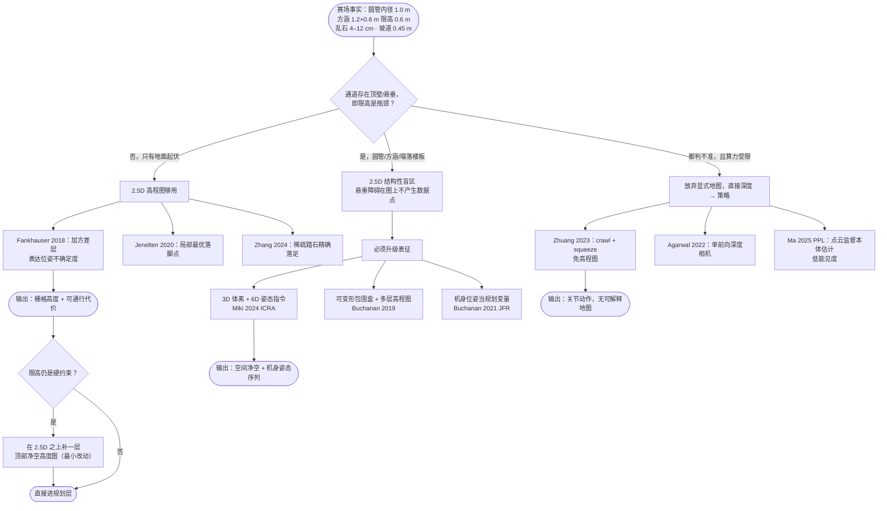
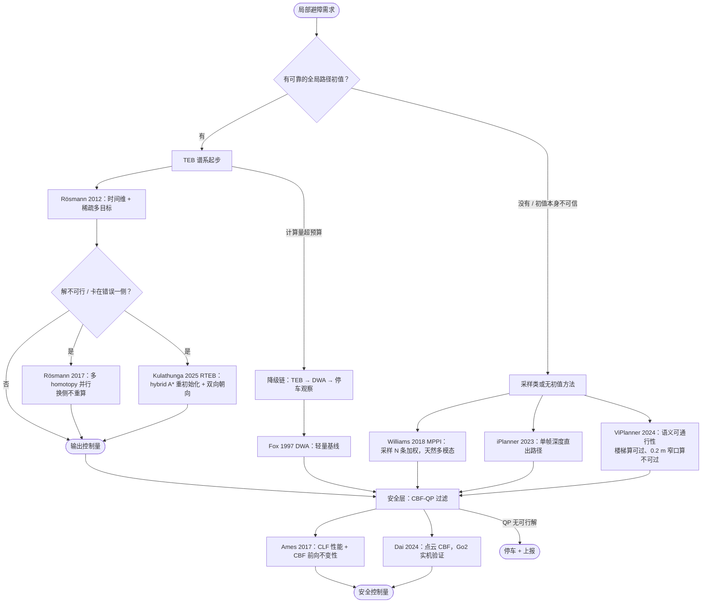
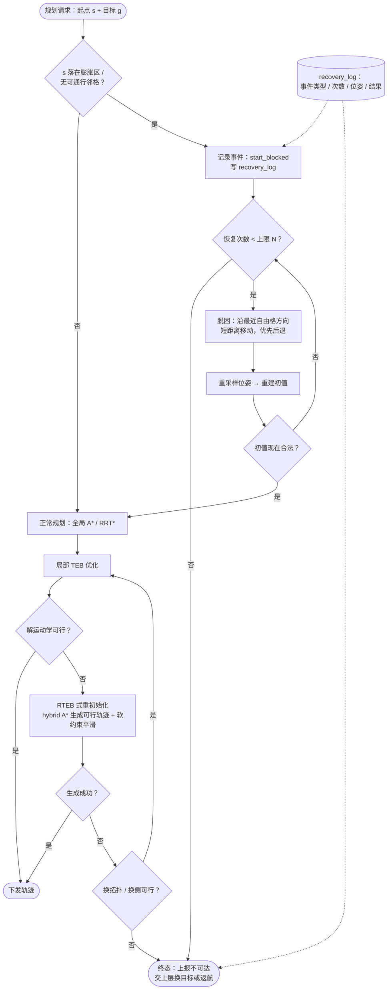

## 9. 横切对比：把前八节压成三张决策图

> 一句话导读：前八节是「一篇一篇看懂」，这一节是「一堆论文怎么选」。三张图分别对应我们三个真实的决策点：**地图怎么表征**、**局部规划器用谁**、**受阻了怎么恢复**。第三张是我们当前卡点的直接产物。

### 9.1 决策图一：地形怎么表征（2.5D 高程图 / 3D 体素 / 直接深度端到端）

**读这张图的结论**：我们同时有「乱石 + 坡道」和「圆管 + 方涵限高」，属于**必须双表征**的场景。工程上最低成本的解法不是上 3D 体素，而是**在现有 2.5D 高程图旁再挂一张「顶部净空图」**——同一套 `plan_grid` 代码，多一个通道。这条建议的依据是 §2.3（限高盲区）+ §4.3（方差层可扩展）。

### 9.2 决策图二：局部规划器用谁

**读这张图的结论**：**不要一上来换 MPPI 或学习式规划**。RTEB（§2.6）给出的路径是「留在 TEB 生态里，用另一个算法救它」，工程风险远低于换赛道。CBF-QP（§6.5/§6.9）是唯一可以**独立于规划器**加的一层，也是唯一有 Go2 实机验证的（§6.9）。

### 9.3 决策图三：`start_blocked` 恢复流程（文献版）

> 这是我们当前卡点的直接产物。综述 §4 第一行写的症状是：**前沿选到机器人身后 + 估计位姿贴墙 → `plan_grid` 起点落在 0.28 m 膨胀区 → 直接进入终态 `start_blocked`，整段任务终止**。文献里这件事从来不是终态。

**这张图的四条边，正好是我们要写的四段代码语义（不是代码本身）**：

| 边 | 文献出处 | 语义 | 为什么必须有 |
|---|---|---|---|
| `B` 的「是」分支 → `H` | Kulathunga 2025 §2.6 | 把 `start_blocked` 从**终态**改成**可恢复事件** | 现在一次贴墙就整段任务终止，赛题「异常时停止或恢复」直接失分 |
| `H → I` | 我们自己的边界条件 | 恢复次数上限 N + 事件记账 | 防止无限重试把「真的不可达」伪装成「还在努力」，对应笔记第 120 行的要求 |
| `J → K` | RTEB 双向朝向 §2.6 | 脱困允许**后退** | 起点在膨胀区时，唯一可行方向常常是身后 |
| `M/N → X` | GBPlanner §7.4 + Buchanan 2021 §2.5 | 局部无解 → 交给全局层重定位/返航 | 死胡同不是「失败」，是「该换层了」 |

**这条链的风险点**：脱困动作会改变真实位姿，而我们是**在仿真里改的**（MuJoCo）。仿真里后退可能撞上没建模的墙体，实机上后退可能踩空。所以恢复动作必须有独立的碰撞检查，不能直接复用规划器的 costmap——这一点文献里 RTEB 没讲，是我们的空白（见 9.4）。

### 9.4 三张图之外：文献给不了我们的三件事

1. **恢复动作本身的安全校验**：RTEB 假设机器人可以「后退脱困」，没讨论脱困过程中撞到什么。我们的场地有 0.28 m 膨胀区紧贴墙体，后退 20 cm 就可能出界。
2. **前端状态机与规划器的责任划分**：CERBERUS（§7）用 GBPlanner 做层间仲裁，但它是有全局图探索的系统；我们只有 frontier 探索 + TEB，层间仲裁要自己定。
3. **限高判定的数值口径**：Buchanan 2021 给了「站高 80 cm vs 开口 60 cm」的范式（§2.5），但「余量留多少算安全」没有通用公式——这是要我们实机测的，属于 `measured_pending`。

---

## 10. 引用边界：这份文档能拿去写报告书吗

### 10.1 可以，但必须守住三条

1. **只引 `[已核实]`**。本文件所有「出处」行的字段都照抄综述，综述标「未核实」的（如 TEB 2012 的 DOI、FAST-LIO 正式 DOI、SQUID 的 venue）在这里仍然是「未核实」，**不要因为读起来顺畅就当成已确认**。
2. **图是解读，不是原文**。流程图是把论文方法压成机制后的**我们的理解**，报告里引用时必须写「据 X 方法整理」而不是「X 论文第 N 节」——因为我们没有逐句核对原文的图号与公式。
3. **二手解读单独标注**。凡综述里标「第三方解读」的内容（例如 Medeiros 2025 的 probing 降速、Miki 2024 的 `collapsed building` 部署、DreamWaQ++ 的细节），本文件同样标注，进报告时要么标「据第三方解读」，要么不写。

### 10.2 与其他文档的分工（不要混写）

| 文档 | 回答什么 | 与本文件的关系 |
|---|---|---|
| `plan/四足机器人导航避障文献综述与选型建议.md` | 引谁、为什么、可信度 | 本文件的**字段底座**，冲突时以它为准 |
| 本文件 | 每篇内部怎么转、怎么选 | 综述的**机制层补充** |
| `plan/2026-11-12-autonomy-randomization.md` | 当前工程卡点与实测 | §9.3 的问题来源 |
| `总体技术方案.md` | 系统设计 | 选型落地的下游 |

### 10.3 明确不要做的事

- 不要把本文件里的**流程图当成实现方案**。图里画的 `hybrid A* 重初始化` 是语义占位，真要做要评估 15 天窗口。
- 不要把「Lite2 实物线」的文献结论搬到**线上 ONNX 评测**上。线上提交物是 `go2-agent-v1` / `go2-detection-v1` 两个模型，环境是 MuJoCo 3.17.0 + Unitree Go2 + ONNX Runtime 1.31.1 CPU，与本文件讨论的导航栈共享的是**任务语义**，不是模型。
- 不要补全本文与综述里保留的「未核实」。空白是刻意的。
